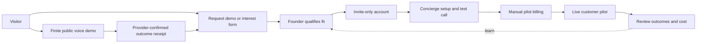
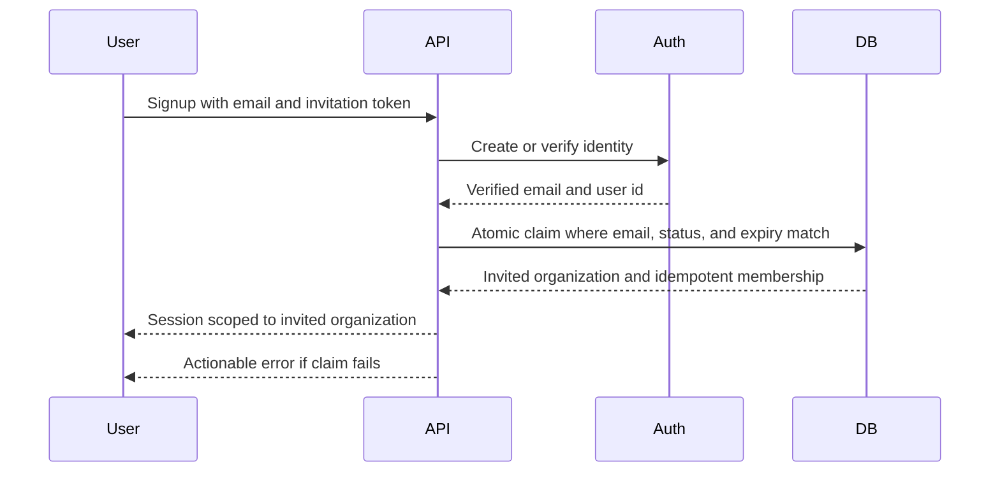

# Controlled SaaS Launch Readiness

**Review date:** 2026-09-04
**Compared:** `origin/codex/controlled-saas-launch` (`c6d8c6b`) against `origin/main` (`e1c47eb`)
**Launch branch size:** 126 files, 9,476 insertions, 105 deletions
**Review scope:** product strategy, authentication, demos, billing, tools, voice runtime, UX, security, and founder operations.

## Decision in one minute

The launch strategy is right for a solo founder. A public proof loop, invite-only onboarding, concierge setup, and manual pilot billing keep the operational surface small while producing real customer evidence.

The branch is **not launch-ready today** for invited pilots and public demos. There are three genuine blockers:

1. The documented comma-separated admin allowlist can prevent the backend from starting.
2. Invitation admission is not bound to the invited email and can fall back to creating a personal organization when invitation processing fails.
3. Public demos are unlimited and have only a broad global rate limit by default; token issuance can consume budget before a call connects.

There is one conditional blocker: the launch notes record a Fish TTS empty-audio failure. It blocks launch only if Fish is in the actual production preset; the system default is Gemini realtime.

After those gates are closed, launch a small concierge pilot. Do not wait for SMS, PSTN transfer, public self-serve billing, CRM, SSO/MFA, or advanced analytics.

## Recommended launch loop



This is a good first-customer loop: the product demonstrates value before asking for credentials, the founder stays in the loop where configuration is still bespoke, and billing does not pretend to be self-serve before it has been proven.

## Branch decision: what to do with `night-batch`

Do **not** merge `origin/codex/night-batch` into the launch branch. Its two commits add SMS owner alerts and TTS-empty-audio classification; neither is required for the controlled launch, and the SMS path adds provider cost and pricing complexity.

Keep the remote branch and its worktree temporarily as deferred history. Close or mark the associated work as deferred, then delete the remote branch and worktree after the launch branch is shipped and there is no recovery value left. Deleting it now is unnecessary and removes a useful reference. When SMS returns, start a fresh branch from the then-current `main` and re-evaluate the design rather than carrying launch assumptions forward.

## True launch blockers

These are the only items I would currently classify as blockers for the stated public-demo + invited-pilot launch. They are boundaries around access, tenant isolation, and spend—not polish.

### P0 — Admin allowlist configuration can crash startup

`shared/config/settings.py:160` declares `PLATFORM_ADMIN_ALLOWLIST` as `list[str]`, while the validator at `shared/config/settings.py:389` expects a comma-separated string. Pydantic Settings attempts JSON parsing for a list before that validator runs.

The documented value below fails during settings construction:

```text
PLATFORM_ADMIN_ALLOWLIST=owner@example.com,team@example.com
pydantic_settings.exceptions.SettingsError: error parsing value for field "platform_admin_allowlist"
```

**Minimum closure:** make the environment contract executable and test a cold start with zero, one, and multiple administrators. The cleanest implementation is a non-decoded raw environment string split and normalized by application code; requiring JSON can work only if blank/example values and every runbook are updated consistently.

**Founder input needed:** the final production administrator email list. No product decision is needed beyond the value format.

### P0 — Invitation admission is not safe enough for a closed SaaS gate

The gate in `backend/src/auth/signup_gate.py:59` checks token existence, status, and expiry, but not the invitation email. It also treats `revoked` as closed even though the model uses `cancelled`. `backend/src/organization/service.py:1035` checks only `accepted`, then performs membership assignment and invitation acceptance as separate operations.

More importantly, `backend/src/auth/service.py:230` and `backend/src/auth/oauth_session.py:104` log invitation failures and continue into `ensure_default_organization_for_user`. That contradicts the launch plan: an invited user must join the invited organization, not receive a fallback personal organization when admission fails. The browser OAuth callback also logs the full bearer invitation token (`frontend/src/app/auth/oauth/callback/page.tsx:49`).

**Minimum closure:**

- Normalize and compare the authenticated email to the invitation email.
- Accept only `pending`, unexpired invitations; reject `cancelled`, `accepted`, and `expired` explicitly.
- Atomically claim the invitation and create an idempotent membership, or use a reviewed database RPC/transaction.
- Make replay and concurrent acceptance safe.
- If an invitation was supplied and processing fails, stop in an actionable auth state; never silently provision a different organization.
- Remove full-token browser logging.
- Decide and test whether password-signup membership waits for email verification. The conservative launch choice is to bind the invite immediately to the verified identity but delay membership acceptance until the account is verified.

The current focused tests pass, but one test explicitly codifies the permissive behavior: `backend/tests/auth/test_signup_gate.py` admits `x@y.com` with a pending token while the invitation row has no email. The test suite needs to change with the policy.

The intended trust boundary is:



### P0 — Public demo controls are unsafe by default

`backend/src/voice_agents/demo_public_routes.py:220` exposes unauthenticated token issuance. The database reservation and one-time WebSocket consumption are good foundations, but the seeded values in `backend/src/worktree_seed.py:42` are `-1` calls remaining and 900 seconds per call. A malformed or missing limit is also coerced to unlimited by `shared/billing/voice_session_entitlement.py:57`.

The reservation is consumed at token issuance, before a WebSocket connects, and the migration has no expiry/release state (`backend/alembic/versions/20260827000001_add_demo_call_limits.py:57`). The endpoint therefore has cost exposure and can burn a finite budget on abandoned tokens. The shared global 100/minute IP limit is not a sufficient demo-abuse control.

**Minimum closure before publishing demo links:**

- Set a finite production budget and short maximum duration for every public demo.
- Add a demo-specific per-IP limit, concurrency cap, and Turnstile or equivalent challenge at token issuance.
- Either add reservation expiry/refund semantics or deliberately accept reservation burn with a small worst-case budget.
- Use isolated, resettable Calendar/Sheets destinations; never let marketing traffic write customer data.
- Fail closed when a demo budget is malformed or unavailable.
- Alert on token issuance, active calls, provider failures, and spend.

For a solo-founder first release, a simple finite total budget plus a short duration and Turnstile is preferable to building a full quota service. The exact cap is a founder decision; it should be sized against maximum cost, not average call length.

### Conditional P0 — Voice provider smoke gate

`docs/09_launch_strategy/03-deferred-and-followups.md` records a Fish TTS zero-byte synthesis incident that can terminate a call. `shared/voice_agents/speech_config_resolver.py` falls back to the Gemini realtime default when no preset is assigned, so this is conditional rather than automatically a branch blocker.

Before promising a live demo or 48-hour setup, identify the production preset and complete one browser call through the public `wss` path. If Fish is selected, either prove the empty-audio failure is fixed or use Cartesia/Gemini for launch until it is.

## Important before the first paid pilot

These do not require building a larger platform, but they must be proven before charging a customer or making the corresponding promise.

| Area | Current state | Minimum launch-safe action |
| --- | --- | --- |
| Billing | Manual Payment Links are intentionally used; paid catalog rows and live price IDs are not published. | Run one exact test-mode link per tier. Verify `organization_id` reaches `customer.subscription.created`, price mapping resolves, the first invoice grants once, and webhook replay is idempotent. Until then, manually activate the first pilot with an auditable checklist. |
| Callback reliability | Email-only callback tool is strategically appropriate, but it fans out sequentially and the idempotency key omits route/recipient. | Limit launch configuration to one owner route/recipient, add a global time budget, include route and recipient in the provider key, and deduplicate one callback operation per call. |
| Callback discoverability | `/callbacks` exists and is org-scoped, but it is absent from `frontend/src/components/layout/nav-config.ts`. | Add a visible “Callback requests” navigation item for the appropriate organization role. A promised owner workflow should not depend on a bookmarked URL. |
| Marketing truth | Pages claim confirmation SMS, an on-call line, universal follow-up, and still show a non-functional Restaurants card. | Replace those claims with the shipped proof: booking or lead capture plus an email callback queue. Remove or implement every placeholder legal link (`href="#"`). |
| Demo privacy | Receipts are private/no-store/noindex, but can display caller PII in a bearer-token page. | Put dummy-data guidance before the call and mask or omit phone, email, address, and notes on public receipts where they are not needed to prove the workflow. |
| Production operations | Docs still list Turnstile keys, PostHog provisioning, Supabase reset redirect allowlist, demo closing-line sync, and observability dashboards as founder tasks. | Complete the small set required by the chosen launch surface. Analytics dashboards and rich OTel can remain manual/low-volume for the first cohort, but auth reset and bot protection must be verified. |

## What is already good

- The phased plan is unusually disciplined: closed signup first, proof-oriented demos, manual billing, then learning before self-serve.
- Interest capture, outcome receipts, and the platform-admin interest queue create a coherent demo-to-conversation funnel.
- The neutral demo organization and separate demo agents are the right isolation boundary.
- Provider-confirmed demo receipts avoid claiming a Calendar/Sheets mutation succeeded when it did not.
- The callback tool is an independent native capability with owner destinations configured on the agent; it does not secretly invoke another registered tool. That is a sound platform boundary.
- Email-only escalation is the correct launch trade-off: it gives the caller a human safety valve without adding SMS cost, carrier delivery, or PSTN transfer complexity.
- RLS/service-role boundaries, backend authorization, signed session/outcome tokens, rate limiting, redacted logging, and focused regression tests are solid foundations.
- The plan is honest that pricing and self-serve billing are not yet fully published. Keep that honesty on the website.

## Product, UX, and business judgment

### Positioning

The strongest wedge is missed-call recovery for single-location US SMBs, demonstrated with three concrete workflows: a dental booking, an HVAC service inquiry, and a restaurant order plus Q&A flow. That is more credible than presenting the product as a universal receptionist, emergency dispatcher, CRM, scheduler, and outbound follow-up system at launch.

### User experience

The no-login demo is excellent top-of-funnel UX. The main expectation risks are:

- The signup page can briefly render “Create your free account” before redirecting a non-invited visitor. Show the invite-only/concierge explanation immediately for a closed gate.
- The request-demo form should say who responds, the expected response time, what access the founder needs, and what “48-hour setup” depends on.
- The demo should clearly say “use fictional data.” The receipt should emphasize provider-confirmed outcome rather than exposing raw caller details.
- A customer needs a simple setup contract: business hours, services/FAQs, routing rules, calendar or lead destination, approved greeting, test call, then call forwarding.

### Business and capacity

Manual pilot billing is a feature of the launch strategy, not a defect. It lets the founder learn actual cost per minute, minutes per successful outcome, provider failure rate, support time, and retention before publishing a rigid self-serve catalog.

Keep a hard WIP limit. For a single founder, a smaller cohort with fast setup and active review is better than accepting more businesses than can be supported. Treat “live in 48 hours” as a target dependent on customer access and approvals, not a blanket guarantee.

## Explicitly defer after launch

Do not block the controlled pilot on:

- SMS notifications or a generic `Send_text` tool.
- PSTN warm transfer, carrier-scale forwarding automation, or outbound campaigns.
- Public self-serve Stripe checkout, annual plans, tax/invoice portal, coupons, or automated overages.
- CRM synchronization, transcript search, multi-location workflows, SSO/MFA, or advanced role design.
- Perfect durable callback outbox delivery, lead deduplication, rich retention tooling, or full OTel dashboards.

For SMS later, the platform-level primitive should probably be an optional, organization-configured messaging capability with explicit recipient/consent/allowlist and cost controls. The callback workflow can then compose that capability through a workflow boundary. Do not decide or implement that abstraction as part of this launch fix.

## Finite launch checklist

### Must close before public demos and invited pilots

- [ ] Fix allowlist parsing and cold-start with multiple admins.
- [ ] Fix invitation email binding, cancelled-state handling, atomic claim, no-fallback behavior, token logging, and replay/race tests.
- [ ] Choose finite demo caps, add abuse controls, and isolate/reset provider destinations.
- [ ] Confirm the production voice preset and complete a public WebSocket smoke call.
- [ ] Run one end-to-end invitation → setup → call → provider mutation → receipt/callback test.

### Must be true before charging

- [ ] Prove Stripe link metadata, price mapping, invoice grant, and webhook replay behavior, or use manual activation until proven.
- [ ] Correct SMS/on-call/universal-follow-up claims and replace placeholder legal links.
- [ ] Make callback ownership discoverable and constrain launch notification fan-out.
- [ ] Provision and verify Turnstile and the Supabase password-reset redirect.

### Good to have later

- [ ] Automated public billing and richer self-serve plan catalog.
- [ ] SMS, transfer, CRM, campaigns, transcript search, and advanced analytics.
- [ ] Outbox/retry infrastructure for every callback delivery and automated retention/deduplication.

## What I need from you to make the branch launchable

I can implement the code-side blockers in a dedicated worktree and leave commits/deployment under your control. Before changing behavior, I need these decisions:

1. Confirm the launch surface: public landing + finite demos + invite-only concierge pilots, with no SMS and no open signup.
2. Confirm the production voice preset/provider: Gemini realtime, Cartesia pipeline, or Fish pipeline.
3. Choose the initial public-demo cap and maximum duration. If you want a recommendation, start small enough that every demo can be manually monitored and reset.
4. Provide the production admin email list and confirm whether you will provision Turnstile, PostHog, Supabase redirect settings, Stripe test webhooks, and the verified Resend sender, or want those included in the implementation checklist.
5. Confirm whether the first paid pilot should be manually activated until the Stripe Payment Link rehearsal passes.

Once those are answered, the work should be a short launch-hardening pass—not another platform-building cycle: close the three P0s, align the public promise, run the finite staging/release gate, and launch to a capped cohort.

## Validation evidence

- `git diff --check origin/main...origin/codex/controlled-saas-launch`: clean.
- Focused backend review suite: **65 passed** across signup gate, signup flow, OAuth invitation ordering, invitation route, demo routes, callback persistence/tool behavior, and escalation routes.
- Production-like settings reproduction: documented comma-separated `PLATFORM_ADMIN_ALLOWLIST` fails before application startup.
- Frontend TypeScript/Vitest commands were started in the audit worktree but did not return promptly in this environment; no failure is being inferred from that timeout.
- No product source files, migrations, branches, or deployments were changed during this review. The existing user-owned `CONTROLLED_SAAS_LAUNCH_REVIEW.md` artifact was preserved.

## Final conclusion

**Keep the controlled SaaS launch branch. Do not merge the night-batch SMS branch.** The product direction is sensible and appropriately scoped for a single-person startup, but the branch needs a small number of security, cost, and promise-alignment fixes before it is genuinely launchable.

After the allowlist, invitation, demo-budget, and provider gates are closed—and the first payment flow is rehearsed—ship the concierge pilot. Learn from real calls and measured economics. Do not turn SMS or the deferred platform backlog into a prerequisite for launch.
