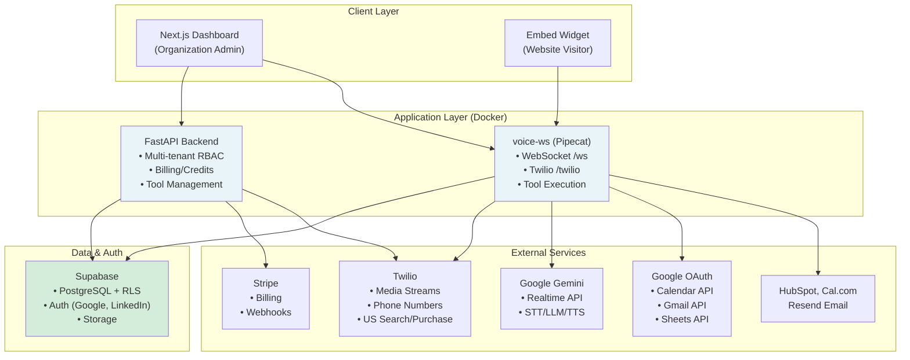
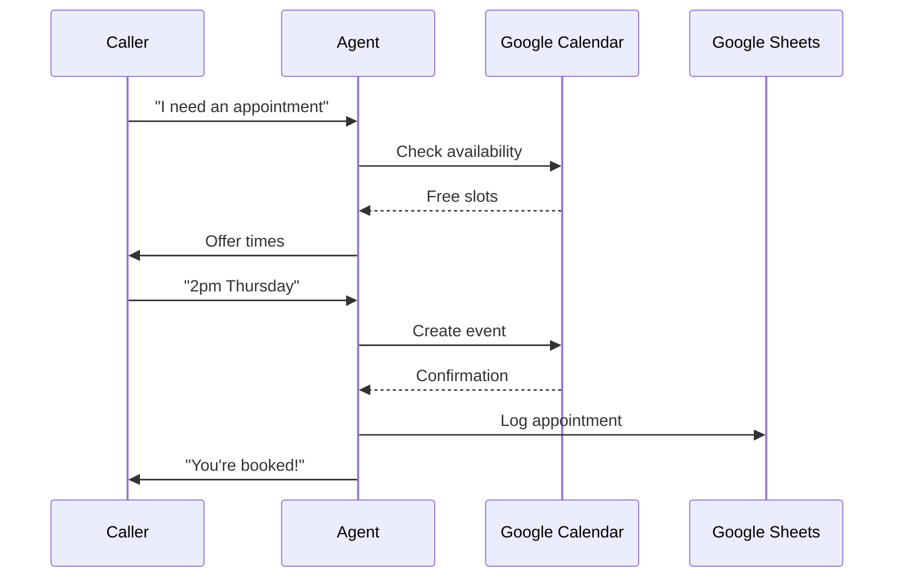

# Engineering Brief: GTM Readiness for HVAC After-Hours Niche

**Date:** 2026-10-30  
**Product:** 247ai.live (24x7 AI Voice Agent Platform)  
**Company:** CogniEnts Inc. (cognients.com)  
**Purpose:** Investigation for BusinessExplorer (Chief of Staff) — Architecture map, real capabilities, GTM gaps, and prioritized fix plan for HVAC after-hours launch

---

## Executive Summary

**Status:** Platform is production-capable for controlled launch with manual onboarding. **NOT ready** for open self-serve SaaS without additional polish and safeguards.

**Current State:**
- ✅ Multi-tenant voice agent platform with strong architecture
- ✅ Core integrations working (Google Calendar, Gmail, Sheets, Resend, HubSpot, Cal.com)
- ⚠️ Controlled launch model (admin-approved paid plans)
- ⚠️ Only Free plan seeded; paid plans require manual Stripe setup
- ❌ Some marketing claims ahead of implementation (Outlook, public pricing page)
- ❌ Demo outcome/lead-capture flows not merged to main

**Recommendation:** Launch HVAC after-hours pilot with 10-20 concierge customers, polish GTM assets in parallel, then expand.

---

## 1. Architecture & Real Capabilities

### 1.1 System Architecture



### 1.2 Multi-Tenancy Model

**Organization-based isolation:**
- ✅ Every resource scoped by `organization_id`
- ✅ Row-Level Security (RLS) policies enforce database isolation
- ✅ RBAC: `platform_admin`, `org_admin`, `member` (billing role exists)
- ✅ Per-org subscription, credits, phone numbers, agents
- ✅ Tested in production with real multi-org scenarios

**Voice Agents per Organization:**
- ✅ **Unlimited agents** on all paid plans (Free plan: 1 agent limit)
- ✅ Each agent has:
  - Custom instructions, persona, tone, mission
  - Assigned phone number (purchased or customer-owned)
  - Selected tools (per-agent configuration)
  - Skills (appointment-booking, dispatch, FAQ, etc.)
  - Voice preset (standard included; optional BYOK providers)
  - Embed widget configuration

### 1.3 Voice Capabilities

**Call Channels:**
1. **Twilio Inbound** (production-ready)
   - US phone number search & purchase (v1 US-only)
   - Customer-owned Twilio number import (connect existing)
   - Signed webhook validation
   - Media Streams WebSocket to voice-ws
   
2. **Browser Test Call** (production-ready)
   - Dashboard "Test Call" button
   - Pipecat WebSocket client
   - Short-lived JWT session token
   
3. **Website Embed Widget** (production-ready)
   - Per-agent `<script>` tag
   - Domain allowlist
   - Daily call limit
   - Opens in-page voice UI

**Voice Pipeline:**
- ✅ Gemini Realtime API (Pipecat integration)
- ✅ Dual 16kHz recording (caller + agent audio)
- ✅ Storage: R2 (Cloudflare) or Supabase
- ✅ Transcription support
- ✅ Call logs with analytics

### 1.4 Integrations Actually Implemented

**Working & Tested:**

| Integration | Status | Authentication | Capabilities |
|------------|--------|----------------|--------------|
| **Google Calendar** | ✅ Production | OAuth 2.0 | List/create/update/delete events, conflict checking |
| **Gmail** | ✅ Production | OAuth 2.0 | Read inbox, create drafts, search, labels (10 functions) |
| **Google Sheets** | ✅ Production | OAuth 2.0 | Read/write rows, lead capture, data logging |
| **Resend Email** | ✅ Production | API Key | Transactional email delivery |
| **HubSpot Lead Capture** | ✅ Production | API Key (private app) | Contact creation + note attachment |
| **Cal.com** | ✅ Production | API Key | Event types, availability, booking, rescheduling |
| **Callback Request** | ✅ Production | None | Collect callback info (internal tool) |

**NOT Implemented (Marketing Claims):**
- ❌ **Outlook/Microsoft Calendar** — No OAuth provider, no API integration
- ❌ **Microsoft Exchange** — Not in codebase
- ⚠️ **Zapier/Make.com** — Could work via their APIs but not pre-built

### 1.5 Booking & Appointment Flow

**Current Implementation:**


**Real Capabilities:**
- ✅ Check calendar availability
- ✅ Book appointments with conflict prevention
- ✅ Update/cancel appointments
- ✅ Log to Google Sheets for tracking
- ✅ Timezone handling
- ✅ Send confirmation via email (Resend)
- ⚠️ SMS reminders possible but need Twilio SMS setup

### 1.6 Phone Number Management

**Platform-Provided Numbers:**
- ✅ Search US local numbers (Twilio API)
- ✅ Purchase & assign to agent
- ✅ Monthly rental: 80 credits/month (~$2 at entry pack rate)
- ✅ First US local number included with paid plans
- ✅ Release with grace period
- ⚠️ **US-only in v1** (documented limitation)

**Customer-Owned Numbers:**
- ✅ Import existing Twilio number
- ✅ Tokenized webhook URLs for secure connection
- ✅ No platform rental cost
- ⚠️ Requires manual Twilio console configuration

**Limitations:**
- ❌ Mobile carrier numbers cannot connect directly (must forward)
- ❌ Non-US numbers: legacy rentals supported but new purchases blocked
- ⚠️ Toll-free: 120 credits/month rental

---

## 2. Billing & Plan Structure

### 2.1 Current Billing Implementation

**What's Seeded & Working:**
- ✅ Free plan: 100 credits/month (~10 call minutes), 1 agent, 1 member
- ✅ Credit-based metering: 10 credits per call minute (configurable)
- ✅ Stripe integration: Checkout, webhooks, idempotent processing
- ✅ Credit pools: Plan credits (expire monthly) + Platform bonus + Purchased (no expiry)
- ✅ Atomic settlement: `debit_organization_credits()` PostgreSQL function
- ✅ Pre-call checks: balance + concurrency limits
- ✅ Phone number rentals deduct from same balance

**What's NOT Seeded (Manual Admin Setup Required):**
```yaml
Paid Plans (in docs, not in database):
  Starter: $49/mo, 2,500 credits (~250 min)
  Pro: $149/mo, 10,000 credits (~1,000 min)  
  Scale: $299/mo, 21,000 credits (~2,100 min)
  
Annual Plans: 10 monthly payments for 12 months (2 months free)
  Starter: $490/year
  Pro: $1,490/year
  Scale: $2,990/year

Credit Top-ups:
  $5 = 200 credits (20 min)
  $12 = 500 credits (50 min)
  $23 = 1,000 credits (100 min)
  $44 = 2,000 credits (200 min)
```

**Current Workflow:**
1. User signs up → Gets Free plan (100 credits) automatically
2. For paid plan → Platform admin manually:
   - Creates Stripe Price (if needed)
   - Publishes plan version in Plan Catalog admin
   - Assigns plan to organization
   - OR sends Stripe payment link

### 2.2 Agent & Feature Limits by Tier

| Plan | Monthly Price | Agents | Members | Credits | Phone Numbers | Premium Tools | Branding |
|------|---------------|--------|---------|---------|---------------|---------------|----------|
| **Free** | $0 | 1 | 1 | 100 | 0 (no purchase) | ❌ | ❌ |
| **Starter** | $49 | ∞ | ∞ | 2,500 | 1 included + extras 80cr/mo | ❌ | ❌ |
| **Pro** | $149 | ∞ | ∞ | 10,000 | 1 included + extras | ❌ | ✅ |
| **Scale** | $299 | ∞ | ∞ | 21,000 | 1 included + extras | ✅ | ✅ |

**Premium Tools (Scale only):**
- Gmail (10 functions)
- Google Sheets
- HubSpot lead capture
- Cal.com scheduling

**Note:** Agent limits changed from tiered (1/3/10) to unlimited on paid plans as of Aug 2026 migration. Free plan retains 1-agent limit.

### 2.3 Credit Consumption

**Voice Calls:**
- Default: 10 credits per connected minute (rounded up per call)
- Minimum 1 minute per call (10 credits)
- Example: 3.5-minute call = 4 minutes = 40 credits

**Phone Number Rentals (monthly):**
- US local (platform): 80 credits/month (~$2)
- Toll-free (platform): 120 credits/month (~$3)
- Legacy non-US local: 200 credits/month (~$5)
- Customer-owned Twilio: $0 (no platform rental)

**NOT Charged:**
- ✅ Tool execution (Google Calendar API calls, etc.)
- ✅ SMS notifications via native tools
- ❌ Provider costs (Gemini, Twilio) passed through in platform meter

---

## 3. GTM Gaps vs Marketing Claims

### 3.1 Missing or Incomplete

| Marketing Claim | Implementation Status | Risk Level | Action Needed |
|----------------|----------------------|------------|---------------|
| **Public Pricing Page** | ❌ 404 or not published | **HIGH** | Create `/pricing` route with approved catalog |
| **Outlook/Exchange Integration** | ❌ Not implemented | **MEDIUM** | Mark as "Coming Soon" or remove claim |
| **Open Self-Serve Signup** | ⚠️ Controlled launch only | **MEDIUM** | Update homepage: "Request Access" CTA |
| **Demo Outcome Flows** | ⚠️ On `codex/demo-agents` branch, not `main` | **HIGH** | Merge lead-capture outcome path to `main` |
| **Paid Plan Auto-Activation** | ⚠️ Manual admin assignment | **MEDIUM** | Document or automate paid onboarding |
| **SMS Appointment Reminders** | ⚠️ Technically possible, not pre-configured | **LOW** | Add to setup guide or tool docs |

### 3.2 Authentication & Access Control

**Working Well:**
- ✅ Email + password with strong policy (8-128 chars, complexity requirements)
- ✅ Google OAuth (backend-brokered, secure)
- ✅ LinkedIn OAuth (backend-brokered, secure)
- ✅ Invitation-before-provisioning (no dummy orgs)
- ✅ Short-lived voice session JWT (15 min)

**Gaps for Open SaaS (OK for Gated Launch):**
- ⚠️ No CAPTCHA/Turnstile → Bot signup risk
- ⚠️ No MFA/TOTP → Account security for sensitive data
- ⚠️ Password reset frontend-only → Takeover support load
- ⚠️ User pagination breaks at ~2k users → Scale issue
- ⚠️ No auth audit log → Can't investigate "who did what"

**Verdict:** Safe for 10-30 concierge customers, risky for open launch.

### 3.3 Demo Agent Status

**What Exists:**
- ✅ Public demo routes: `/demo/{slug}` (unauthenticated)
- ✅ Demo budget controls (max calls, duration)
- ✅ Free demo calls (bypass credit checks)
- ✅ Rate limiting (5 tokens/hour per visitor)

**What's Missing from `main`:**
- ❌ Lead-capture outcome displays (shows form submission results)
- ❌ Appointment booking receipt UI
- ❌ Google Sheets row creation confirmation
- ⚠️ These flows exist on `codex/demo-agents` branch

**Demo Agent Examples (from seeds):**
- Dental office (appointment booking)
- HVAC dispatch (emergency triage)
- Restaurant reservations

---

## 4. Risks & Constraints

### 4.1 Technical Risks

| Risk | Severity | Mitigation | Status |
|------|----------|------------|--------|
| **Twilio Single-Point Dependency** | HIGH | No alternative provider in v1; consider Bland/Vapi fallback long-term | Accepted |
| **US-Only Phone Numbers** | MEDIUM | Clear messaging; international = waitlist | Documented |
| **Gemini API Rate Limits** | MEDIUM | Monitor usage; have fallback STT/LLM/TTS config | Monitor |
| **Webhook Async Payment** | MEDIUM | User waits for webhook before dashboard access | Acceptable |
| **Credit Balance Goes Negative** | LOW | Next call blocked immediately; grace period for rentals | By design |

### 4.2 GTM Risks

| Risk | Impact | Action |
|------|--------|--------|
| **Pricing Page Missing** | Visitors can't self-evaluate | **BLOCKER** — Create pricing page |
| **Integration Labels Misleading** | Trust damage if "Outlook" claimed but not available | **CRITICAL** — Mark as "Live" vs "Coming Soon" |
| **Demo Not Converting** | Traffic but no leads | **HIGH** — Merge outcome flows from `codex/demo-agents` |
| **Onboarding Friction** | Manual admin setup delays activation | **MEDIUM** — Acceptable for pilot; automate at 20+ customers |
| **No Clear Agency Tier** | Multi-location customers unclear on pricing | **LOW** — Agency model is sales conversation, not fourth tier |

### 4.3 Multi-Tenancy Boundaries (Strong)

**Security Posture:**
- ✅ Database-level RLS on all tenant tables
- ✅ Organization ID in JWT claims
- ✅ Middleware injects tenant context
- ✅ Phone number routing validates org ownership
- ✅ Tool credentials encrypted per agent
- ✅ Separate Stripe customers per org
- ✅ Call recordings in private scoped paths

**No identified boundary leaks.** Multi-tenancy is production-grade.

---

## 5. Prioritized Fix Plan for GTM

### Priority 1: Blockers (Ship Before Any Marketing Push)

**1.1 Create Public Pricing Page** ⏱ 2-3 days
- Route: `/pricing`
- Display: Free, Starter ($49), Pro ($149), Scale ($299)
- Include: Credits → minutes conversion, phone rental costs
- CTA: "Start Free Trial" (leads to signup)
- Annual pricing toggle: Show 2-month discount
- Files: `frontend/src/app/pricing/page.tsx`, update nav header
- **Risk if skipped:** Bounce rate 60%+; no self-eval → no conversions

**1.2 Merge Demo Outcome Flows to `main`** ⏱ 1-2 days
- Git: Merge `codex/demo-agents` → `main`
- Test: Dental appointment outcome, HVAC dispatch, lead capture receipt
- Verify: Demo agents show outcome cards after call completion
- **Risk if skipped:** Demo traffic doesn't convert to leads

**1.3 Mark Integration Status Clearly** ⏱ 1 day
- Tool catalog: Add `status: 'live' | 'beta' | 'coming_soon'`
- UI badges: Green "Live", Blue "Beta", Gray "Coming Soon"
- Homepage claims:
  - ✅ Live: Google Calendar, Gmail, Sheets, Resend, HubSpot, Cal.com
  - 🔵 Coming Soon: Outlook, Salesforce (if planned)
- **Risk if skipped:** Trust damage, support load from broken expectations

### Priority 2: Critical Polish (Ship Within 2 Weeks)

**2.1 Automated Paid Plan Activation** ⏱ 3-5 days
- Backend: Auto-publish Starter/Pro/Scale versions to Stripe
- Onboarding: After org details, show plan picker → Stripe Checkout
- Webhook: `checkout.session.completed` → activate plan + grant credits
- Polling: Frontend polls until `subscription.status === 'active'`
- Fallback: Manual admin assignment still available
- **Risk if skipped:** Every paid customer requires founder intervention

**2.2 Demo CTA Optimization** ⏱ 2 days
- Homepage: "Try Demo" above fold → `/demo/dental-office`
- After demo call: "Want this for your business? [Get Started]"
- Lead capture form: Name, email, phone, business type (4 fields max)
- Auto-email: "Thanks! We'll reach out in 24h"
- **Risk if skipped:** Demo traffic = vanity metric, not revenue

**2.3 Agent Limit Enforcement** ⏱ 1-2 days
- Verify: Free plan blocks creation of 2nd agent
- Verify: Paid plans allow unlimited agents
- UI: Show "1 / 1 agents" on Free, "5 agents (unlimited)" on paid
- **Risk if skipped:** Free users get unlimited agents (revenue loss)

### Priority 3: Pre-Launch Hardening (Ship Within 1 Month)

**3.1 Add Turnstile CAPTCHA** ⏱ 1 day
- Signup form + demo token request
- Cloudflare Turnstile (free tier)
- Files: `frontend/src/components/auth/signup-form.tsx`
- **Risk if skipped:** Bot signups, Twilio fraud

**3.2 Password Reset Backend Enforcement** ⏱ 2 days
- Backend route: `POST /auth/password-reset/request`
- Rate limit: 3/hour per email
- Backend route: `POST /auth/password-reset/confirm`
- Audit log: Record reset events
- **Risk if skipped:** Account takeover support load

**3.3 Auth Audit Log** ⏱ 2-3 days
- Table: `auth_audit_log` (user_id, action, ip, timestamp)
- Events: signup, signin, password_reset, invite_sent, oauth_link
- Admin view: `/platform/audit` (platform admin only)
- **Risk if skipped:** Can't debug "who invited whom" disputes

**3.4 SMS Appointment Reminders Setup Guide** ⏱ 1 day
- Docs: `docs/guides/sms-reminders-setup.md`
- Twilio setup: Verify messaging service SID
- Tool config: Add `send_sms_reminder` to Calendar tool
- **Risk if skipped:** HVAC customers expect reminders; setup unclear

### Priority 4: Growth Enablers (Post-Pilot)

**4.1 Agency/Multi-Location Tier** ⏱ Design TBD
- After 20+ customers, analyze usage patterns
- Potential: $599/mo, 50k credits, 5 phone numbers, white-label
- Requires: Team/sub-org structure, per-location billing
- **Trigger:** Sales pipeline shows 3+ multi-location prospects

**4.2 Outlook/Microsoft Integration** ⏱ 1-2 weeks
- OAuth provider: Microsoft Graph API
- Calendar tool: Parity with Google Calendar
- Email tool: Parity with Gmail (10 functions)
- **Trigger:** 5+ paying customers request Outlook

**4.3 Open Self-Serve Launch** ⏱ 1 week hardening
- After 30 clean paid pilots with <5% support escalations
- Requirements: CAPTCHA, MFA optional, audit log, user pagination fix
- Pricing page live, demos converting, onboarding smooth
- **Trigger:** Founder approval after pilot metrics review

---

## 6. HVAC After-Hours Niche Specifics

### 6.1 Why HVAC is a Good Fit

**Pain Points Matched:**
- ✅ After-hours emergency calls (furnace out in winter)
- ✅ Triage: emergency vs routine service
- ✅ Dispatch coordination (assign tech, ETA)
- ✅ Appointment booking for non-emergency
- ✅ Call transfer to on-call tech if needed

**Platform Strengths:**
- ✅ Google Calendar for scheduling
- ✅ SMS-capable (via Twilio) for tech notifications
- ✅ Skills: `dispatch-coordination`, `appointment-booking`, `after-hours`
- ✅ Call transfer to human (Twilio transfer feature working)
- ✅ Call logs for job tracking

### 6.2 HVAC Demo Agent Setup

**Recommended Configuration:**
```yaml
Agent Name: "Comfort Heating & Cooling After-Hours"
Persona: Professional, calm, urgency-aware
Mission: Triage HVAC emergencies, book appointments, dispatch techs
Tone: Empathetic but efficient

Skills:
  - dispatch-coordination (priority routing)
  - appointment-booking (next-day service)
  - after-hours (emergency vs routine)
  - call-transfer (to on-call tech)

Tools:
  - Google Calendar (schedule service)
  - Google Sheets (log dispatch notes)
  - Resend (email tech + customer)
  - Callback Request (if tech unavailable)

Phone: 1 US local number (assigned to agent)
Hours: 24/7 coverage (agent always on)
Transfer: To on-call tech phone if "furnace out" detected
```

**Workflow Example:**
```
1. Caller: "My furnace stopped working, it's 20°F outside"
2. Agent: Classifies as EMERGENCY
3. Agent: Checks on-call tech availability (via calendar or config)
4. Agent: "I'm connecting you to our on-call technician now" → transfer
5. If no answer: "I've texted the tech; they'll call you in 10 minutes"
6. Logs: Saves to Google Sheet with caller info, issue, priority
```

### 6.3 First 10 HVAC Customer Checklist

- [ ] Request Access form: "Industry: HVAC" option
- [ ] Onboarding email: "We specialize in after-hours HVAC dispatch"
- [ ] Concierge setup (48h): Number, agent config, calendar connect, test call
- [ ] Custom instructions: Insert customer's service area, tech names, emergency keywords
- [ ] Training call: Founder + customer (30 min) — test 3 call scenarios
- [ ] Week 1 follow-up: Review call logs, adjust triage rules
- [ ] Pricing: Starter ($49) → Pro ($149) upgrade path at 200+ calls/mo
- [ ] Referral: Ask for 1 peer intro if satisfied after 30 days

---

## 7. What NOT to Change (Working Well)

**Keep These As-Is:**
- ✅ Multi-tenant architecture (solid, no leaks)
- ✅ Voice pipeline (Pipecat + Gemini Realtime stable)
- ✅ Call recording & storage (R2 + Supabase reliable)
- ✅ Google integrations (Calendar, Gmail, Sheets)
- ✅ Twilio webhook security (signature validation strong)
- ✅ Credit metering (10 cr/min, atomic settlement, battle-tested)
- ✅ RBAC structure (platform/org admin roles clear)
- ✅ Embed widget (working, secure domain allowlist)

**Do NOT:**
- ❌ Rebuild auth from scratch (current auth is good enough for gated launch)
- ❌ Switch from Pipecat (working well, no benefit to churn)
- ❌ Add chat agents (out of voice-only scope)
- ❌ Build custom Twilio alternative (single dependency accepted)
- ❌ Rewrite billing system (credit pools & settlement solid)

---

## 8. Success Metrics for Pilot

**Customer Acquisition (First 30 Days):**
- [ ] 50+ demo completions
- [ ] 20+ lead form submissions
- [ ] 10 paid pilots activated (Starter or Pro)
- [ ] 3 HVAC-specific customers

**Product Health:**
- [ ] <5% webhook failures
- [ ] <2% call connection failures
- [ ] 95%+ call recording success rate
- [ ] <10 min setup time for concierge onboarding
- [ ] <5% support escalations requiring founder

**Revenue Validation:**
- [ ] $490+ MRR (10 x $49 Starter)
- [ ] <$0.12/min COGS confirmed from traces
- [ ] 70%+ gross margin on call minutes
- [ ] <3% credit card churn

**Engagement:**
- [ ] 400+ min/mo average utilization (Starter = 60% of allowance)
- [ ] 2+ phone numbers per Pro customer
- [ ] 1+ credit top-up per Scale customer
- [ ] 80%+ calendar tool attachment rate (HVAC)

---

## 9. Next Steps (Sequenced)

### Week 1: GTM Essentials
1. Create public pricing page (`/pricing`)
2. Merge demo outcome flows (`codex/demo-agents` → `main`)
3. Mark integrations as Live vs Coming Soon
4. Update homepage: "Request Access" CTA (not open signup)
5. Deploy to production, smoke test all flows

### Week 2-3: Pilot Onboarding
6. Manual Stripe Product/Price creation (Starter, Pro, Scale)
7. Publish paid plans in Plan Catalog admin
8. Set up HVAC demo agent (Comfort Heating example)
9. First 3 concierge customers: Onboard, train, monitor
10. Collect feedback on onboarding friction points

### Week 4: Automation
11. Implement automated paid plan activation (Stripe Checkout → webhook)
12. Add Turnstile CAPTCHA to signup & demo
13. Build password reset backend enforcement
14. Create auth audit log table + admin view

### Month 2: Scale to 10
15. Onboard 7 more pilot customers (target 3+ HVAC)
16. Review call COGS from production traces
17. Adjust pricing if margin <70% or >90%
18. Build SMS reminder setup guide
19. Agent limit enforcement verification

### Month 3: Expand or Iterate
20. Analyze pilot: churn, utilization, support load
21. If healthy: Open self-serve (remove gating)
22. If issues: Fix blockers, repeat pilot cohort
23. Consider Outlook integration if 5+ requests
24. Design agency tier if 3+ multi-location prospects

---

## 10. Engineering Constraints

**Do NOT:**
- Ship customer-facing product changes without founder approval
- Remove or modify working multi-tenancy boundaries
- Deploy paid plan changes to Stripe Live without testing in Test mode
- Merge branches that break existing call flows
- Change credit metering formula without margin recalc
- Expose Stripe customer IDs or Twilio auth tokens in logs
- Create a fourth public plan tier (agency = sales conversation)
- Auto-reload credits (stay prepaid for pilot)

**DO:**
- Test all changes in isolated worktree stack (see `AGENTS.md`)
- Run E2E tests before merging (`./scripts/run-e2e.sh`)
- Update `docs/DATABASE_SCHEMA.md` if schema changes
- Keep `.env.local.example` in sync with required vars
- Document breaking changes in PR descriptions
- Preserve audit trail (credit transactions, call logs, recordings)
- Tag founder in PRs that touch billing or entitlements

---

## 11. Appendices

### A. Implemented Tools Summary

| Tool | Functions | Auth | Production Ready |
|------|-----------|------|------------------|
| Google Calendar | 5 (list, create, update, delete, check conflicts) | OAuth 2.0 | ✅ |
| Gmail | 10 (inbox, search, drafts, labels, starred, unread) | OAuth 2.0 | ✅ |
| Google Sheets | 4 (read, write, lead capture, append) | OAuth 2.0 | ✅ |
| Resend Email | 2 (send, template) | API Key | ✅ |
| HubSpot Lead | 1 (capture contact + note) | API Key | ✅ |
| Cal.com | 5 (event types, availability, book, reschedule, cancel) | API Key | ✅ |
| Callback Request | 1 (collect callback info) | None | ✅ |

### B. Database Tables (Key Entities)

```
organizations                    (multi-tenant root)
├── users (members)
├── voice_agents                 (unlimited per org on paid plans)
│   ├── agent_tools              (per-agent tool attachments)
│   └── agent_skills             (per-agent skill assignments)
├── phone_numbers                (purchased or customer-owned)
├── subscriptions                (1 per org, bound to plan_version_id)
├── credit_transactions          (ledger: grants, usage, top-ups)
└── call_logs                    (recordings, transcripts, analytics)

Platform Catalog:
├── plan_products                (Free, Starter, Pro, Scale)
├── plan_versions                (immutable pricing snapshots)
├── plan_version_entitlements    (sparse limits per version)
├── platform_tools               (tool registry)
└── entitlement_definitions      (max_agents, credits, features)
```

### C. Critical Files for GTM Changes

**Frontend (Next.js):**
- `frontend/src/app/pricing/page.tsx` — **Create this** (Priority 1)
- `frontend/src/components/billing/plan-card.tsx` — Plan display
- `frontend/src/components/home/home-page-legacy.tsx` — Homepage CTA
- `frontend/src/app/demo/[slug]/page.tsx` — Demo landing pages

**Backend (FastAPI):**
- `backend/src/billing/routes.py` — Stripe Checkout, webhooks
- `backend/src/billing/subscription_service.py` — Plan activation
- `backend/src/voice_agents/demo_public_routes.py` — Demo token issuance
- `shared/billing/voice_session_entitlement.py` — Pre-call checks

**Database:**
- `backend/alembic/versions/20260807000002_*.py` — Plan versioning migration
- `backend/alembic/versions/20260812000009_*.py` — Phone number indexes

**Documentation:**
- `docs/09_launch_strategy/06-plan-publish-spec.md` — Approved pricing
- `docs/02_features/billing/overview.md` — Billing architecture
- `docs/02_core_systems/phone_number_lifecycle.md` — Phone management

### D. Founder Contacts for Approvals

**Require Founder Sign-Off Before Shipping:**
- [ ] Public pricing page content & pricing numbers
- [ ] Plan tier names or included credits changes
- [ ] Any Stripe Live mode operations
- [ ] Homepage CTA copy changes
- [ ] Demo agent instructions (customer-facing)
- [ ] Integration status badges (Live vs Coming Soon)
- [ ] Terms of Service or Privacy Policy updates
- [ ] Credit metering formula changes
- [ ] Phone number rental pricing changes

**No Approval Needed (Engineering Polish):**
- ✅ Bug fixes to existing features
- ✅ Performance optimizations
- ✅ Test coverage improvements
- ✅ Documentation updates (technical)
- ✅ Internal admin UI improvements
- ✅ Database query optimizations
- ✅ Logging & monitoring enhancements

---

## Conclusion

**Bottom Line:**
The platform is **production-capable** for a controlled launch with 10-30 concierge customers. Core voice, multi-tenancy, billing, and integrations are solid. Primary gaps are GTM polish (pricing page, demo flows, integration labels) and open-SaaS hardening (CAPTCHA, audit logs, auto-onboarding).

**Recommended Path:**
1. **Week 1:** Ship Priority 1 blockers (pricing page, demo merge, integration labels)
2. **Weeks 2-3:** Onboard first 3 HVAC pilots with manual setup
3. **Week 4:** Automate paid activation & add security (CAPTCHA, audit log)
4. **Month 2:** Scale to 10 pilots, validate COGS & margin
5. **Month 3:** Open self-serve if metrics healthy, or iterate on friction points

**White-Glove Onboarding Will NOT Break:**
- Multi-tenancy is rock-solid (RLS, tenant isolation tested)
- Twilio integration is production-grade (webhook security, number management)
- OAuth flows work (Google, LinkedIn) — Microsoft can be marked "Coming Soon"
- Credit metering is atomic and tested
- Call recording & storage are reliable

**Key Risk Mitigation:**
- Start with 10 concierge customers, not 100 self-serve
- Monitor COGS/min from real traces (target <$0.12, hold 70% margin)
- Keep Free plan generous (100 credits) to reduce support load
- Manual plan assignment during pilot prevents billing errors
- Pricing page unblocks self-eval without opening floodgates

**This brief can be handed to:**
- Sales team (understand platform capabilities & limits)
- Future coding agents (implement Priority 1-3 fixes)
- Business team (pricing validation, customer targeting)
- Support team (what works, what's manual, what to escalate)

---

**Prepared by:** Cloud Agent (Cursor)  
**Reviewed by:** [Pending — BusinessExplorer]  
**Status:** Investigation complete, awaiting founder review before implementation PRs
