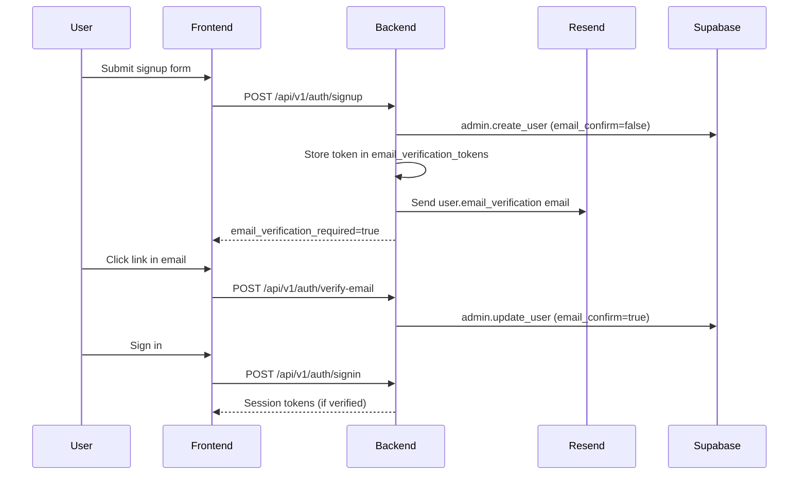

# Notification System - Quick Start

Billing alerts use a durable two-stage flow: credit consumption writes a
transaction-linked `credit_notification_outbox` row, then the notification
retry scheduler evaluates the 20%, 10%, and 5% thresholds and delivers to
organization admins. Resend is the initial adapter behind a provider-neutral
email contract.

OAuth connection-attention reminders use the durable notification service.
The token refresh worker checks enabled, authenticated OAuth connections on its
normal cycle. It emails every organization admin when a connection enters the
attention window and again when it expires or needs immediate reauthorization.
An organization admin can add a shared inbox and opt in to SMS or Telegram on
**Organization → Notifications**. Platform admins set provider credentials and
their own destinations on **Platform → Notifications**. Email retries use
`notification_logs`; SMS and Telegram retries use `oauth_attention_outbox`,
with independent state for each platform and organization channel.

## Quick Setup

### 1. Configure Environment

Add to your `.env` file:

```bash
RESEND_API_KEY=re_your_resend_api_key_here
RESEND_FROM_EMAIL=noreply@yourdomain.com
RESEND_FROM_NAME=24x7 AI
EMAIL_PROVIDER=resend
NOTIFICATION_RETRY_CHECK_INTERVAL_MINUTES=5
ENCRYPTION_KEY=your-fernet-key
```

### 2. Run Migration

```bash
cd backend
alembic upgrade head
```

This creates notification tables, `email_verification_tokens`,
`platform_notification_settings`, `organization_notification_settings`, and the
OAuth attention delivery outbox.

Migration `20260811000004` also seeds the required `credits.low_balance` event;
`20260817000001` seeds the OAuth connection-attention event. The event seed
script remains useful for the other built-in templates.

### 3. Seed Events

```bash
python scripts/seed_notification_events.py
```

### 4. Configure Platform Settings (UI)

Platform admins: open **Platform → Notifications** (`/platform/notifications`) to set:

- Platform-admin **recipient email** for demo and interest lead alerts
- Verification email **from address** and **from name** (Resend)
- Telegram **bot token**, platform **chat ID**, and platform alert opt-in
- Platform-admin OAuth alert email and optional SMS destination

Organization admins configure an optional shared inbox, SMS number, and
Telegram chat on **Organization → Notifications** (`/organization?tab=notifications`).
They do not configure provider credentials. Organization-admin account emails
remain recipients even when no shared inbox is set.

Public demo and interest-form submissions are retained in `interest_leads` and
then notify the configured recipient and/or Telegram chat. Email requires the
recipient, `RESEND_API_KEY`, and a valid sender. Telegram requires the enabled
switch, bot token, and chat ID. An incomplete channel is skipped; a provider
failure does not affect the visitor's successful submission. Email failures
use the existing idempotent retry scheduler.

## Signup Verification Flow



## Telegram Admin Alerts

Triggered on:

- New email signup
- New OAuth signup (Google/LinkedIn)
- User joins via invitation (signup or existing user accepting invite)
- Public demo and interest-form submissions

Configure platform signup alerts at `/platform/notifications`. Platform
OAuth alerts use the platform admin's own Telegram/SMS opt-ins. Organization
OAuth alerts use each organization's opt-ins from
`/organization?tab=notifications`; an organization Telegram destination uses
the platform-managed bot token. An opted-in channel with missing provider
credentials stays pending in the durable outbox for retry after configuration.

## Delivery reliability

`NotificationService` renders the event, writes a pending
`notification_logs` row, and delegates delivery through `EmailProvider`.
Resend is the initial adapter. A stable `idempotency_key` reuses
failed/pending rows, increments the attempt count, and returns an already-sent
result without calling the provider again. This keeps billing warnings safe to
retry while preserving an audit trail for provider failures.

The backend starts an hourly retry scheduler. It waits five minutes between
attempts and skips legacy log rows that do not have an idempotency key.

## Send Your First Email

```python
from src.notifications.service import notification_service
from src.notifications.models import SendNotificationRequest

await notification_service.send_notification(
    SendNotificationRequest(
        event_key="user.signup",
        recipient_email="user@example.com",
        recipient_name="John Doe",
        template_variables={
            "user_name": "John Doe",
            "user_email": "user@example.com",
            "created_at": "2025-10-03",
            "dashboard_url": "https://app.example.com/dashboard",
        },
    )
)
```

## API Endpoints

| Method | Path | Access | Description |
| ------ | ---- | ------ | ----------- |
| GET | `/api/v1/notifications/admin/settings` | platform_admin | Read platform notification settings |
| PUT | `/api/v1/notifications/admin/settings` | platform_admin | Update platform settings and provider credentials |
| GET | `/api/v1/notifications/organizations/{organization_id}/settings` | target org_admin or platform_admin | Read organization alert destinations |
| PUT | `/api/v1/notifications/organizations/{organization_id}/settings` | target org_admin or platform_admin | Update organization alert destinations |
| POST | `/api/v1/auth/verify-email` | Public | Verify email token |
| POST | `/api/v1/auth/resend-verification` | Public | Resend verification email |

See [Notification System docs](../../docs/02_core_systems/notification_system.md) for the full reference.

## Tests

```bash
cd backend
pytest tests/notifications/ tests/auth/test_sign_up_flow.py -v
```

```bash
cd frontend
npx vitest run tests/services/test-auth-service-verification.test.ts
```
