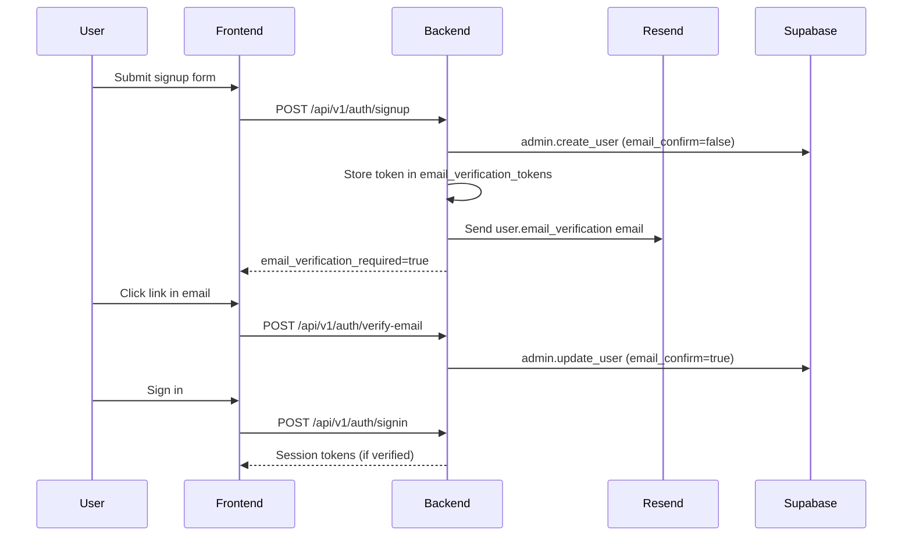

# Notification System - Quick Start

## Quick Setup

### 1. Configure Environment

Add to your `.env` file:

```bash
RESEND_API_KEY=re_your_resend_api_key_here
RESEND_FROM_EMAIL=noreply@yourdomain.com
RESEND_FROM_NAME=SaaS Platform
ENCRYPTION_KEY=your-fernet-key
```

### 2. Run Migration

```bash
cd backend
alembic upgrade head
```

This creates notification tables, `email_verification_tokens`, and
`platform_notification_settings`.

### 3. Seed Events

```bash
python scripts/seed_notification_events.py
```

### 4. Configure Platform Settings (UI)

Platform admins: open **Platform → Notifications** (`/platform/notifications`) to set:

- Verification email **from address** and **from name** (Resend)
- Telegram **bot token**, **chat ID**, and enable/disable alerts

## Signup Verification Flow



## Telegram Admin Alerts

Triggered on:

- New email signup
- New OAuth signup (Google/LinkedIn)
- User joins via invitation (signup or existing user accepting invite)

Configure at `/platform/notifications`. Alerts are skipped when disabled or
bot token/chat ID is missing.

## Send Your First Email

```python
from src.notifications.service import notification_service
from src.notifications.models import SendNotificationRequest

await notification_service.send_notification(
    SendNotificationRequest(
        event_key="user.signup",
        recipient_email="user@example.com",
        recipient_name="John Doe",
        template_variables={
            "user_name": "John Doe",
            "user_email": "user@example.com",
            "created_at": "2025-10-03",
            "dashboard_url": "https://app.example.com/dashboard",
        },
    )
)
```

## API Endpoints

| Method | Path | Access | Description |
| ------ | ---- | ------ | ----------- |
| GET | `/api/v1/notifications/admin/settings` | platform_admin | Read notification settings |
| PUT | `/api/v1/notifications/admin/settings` | platform_admin | Update settings |
| POST | `/api/v1/auth/verify-email` | Public | Verify email token |
| POST | `/api/v1/auth/resend-verification` | Public | Resend verification email |

See [Notification System docs](../../docs/02_core_systems/notification_system.md) for the full reference.

## Tests

```bash
cd backend
pytest tests/notifications/ tests/auth/test_sign_up_flow.py -v
```

```bash
cd frontend
npx vitest run tests/services/test-auth-service-verification.test.ts
```
