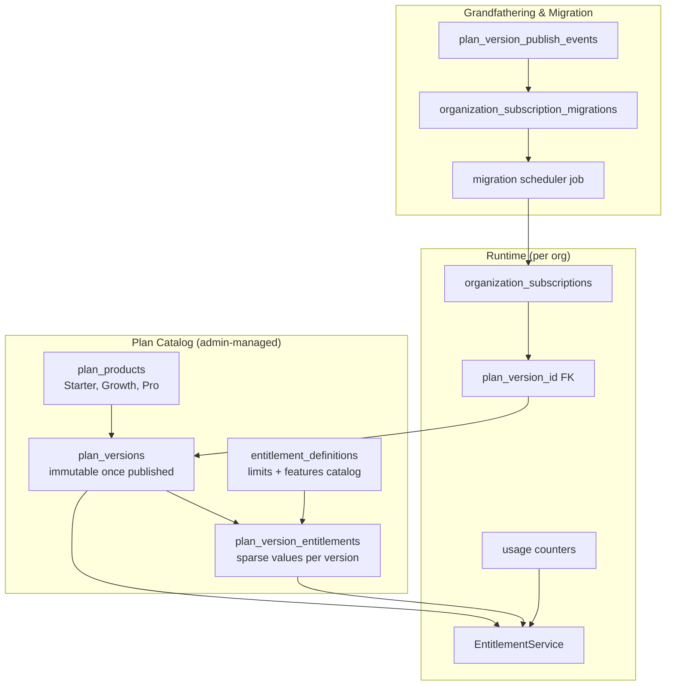

# ADR: Plan Versioning, Entitlements & Grandfathering

**Status:** Accepted; baseline implemented
**Date:** 2026-08-07
**Deciders:** Platform architecture
**Related:** [Plan Entitlements & Limits](../03_implementation/plan_entitlements_and_limits.md), [Subscription-Aware Onboarding and Credit Policy](./ADR_SUBSCRIPTION_AWARE_ONBOARDING_AND_CREDIT_POLICY.md)

---

## Context

24x7 AI needs subscription tiers where:

1. Platform admins can define **any number of plans**, each with **any subset** of features and limits.
2. Limit **types vary by plan** (e.g. one plan has `max_agents` only; another adds `included_credits_per_billing_period` and `premium_tools`).
3. Configured limits must be **enforceable at runtime** without code deploys for every new limit key (within a registered handler catalog).
4. When admins change pricing or limits, **existing subscribers must keep what they signed up for**.
5. New signups receive the **latest published version**.
6. Admins can configure a **grace period** (e.g. 2 or 4 months) after which legacy subscribers must migrate (or optionally may stay forever).

Stripe Prices are already immutable in practice (changes require new Price objects). The platform must mirror that immutability for entitlements.

---

## Decision

Adopt a **Plan Product → Plan Version** model with **immutable published versions**, **subscription binding to a version**, and **explicit migration policies** when publishing a new version.

### Key rules

| Rule | Rationale |
|------|-----------|
| **Never edit a published plan version in place** | Guarantees grandfathering |
| **Subscriptions reference `plan_version_id`, not "current plan"** | Runtime reads frozen terms |
| **Sparse limits per version** | Plans only store limits that apply to them |
| **Limit catalog is extensible** | New limit types via definitions + handlers |
| **Stripe Price 1:1 with published version** | Billing matches entitlements |
| **Migration policy is per publish event** | Configurable grace period per change |

---

## Architecture

---

## Consequences

### Positive

- Existing customers protected from silent limit/price changes
- Admins can iterate on plans without engineering deploys (within handler catalog)
- Clear audit trail: who was on which version when
- Aligns with Stripe's immutable Price model

### Negative / trade-offs

- More tables and admin UI complexity than flat `subscription_plans`
- Publishing a plan change requires creating a version + Stripe Price (not inline edit)
- Migration jobs and customer comms needed for forced upgrades

### Cancellation policy (accepted)

- **No refunds** on voluntary subscription cancellation
- **Cancel at period end only** — entitlements and credits (for the paid period) remain until `current_period_end`
- Aligns with existing `stripe_service.cancel_subscription(cancel_at_period_end=True)` implementation

### Alternatives considered

| Alternative | Rejected because |
|-------------|------------------|
| Edit `subscription_plans` in place | Breaks grandfathering |
| Store limits only in Stripe metadata | Not queryable; no versioning story |
| Snapshot JSON on every request | Harder to admin; drift from catalog |
| Stripe Entitlements API only | Insufficient for agent counts, concurrent calls, credit pools |

---

## Implementation note

The baseline schema, APIs, admin flows, and enforcement paths are implemented
through migration `20260808000012`. The subscription-aware onboarding and
credit-policy decisions that complete this ADR are recorded in [Subscription-
Aware Onboarding and Credit Policy](./ADR_SUBSCRIPTION_AWARE_ONBOARDING_AND_CREDIT_POLICY.md).

Full implementation details remain in [Plan Entitlements & Limits](../03_implementation/plan_entitlements_and_limits.md).
