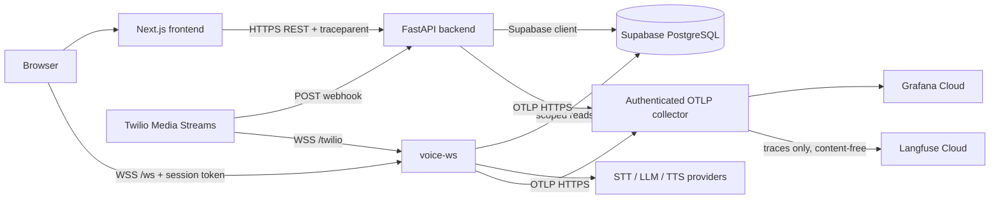
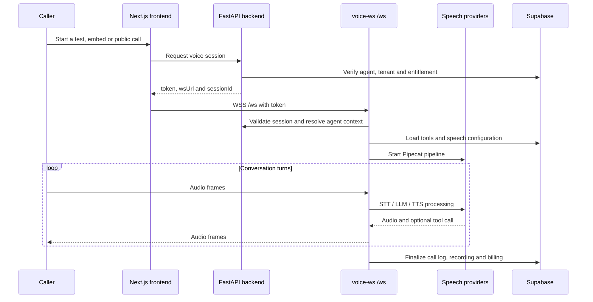
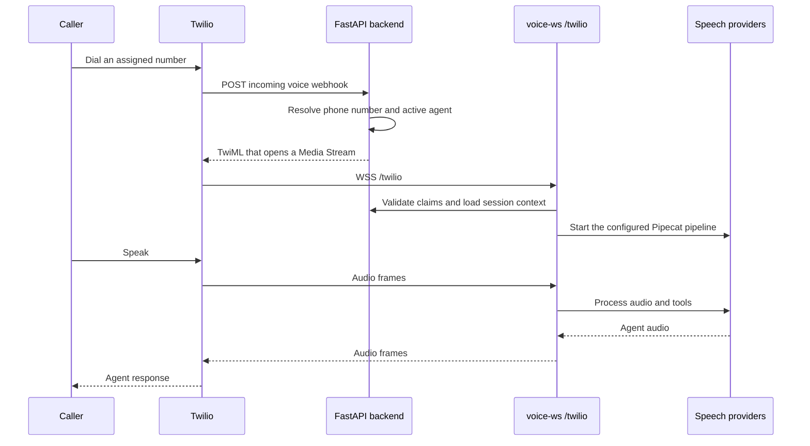
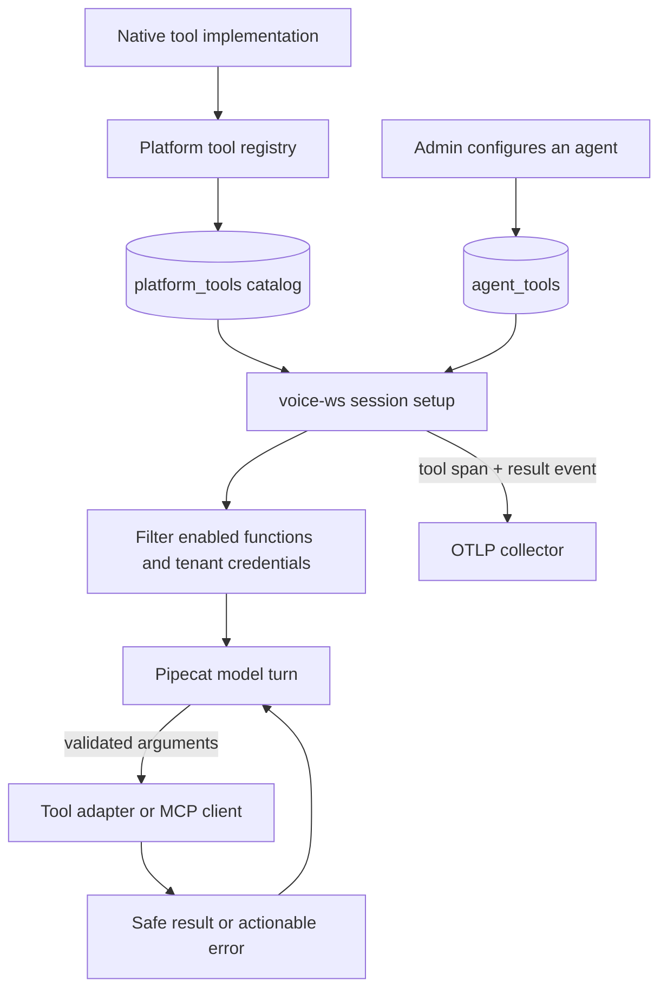
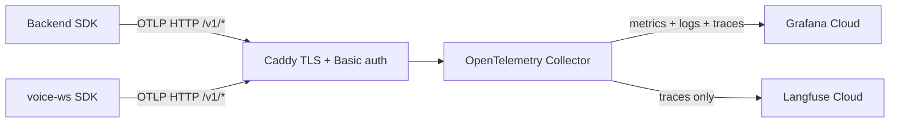

# System Architecture

24x7 AI is a multi-tenant SaaS platform for configuring and running voice
agents. The frontend manages organizations, agents, tools and billing. The
backend owns authentication, authorization, persistence and session issuance.
The `voice-ws` service owns the real-time audio session and executes the tools
selected for the resolved agent.

## System context



The browser does not export telemetry directly. Its API client creates or
forwards a W3C `traceparent`, allowing a backend request and the later voice
session to be correlated without exposing credentials or conversation data.

## Runtime boundaries

### Frontend

The Next.js 15 App Router application provides the dashboard, authentication
flows, agent configuration and the browser call surface. It calls the backend
through the shared API client and includes correlation headers. Browser-side
OpenTelemetry exporters are disabled by default; this keeps customer
credentials and high-cardinality browser events out of the telemetry stores.

### Backend

The FastAPI application is the control plane. It validates Supabase sessions,
enforces organization and platform-admin authorization, manages agents and
tools, and issues short-lived `voice_ws_session` JWTs signed with the shared
`JWT_SECRET_KEY`. It exposes liveness and readiness endpoints and emits
request spans, metrics and structured diagnostic events through the shared
OpenTelemetry setup.

The backend remains the source of truth for call logs, recordings, billing and
credit settlement. Telemetry describes those operations but never replaces
their database records.

### voice-ws

`voice-ws` is the Pipecat WebSocket runtime for browser calls, embeds, public
calls and Twilio Media Streams. It accepts `/ws` for browser clients and
`/twilio` for Twilio streams. Each connection validates the backend-issued
JWT, resolves the organization and agent, assembles the configured tools and
speech pipeline, then starts the call.

The runtime has no shared session manager. A session owns its transport,
pipeline, tool context, recording policy and finalization. This keeps tenant
scope explicit and makes restart and cleanup behavior observable.

### Supabase

Supabase provides PostgreSQL, Auth, Storage and Realtime. Organization,
agent, tool, call-log, recording and billing data are tenant-scoped. Alembic
migrations own schema changes; runtime startup does not mutate master data.

## Call flows

### Browser call



### Twilio call



## Tool execution

Native platform tools are registered through the shared platform-tool registry.
Remote MCP servers are external dependencies. Tool schemas and docstrings are
the model-facing contract; generic prompts do not contain tool-specific
instructions.



Tool execution is wrapped with a `tool.execute` span and a `tool.result`
event. The telemetry records the tool name, outcome, duration and safe error
classification. It deliberately drops arguments, returned payloads, access
tokens and provider response bodies.

## Observability architecture

The application uses one OpenTelemetry contract in backend, shared code and
voice-ws. Metrics and structured events remain useful when traces are sampled;
all signals use bounded queues and background exporters so telemetry does not
block an audio turn or HTTP request.



The production cloud profile runs two long-lived containers on a small
telemetry host: Caddy and the pinned collector. A one-shot volume initializer
sets queue permissions during startup. Grafana Cloud supplies dashboards,
metrics, logs, traces and alerting; Langfuse Cloud receives metadata-only
traces for AI call navigation. No Grafana, Loki, Tempo, Prometheus or
Alertmanager container is required in production.

Safe trace attributes include release, service, environment, request/session/
call/agent/organization identifiers, channel, operation, provider/model,
tool name, stage, duration, token counts and normalized failure codes. The
following are excluded: prompts, completions, transcripts, audio, tool
arguments and results, credentials and full request or provider bodies.

See [Observability operations](../05_operations/observability.md) for the
launch profile, dashboards, alert thresholds, smoke check and retention
guidance.

## Health and failure boundaries

- `/health/live` answers whether the process is running and does not call an
  AI provider.
- `/health/ready` checks required application dependencies and reports a safe
  readiness status. It does not reveal secrets or tenant data.
- Request, call, tool, recording, finalization and billing operations mark
  failures in telemetry before returning their normal domain error.
- Collector export failure is isolated from application work. Bounded SDK and
  collector queues absorb short outages; operators are alerted when the
  destination or queue cannot keep up.
- Correlation IDs and `traceparent` connect a frontend request, backend session
  issuance and voice call without putting raw user content into traces.

## Deployment profiles

| Environment       | Application telemetry                                | Telemetry services                                                   | Intended use                                       |
| ----------------- | ---------------------------------------------------- | -------------------------------------------------------------------- | -------------------------------------------------- |
| Regular local     | Disabled in `.env.local.example`                     | None                                                                 | Fast app-only development                          |
| Isolated worktree | Enabled to a private local collector                 | Prometheus, Loki, Tempo, Grafana, Alertmanager and collector overlay | Feature development and dashboard smoke tests      |
| Staging           | Disabled in `.env.staging.example`                   | None                                                                 | Release validation without a second hosted account |
| Production        | Explicitly enabled after credentials are provisioned | Caddy + collector host, Grafana Cloud and Langfuse Cloud             | Launch monitoring and incident response            |

The production application and telemetry host are separate Compose projects.
The backend and voice-ws send OTLP to the collector’s HTTPS DNS endpoint;
they do not connect to Grafana or Langfuse directly. Only the collector holds
the Grafana and Langfuse credentials. See
[`docker-compose.observability.cloud.yml`](../../docker-compose.observability.cloud.yml)
and [deployment environment variables](../05_operations/deployment/environment-variables.md).

## Repository map

```
backend/                         FastAPI control plane
frontend/                        Next.js dashboard and call UI
shared/config/opentelemetry.py  Shared SDK setup and redaction
shared/observability/            Correlation, spans, metrics and events
voice-ws/src/bot.py              Pipecat call lifecycle
voice-ws/src/telemetry.py        Turn and native AI metrics observer
voice-ws/src/tools/              Native and MCP tool assembly
deploy/observability/            Collector, dashboards, alert rules and probes
docker-compose.observability.yml Local full observability overlay
docker-compose.observability.cloud.yml Production cloud collector profile
docs/05_operations/observability.md Operator setup and response guide
```

## Design decisions

1. **OpenTelemetry is the service boundary.** Instrumentation stays in the
   application and the collector owns fan-out, retries and destination
   credentials.
2. **Hosted storage is the launch profile.** One production Grafana Cloud
   stack and one Langfuse project avoid running five stateful observability
   services before traffic justifies them.
3. **Langfuse receives metadata only.** It adds AI-oriented trace navigation
   without duplicating prompts, recordings or the platform’s call-log source
   of truth.
4. **Telemetry is best effort and bounded.** A telemetry outage must not stop
   calls, tool execution or billing; alerts make loss visible so it can be
   repaired.
5. **Production configuration is opt-in.** Staging and local examples remain
   disabled until an operator deliberately provisions and validates a
   destination.
