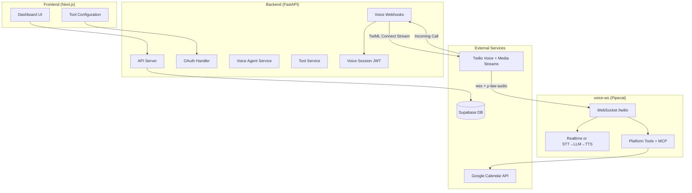
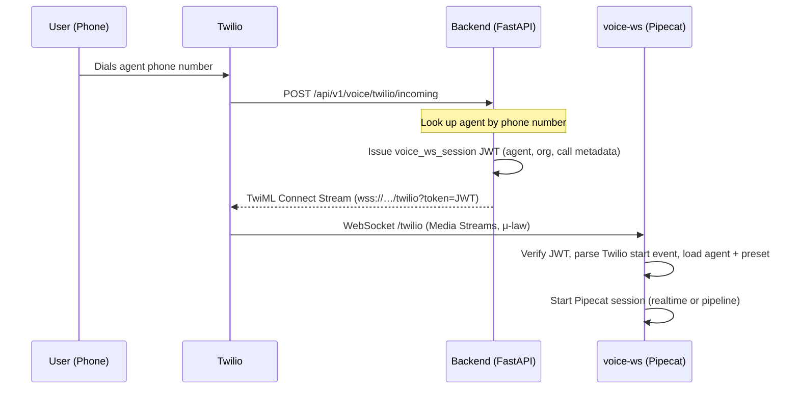
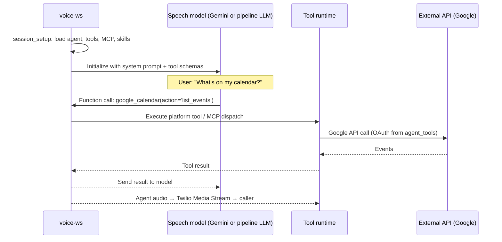

# AI Voice Agent Platform: Twilio Call Flow (Pipecat Media Streams)

This document walks through how an inbound PSTN call reaches a voice agent, from phone number configuration through tool execution in `voice-ws`.

## 1. High-Level Architecture

The platform bridges traditional telephony (Twilio) with AI speech providers (Gemini Realtime or a modular STT→LLM→TTS pipeline) over a **bidirectional Twilio Media Stream WebSocket** handled by `voice-ws` (Pipecat).

For **outbound** PSTN calls (planned), the same Media Stream path is reused after the backend originates the call via Twilio. See **[Outbound phone calls](../03_implementation/outbound_phone_calls.md)**.

---

## 2. The Flow: Step-by-Step

### Phase A: Tool Registration & Configuration

Before an agent can use tools, they must be defined in code and configured by a business user.

1. **Code definition**: A developer creates a tool class (e.g. `GoogleCalendarTool`) inheriting from `BaseTool`, with `metadata` (name, description, config schema).
2. **Registry**: The tool is registered in the platform tool registry so the system knows it exists.
3. **User configuration**:
   - The business user logs into the dashboard.
   - Available tools are fetched via `tool_routes.py`.
   - For **Google Calendar**, they click "Connect", triggering OAuth via `AuthService`.
   - Encrypted tokens are stored in `agent_tools` as `sensitive_config`.

### Phase B: Incoming Call & Session Initialization

**Key classes/methods:**

- `VoiceAgentService.get_agent_by_phone()`: Maps the dialed number to an agent.
- `voice_session_service.create_session_token()`: Signs a short-lived JWT (`JWT_SECRET_KEY`, shared with `voice-ws`).
- `handle_twilio_incoming()` / `_handle_pipecat_incoming()`: Returns TwiML with `<Connect><Stream url="wss://…/twilio?token=…"/>`.
- Backend requires **`VOICE_WS_TWILIO_URL`** (public `wss://` base, e.g. ngrok in dev) so Twilio can reach `voice-ws`.

**Call-log lifecycle and concurrency:** The backend creates the Twilio
`CallSid` row before returning TwiML so status callbacks have a record to
update. The session JWT carries that same `CallSid`; `voice-ws` excludes it
from the admission count while checking the current session and reuses the
row for duration and credit tracking. This keeps one PSTN call represented by
one active `call_logs` row and prevents a one-call plan from rejecting its own
inbound call.

There is **no LiveKit room or SIP bridge**. Audio flows directly between Twilio and `voice-ws` over Media Streams.

### Phase C: Agent Execution & Tool Usage

Once the WebSocket is up, `voice-ws` runs the agent preset and executes tools on LLM function calls.

**Details in `voice-ws`:**

- **Preset resolution**: Agent uses a published preset — Gemini Realtime (`/ws` and `/twilio`) or modular pipeline (STT → LLM → TTS).
- **Tool assembly**: `voice-ws/src/tools/assembly.py` loads platform tools and MCP connectors from the database (with OAuth tokens).
- **No session snapshot manager**: Tools and config are loaded at session start from the database; token refresh runs in the backend.

---

## 3. Key Components Reference

### Voice session JWT (`shared/voice_agents/voice_session_service.py`)

- Backend issues tokens for browser test calls (`/ws`), embed, public org page, and Twilio (`/twilio`).
- `voice-ws` verifies the JWT before accepting the WebSocket.

### Tool service (two-tier)

- **Backend / frontend**: Safe tool responses (no OAuth secrets).
- **voice-ws**: Full tool instances with decrypted `sensitive_config` for execution.

### Twilio webhooks (`backend/src/voice_agents/voice_routes.py`)

- **Incoming**: Returns Media Stream TwiML.
- **Status callbacks**: Call lifecycle for logging and billing.

---

## Summary for New Developers

To extend telephony or voice behavior:

1. **Inbound**: Ensure `VOICE_WS_TWILIO_URL` points at a public `wss://` URL for `voice-ws`, and Twilio voice webhooks hit the backend.
2. **New tool**: Add a class under `shared/voice_agents/tools/implementations/`; `voice-ws` picks it up via the platform tool registry.
3. **Outbound (planned)**: Backend originates via Twilio Calls API and returns the same Stream TwiML on answer — see **[Outbound phone calls](../03_implementation/outbound_phone_calls.md)**.

**Further reading:**

- [ADR: Pipecat WebSocket transport](ADR_VOICE_WS_PIPECAT.md)
- [voice-ws README](../../voice-ws/README.md)
- [Voice engine](02_core_systems/voice_engine.md)
