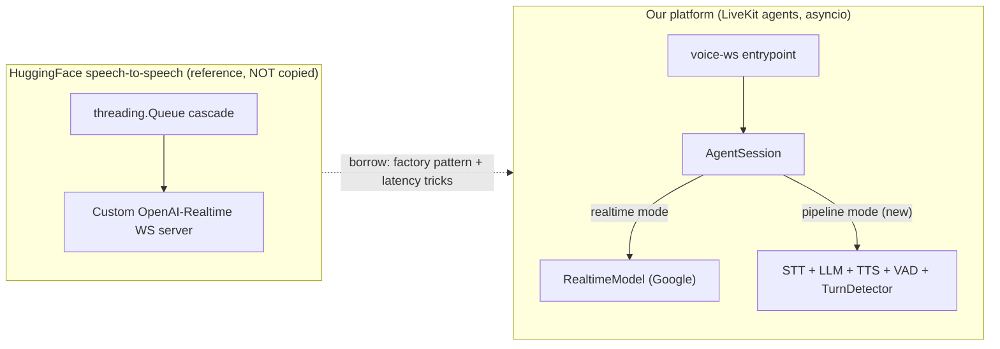
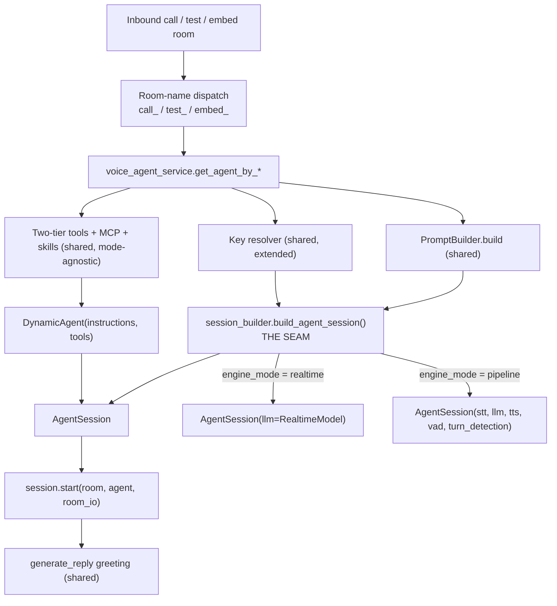
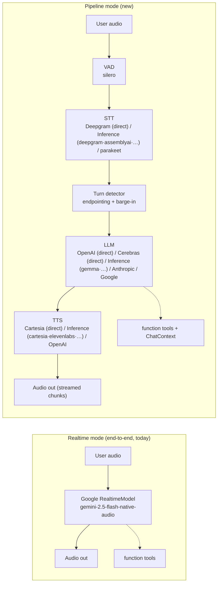
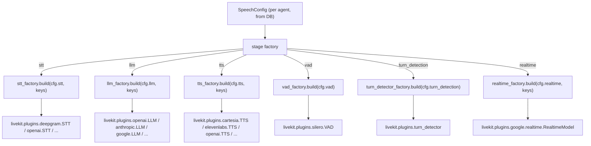
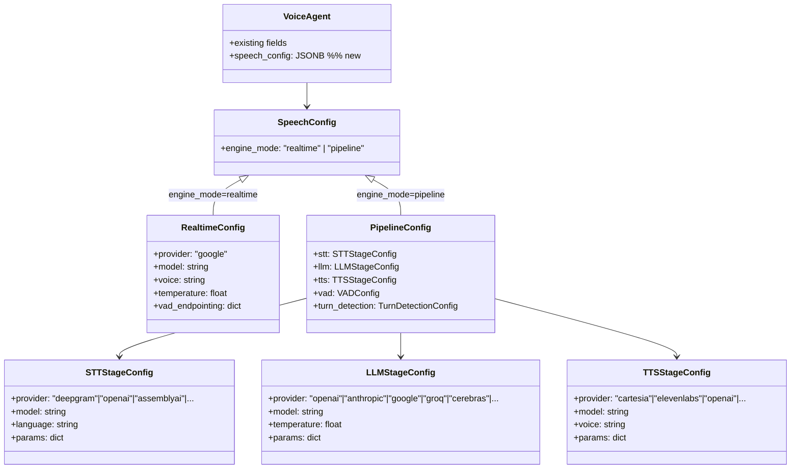
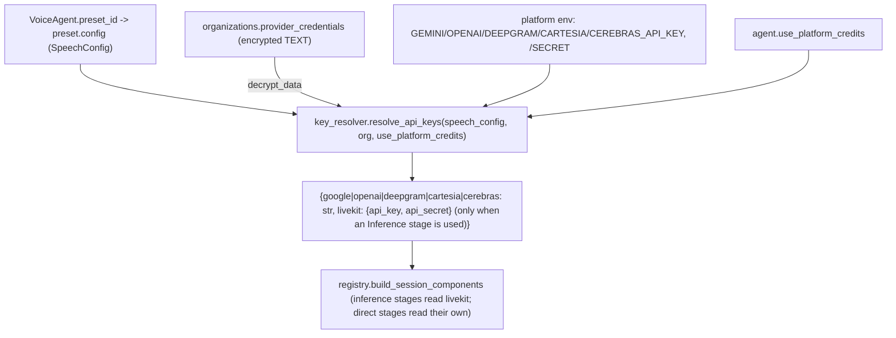
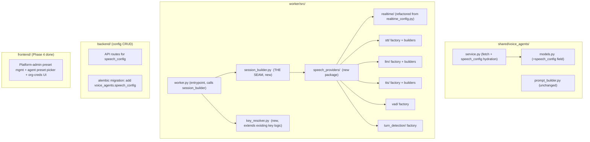
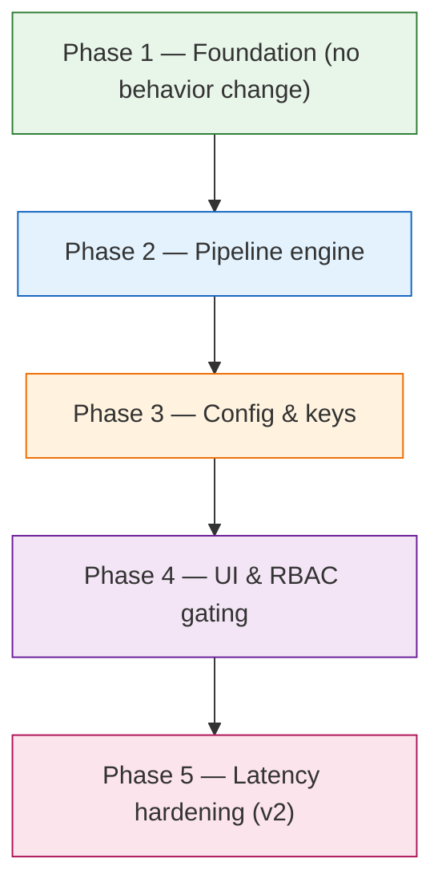

# Voice Engine: End-to-End + Pipeline Design (High-Level)

> **Implementation note (2026-08):** Voice runtime is **`voice-ws/`** (Pipecat WebSocket +
> Twilio Media Streams). Sections below describe the original LiveKit-oriented design
> phases; current wiring lives in `voice-ws/src/session_setup.py` and
> `voice-ws/src/speech/factory.py`. See [voice_engine.md](../02_core_systems/voice_engine.md)
> and [ADR_VOICE_WS_PIPECAT.md](ADR_VOICE_WS_PIPECAT.md). The deprecated preset
> provider slug **`livekit_inference`** was a removed provider name, not the LiveKit product.

> Status: **Phases 1–4 complete** (Phases 1–2b behavior-neutral; Phase 3 makes the
> pipeline usable by agents; Phase 4 makes it usable end-to-end through the UI).
> Phase 1 added the config models, `speech_providers/` package with the realtime
> provider behind a factory, the `session_builder` seam, and wired the worker
> through. Phase 2 wired the pipeline branch: per-stage LiveKit-native cloud
> providers (Silero VAD + Deepgram STT + OpenAI LLM + Cartesia TTS) behind a
> table-driven factory, with `turn_detection` deferred to Phase 5. Phase 2b added
> LiveKit **Inference** (STT/LLM/TTS through a single voice-ws (Pipecat) auth, special
> dispatch path) and **Cerebras** (direct OpenAI-compatible LLM, keyed path), so a
> pipeline can mix Inference and direct stages per stage. **Phase 3** added
> platform-admin-managed **presets** (`pipeline_presets` catalog), per-agent
> `preset_id` (live fetch, no versioning), and a per-org **key resolver** backed by
> one encrypted `organizations.provider_credentials` blob. **Phase 4** added the
> platform-admin preset management page (`/platform/presets`), the agent preset
> picker (a "voice profile" select that hides `engine_mode`/STT/LLM/TTS from org
> users), and the per-provider org-credentials UI (with a backend-derived
> `provider_credentials_status` boolean map). 100% coverage on the new shared
> modules; 95 backend + 45 voice-ws Phase-3 tests green; full frontend vitest suite
> (532 tests) + org-credentials backend tests (20) green; no-network container
> smoke confirms the full key-resolution → Inference-injection seam; browser smoke
> validates the full create/publish/edit/unpublish/delete + picker + org-cred flow.
> Live calls are unchanged for legacy agents (`preset_id=None` → the **current platform default**
> preset row — initially added by Phase 4 and now selectable among platform profiles;
> `default_realtime_config()` remains the ultimate hardcoded safety net).
> **Phase 5 pending** (latency hardening). **The Phase 3 migration
> (`20260729000001`) has been run** (`alembic upgrade head` in the backend
> container) — the `pipeline_presets` table + `voice_agents.preset_id` FK +
> `organizations.provider_credentials` blob exist, and two starter presets are
> seeded.
>
> **Preset direction (locked in, landed in Phase 3):** configuration is exposed to
> org admins/users as **platform-admin-managed presets**, not a raw per-stage
> provider+model picker. Two preset types only — `{realtime, pipeline}` — a
> "mixed" preset is just a pipeline where some stages use Inference and some use
> direct providers (no third type). Agents **reference** a preset by id **only** —
> **no versioning**: voice-ws fetches the preset row live on every call, so an
> admin's edit takes effect on the next call. For LiveKit Inference, a tenant can
> **bring its own LiveKit key** (org-level, Inference-only for now, injected only
> when the preset uses an Inference stage) instead of consuming the platform's
> LiveKit plan — mirrors the existing Google-key BYO / `use_platform_credits`
> pattern; a future path migrates LiveKit rooms/sessions to tenant keys.
>
> Implementation doc (component reference, per-stage builders, tests):
> [`02_core_systems/voice_engine.md`](../02_core_systems/voice_engine.md)
>
> Goal: support **two configurable conversation engines** per agent — the existing
> Google end-to-end realtime model, **and** a modular STT → LLM → TTS pipeline where
> each stage can use a different provider/model. Reuse existing voice-ws plumbing; keep
> it modular and swappable.

## Key decision (please confirm)

The HF `speech-to-speech` reference is **not** LiveKit — it is a custom
`threading.Queue` cascade behind a self-built OpenAI-Realtime WebSocket server, and the
`hf-realtime-voice` space is just a FastAPI metering gateway in front of it
(silero VAD → parakeet STT → Gemma-4-31B on Cerebras → Qwen3-TTS).

We are already on **LiveKit agents (asyncio)**. LiveKit's `AgentSession` natively
supports **both** modes by construction:

- End-to-end (today): `AgentSession(llm=RealtimeModel(...))`
- Pipeline (new): `AgentSession(stt=..., llm=..., tts=..., vad=..., turn_detection=...)`

**Recommendation: use LiveKit's native pipeline mode**, *not* a port of the HF queue
plumbing. This reuses 100% of our existing infrastructure (JobContext, `room_io`,
PromptBuilder, two-tier tools + MCP, room-name dispatch, greeting, API-key routing) and
keeps a single asyncio runtime. From the HF repo we borrow the **provider-factory
abstraction** and a small set of latency techniques LiveKit does not already provide.

---

## 1. Where the two modes diverge — one seam only

Everything upstream (room dispatch, agent fetch, prompt build, tool/MCP wiring,
API-key resolution) and downstream (room join, greeting, cleanup) is **shared and
unchanged**. The *only* divergence is **how the `AgentSession` is constructed**.

**Why tools are mode-agnostic:** tools attach to the LiveKit `Agent`
(`livekit_agent.update_tools(...)`), not to the model/session — so the existing
in-tree `BaseTool` registry, the MCP `RawFunctionTool` adapter, and the skills
`load_skill` tools all carry over to pipeline mode unchanged. (Bonus: the Gemini-realtime
schema-sanitization hack in `mcp/livekit_adapter.py` is only needed for the realtime
mode's strict validator; pipeline LLMs like OpenAI/Anthropic are more lenient.)

---

## 2. The two engine modes side by side

Latency in pipeline mode comes from **streaming at every stage** (LiveKit already does
this): STT partials → LLM token stream → TTS first-chunk streaming, with VAD-driven
barge-in cancelling in-flight work. The HF repo's extra tricks we can layer on later
(see §6).

---

## 3. Provider factory abstraction (the modular core)

Borrowed from HF's `get_stt_handler` / `get_llm_handler` / `get_tts_handler` factory
pattern, but each builder returns a **LiveKit plugin instance** instead of a custom
handler. Each stage is independently swappable; adding a provider = one new builder
file + one factory branch + one config variant. No change to the session seam.

---

## 4. Config data model (per-agent, modular, low schema churn)

A single JSONB column `speech_config` on `voice_agents`, validated by a **Pydantic
discriminated union**. JSONB avoids a migration every time we add a provider/field;
the discriminated union keeps it typed and validated. Backward-compatible default =
current realtime behavior, so existing agents are unaffected.

---

## 5. API-key resolution (extended, shared) — ✅ Phase 3 done

Implemented in `shared/voice_agents/key_resolver.py` (`resolve_api_keys`).
All per-org provider keys live in **one Fernet-encrypted TEXT blob** on
`organizations.provider_credentials` (`encrypt_data`/`decrypt_data` in
`shared/common/security.py`), shape `{google, deepgram, openai, cartesia,
cerebras, livekit: {api_key, api_secret}}` (only the set keys present). This
consolidates the previously-plaintext `google_api_key` (a latent security gap)
and adds storage for the direct-provider + LiveKit Inference keys. The legacy
`google_api_key` column is retained temporarily for rolling-deployment
compatibility but is no longer the source of truth. Migration
`20260922000002` moves any remaining value into the encrypted blob and clears
the plaintext column; a later cleanup migration can drop the empty column.

The resolver pairs a `SpeechConfig` with the org's decrypted blob + the platform
env vars and returns a `{provider: api_key}` map, with the same org-vs-platform +
`use_platform_credits` semantics as before. **Only the providers the config
actually needs appear** in the result — a realtime agent gets just
`{"google": ...}`; an all-direct pipeline never touches `livekit`. Providers
with no resolvable key (neither org nor env) are **omitted** (no raise) — the
registry's existing per-provider guard raises a clear `ValueError` naming the
provider, preserving the current fail-fast behavior. If an existing encrypted
org blob cannot be authenticated, resolution fails closed rather than charging
the platform account.

LiveKit **Inference** is the one special case: a single voice-ws (Pipecat) auth
(`api_key` + `api_secret`) authenticates *all* Inference stages in a pipeline, so
the resolver injects it under a dedicated `livekit` entry (a nested
`{api_key, api_secret}` dict) **only when the preset's config actually contains a
stage with `provider == "livekit_inference"`** — not one key per Inference stage.
Rationale: the platform's LiveKit plan limits won't scale to all tenants' calls,
so a tenant can bring its own LiveKit key for **Inference only**; a future path
migrates LiveKit rooms/sessions to tenant keys. Direct providers
(Deepgram/OpenAI/Cartesia/Cerebras) each keep their own per-org / platform key.
The registry's `_build_livekit_inference_stage` reads `api_keys["livekit"]` and
passes `api_key`/`api_secret` to the Inference builders (falling back to env when
both are `None`).

---

## 6. Latency techniques — what LiveKit gives us vs. what we borrow from HF

MVP = native LiveKit pipeline mode + provider factories + config + key resolution.
The HF-style speculative-turn / cancel-scope / compaction work is **v2 latency
hardening**, not a blocker for the core capability.

---

## 7. Component layout (worker + shared)

---

## 8. Phased rollout

- **P1 Foundation:** Extract `session_builder` + `speech_providers/` package; refactor
  existing `realtime_config.py` into the `realtime/` provider behind the factory.
  Net behavior identical. Existing realtime tests stay green. (Pure refactor — the
  seam now exists but only realtime is wired.) **✅ Done** — config models in
  `shared/voice_agents/speech_config.py`, provider package in
  `worker/src/speech_providers/`, seam in `worker/src/session_builder.py`, worker
  wired through, 100% coverage on new modules.
- **P2 Pipeline engine:** Add `stt/`, `llm/`, `tts/`, `vad/`, `turn_detection/`
  factories + ≥1 provider each (e.g. Deepgram STT, OpenAI LLM, Cartesia TTS, Silero
  VAD). `session_builder` branches on `engine_mode`. Install the LiveKit plugin
  packages. Unit + integration tests with mocked plugins. **✅ Done** — per-stage
  builders in `worker/src/speech_providers/{stt,llm,tts,vad}/`
  (Deepgram `nova-3`, OpenAI `gpt-4.1`, Cartesia `sonic-3`, Silero VAD via the
  offline `VAD.load` classmethod), table-driven dispatch + per-provider key
  guards in `registry.py`, conditional `vad`/`turn_detection` assembly in
  `session_builder.py`, env scaffolding (`DEEPGRAM_API_KEY` / `OPENAI_API_KEY` /
  `CARTESIA_API_KEY` in `.env.local.example` + `docker-compose.dev.yml`). The registry
  always builds an explicit standalone Silero VAD for the pipeline (even when
  `config.vad` is `None`) to keep it off the bundled `livekit.agents.inference`
  VAD / missing-Pillow path (deferred bug #7). `turn_detection` is deferred to
  Phase 5 (non-`None` config raises `NotImplementedError`). 100% coverage on the
  new modules; behavior-neutral (worker still uses the realtime default).
- **P2b Inference + Cerebras:** Add LiveKit **Inference** as a dispatchable
  provider for STT/LLM/TTS (single voice-ws (Pipecat) auth via `api_key`+`api_secret`,
  special dispatch path in `registry.py` bypassing the per-provider key guard)
  and **Cerebras** as a direct LLM (`openai.LLM.with_cerebras`, keyed path). A
  pipeline may mix Inference and direct stages per stage (the "mixed preset"
  direction — still just a pipeline). **✅ Done** —
  `worker/src/speech_providers/{stt,llm,tts}/livekit_inference.py` +
  `worker/src/speech_providers/llm/cerebras.py`; Inference reads the platform
  LiveKit key from the env (Phase 2b), with `api_key`/`api_secret` builder kwargs
  as the Phase 3 per-org injection seam; Inference has no implicit default model
  (raises `ValueError`) and splits `params` into top-level kwargs vs
  `extra_kwargs` (LLM `temperature`, STT `keywords`, etc. are not top-level).
  100% coverage on the new modules; behavior-neutral (worker still uses the
  realtime default).
- **P3 Presets, config & keys:** Platform-admin-managed **pipeline presets**
  (Alembic migration `20260729000001` adding the `pipeline_presets` catalog table +
  `voice_agents.preset_id` FK + `organizations.provider_credentials` encrypted blob).
  Two preset types only — `{realtime, pipeline}`; a "mixed" preset is just a
  pipeline mixing Inference + direct stages. **No versioning (locked decision):**
  the agent stores only `preset_id`; voice-ws fetches the preset row **live on
  every call** (`preset_service.get_preset_by_id`), so an admin's edit takes effect
  on the next call — no `preset_version`, no snapshot. Pydantic discriminated-union
  validation (`shared/voice_agents/preset_models.py`); `preset_type` is derived from
  `config.engine_mode` on every write (denormalized filter column, never hand-set).
  Per-provider **key resolver** (`shared/voice_agents/key_resolver.py`): reads all
  keys from the decrypted `provider_credentials` blob (not the plaintext
  `google_api_key` column), injects `livekit: {api_key, api_secret}` **only when an
  Inference stage is used**, omits providers with no resolvable key. Backend CRUD +
  RBAC (`backend/src/voice_agents/preset_routes.py`, platform_admin) + agent
  assignment validation (must exist + be published) + org-credential write/read
  (encrypt into the blob, clear the plaintext column). 100% coverage on
  `key_resolver`/`preset_models`/`preset_service`; no frontend in this phase (no
  browser validation). **✅ Done.** Migration reviewed and **run** (`alembic
  upgrade head` in the backend container).
- **P4 UI & RBAC:** Frontend preset picker + platform-admin preset management UI +
  per-provider org-credentials UI (fold `engine_mode` into one "voice profile"
  picker; user never sees engine mode / STT/LLM/TTS). RBAC gating on who can switch
  engines/configure stages (deferred decision — wiring point only). E2E + browser
  validation. **✅ Done** — three workstreams landed:
  - **(A) `/platform/presets`** platform-admin management page (`useAuth()` gate on
    `platform_admin`, `AccessDenied` otherwise) + `PlatformPresetsManager` catalog
    with a right-side create/edit drawer, matching the rest of the application.
    The
    `PresetConfigForm` authoring sub-form emits **exactly** the `speech_config.py`
    discriminated-union shape (server `extra="forbid"` rejects stray keys): a
    `realtime | pipeline` type selector, realtime defaults reproduced from
    `speech_config.py` (model/voice/temperature/endpointing), and pipeline
    `stt`/`llm`/`tts` (+ optional `vad`) stage blocks (provider `<select>` + optional
    `model` + optional `params` JSON). `turn_detection` is omitted (Phase 5). Nav
    entry added under `platform_admin` (`SlidersHorizontal`).
  - **(B) Agent preset picker** — reusable `PresetPicker` single-select used by the
    create widget and the agent detail page; lists **published** presets from
    `usePresets()` plus a generic **"Default"** option → `preset_id = null`
    (resolves to the System Default row — the underlying model is not revealed to
    the org user). Shows preset name + description + a subtle Realtime/Pipeline
    type badge (the "Default" option carries no badge) — org users **never see**
    `engine_mode`/STT/LLM/TTS stage fields. Agent interfaces gained `preset_id`
    (`VoiceAgent` read; `VoiceAgentCreate`/`VoiceAgentUpdate` optional; `null`
    clears → System Default, omitted preserves).
  - **(C) Per-provider org-credentials UI** — dedicated "Third-party API Credentials"
    Card on `/organization` with its own Save button (separate from the main org
    form to avoid the empty-string-clears footgun): `type="password"` inputs per
    provider (google/deepgram/openai/cartesia/cerebras + livekit
    `{api_key, api_secret}`); save sends `provider_credentials_input` with **only
    touched fields** (non-empty string to set, `null` to clear, omitted to
    preserve). Read view shows Configured/Not-configured pills driven by the
    backend-derived `provider_credentials_status` map (booleans only — never
    decrypted values). Gated on `canUpdateOrganization` + platform/org-admin check.
    Each provider row includes a provider dashboard/API-key link, a tooltip with
    provider-specific guidance, and an optional non-secret reference description.
    Descriptions are stored separately in
    `organizations.provider_credentials_descriptions` and are never consumed by
    the voice runtime.
  - **Backend (C support):** `organization/service.py` computes
    `provider_credentials_status` from the decrypted blob on read and attaches it
    to the org response (no decrypted values exposed); surfaced read-only on
    `Organization` (`shared/organization/models.py`).
  Validation: `tsc --noEmit` clean; full vitest suite (532 tests) green; backend
  org-credentials tests (20) green; browser smoke (create/publish/edit/unpublish/
  delete + 409 `in_use` dialog, picker prefill + clear cycle, org-cred set/clear
  pills, non-platform-admin denied) all pass. Throwaway smoke agent deleted; the
  two presets authored during validation are kept as starter catalog content
  (owner decision).
- **P4 follow-ups (done)** — two enhancements to the Phase 4 surface:
  - **Original system default voice profile (superseded by migration
    `20261030000001`).** The Phase 4 fallback for an agent with
    `preset_id=null` was a hardcoded `default_realtime_config()` in voice-ws —
    invisible/unmanageable, shown in the picker as a hardcoded "Default (Gemini
    Realtime)" option. Promoted to a dedicated, always-present, admin-only,
    non-published **"System Default"** row: `pipeline_presets.is_default=true`
    with a **partial unique index** `ux_pipeline_presets_is_default`
    (`WHERE is_default = true`, at-most-one default), migration
    `20260729000002`, seeded with today's Gemini-realtime config so out-of-box
    behavior is identical. The platform admin edits only its `config` via
    `GET`/`PUT /api/v1/presets/default` (config-only; the service re-validates
    the `SpeechConfig` and re-derives `preset_type`); at that time it was not
    publishable and `upsert_preset` rejected the reserved name `"System Default"`.
    Migration `20261030000001` made it published, platform-managed, renameable,
    and selectable alongside additional platform profiles. The worker's null-resolution (`_resolve_speech_config`
    in `worker/src/worker.py`) now reads this row via
    `preset_service.get_default_preset` and keeps `default_realtime_config()`
    only as the ultimate safety net (missing/unparseable default → hardcoded
    fallback). The org-admin picker's hardcoded option became a generic
    **"Default" → null**. **✅ Done** — 82 backend + 8 voice-ws + 39 frontend
    tests green; browser-validated (System Default row pinned to top with a
    "Default" badge, config edit/save round-trip, picker "Default" option).
    - **Follow-up: aligned default messaging.** The picker's default option now
      shows the **same** name + description as the platform-admin Voice Presets
      page — **"System Default"** / "Used when an agent has no voice profile
      selected." — via a single shared `DEFAULT_PRESET_DISPLAY` constant
      (`frontend/src/types/preset.ts`) used by both the picker
      (`preset-picker.tsx`) and the platform page (`platform-presets-manager.tsx`),
      so the two surfaces can't drift. The default option carries no type badge
      (the underlying engine is a platform-admin concern). At that time,
      `"System Default"` was a reserved name. **✅ Done** — picker + type vitest green; browser-validated
      (picker radio "System Default …" matches the platform page exactly).
  - **Multiple platform profiles (migration `20261030000001`).** The original
    single seeded row is now a published platform-managed profile. Presets
    declare `credential_source=platform|organization`: platform profiles use
    platform provider keys, while organization profiles require org keys unless
    the agent explicitly selects platform credits. Platform admins can publish
    additional platform profiles and select a default with
    `POST /api/v1/presets/{id}/default`. A service-role-only transactional RPC
    serializes changes; database constraints require the one default to remain
    published and platform-managed. The org picker shows the selected default's
    dynamic name, description, and readiness on its null selection; other
    published profiles remain explicit choices. Admins can edit the selected
    default through the normal preset editor, but cannot unpublish or delete it.
  - **Organization page tabs.** `/organization` refactored from two stacked Cards
    into a tabbed layout ("Organization Info" / "API Credentials") using the
    existing `AnimatedTabs` primitive, with `?tab=info|credentials` deep-linking
    (mirrors the agent-detail `?tab=` idiom; legacy `?tab=phone-numbers|skills|ai-agent`
    still redirect via `legacy-tab-redirect.ts`). The credentials Card renamed
    "Voice Provider Credentials" → **"Third-party API Credentials"**. No logic
    change to the save / cred-status flow. **✅ Done** — org page + legacy-redirect
    vitest green; browser-validated (tab switch + `?tab=` deep-link both ways).
    - **Follow-up: Google key moved off the Info tab.** The Google API key field
      was removed from the "Organization Info" tab (edit + read views); google is
      managed **exclusively** on the "API Credentials" tab. The Info tab no longer
      sends `google_api_key` on save. The backend `update_organization` now
      validates a google key arriving via `provider_credentials_input` (the
      credentials-tab path) exactly like the legacy `google_api_key` field —
      invalid keys are rejected before any write (`Invalid Google API key: …`).
      **✅ Done** — org-credentials backend tests green (+2); browser-validated
      (Info tab has no Google field in read or edit mode; credentials tab still
      has it; an invalid google key submitted from the credentials tab is
      rejected with a toast and writes nothing).
- **P5 Latency hardening (v2):** SpeculativeTurnTracker, CancelScope cross-stage stale
  drop, sentence-batched LLM→TTS, TTS leading-silence trim, ChatContext compaction,
  model warmup. Benchmarks before/after.

---

## 9. Testing & documentation strategy

- **Unit:** provider factories (assert correct LiveKit plugin + params from a config),
  Pydantic discriminated-union validation (valid/invalid/defaults), key resolver
  (org vs platform vs `use_platform_credits`), `session_builder` branching
  (realtime vs pipeline construction).
- **Integration:** pipeline-mode session start with mocked plugins; tool/MCP invocation
  in pipeline mode (verifies the mode-agnostic tool claim); barge-in cancellation.
- **Regression:** existing realtime tests stay green throughout (P1 is behavior-neutral).
- **Docs:** this file (architecture), a `voice_engine.md` module doc, provider-plugin
  guide (`docs/03_development/`), `DATABASE_SCHEMA.md` update for `speech_config`,
  README updates for `voice-ws/` and `shared/`.
- **Validation gates (per CLAUDE.md):** `py_compile` on changed files, `pytest` with
  coverage of new branches, `agent-browser` smoke test of the config UI, cleanup of
  smoke artifacts. No git commits without explicit approval.
