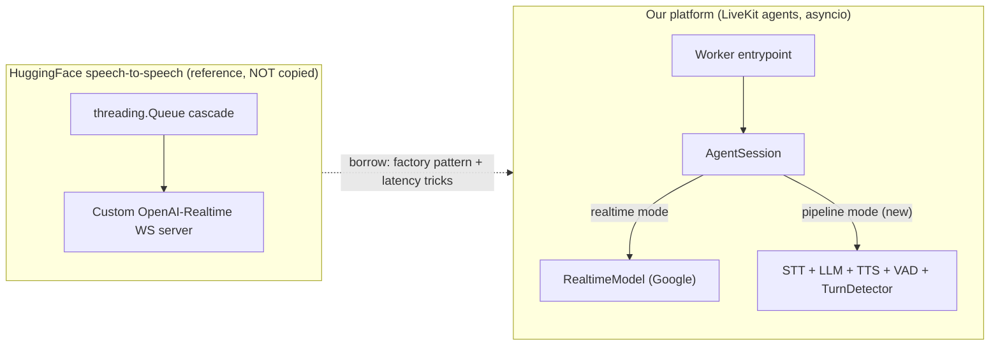
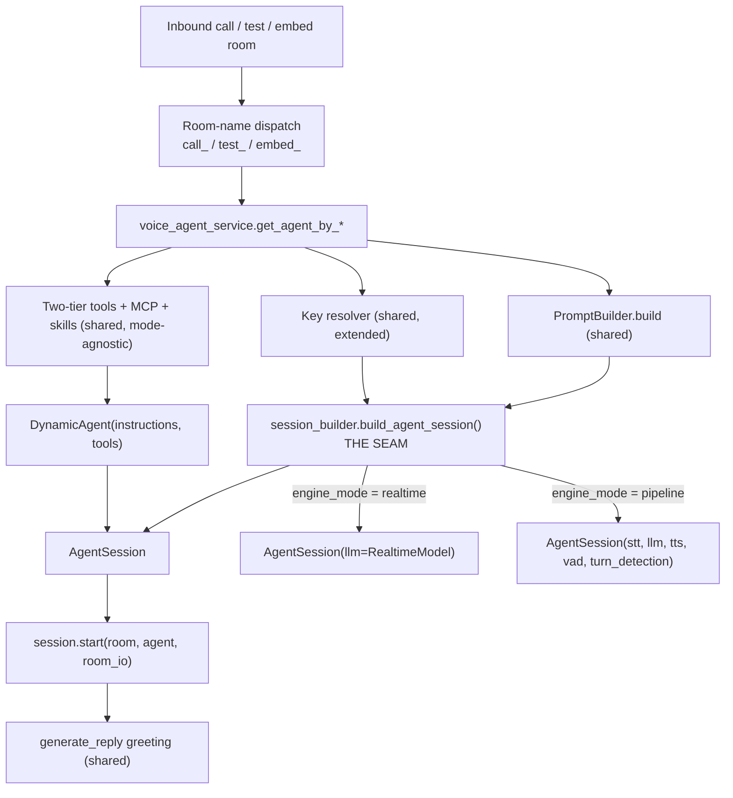
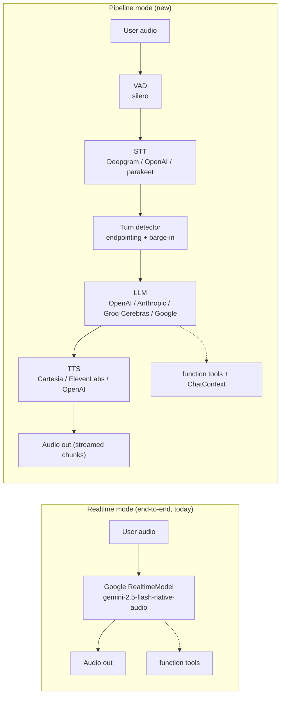
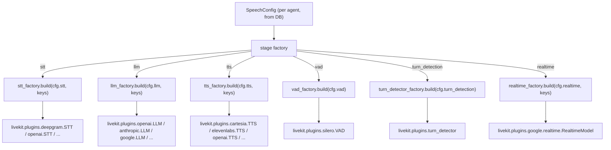
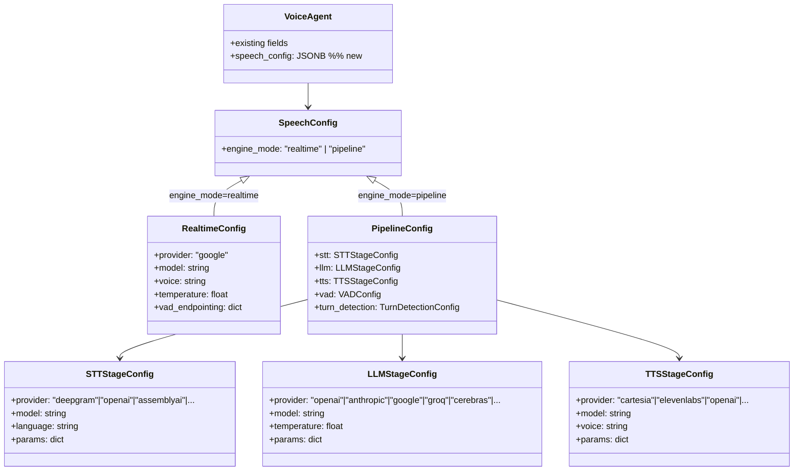
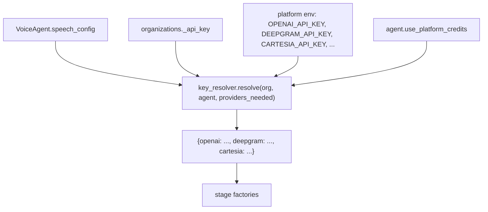
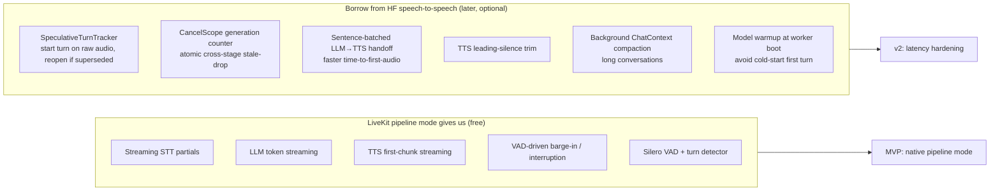
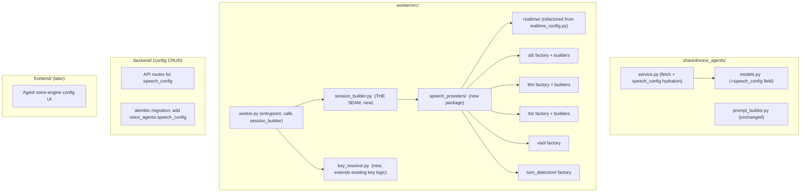
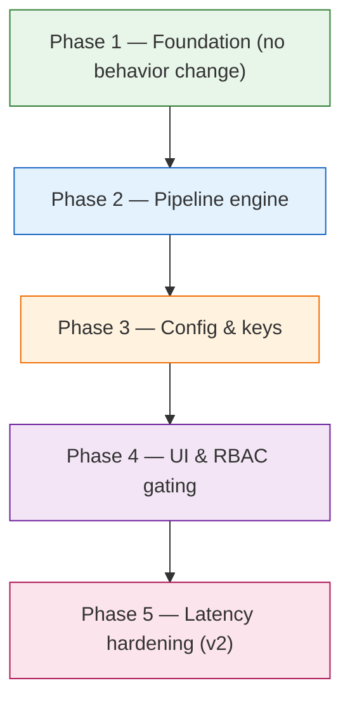

# Voice Engine: End-to-End + Pipeline Design (High-Level)

> Status: **Phase 1 complete** (behavior-neutral refactor — config models,
> `speech_providers/` package with realtime provider behind a factory,
> `session_builder` seam, worker wired through; 100% coverage on new modules;
> existing realtime tests green). Phases 2–5 pending.
>
> Implementation doc (Phase 1 details, component reference, tests):
> [`02_core_systems/voice_engine.md`](../02_core_systems/voice_engine.md)
>
> Goal: support **two configurable conversation engines** per agent — the existing
> Google end-to-end realtime model, **and** a modular STT → LLM → TTS pipeline where
> each stage can use a different provider/model. Reuse existing worker plumbing; keep
> it modular and swappable.

## Key decision (please confirm)

The HF `speech-to-speech` reference is **not** LiveKit — it is a custom
`threading.Queue` cascade behind a self-built OpenAI-Realtime WebSocket server, and the
`hf-realtime-voice` space is just a FastAPI metering gateway in front of it
(silero VAD → parakeet STT → Gemma-4-31B on Cerebras → Qwen3-TTS).

We are already on **LiveKit agents (asyncio)**. LiveKit's `AgentSession` natively
supports **both** modes by construction:

- End-to-end (today): `AgentSession(llm=RealtimeModel(...))`
- Pipeline (new): `AgentSession(stt=..., llm=..., tts=..., vad=..., turn_detection=...)`

**Recommendation: use LiveKit's native pipeline mode**, *not* a port of the HF queue
plumbing. This reuses 100% of our existing infrastructure (JobContext, `room_io`,
PromptBuilder, two-tier tools + MCP, room-name dispatch, greeting, API-key routing) and
keeps a single asyncio runtime. From the HF repo we borrow the **provider-factory
abstraction** and a small set of latency techniques LiveKit does not already provide.

---

## 1. Where the two modes diverge — one seam only

Everything upstream (room dispatch, agent fetch, prompt build, tool/MCP wiring,
API-key resolution) and downstream (room join, greeting, cleanup) is **shared and
unchanged**. The *only* divergence is **how the `AgentSession` is constructed**.

**Why tools are mode-agnostic:** tools attach to the LiveKit `Agent`
(`livekit_agent.update_tools(...)`), not to the model/session — so the existing
in-tree `BaseTool` registry, the MCP `RawFunctionTool` adapter, and the skills
`load_skill` tools all carry over to pipeline mode unchanged. (Bonus: the Gemini-realtime
schema-sanitization hack in `mcp/livekit_adapter.py` is only needed for the realtime
mode's strict validator; pipeline LLMs like OpenAI/Anthropic are more lenient.)

---

## 2. The two engine modes side by side

Latency in pipeline mode comes from **streaming at every stage** (LiveKit already does
this): STT partials → LLM token stream → TTS first-chunk streaming, with VAD-driven
barge-in cancelling in-flight work. The HF repo's extra tricks we can layer on later
(see §6).

---

## 3. Provider factory abstraction (the modular core)

Borrowed from HF's `get_stt_handler` / `get_llm_handler` / `get_tts_handler` factory
pattern, but each builder returns a **LiveKit plugin instance** instead of a custom
handler. Each stage is independently swappable; adding a provider = one new builder
file + one factory branch + one config variant. No change to the session seam.

---

## 4. Config data model (per-agent, modular, low schema churn)

A single JSONB column `speech_config` on `voice_agents`, validated by a **Pydantic
discriminated union**. JSONB avoids a migration every time we add a provider/field;
the discriminated union keeps it typed and validated. Backward-compatible default =
current realtime behavior, so existing agents are unaffected.

---

## 5. API-key resolution (extended, shared)

Today: only `org.google_api_key` vs platform `GEMINI_API_KEY`, toggled by
`use_platform_credits`. Extend to a **per-provider key resolver** that returns a
`{provider: api_key}` map, with the same org-vs-platform + `use_platform_credits`
semantics. New provider keys live alongside `google_api_key` on `organizations`
(or a small `org_provider_credentials` table if encryption/rotation needs grow).

---

## 6. Latency techniques — what LiveKit gives us vs. what we borrow from HF

MVP = native LiveKit pipeline mode + provider factories + config + key resolution.
The HF-style speculative-turn / cancel-scope / compaction work is **v2 latency
hardening**, not a blocker for the core capability.

---

## 7. Component layout (worker + shared)

---

## 8. Phased rollout

- **P1 Foundation:** Extract `session_builder` + `speech_providers/` package; refactor
  existing `realtime_config.py` into the `realtime/` provider behind the factory.
  Net behavior identical. Existing realtime tests stay green. (Pure refactor — the
  seam now exists but only realtime is wired.) **✅ Done** — config models in
  `shared/voice_agents/speech_config.py`, provider package in
  `worker/src/speech_providers/`, seam in `worker/src/session_builder.py`, worker
  wired through, 100% coverage on new modules.
- **P2 Pipeline engine:** Add `stt/`, `llm/`, `tts/`, `vad/`, `turn_detection/`
  factories + ≥1 provider each (e.g. Deepgram STT, OpenAI LLM, Cartesia TTS, Silero
  VAD). `session_builder` branches on `engine_mode`. Install the LiveKit plugin
  packages. Unit + integration tests with mocked plugins.
- **P3 Config & keys:** Alembic migration adding `voice_agents.speech_config` (JSONB,
  nullable, defaults to realtime). Pydantic discriminated-union validation. Per-provider
  key resolver. Backend CRUD + validation tests.
- **P4 UI & RBAC:** Frontend agent config UI (engine mode + per-stage model pickers).
  RBAC gating on who can switch engines/configure stages (deferred decision — wiring
  point only). E2E + browser validation.
- **P5 Latency hardening (v2):** SpeculativeTurnTracker, CancelScope cross-stage stale
  drop, sentence-batched LLM→TTS, TTS leading-silence trim, ChatContext compaction,
  model warmup. Benchmarks before/after.

---

## 9. Testing & documentation strategy

- **Unit:** provider factories (assert correct LiveKit plugin + params from a config),
  Pydantic discriminated-union validation (valid/invalid/defaults), key resolver
  (org vs platform vs `use_platform_credits`), `session_builder` branching
  (realtime vs pipeline construction).
- **Integration:** pipeline-mode session start with mocked plugins; tool/MCP invocation
  in pipeline mode (verifies the mode-agnostic tool claim); barge-in cancellation.
- **Regression:** existing realtime tests stay green throughout (P1 is behavior-neutral).
- **Docs:** this file (architecture), a `voice_engine.md` module doc, provider-plugin
  guide (`docs/03_development/`), `DATABASE_SCHEMA.md` update for `speech_config`,
  README updates for `worker/` and `shared/`.
- **Validation gates (per CLAUDE.md):** `py_compile` on changed files, `pytest` with
  coverage of new branches, `agent-browser` smoke test of the config UI, cleanup of
  smoke artifacts. No git commits without explicit approval.