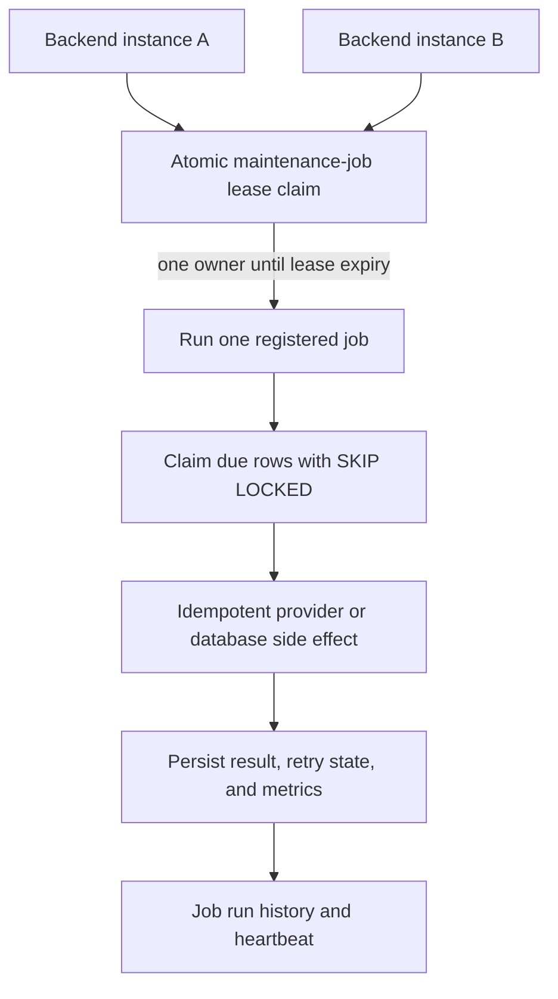

# Maintenance jobs and horizontal scaling plan

This document records current maintenance-job behavior and the target shared
runner design. OAuth refresh now uses a per-connection lease plus a credential
generation fence, and OAuth Telegram/SMS alerts use a claimed outbox. This
change does not introduce a generic job runner for the remaining jobs.

## Current execution model

The backend starts the maintenance loops from the FastAPI lifespan. Each
backend instance starts its own in-process `asyncio` task and sleeps between
runs. The current jobs include:

| Job | Current protection | Horizontal-scaling risk |
| --- | --- | --- |
| OAuth token refresh | Postgres per-`agent_tool` lease plus a credential-version write fence; DNS and provider calls have hard deadlines | Provider calls can still have ambiguous outcomes; those stop retries and trigger admin recovery |
| Free-plan renewal | Idempotent credit-grant key | Period-window updates and duplicate scans can race |
| Subscription plan migration | No durable claim | Two instances can perform the same Stripe/database migration |
| Phone-number rental/release | Idempotent rental debit key | Twilio release and lifecycle updates can be attempted concurrently |
| Notification retry and low-credit outbox | Email idempotency metadata, but the general retry loop has no row claim; OAuth Telegram/SMS has a dedicated `SKIP LOCKED` outbox | Duplicate sends remain possible for the general retry loop and after a provider accepted an OAuth alert but acknowledgment was lost |

The token-refresh lease protects a connection refresh, but it does not
coordinate the other jobs. The current fleet is not yet safe to scale
horizontally for all maintenance work. A process restart also resets the
in-memory cadence; there is no durable “next run” or run-history record for
most jobs.

## Target architecture

Use Postgres as the coordination authority because it is already the shared
transaction boundary for billing, phone ownership, and job state.

### 1. Durable job registry

Introduce a singleton row per job containing:

- stable `job_name`;
- enabled flag and configured interval;
- `next_run_at`;
- `lease_owner` and `lease_until`;
- last start, finish, success/failure, and error summary;
- consecutive failure count and last heartbeat.

The registry is the authoritative schedule. Environment variables remain safe
bootstrap defaults, while platform-admin settings can eventually change a job
without restarting every backend instance.

### 2. Atomic lease acquisition

Implement one Postgres function that locks the job row and claims it only when
the job is due and either has no lease or its lease has expired. The function
must atomically advance `next_run_at` and return the claim token. The runner
renews the lease for long jobs and releases it with the final outcome. A
crashed instance is recovered when `lease_until` expires.

The lease must not be an in-memory lock, process PID, or best-effort
“select-then-update” sequence. All instances use the same database function.

### 3. Per-row claims for batch jobs

The job lease prevents duplicate job-wide execution, but batch handlers should
also claim rows in bounded batches using `FOR UPDATE SKIP LOCKED` (or a shared
claim table) before an external side effect. Each claim needs an expiry and an
idempotency key. This protects against operator retries, overlapping manual
runs, and a lease expiring while a provider call is still in flight.

Examples:

- phone releases: claim the `release_pending` row before calling Twilio;
- notification delivery: claim the notification before calling Resend or
  Telegram;
- plan migration: claim the subscription before updating Stripe;
- free renewal: claim the subscription period before granting credits.

### 4. Side-effect and reconciliation contract

Every handler must remain safe if the provider responds slowly or the process
dies after the provider succeeds but before the database update. Use stable
idempotency keys where the provider supports them, persist the provider ID
before advancing local state when possible, and add a reconciliation pass for
ambiguous outcomes. A lease is coordination, not a replacement for
idempotency.

### 5. Rollout sequence

1. Add registry, run-history, and claim functions with a migration.
2. Build a generic `MaintenanceJobRunner` with metrics and structured logs.
3. Migrate phone rental/release first because it can create provider charges
   or release owned numbers.
4. Migrate notifications and plan migration, then free-plan renewal.
5. Keep token refresh on its existing per-tool lease until the generic runner
   is proven; then consolidate only if behavior remains equivalent.
6. Add a platform-admin maintenance page for interval, enabled state,
   last-run status, and manual retry after the coordination layer is proven.

## Acceptance criteria for the follow-up

- Two backend instances cannot both hold the same active job lease.
- A crashed owner is recoverable after the configured lease TTL.
- Every external side effect has a stable idempotency or reconciliation path.
- Run history exposes start, finish, duration, outcome, and error details.
- Tests cover lease contention, expiry takeover, retries, overlapping batches,
  and provider timeout after success.
- A staging deployment runs the jobs on at least two backend instances before
  production rollout.

Until this work is implemented, treat the remaining unclaimed maintenance
jobs as unsafe for concurrent execution and keep their provider/database
operations idempotent. OAuth token refresh and its Telegram/SMS alert outbox
have their own Postgres coordination; that protection does not extend to the
other rows in the table. A generic runner remains the next platform-hardening
task after the Twilio integration.
