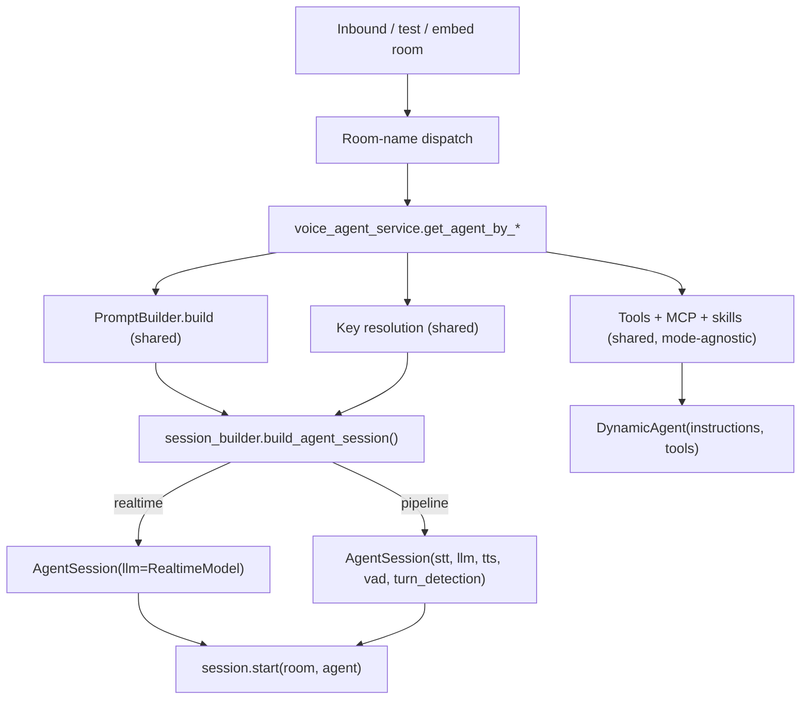

# Voice Engine — End-to-End Realtime + Modular Pipeline

The voice engine is the part of the worker that turns a LiveKit room into a
conversation. It supports **two configurable engines per agent**, chosen via the
agent's `speech_config`:

- **Realtime (end-to-end)** — a single speech model (Google Gemini native-audio)
  handles STT + LLM + TTS together. This is the original behavior.
- **Pipeline (modular)** — an STT → LLM → TTS cascade where each stage can use a
  different provider/model, independently configurable. (Config + seam landed in
  Phase 1; per-stage providers wired in Phase 2.)

The design goal is **modularity and reuse**: everything except *how the
`AgentSession` is constructed* is shared between the two engines — room dispatch,
prompt building, the two-tier tool system (in-tree `BaseTool`s + remote MCP +
skills), greeting, and cleanup.

> High-level design with Mermaid diagrams:
> [`01_architecture/voice_engine_pipeline_design.md`](../01_architecture/voice_engine_pipeline_design.md)

## The single seam

`build_agent_session` is the only place the two engines diverge. It delegates
plugin construction to the provider factory and only decides how to assemble the
`AgentSession` from the resulting components.

## Components

### `shared/voice_agents/speech_config.py` — typed config contract

A Pydantic discriminated union on `engine_mode`:

- `RealtimeSpeechConfig` — `engine_mode=realtime`, Google native-audio model,
  voice, temperature, endpointing. Defaults **exactly reproduce** the constants
  previously hardcoded in the worker, so `default_realtime_config()` is
  behavior-neutral (legacy agents with no `speech_config` get today's tuning).
- `PipelineSpeechConfig` — `engine_mode=pipeline`, with `stt` / `llm` / `tts`
  (required) and `vad` / `turn_detection` (optional) stage configs.
- `StageConfig` — `provider` (factory dispatch key) + `model` + open `params`
  dict, so adding a provider never needs a schema migration.
- `parse_speech_config(None)` → default realtime config (backward compatibility).

Stored as a single JSONB column `voice_agents.speech_config` (Phase 3 Alembic
migration). JSONB + discriminated union = adding a provider/tunable is a code
change, not a migration.

### `worker/src/speech_providers/` — provider factory (the modular core)

Modeled on HuggingFace's `speech-to-speech` `get_stt_handler` /
`get_llm_handler` / `get_tts_handler` factory pattern — but each builder returns
a **LiveKit plugin instance** (not a custom handler), so the session stays on
LiveKit's asyncio runtime (we did **not** port HF's `threading.Queue` plumbing).

- `realtime/provider.py` — `build_realtime_model(api_key, config)` →
  `RealtimeModel`. Holds the latency/reliability tuning (thinking off, barge-in
  on, endpointing). See its docstring for the rationale.
- `stt/deepgram.py`, `llm/openai.py`, `tts/cartesia.py`, `vad/silero.py` (Phase 2)
  — per-stage **direct** providers, each mirroring the realtime pattern: a pure
  `build_<provider>_<stage>_config(config) -> dict` (plugin kwargs, **no** api_key
  — deterministic, unit-testable) + `build_<provider>_<stage>(api_key, config)`
  that injects the key and constructs the plugin (constructed but not connected —
  safe with a fake key in tests). Defaults: Deepgram `nova-3` / `en-US`, OpenAI
  `gpt-4.1`, Cartesia `sonic-3` (default voice UUID / `en`); `model` is passed
  only when the config sets it, otherwise the plugin default applies, and
  `config.params` is forwarded verbatim. Silero VAD is local/offline —
  `build_silero_vad(config)` calls the sync `silero.VAD.load(**params)`
  classmethod with the **bundled** ONNX model (no network, no api_key).
- `stt/livekit_inference.py`, `llm/livekit_inference.py`, `tts/livekit_inference.py` (Phase 2b) — LiveKit
  **Inference** builders. Inference gives access to many models (Deepgram STT,
  Cerebras/Gemma LLM, Cartesia TTS, ...) through a single LiveKit Cloud auth
  (`api_key` + `api_secret`), so these stages bypass the per-provider key guard
  and resolve the LiveKit key on their own (env in Phase 2b; the `api_key`/
  `api_secret` kwargs are the Phase 3 per-org injection seam). Unlike the direct
  providers, Inference has **no implicit default model** — the config function
  raises `ValueError` if `model` is `None` — and it splits `config.params` into
  top-level constructor kwargs vs `extra_kwargs` (provider-specific options like
  Deepgram `keywords` or LLM `temperature` are not top-level on the Inference
  plugins).
- `llm/cerebras.py` (Phase 2b) — Cerebras, a **direct** OpenAI-compatible LLM
  built via `openai.LLM.with_cerebras` for high throughput / low latency. It
  rides the normal keyed path (`cerebras` entry in `LLM_BUILDERS`), so a pipeline
  can mix it with Inference stages (e.g. Inference STT + Cerebras LLM +
  Inference TTS — the "mixed preset" direction, still just a pipeline). Default
  model `llama-4-scout-17b-16e-instruct`; `temperature` is top-level here.
- `turn_detection/` (Phase 2) — package stub only. No builder is wired; the
  pipeline runs on LiveKit's default VAD-based turn detection. An explicit
  turn-detector builder (RNT / speculative turn tracking) is deferred to Phase 5.
- `registry.py` — `build_session_components(speech_config, api_keys)` →
  `RealtimeComponents` (single `llm`) or `PipelineComponents`
  (stt/llm/tts/vad/turn_detection). Both branches are wired. The pipeline branch
  dispatches each stage through `_build_keyed_or_livekit_inference_stage`: a stage with
  `provider == "livekit_inference"` takes the special **Inference path**
  (`LIVEKIT_INFERENCE_STAGE_BUILDERS`, single LiveKit Cloud auth, no per-stage key guard);
  any other provider takes the **keyed path** through a small per-stage table
  (`STT_BUILDERS` / `LLM_BUILDERS` / `TTS_BUILDERS`) keyed by the stage's
  `provider`, reads the matching key from `api_keys` (raising `ValueError`
  naming the provider if missing — mirroring the realtime Google-key guard), and
  raises `NotImplementedError` for an unsupported provider. This split lets a
  pipeline **mix** Inference and direct stages freely (the "mixed preset"
  direction — still a pipeline, no third preset type). **VAD is always built**
  as an explicit standalone Silero VAD (even when `config.vad` is `None`,
  via `VAD_BUILDERS["silero"](None)`) to keep the pipeline off the bundled
  `livekit.agents.inference` VAD path (the missing-Pillow path, deferred bug #7).
  `turn_detection` of `None` → `None`; a non-`None` config raises
  `NotImplementedError` (Phase 5).

Adding a direct provider = one new builder module + one entry in the relevant
`*_BUILDERS` table. Adding an Inference stage = one new builder module + one
entry in `LIVEKIT_INFERENCE_STAGE_BUILDERS`. No change to the session seam.

### `worker/src/session_builder.py` — the seam

`build_agent_session(speech_config, api_keys, userdata)` → `AgentSession`.

- realtime → `AgentSession(llm=RealtimeModel, userdata=...)`
- pipeline → `AgentSession(stt=..., llm=..., tts=..., userdata=...)`, with `vad=`
  and `turn_detection=` passed **only when not `None`** (`vad=None` opts out of
  VAD; `turn_detection` has no valid `None` and must be omitted). In practice the
  registry always supplies a Silero VAD, so `vad=` is always set for a pipeline
  session; the `None`-omission guard is for robustness / direct
  `PipelineComponents` callers.

### `worker/src/realtime_config.py` — backward-compat shim

Re-exports the realtime builder/constants from `speech_providers.realtime.provider`
under their old names so existing importers (notably `test_realtime_config.py`)
keep working. New code should import from `speech_providers.realtime` and
`shared.voice_agents.speech_config` directly.

## Why tools are engine-agnostic

Tools attach to the LiveKit `Agent` (`livekit_agent.update_tools(...)`), not to
the model/session. So the in-tree `BaseTool` registry, the remote-MCP
`RawFunctionTool` adapter, and the skills `load_skill` tools all carry over to
pipeline mode unchanged. Bonus: the Gemini-realtime JSON-schema sanitization
hack (`mcp/livekit_adapter.py`) is only needed for the realtime model's strict
validator — pipeline LLMs (OpenAI/Anthropic) are more lenient.

## Latency

LiveKit's pipeline mode already streams at every stage (STT partials → LLM token
stream → TTS first-chunk) with VAD-driven barge-in. The HF `speech-to-speech`
repo's extra techniques (SpeculativeTurnTracker, CancelScope generation-counter,
sentence-batched LLM→TTS, TTS leading-silence trim, background ChatContext
compaction, model warmup) are **Phase 5 latency hardening**, not a prerequisite
for the core capability.

## Phased rollout

- **Phase 1 (done)** — config models, `speech_providers/` package with realtime
  provider behind a factory, `session_builder` seam, worker wired through.
  Behavior-neutral refactor; existing realtime tests stay green; 100% coverage on
  new modules.
- **Phase 2 (done)** — pipeline engine: `stt/`, `llm/`, `tts/`, `vad/`,
  `turn_detection/` factories + one LiveKit-native cloud provider per keyed stage
  (Deepgram STT, OpenAI LLM, Cartesia TTS, Silero VAD); table-driven dispatch +
  per-provider key guards in `registry.py`; conditional `vad`/`turn_detection`
  assembly in `session_builder.py`; env scaffolding
  (`DEEPGRAM_API_KEY` / `OPENAI_API_KEY` / `CARTESIA_API_KEY`). Behavior-neutral
  (worker still uses the realtime default); 100% coverage on new modules; full
  worker suite green.
- **Phase 2b (done)** — LiveKit **Inference** as a dispatchable provider for
  STT/LLM/TTS (single LiveKit Cloud auth, many models; special dispatch path
  bypassing the per-provider key guard) + **Cerebras** as a direct LLM
  (`openai.LLM.with_cerebras`, keyed path). A pipeline may mix Inference and
  direct stages per stage (the "mixed preset" direction). Inference reads the
  platform LiveKit key from the env in Phase 2b; the `api_key`/`api_secret`
  builder kwargs are the Phase 3 per-org injection seam. 100% coverage on new
  modules; behavior-neutral (worker still uses the realtime default).
- **Phase 3** — platform-admin-managed **pipeline presets** (table +
  Alembic migration adding `voice_agents.speech_config` JSONB); backend CRUD +
  RBAC; per-org **key resolver** (LiveKit key+secret as a first-class org
  credential for Inference, plus direct-provider keys, `use_platform_credits`);
  agents reference a preset (reference + versioning). Two preset types only:
  `{realtime, pipeline}` — a "mixed" preset is just a pipeline where some stages
  use Inference and some use direct providers.
- **Phase 4** — frontend agent config UI (engine mode + per-stage model pickers);
  RBAC gating on who can switch engines.
- **Phase 5** — latency hardening (borrowed from HF `speech-to-speech`) + the
  explicit turn-detector builder.

## Tests

- `worker/tests/test_speech_config.py` — config defaults, overrides, validation,
  discriminated-union dispatch, `None` fallback.
- `worker/tests/test_realtime_provider.py` — config-driven kwargs, fixed tuning
  invariance, model construction.
- `worker/tests/test_stt_provider.py` (Phase 2) — Deepgram STT config kwargs +
  real plugin construction (`_opts.model` / `_opts.language`).
- `worker/tests/test_livekit_inference_stt_provider.py` (Phase 2b) — LiveKit Inference
  STT: model-required guard, top-level vs `extra_kwargs` param split, env-cred
  fallback, explicit-cred override, missing-key `ValueError`.
- `worker/tests/test_llm_provider.py` (Phase 2 + 2b) — OpenAI LLM and Cerebras
  LLM config kwargs + real plugin construction (`_opts.model` / `_opts.temperature`).
- `worker/tests/test_livekit_inference_llm_provider.py` (Phase 2b) — LiveKit Inference
  LLM: `temperature` routed to `extra_kwargs` (not top-level), env/explicit
  creds, missing-key guard.
- `worker/tests/test_tts_provider.py` (Phase 2) — Cartesia TTS config kwargs +
  real plugin construction (`_opts.model` / `_opts.voice` / `_opts.api_key`).
- `worker/tests/test_livekit_inference_tts_provider.py` (Phase 2b) — LiveKit Inference
  TTS: `voice` top-level vs provider-specific `extra_kwargs`, env/explicit creds,
  missing-key guard.
- `worker/tests/test_vad_provider.py` (Phase 2) — Silero VAD config (params-only,
  no `model`/`api_key`) + offline `VAD.load` construction + `None`-defaults path.
- `worker/tests/test_speech_provider_registry.py` — factory dispatch, per-stage
  key guards, unsupported-provider / unsupported-vad / non-`None`-turn-detection
  `NotImplementedError`s, always-on default Silero VAD, `TypeError` guard;
  Inference special-path dispatch (no per-stage key guard), Cerebras keyed
  dispatch + missing-key guard, mixed Inference+direct pipeline.
- `worker/tests/test_session_builder.py` — realtime + pipeline session assembly,
  userdata forwarding, `vad`/`turn_detection` omission vs forwarding,
  unknown-component `TypeError` guard.
- `worker/tests/test_realtime_config.py` — (pre-existing) default tuning via the
  backward-compat shim.