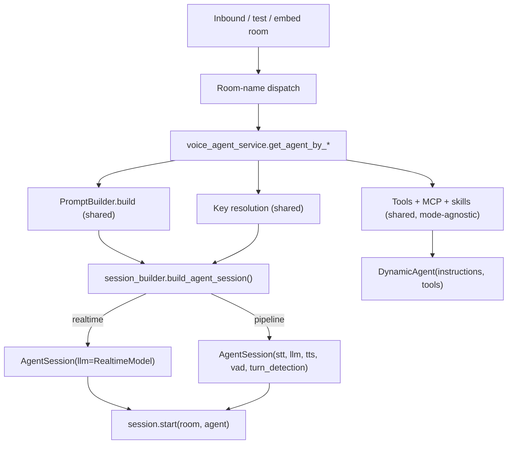

# Voice Engine — End-to-End Realtime + Modular Pipeline

The voice engine is the part of the worker that turns a LiveKit room into a
conversation. It supports **two configurable engines per agent**, chosen via the
agent's `speech_config`:

- **Realtime (end-to-end)** — a single speech model (Google Gemini native-audio)
  handles STT + LLM + TTS together. This is the original behavior.
- **Pipeline (modular)** — an STT → LLM → TTS cascade where each stage can use a
  different provider/model, independently configurable. (Engine wired in Phase 2;
  config + seam landed in Phase 1.)

The design goal is **modularity and reuse**: everything except *how the
`AgentSession` is constructed* is shared between the two engines — room dispatch,
prompt building, the two-tier tool system (in-tree `BaseTool`s + remote MCP +
skills), greeting, and cleanup.

> High-level design with Mermaid diagrams:
> [`01_architecture/voice_engine_pipeline_design.md`](../01_architecture/voice_engine_pipeline_design.md)

## The single seam

`build_agent_session` is the only place the two engines diverge. It delegates
plugin construction to the provider factory and only decides how to assemble the
`AgentSession` from the resulting components.

## Components

### `shared/voice_agents/speech_config.py` — typed config contract

A Pydantic discriminated union on `engine_mode`:

- `RealtimeSpeechConfig` — `engine_mode=realtime`, Google native-audio model,
  voice, temperature, endpointing. Defaults **exactly reproduce** the constants
  previously hardcoded in the worker, so `default_realtime_config()` is
  behavior-neutral (legacy agents with no `speech_config` get today's tuning).
- `PipelineSpeechConfig` — `engine_mode=pipeline`, with `stt` / `llm` / `tts`
  (required) and `vad` / `turn_detection` (optional) stage configs.
- `StageConfig` — `provider` (factory dispatch key) + `model` + open `params`
  dict, so adding a provider never needs a schema migration.
- `parse_speech_config(None)` → default realtime config (backward compatibility).

Stored as a single JSONB column `voice_agents.speech_config` (Phase 3 Alembic
migration). JSONB + discriminated union = adding a provider/tunable is a code
change, not a migration.

### `worker/src/speech_providers/` — provider factory (the modular core)

Modeled on HuggingFace's `speech-to-speech` `get_stt_handler` /
`get_llm_handler` / `get_tts_handler` factory pattern — but each builder returns
a **LiveKit plugin instance** (not a custom handler), so the session stays on
LiveKit's asyncio runtime (we did **not** port HF's `threading.Queue` plumbing).

- `realtime/provider.py` — `build_realtime_model(api_key, config)` →
  `RealtimeModel`. Holds the latency/reliability tuning (thinking off, barge-in
  on, endpointing). See its docstring for the rationale.
- `registry.py` — `build_session_components(speech_config, api_keys)` →
  `RealtimeComponents` (single `llm`) or `PipelineComponents` (stt/llm/tts/vad/
  turn_detection). Phase 1 wires only the realtime branch; pipeline branch raises
  `NotImplementedError` until Phase 2.

Adding a provider = one new builder module + one factory branch + one config
variant. No change to the session seam.

### `worker/src/session_builder.py` — the seam

`build_agent_session(speech_config, api_keys, userdata)` → `AgentSession`.

- realtime → `AgentSession(llm=RealtimeModel, userdata=...)`
- pipeline → `AgentSession(stt=..., llm=..., tts=..., vad=..., turn_detection=...,
  userdata=...)` (Phase 2)

### `worker/src/realtime_config.py` — backward-compat shim

Re-exports the realtime builder/constants from `speech_providers.realtime.provider`
under their old names so existing importers (notably `test_realtime_config.py`)
keep working. New code should import from `speech_providers.realtime` and
`shared.voice_agents.speech_config` directly.

## Why tools are engine-agnostic

Tools attach to the LiveKit `Agent` (`livekit_agent.update_tools(...)`), not to
the model/session. So the in-tree `BaseTool` registry, the remote-MCP
`RawFunctionTool` adapter, and the skills `load_skill` tools all carry over to
pipeline mode unchanged. Bonus: the Gemini-realtime JSON-schema sanitization
hack (`mcp/livekit_adapter.py`) is only needed for the realtime model's strict
validator — pipeline LLMs (OpenAI/Anthropic) are more lenient.

## Latency

LiveKit's pipeline mode already streams at every stage (STT partials → LLM token
stream → TTS first-chunk) with VAD-driven barge-in. The HF `speech-to-speech`
repo's extra techniques (SpeculativeTurnTracker, CancelScope generation-counter,
sentence-batched LLM→TTS, TTS leading-silence trim, background ChatContext
compaction, model warmup) are **Phase 5 latency hardening**, not a prerequisite
for the core capability.

## Phased rollout

- **Phase 1 (done)** — config models, `speech_providers/` package with realtime
  provider behind a factory, `session_builder` seam, worker wired through.
  Behavior-neutral refactor; existing realtime tests stay green; 100% coverage on
  new modules.
- **Phase 2** — pipeline engine: `stt/`, `llm/`, `tts/`, `vad/`,
  `turn_detection/` factories + ≥1 provider each; `session_builder` pipeline
  branch.
- **Phase 3** — Alembic migration adding `voice_agents.speech_config` (JSONB);
  backend CRUD + validation; per-provider key resolver.
- **Phase 4** — frontend agent config UI (engine mode + per-stage model pickers);
  RBAC gating on who can switch engines.
- **Phase 5** — latency hardening (borrowed from HF `speech-to-speech`).

## Tests

- `worker/tests/test_speech_config.py` — config defaults, overrides, validation,
  discriminated-union dispatch, `None` fallback.
- `worker/tests/test_realtime_provider.py` — config-driven kwargs, fixed tuning
  invariance, model construction.
- `worker/tests/test_speech_provider_registry.py` — factory dispatch, key
  handling, `NotImplementedError`/`TypeError` guards.
- `worker/tests/test_session_builder.py` — realtime session assembly, userdata,
  pipeline/unknown-component guards.
- `worker/tests/test_realtime_config.py` — (pre-existing) default tuning via the
  backward-compat shim.