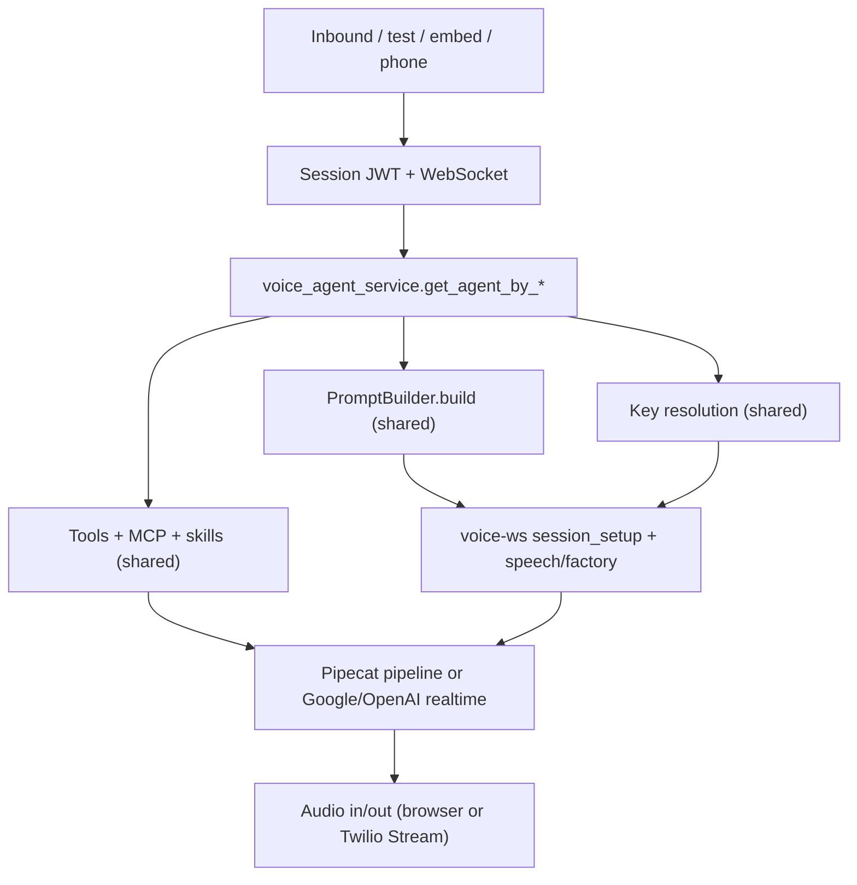

# Voice Engine — End-to-End Realtime + Modular Pipeline

> **Active transport (2026-08):** Browser, embed, public-page, and phone calls use
> **`voice-ws/`** (Pipecat WebSocket + Twilio Media Streams). Shared layers below
> (`SpeechConfig`, presets, `key_resolver`, `PromptBuilder`, tools/MCP/skills) are
> consumed by `voice-ws` at session start. The deprecated preset provider slug
> **`livekit_inference`** (removed provider name, not the LiveKit product) is
> normalized to direct providers via migration
> `20260803000001_remove_livekit_inference_from_presets`.

The voice engine is the part of the platform that turns an authenticated session
into a conversation. It supports **two configurable engines per agent**, chosen via
the agent's `speech_config`:

- **Realtime (end-to-end)** — a single speech model handles STT + LLM + TTS
  together. The worker supports Google Gemini native-audio and OpenAI
  (`gpt-live-1` plus the standard `gpt-realtime-2.1` adapter).
- **Pipeline (modular)** — an STT → LLM → TTS cascade where each stage can use a
  different provider/model, independently configurable. (Config + seam landed in
  Phase 1; per-stage providers wired in Phase 2.)

The design goal is **modularity and reuse**: everything except _how the
`AgentSession` is constructed_ is shared between the two engines — room dispatch,
prompt building, the two-tier tool system (in-tree `BaseTool`s + remote MCP +
skills), greeting, and cleanup.

> High-level design with Mermaid diagrams:
> [`01_architecture/voice_engine_pipeline_design.md`](../01_architecture/voice_engine_pipeline_design.md)

## The single seam

`voice-ws` session setup is the only place the two engines diverge. It delegates
provider construction to `voice-ws/src/speech/factory.py` and assembles either a
Google/OpenAI realtime session or a modular Pipecat pipeline.

## Components

### `shared/voice_agents/speech_config.py` — typed config contract

A Pydantic discriminated union on `engine_mode`:

- `RealtimeSpeechConfig` — `engine_mode=realtime`, a supported provider/model,
  voice, and provider-specific tuning. Google keeps the existing arbitrary model
  and endpointing fields. OpenAI supports `gpt-live-1` and `gpt-realtime-2.1`
  with per-model voice validation; its params and Gemini-only tuning remain at
  their inert defaults. Defaults **exactly reproduce** the legacy Google
  constants, so `default_realtime_config()` remains behavior-neutral.
- `PipelineSpeechConfig` — `engine_mode=pipeline`, with `stt` / `llm` / `tts`
  (required) and `vad` / `turn_detection` (optional) stage configs.
- `StageConfig` — `provider` (factory dispatch key) + `model` + open `params`
  dict, so adding a provider never needs a schema migration.
- `parse_speech_config(None)` → default realtime config (backward compatibility).

A `SpeechConfig` is stored as the `config` JSONB column on a **preset** row
(`pipeline_presets.config` — Phase 3 Alembic migration `20260729000001`), not
directly on the agent. An agent references a preset via `voice_agents.preset_id`
(FK); voice-ws loads the preset row live on every call and parses its `config`
(no versioning — admin edits take effect on the next call). JSONB + discriminated
union = adding a provider/tunable is a code change, not a migration.

### `shared/voice_agents/preset_models.py` + `preset_service.py` — preset catalog (Phase 3)

Platform-admin-managed named presets mirroring the `platform_tools` catalog
pattern: no RLS, `is_published` lifecycle, `(result, error)` service contract,
`assert_platform_role("platform_admin")` gating. `PresetType` is
`realtime`|`pipeline`, **derived from `config.engine_mode` on every write** by
the service (denormalized filter column, never hand-set; `extra="forbid"` on the
Pydantic models rejects a hand-set `preset_type`). The `voice-ws` runtime fetches a preset by
id (`get_preset_by_id`) — drafts and published both resolve; assignment
validation (in the agent routes) enforces `is_published`. Deleting an in-use
preset returns `"in_use"` (route → 409 with the agent list); `?force=true` proceeds
and the `voice_agents.preset_id` FK `ON DELETE SET NULL` drops agents back to the
current platform default preset row (initially seeded as **System Default** in
Phase 4). Presets carry **no secrets**.

**Platform and organization profiles (migration `20261030000001`).** Each
preset has a `credential_source`: `platform` profiles use provider keys from the
platform environment, while `organization` profiles require credentials stored
for that organization. The agent's explicit `use_platform_credits` option still
allows an organization profile to use platform keys. Existing custom profiles
default to `organization`.

There is one `is_default=true` row, and it must be published and platform
managed. The migration promotes the existing seeded row. Platform admins can
author additional platform profiles, publish them, and select one as default
with `POST /api/v1/presets/{id}/default`. The service-role-only
`set_default_pipeline_preset(uuid)` RPC serializes concurrent changes. The
default appears in the org picker as its dynamic `preset_id=null` option; other
published platform or organization profiles appear as explicit choices. The
default cannot be unpublished or deleted, but it can be renamed and edited like
other presets. The earlier `GET`/`PUT /api/v1/presets/default` endpoints remain
for compatibility. The null-selection readiness flag checks the platform
provider keys required by the selected default and can be false when those keys
are unavailable; organization credentials do not make a platform profile ready.

The partial unique index `ux_pipeline_presets_is_default` ensures at most one
default row, and a database CHECK requires that row to be published and use
platform credentials. The hardcoded `default_realtime_config()` remains the
runtime safety net only when the database default is missing or invalid.

### Model capability validation and call failures

The OpenRouter pipeline builder sends `reasoning.effort=none` and
`reasoning.exclude=true` so reasoning does not add voice latency. The preset
service therefore checks OpenRouter LLM models against the provider catalog when
a configuration is published, when a live configuration is edited, and when
the platform default is edited. A model whose metadata requires reasoning is
rejected with an actionable admin error. The resolver is provider-specific and
cached; providers without a resolver remain valid so their adapters can be
added independently. Draft-only authoring does not make a provider network
request until the preset becomes live.

If a legacy or already-published preset still reaches the runtime and Pipecat
reports an `ErrorFrame` or runner exception, `voice-ws` records the first safe
classification on `call_logs.failure_code` and `call_logs.failure_message` and
finalizes the call as `failed`. The authenticated Calls UI displays that
classification. Raw provider exceptions remain in runtime logs/telemetry and
are never persisted in or returned by the call-log API. Migration
`20260902000001_add_call_failure_details` adds the nullable fields and index.

### `shared/voice_agents/key_resolver.py` — per-org key resolver (Phase 3)

`resolve_api_keys(speech_config, org, use_platform_credits, credential_source)`
→ the `api_keys` map the factory expects. Realtime resolves the configured
provider; pipeline resolves each stage. A `platform` profile uses platform env
keys and ignores org keys. An `organization` profile requires its org's
Fernet-encrypted `organizations.provider_credentials` keys; the explicit
`use_platform_credits` option overrides the profile source. Missing keys are
omitted, and a non-empty unreadable org blob fails closed. Legacy callers that
do not pass a preset source retain transition behavior. Legacy
`livekit_inference` stages are normalized to direct providers via
`normalize_stage_provider()`.

### `voice-ws/src/speech/factory.py` — Pipecat provider factory

Each builder returns a **Pipecat-compatible service** (STT, LLM, TTS, VAD) for pipeline
presets, or a provider-specific realtime adapter for `engine_mode=realtime`.

- Realtime — Google Gemini native-audio, OpenAI Realtime, or the custom
  GPT-Live WebSocket/delegation adapter (see `voice-ws/src/bot.py`, session setup).
  GPT-Live keeps audio at the provider's 24 kHz boundary, preserves upstream
  input transcript fragments, and groups late/overlapping transcript deltas by
  the provider's `start_ms`/`end_ms` intervals. Those intervals are required:
  the adapter rejects transcript events without them instead of guessing a turn
  from network timing. It reports cumulative usage through Pipecat metrics and
  requires a confirmed `session.closed` event before a call is completed.
- Pipeline — Deepgram STT, OpenAI/Cerebras/OpenRouter LLM, Cartesia/Fish TTS
- `normalize_stage_provider()` — maps deprecated `livekit_inference` slug to direct providers

### `voice-ws/src/session_setup.py` — the seam

Loads agent, preset, prompt, tools, MCP, and skills; builds the Pipecat pipeline
or selected realtime session for `/ws` and `/twilio`. Pipeline-only provider
fallback remains separate; a realtime provider failure is surfaced rather than
silently switching models.

## Why tools are engine-agnostic

Tools register as Pipecat function handlers in `voice-ws/src/tools/assembly.py` (platform
`BaseTool`s, MCP, and skills). The same tool metadata and OAuth tokens are used
regardless of realtime vs pipeline preset. JSON-schema sanitization in
`shared/voice_agents/tools/mcp/schema_sanitize.py` helps strict Gemini realtime
validation; pipeline LLMs are generally more lenient.

## Organization tool visibility

Platform admins publish tools into the global catalog. The organization-level
**Organization Tools** catalog applies a sparse visibility override: published
tools are visible by default, and organization admins can hide a tool from new
agent connections. The backend enforces this on both catalog reads and attach
requests; the frontend is not the security boundary.

Hiding or unpublishing a tool does not silently detach it from existing agents.
`voice-ws` continues to resolve attached tools through `agent_tools`, while the
agent UI keeps the connection visible with a `Hidden` or `Unpublished` status.
This preserves runtime continuity and gives an admin an explicit path to
remove or reconfigure the existing connection. On an agent's Tools tab, the
Connected filter is selected by default. Agents with connections see those
cards first; agents without connections see a **See all tools** action that
switches to the full catalog.

## Latency

Pipecat pipeline mode streams at every stage (STT partials → LLM token
stream → TTS first-chunk) with VAD-driven barge-in where configured. Additional
latency techniques (speculative turn detection, sentence-batched LLM→TTS, model
warmup) are **future hardening**, not prerequisites for the core capability.

## Phased rollout

- **Phase 1 (done)** — config models, `speech_providers/` package with realtime
  provider behind a factory, `session_builder` seam, voice-ws wired through.
  Behavior-neutral refactor; existing realtime tests stay green; 100% coverage on
  new modules.
- **Phase 2 (done)** — pipeline engine: `stt/`, `llm/`, `tts/`, `vad/`,
  `turn_detection/` factories + one LiveKit-native cloud provider per keyed stage
  (Deepgram STT, OpenAI LLM, Cartesia TTS, Silero VAD); table-driven dispatch +
  per-provider key guards in `registry.py`; conditional `vad`/`turn_detection`
  assembly in `session_builder.py`; env scaffolding
  (`DEEPGRAM_API_KEY` / `OPENAI_API_KEY` / `CARTESIA_API_KEY`). Behavior-neutral
  (worker still uses the realtime default); 100% coverage on new modules; full
  voice-ws suite green.
- **Phase 2b (done)** — LiveKit **Inference** as a dispatchable provider for
  STT/LLM/TTS (single voice-ws (Pipecat) auth, many models; special dispatch path
  bypassing the per-provider key guard) + **Cerebras** as a direct LLM
  (`openai.LLM.with_cerebras`, keyed path). A pipeline may mix Inference and
  direct stages per stage (the "mixed preset" direction). Inference reads the
  platform LiveKit key from the env in Phase 2b; the `api_key`/`api_secret`
  builder kwargs are the Phase 3 per-org injection seam. 100% coverage on new
  modules; behavior-neutral (worker still uses the realtime default).
- **Phase 3 (done)** — platform-admin-managed **pipeline presets**: the
  `pipeline_presets` catalog table + `voice_agents.preset_id` FK + encrypted
  `organizations.provider_credentials` blob (Alembic migration
  `20260729000001`, reviewed and **run**). Backend
  CRUD + RBAC (`preset_routes.py`, platform_admin) + agent assignment validation
  (must exist + be published). Per-org **key resolver** (`key_resolver.py`): all
  keys in one encrypted blob, `livekit` injected only for Inference stages,
  missing providers omitted, `use_platform_credits` toggle. **No versioning** —
  voice-ws fetches the preset row live each call; admin edits take effect on
  the next call. Two preset types only: `{realtime, pipeline}` — a "mixed" preset
  is just a pipeline where some stages use Inference and some use direct
  providers. 100% coverage on the new shared modules; 95 backend + 45 worker
  Phase-3 tests green; no-network container smoke confirms the key-resolution →
  Inference-injection seam. No frontend in this phase (no browser validation) —
  legacy agents (`preset_id=None`) are unchanged.
- **Phase 4 (done)** — frontend preset picker + platform-admin preset management UI +
  per-provider org-credentials UI (fold `engine_mode` into one "voice profile"
  picker); RBAC gating on who can switch engines. Three workstreams all landed and
  browser-validated:
  - **(A) Platform-admin preset management** — `/platform/presets` page (gated on
    `user.hasRole("platform_admin")`, `AccessDenied` otherwise) +
    `PlatformPresetsManager` catalog with a right-side create/edit drawer,
    matching the application-wide entity-management pattern. The drawer uses
    the shared `form-drawer` / `form-section` / `form-field` / `form-control`
    hierarchy from `globals.css`. Authoring a preset uses `PresetConfigForm`, which
    emits **exactly** the `speech_config.py` discriminated-union shape
    (`extra="forbid"` on the server, so no stray keys). Publish allowed once a
    valid config is authored; backend 400 (invalid config) shown inline. A nav
    entry (`SlidersHorizontal`, `requiredPermission: "platform:admin"`) was added
    under the `platform_admin` section. Every catalog row also exposes **Copy**;
    it opens the same author drawer as a new draft with the source description
    and configuration prefilled, while generating a collision-safe name so the
    upsert-by-name create endpoint cannot overwrite the source preset.
  - **(B) Agent preset picker** — reusable `PresetPicker` single-select used by
    both the create widget and the agent detail page. Lists **published** presets
    only from `usePresets()` plus a generic **"Default"** option →
    `preset_id = null` (the org user never sees the underlying model — it resolves
    to the current platform default). Shows preset name + description + a subtle
    Realtime/Pipeline type badge (the "Default" option carries no badge) — the org
    user **never sees** `engine_mode` / STT / LLM / TTS stage fields. Empty state
    when no preset is published. The agent interfaces gained `preset_id`
    (`VoiceAgent` read; `VoiceAgentCreate`/`VoiceAgentUpdate` optional). `null`
    clears (→ current platform default); omitted on create preserves the default.
  - **(C) Per-provider org-credentials UI** — dedicated "Third-party API
    Credentials" Card on `/organization` with its own Save button (separate from
    the main org form, avoiding the empty-string-clears-everything footgun).
    `type="password"` inputs per provider (google/deepgram/openai/cartesia/cerebras
    - livekit `{api_key, api_secret}`); save sends `provider_credentials_input`
      with **only touched fields** (non-empty string to set, `null` to explicitly
      clear, omitted to preserve). Read view shows green-dot "Configured" / gray
      "Not configured" pills driven by the backend-derived
      `provider_credentials_status` map (booleans only — never decrypted values).
      Each provider row also links to its provider dashboard or API-key
      documentation, exposes provider-specific help text, and supports an
      optional non-secret reference description. Descriptions are persisted in
      `organizations.provider_credentials_descriptions` through
      `provider_credentials_descriptions_input`; they are never sent to the
      provider runtime.
      Gated on `canUpdateOrganization` + the page-level platform/org-admin check.
  - **Backend (C support):** `organization/service.py` computes
    `provider_credentials_status` from the decrypted blob on read and attaches it
    to the org response (no decrypted values exposed); surfaced as a read-only
    field on `Organization` (`shared/organization/models.py`).
    Validation: `tsc --noEmit` clean on source; full vitest suite green (532 tests);
    backend org-credentials tests green (20); browser smoke (create/publish/edit/
    unpublish/delete + 409 `in_use` dialog, picker prefill + clear cycle, org-cred
    set/clear pills, non-platform-admin denied) all pass. Throwaway smoke agent
    deleted; the two presets authored during validation are kept as starter catalog
    content (owner decision).
- **Phase 4 follow-ups (done)** — two enhancements to the Phase 4 surface:
  - **Original system default voice profile (superseded by migration
    `20261030000001`).** The Phase 4 fallback for an agent with
    `preset_id=null` was a hardcoded `default_realtime_config()` in voice-ws —
    invisible/unmanageable, and shown in the picker as a hardcoded "Default (Gemini
    Realtime)" option. Promoted to a dedicated, always-present, admin-only,
    non-published **"System Default"** row (`pipeline_presets.is_default=true`,
    partial unique index `ux_pipeline_presets_is_default`, migration
    `20260729000002`, seeded with today's Gemini-realtime config so out-of-box
    behavior is identical). The platform admin edits only its `config` via
    `GET`/`PUT /api/v1/presets/default`; at that time it was non-publishable and
    non-deletable. Migration `20261030000001` promoted it to a published
    platform-managed preset and added selectable platform profiles. The worker's
    null resolution reads the current default row
    (`preset_service.get_default_preset`) and keeps `default_realtime_config()`
    only as the ultimate safety net (missing/unparseable default). The org-admin
    picker's hardcoded option became a generic **"Default" → null** (no underlying
    model revealed). 82 backend + 8 voice-ws + 39 frontend tests green.
    - **Follow-up: aligned default messaging.** The picker's default option now
      shows the **same** name + description as the platform-admin Voice Presets
      page — **"System Default"** / "Used when an agent has no voice profile
      selected." — via a single shared `DEFAULT_PRESET_DISPLAY` constant at the
      time. The current picker reads the selected default's name, description,
      credential source, and readiness from the catalog. The default can be
      renamed, and the old name is no longer globally reserved.
  - **Organization page tabs.** `/organization` refactored from two stacked Cards
    into a tabbed layout ("Organization Info" / "API Credentials") using the
    existing `AnimatedTabs` primitive, with `?tab=info|credentials` deep-linking
    (mirrors the agent-detail `?tab=` idiom; legacy `?tab=phone-numbers|skills|`
    `ai-agent` still redirect). The credentials Card renamed "Voice Provider
    Credentials" → **"Third-party API Credentials"**. No logic change to the
    save/cred-status flow.
  - **Follow-up: Google key moved off the Info tab.** The Google API key field
    was removed from the "Organization Info" tab (edit + read views); google is
    now managed **exclusively** on the "API Credentials" tab. The Info tab no
    longer sends `google_api_key` on save. The backend `update_organization`
    now validates a google key arriving via `provider_credentials_input`
    (the credentials-tab path) exactly like the legacy `google_api_key`
    field — invalid keys are rejected before any write (for example,
    `Invalid Google API key: …`). The legacy `google_api_key` write path is
    retained for any other caller but the frontend no longer uses it.
- **Phase 5** — latency hardening (borrowed from HF `speech-to-speech`) + the
  explicit turn-detector builder.

## Tests

- `worker/tests/test_speech_config.py` — config defaults, overrides, validation,
  discriminated-union dispatch, `None` fallback.
- `worker/tests/test_realtime_provider.py` — config-driven kwargs, fixed tuning
  invariance, model construction.
- `worker/tests/test_stt_provider.py` (Phase 2) — Deepgram STT config kwargs +
  real plugin construction (`_opts.model` / `_opts.language`).
- `worker/tests/test_llm_provider.py` (Phase 2 + 2b) — OpenAI LLM and Cerebras
  LLM config kwargs + real plugin construction (`_opts.model` / `_opts.temperature`).
- `worker/tests/test_tts_provider.py` (Phase 2) — Cartesia TTS config kwargs +
  real plugin construction (`_opts.model` / `_opts.voice` / `_opts.api_key`).
- `worker/tests/test_vad_provider.py` (Phase 2) — Silero VAD config (params-only,
  no `model`/`api_key`) + offline `VAD.load` construction + `None`-defaults path.
- `worker/tests/test_speech_provider_registry.py` — factory dispatch, per-stage
  key guards, unsupported-provider / unsupported-vad / non-`None`-turn-detection
  `NotImplementedError`s, always-on default Silero VAD, `TypeError` guard;
  Inference special-path dispatch (no per-stage key guard), Cerebras keyed
  dispatch + missing-key guard, mixed Inference+direct pipeline, **Phase 3
  Inference `api_key`/`api_secret` injection from `api_keys["livekit"]`** +
  env fallback when `livekit` absent.
- `worker/tests/test_session_builder.py` — realtime + pipeline session assembly,
  userdata forwarding, `vad`/`turn_detection` omission vs forwarding,
  unknown-component `TypeError` guard.
- `worker/tests/test_realtime_config.py` — (pre-existing) default tuning via the
  backward-compat shim.

### Phase 3 tests (presets + key resolver + org credentials)

- `backend/tests/shared/voice_agents/test_preset_models.py` — `config`
  discriminated-union validation (realtime vs pipeline), `preset_type` not
  hand-set (`extra="forbid"`).
- `backend/tests/shared/voice_agents/test_preset_service.py` — upsert derives
  `preset_type`; publish flip; list `only_published`/`include_drafts`; usage
  join; delete `in_use` guard + `force`; `(result, error)` shape; all
  failure/exception/not-found branches (100% coverage).
- `backend/tests/shared/voice_agents/test_key_resolver.py` — realtime resolves
  the selected provider (Google or OpenAI); pipeline direct-only → no `livekit`;
  Inference stage → `livekit` present; `use_platform_credits` forces env; org
  key wins; missing → omitted; `livekit` nested dict shape; google from
  decrypted blob not plaintext column; unsupported-config `TypeError`; empty
  org blob (100% coverage).
- `backend/tests/voice_agents/test_preset_routes.py` — 403 for non-admin on
  create/publish/unpublish/usage/delete + `include_drafts`; 201/200 success for
  platform_admin; list published-only vs drafts; 409 `in_use` with agent list;
  404 not found; draft fetch 403 for non-admin.
- `backend/tests/voice_agents/test_agent_routes.py::TestAgentPresetAssignment` —
  create/update with `preset_id` validates published; draft → 400; missing → 400;
  lookup error → 400; `preset_id=None` and omitted-`preset_id` skip validation.
- `backend/tests/organization/test_org_credentials.py` — writing `google_api_key`
  stores encrypted `provider_credentials["google"]` + clears plaintext column;
  empty key clears; `provider_credentials_input` merged; invalid key rejected;
  read path resolves from decrypted blob / transitional plaintext fallback;
  unreadable blobs fail closed; `_merge_provider_credentials`
  preserve/clear/empty/decrypt-failure.

### Phase 4 follow-up tests (system default + org tabs)

- `backend/tests/shared/voice_agents/test_preset_models.py` — `Preset` carries
  `is_default`; `PresetCreate`/`PresetUpdate` reject a hand-set `is_default`
  (`extra="forbid"`).
- `backend/tests/shared/voice_agents/test_preset_service.py` — default retrieval,
  atomic selection, source/published guards, editable default fields, default
  publish/delete protections, and config validation.
- `backend/tests/voice_agents/test_preset_routes.py::TestPresetDefaultRoutes` —
  `GET`/`PUT /presets/default` 403 for non-admin, 200/404 for platform_admin;
  invalid config → 400; publish/delete/generic-update on the default row → 400.
- `worker/tests/test_preset_resolution.py` — `_resolve_speech_config`: explicit
  preset loaded / missing / error / unparseable → hardcoded fallback; no preset →
  System Default row (pipeline) / no-default → hardcoded / default-error →
  hardcoded / default-unparseable → hardcoded.
- `frontend/src/services/__tests__/preset-service.test.ts` — `getDefaultPreset` /
  `updateDefaultPreset` (raw config body); `Preset` fixture carries `is_default`.
- `frontend/src/types/__tests__/voice-agent-preset.test.ts` — `preset_id` doc
  contract updated (`null` = system default, the admin-designated fallback).
- `frontend/src/app/(dashboard)/organization/__tests__/page.test.tsx` — tab
  presence + default-info, switch → `?tab=credentials`, deep-link `?tab=credentials`.
- `frontend/src/app/(dashboard)/organization/__tests__/legacy-tab-redirect.test.ts`
  — `info`/`credentials` → `null` (in-page tabs, no redirect).
