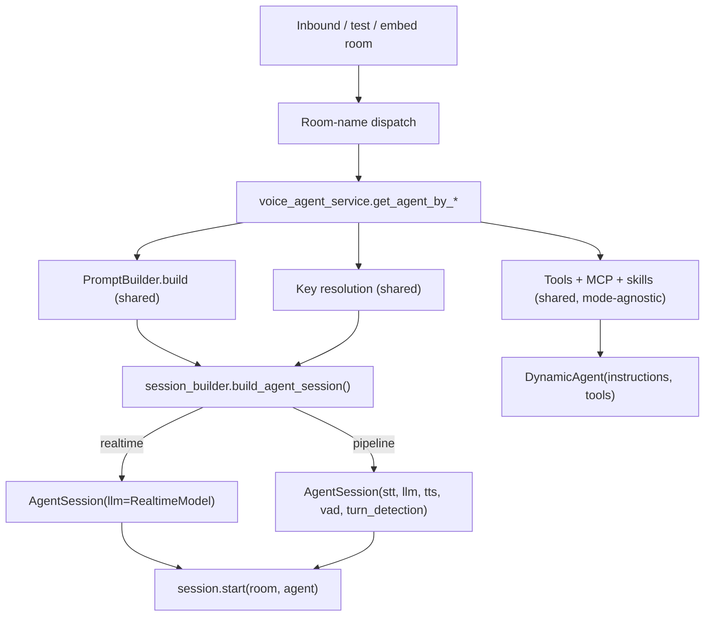

# Voice Engine — End-to-End Realtime + Modular Pipeline

The voice engine is the part of the worker that turns a LiveKit room into a
conversation. It supports **two configurable engines per agent**, chosen via the
agent's `speech_config`:

- **Realtime (end-to-end)** — a single speech model (Google Gemini native-audio)
  handles STT + LLM + TTS together. This is the original behavior.
- **Pipeline (modular)** — an STT → LLM → TTS cascade where each stage can use a
  different provider/model, independently configurable. (Config + seam landed in
  Phase 1; per-stage providers wired in Phase 2.)

The design goal is **modularity and reuse**: everything except *how the
`AgentSession` is constructed* is shared between the two engines — room dispatch,
prompt building, the two-tier tool system (in-tree `BaseTool`s + remote MCP +
skills), greeting, and cleanup.

> High-level design with Mermaid diagrams:
> [`01_architecture/voice_engine_pipeline_design.md`](../01_architecture/voice_engine_pipeline_design.md)

## The single seam

`build_agent_session` is the only place the two engines diverge. It delegates
plugin construction to the provider factory and only decides how to assemble the
`AgentSession` from the resulting components.

## Components

### `shared/voice_agents/speech_config.py` — typed config contract

A Pydantic discriminated union on `engine_mode`:

- `RealtimeSpeechConfig` — `engine_mode=realtime`, Google native-audio model,
  voice, temperature, endpointing. Defaults **exactly reproduce** the constants
  previously hardcoded in the worker, so `default_realtime_config()` is
  behavior-neutral (legacy agents with no `speech_config` get today's tuning).
- `PipelineSpeechConfig` — `engine_mode=pipeline`, with `stt` / `llm` / `tts`
  (required) and `vad` / `turn_detection` (optional) stage configs.
- `StageConfig` — `provider` (factory dispatch key) + `model` + open `params`
  dict, so adding a provider never needs a schema migration.
- `parse_speech_config(None)` → default realtime config (backward compatibility).

A `SpeechConfig` is stored as the `config` JSONB column on a **preset** row
(`pipeline_presets.config` — Phase 3 Alembic migration `20260729000001`), not
directly on the agent. An agent references a preset via `voice_agents.preset_id`
(FK); the worker loads the preset row live on every call and parses its `config`
(no versioning — admin edits take effect on the next call). JSONB + discriminated
union = adding a provider/tunable is a code change, not a migration.

### `shared/voice_agents/preset_models.py` + `preset_service.py` — preset catalog (Phase 3)

Platform-admin-managed named presets mirroring the `platform_tools` catalog
pattern: no RLS, `is_published` lifecycle, `(result, error)` service contract,
`assert_platform_role("platform_admin")` gating. `PresetType` is
`realtime`|`pipeline`, **derived from `config.engine_mode` on every write** by
the service (denormalized filter column, never hand-set; `extra="forbid"` on the
Pydantic models rejects a hand-set `preset_type`). The worker fetches a preset by
id (`get_preset_by_id`) — drafts and published both resolve; assignment
validation (in the agent routes) enforces `is_published`. Deleting an in-use
preset returns `"in_use"` (route → 409 with the agent list); `?force=true` proceeds
and the `voice_agents.preset_id` FK `ON DELETE SET NULL` drops agents back to the
**System Default** preset row (Phase 4). Presets carry **no secrets**.

**System default (Phase 4, migration `20260729000002`).** The catalog always
contains one `is_default=true` row (`name='System Default'`, `is_published=false`,
seeded with `default_realtime_config()`). It is the fallback an agent uses when
`preset_id` is NULL (legacy agent, or one whose preset was deleted). It replaces
the previously-hardcoded `default_realtime_config()` worker fallback — now a real,
editable row. Platform-admin-managed via dedicated `GET`/`PUT /api/v1/presets/default`
routes (config-only writes; the service re-validates the `SpeechConfig` and
re-derives `preset_type`). The service guards make it **non-publishable and
non-deletable** (immutable except its `config`); `upsert_preset` rejects the
reserved name `"System Default"`. It never appears in the org-admin picker — the
picker lists published presets plus a generic **"Default" → `null`** option (does
not reveal the underlying model). A **partial unique index**
`ux_pipeline_presets_is_default` (`WHERE is_default = true`) enforces at most one
default row.

### `shared/voice_agents/key_resolver.py` — per-org key resolver (Phase 3)

`resolve_api_keys(speech_config, org, use_platform_credits)` → the `api_keys` map
the factory expects. Reads all per-org provider keys from one Fernet-encrypted
`organizations.provider_credentials` blob (via `decrypt_data`), with platform env
fallback and the `use_platform_credits` toggle. **Only the providers the config
needs appear**; missing providers are omitted (the registry's guard fails fast).
`livekit: {api_key, api_secret}` is injected **only when an Inference stage is
used**. The registry's `_build_livekit_inference_stage` passes those to the
Inference builders (env fallback when both `None`).

### `worker/src/speech_providers/` — provider factory (the modular core)

Modeled on HuggingFace's `speech-to-speech` `get_stt_handler` /
`get_llm_handler` / `get_tts_handler` factory pattern — but each builder returns
a **LiveKit plugin instance** (not a custom handler), so the session stays on
LiveKit's asyncio runtime (we did **not** port HF's `threading.Queue` plumbing).

- `realtime/provider.py` — `build_realtime_model(api_key, config)` →
  `RealtimeModel`. Holds the latency/reliability tuning (thinking off, barge-in
  on, endpointing). See its docstring for the rationale.
- `stt/deepgram.py`, `llm/openai.py`, `tts/cartesia.py`, `vad/silero.py` (Phase 2)
  — per-stage **direct** providers, each mirroring the realtime pattern: a pure
  `build_<provider>_<stage>_config(config) -> dict` (plugin kwargs, **no** api_key
  — deterministic, unit-testable) + `build_<provider>_<stage>(api_key, config)`
  that injects the key and constructs the plugin (constructed but not connected —
  safe with a fake key in tests). Defaults: Deepgram `nova-3` / `en-US`, OpenAI
  `gpt-4.1`, Cartesia `sonic-3` (default voice UUID / `en`); `model` is passed
  only when the config sets it, otherwise the plugin default applies, and
  `config.params` is forwarded verbatim. Silero VAD is local/offline —
  `build_silero_vad(config)` calls the sync `silero.VAD.load(**params)`
  classmethod with the **bundled** ONNX model (no network, no api_key).
- `stt/livekit_inference.py`, `llm/livekit_inference.py`, `tts/livekit_inference.py` (Phase 2b) — LiveKit
  **Inference** builders. Inference gives access to many models (Deepgram STT,
  Cerebras/Gemma LLM, Cartesia TTS, ...) through a single LiveKit Cloud auth
  (`api_key` + `api_secret`), so these stages bypass the per-provider key guard
  and resolve the LiveKit key on their own (env in Phase 2b; the `api_key`/
  `api_secret` kwargs are the Phase 3 per-org injection seam). Unlike the direct
  providers, Inference has **no implicit default model** — the config function
  raises `ValueError` if `model` is `None` — and it splits `config.params` into
  top-level constructor kwargs vs `extra_kwargs` (provider-specific options like
  Deepgram `keywords` or LLM `temperature` are not top-level on the Inference
  plugins).
- `llm/cerebras.py` (Phase 2b) — Cerebras, a **direct** OpenAI-compatible LLM
  built via `openai.LLM.with_cerebras` for high throughput / low latency. It
  rides the normal keyed path (`cerebras` entry in `LLM_BUILDERS`), so a pipeline
  can mix it with Inference stages (e.g. Inference STT + Cerebras LLM +
  Inference TTS — the "mixed preset" direction, still just a pipeline). Default
  model `llama-4-scout-17b-16e-instruct`; `temperature` is top-level here.
- `turn_detection/` (Phase 2) — package stub only. No builder is wired; the
  pipeline runs on LiveKit's default VAD-based turn detection. An explicit
  turn-detector builder (RNT / speculative turn tracking) is deferred to Phase 5.
- `registry.py` — `build_session_components(speech_config, api_keys)` →
  `RealtimeComponents` (single `llm`) or `PipelineComponents`
  (stt/llm/tts/vad/turn_detection). Both branches are wired. The pipeline branch
  dispatches each stage through `_build_keyed_or_livekit_inference_stage`: a stage with
  `provider == "livekit_inference"` takes the special **Inference path**
  (`LIVEKIT_INFERENCE_STAGE_BUILDERS`, single LiveKit Cloud auth, no per-stage key guard);
  any other provider takes the **keyed path** through a small per-stage table
  (`STT_BUILDERS` / `LLM_BUILDERS` / `TTS_BUILDERS`) keyed by the stage's
  `provider`, reads the matching key from `api_keys` (raising `ValueError`
  naming the provider if missing — mirroring the realtime Google-key guard), and
  raises `NotImplementedError` for an unsupported provider. This split lets a
  pipeline **mix** Inference and direct stages freely (the "mixed preset"
  direction — still a pipeline, no third preset type). **VAD is always built**
  as an explicit standalone Silero VAD (even when `config.vad` is `None`,
  via `VAD_BUILDERS["silero"](None)`) to keep the pipeline off the bundled
  `livekit.agents.inference` VAD path (the missing-Pillow path, deferred bug #7).
  `turn_detection` of `None` → `None`; a non-`None` config raises
  `NotImplementedError` (Phase 5).

Adding a direct provider = one new builder module + one entry in the relevant
`*_BUILDERS` table. Adding an Inference stage = one new builder module + one
entry in `LIVEKIT_INFERENCE_STAGE_BUILDERS`. No change to the session seam.

### `worker/src/session_builder.py` — the seam

`build_agent_session(speech_config, api_keys, userdata)` → `AgentSession`.

- realtime → `AgentSession(llm=RealtimeModel, userdata=...)`
- pipeline → `AgentSession(stt=..., llm=..., tts=..., userdata=...)`, with `vad=`
  and `turn_detection=` passed **only when not `None`** (`vad=None` opts out of
  VAD; `turn_detection` has no valid `None` and must be omitted). In practice the
  registry always supplies a Silero VAD, so `vad=` is always set for a pipeline
  session; the `None`-omission guard is for robustness / direct
  `PipelineComponents` callers.

### `worker/src/realtime_config.py` — backward-compat shim

Re-exports the realtime builder/constants from `speech_providers.realtime.provider`
under their old names so existing importers (notably `test_realtime_config.py`)
keep working. New code should import from `speech_providers.realtime` and
`shared.voice_agents.speech_config` directly.

## Why tools are engine-agnostic

Tools attach to the LiveKit `Agent` (`livekit_agent.update_tools(...)`), not to
the model/session. So the in-tree `BaseTool` registry, the remote-MCP
`RawFunctionTool` adapter, and the skills `load_skill` tools all carry over to
pipeline mode unchanged. Bonus: the Gemini-realtime JSON-schema sanitization
hack (`mcp/livekit_adapter.py`) is only needed for the realtime model's strict
validator — pipeline LLMs (OpenAI/Anthropic) are more lenient.

## Latency

LiveKit's pipeline mode already streams at every stage (STT partials → LLM token
stream → TTS first-chunk) with VAD-driven barge-in. The HF `speech-to-speech`
repo's extra techniques (SpeculativeTurnTracker, CancelScope generation-counter,
sentence-batched LLM→TTS, TTS leading-silence trim, background ChatContext
compaction, model warmup) are **Phase 5 latency hardening**, not a prerequisite
for the core capability.

## Phased rollout

- **Phase 1 (done)** — config models, `speech_providers/` package with realtime
  provider behind a factory, `session_builder` seam, worker wired through.
  Behavior-neutral refactor; existing realtime tests stay green; 100% coverage on
  new modules.
- **Phase 2 (done)** — pipeline engine: `stt/`, `llm/`, `tts/`, `vad/`,
  `turn_detection/` factories + one LiveKit-native cloud provider per keyed stage
  (Deepgram STT, OpenAI LLM, Cartesia TTS, Silero VAD); table-driven dispatch +
  per-provider key guards in `registry.py`; conditional `vad`/`turn_detection`
  assembly in `session_builder.py`; env scaffolding
  (`DEEPGRAM_API_KEY` / `OPENAI_API_KEY` / `CARTESIA_API_KEY`). Behavior-neutral
  (worker still uses the realtime default); 100% coverage on new modules; full
  worker suite green.
- **Phase 2b (done)** — LiveKit **Inference** as a dispatchable provider for
  STT/LLM/TTS (single LiveKit Cloud auth, many models; special dispatch path
  bypassing the per-provider key guard) + **Cerebras** as a direct LLM
  (`openai.LLM.with_cerebras`, keyed path). A pipeline may mix Inference and
  direct stages per stage (the "mixed preset" direction). Inference reads the
  platform LiveKit key from the env in Phase 2b; the `api_key`/`api_secret`
  builder kwargs are the Phase 3 per-org injection seam. 100% coverage on new
  modules; behavior-neutral (worker still uses the realtime default).
- **Phase 3 (done)** — platform-admin-managed **pipeline presets**: the
  `pipeline_presets` catalog table + `voice_agents.preset_id` FK + encrypted
  `organizations.provider_credentials` blob (Alembic migration
  `20260729000001`, reviewed and **run**). Backend
  CRUD + RBAC (`preset_routes.py`, platform_admin) + agent assignment validation
  (must exist + be published). Per-org **key resolver** (`key_resolver.py`): all
  keys in one encrypted blob, `livekit` injected only for Inference stages,
  missing providers omitted, `use_platform_credits` toggle. **No versioning** —
  the worker fetches the preset row live each call; admin edits take effect on
  the next call. Two preset types only: `{realtime, pipeline}` — a "mixed" preset
  is just a pipeline where some stages use Inference and some use direct
  providers. 100% coverage on the new shared modules; 95 backend + 45 worker
  Phase-3 tests green; no-network container smoke confirms the key-resolution →
  Inference-injection seam. No frontend in this phase (no browser validation) —
  legacy agents (`preset_id=None`) are unchanged.
- **Phase 4 (done)** — frontend preset picker + platform-admin preset management UI +
  per-provider org-credentials UI (fold `engine_mode` into one "voice profile"
  picker); RBAC gating on who can switch engines. Three workstreams all landed and
  browser-validated:
  - **(A) Platform-admin preset management** — `/platform/presets` page (gated on
    `user.hasRole("platform_admin")`, `AccessDenied` otherwise) +
    `PlatformPresetsManager` two-view inline toggle (manage list / author form)
    mirroring `/platform/tools`. Authoring a preset uses `PresetConfigForm`, which
    emits **exactly** the `speech_config.py` discriminated-union shape
    (`extra="forbid"` on the server, so no stray keys). Publish allowed once a
    valid config is authored; backend 400 (invalid config) shown inline. A nav
    entry (`SlidersHorizontal`, `requiredPermission: "platform:admin"`) was added
    under the `platform_admin` section.
  - **(B) Agent preset picker** — reusable `PresetPicker` single-select used by
    both the create widget and the agent detail page. Lists **published** presets
    only from `usePresets()` plus a generic **"Default"** option →
    `preset_id = null` (the org user never sees the underlying model — it resolves
    to the System Default). Shows preset name + description + a subtle
    Realtime/Pipeline type badge (the "Default" option carries no badge) — the org
    user **never sees** `engine_mode` / STT / LLM / TTS stage fields. Empty state
    when no preset is published. The agent interfaces gained `preset_id`
    (`VoiceAgent` read; `VoiceAgentCreate`/`VoiceAgentUpdate` optional). `null`
    clears (→ System Default); omitted on create preserves the default.
  - **(C) Per-provider org-credentials UI** — dedicated "Third-party API
    Credentials" Card on `/organization` with its own Save button (separate from
    the main org form, avoiding the empty-string-clears-everything footgun).
    `type="password"` inputs per provider (google/deepgram/openai/cartesia/cerebras
    + livekit `{api_key, api_secret}`); save sends `provider_credentials_input`
    with **only touched fields** (non-empty string to set, `null` to explicitly
    clear, omitted to preserve). Read view shows green-dot "Configured" / gray
    "Not configured" pills driven by the backend-derived
    `provider_credentials_status` map (booleans only — never decrypted values).
    Gated on `canUpdateOrganization` + the page-level platform/org-admin check.
  - **Backend (C support):** `organization/service.py` computes
    `provider_credentials_status` from the decrypted blob on read and attaches it
    to the org response (no decrypted values exposed); surfaced as a read-only
    field on `Organization` (`shared/organization/models.py`).
  Validation: `tsc --noEmit` clean on source; full vitest suite green (532 tests);
  backend org-credentials tests green (20); browser smoke (create/publish/edit/
  unpublish/delete + 409 `in_use` dialog, picker prefill + clear cycle, org-cred
  set/clear pills, non-platform-admin denied) all pass. Throwaway smoke agent
  deleted; the two presets authored during validation are kept as starter catalog
  content (owner decision).
- **Phase 4 follow-ups (done)** — two enhancements to the Phase 4 surface:
  - **System default voice profile.** The Phase 4 fallback for an agent with
    `preset_id=null` was a hardcoded `default_realtime_config()` in the worker —
    invisible/unmanageable, and shown in the picker as a hardcoded "Default (Gemini
    Realtime)" option. Promoted to a dedicated, always-present, admin-only,
    non-published **"System Default"** row (`pipeline_presets.is_default=true`,
    partial unique index `ux_pipeline_presets_is_default`, migration
    `20260729000002`, seeded with today's Gemini-realtime config so out-of-box
    behavior is identical). The platform admin edits only its `config` via
    `GET`/`PUT /api/v1/presets/default`; the service guards make it non-publishable
    and non-deletable. The worker's null resolution now reads this row
    (`preset_service.get_default_preset`) and keeps `default_realtime_config()`
    only as the ultimate safety net (missing/unparseable default). The org-admin
    picker's hardcoded option became a generic **"Default" → null** (no underlying
    model revealed). 82 backend + 8 worker + 39 frontend tests green.
    - **Follow-up: aligned default messaging.** The picker's default option now
      shows the **same** name + description as the platform-admin Voice Presets
      page — **"System Default"** / "Used when an agent has no voice profile
      selected." — via a single shared `DEFAULT_PRESET_DISPLAY` constant
      (`frontend/src/types/preset.ts`) used by both the picker
      (`preset-picker.tsx`) and the platform page (`platform-presets-manager.tsx`),
      so the two surfaces can't drift. The default option still carries no type
      badge (the underlying engine is a platform-admin concern). `"System Default"`
      is the backend reserved name (`upsert_preset` rejects it), so it can't
      collide with a published preset in the picker.
  - **Organization page tabs.** `/organization` refactored from two stacked Cards
    into a tabbed layout ("Organization Info" / "API Credentials") using the
    existing `AnimatedTabs` primitive, with `?tab=info|credentials` deep-linking
    (mirrors the agent-detail `?tab=` idiom; legacy `?tab=phone-numbers|skills|`
    `ai-agent` still redirect). The credentials Card renamed "Voice Provider
    Credentials" → **"Third-party API Credentials"**. No logic change to the
    save/cred-status flow.
    - **Follow-up: Google key moved off the Info tab.** The Google API key field
      was removed from the "Organization Info" tab (edit + read views); google is
      now managed **exclusively** on the "API Credentials" tab. The Info tab no
      longer sends `google_api_key` on save. The backend `update_organization`
      now validates a google key arriving via `provider_credentials_input`
      (the credentials-tab path) exactly like the legacy `google_api_key`
      field — invalid keys are rejected before any write (`Invalid Google API
      key: …`). The legacy `google_api_key` write path is retained for any
      other caller but the frontend no longer uses it.
- **Phase 5** — latency hardening (borrowed from HF `speech-to-speech`) + the
  explicit turn-detector builder.

## Tests

- `worker/tests/test_speech_config.py` — config defaults, overrides, validation,
  discriminated-union dispatch, `None` fallback.
- `worker/tests/test_realtime_provider.py` — config-driven kwargs, fixed tuning
  invariance, model construction.
- `worker/tests/test_stt_provider.py` (Phase 2) — Deepgram STT config kwargs +
  real plugin construction (`_opts.model` / `_opts.language`).
- `worker/tests/test_livekit_inference_stt_provider.py` (Phase 2b) — LiveKit Inference
  STT: model-required guard, top-level vs `extra_kwargs` param split, env-cred
  fallback, explicit-cred override, missing-key `ValueError`.
- `worker/tests/test_llm_provider.py` (Phase 2 + 2b) — OpenAI LLM and Cerebras
  LLM config kwargs + real plugin construction (`_opts.model` / `_opts.temperature`).
- `worker/tests/test_livekit_inference_llm_provider.py` (Phase 2b) — LiveKit Inference
  LLM: `temperature` routed to `extra_kwargs` (not top-level), env/explicit
  creds, missing-key guard.
- `worker/tests/test_tts_provider.py` (Phase 2) — Cartesia TTS config kwargs +
  real plugin construction (`_opts.model` / `_opts.voice` / `_opts.api_key`).
- `worker/tests/test_livekit_inference_tts_provider.py` (Phase 2b) — LiveKit Inference
  TTS: `voice` top-level vs provider-specific `extra_kwargs`, env/explicit creds,
  missing-key guard.
- `worker/tests/test_vad_provider.py` (Phase 2) — Silero VAD config (params-only,
  no `model`/`api_key`) + offline `VAD.load` construction + `None`-defaults path.
- `worker/tests/test_speech_provider_registry.py` — factory dispatch, per-stage
  key guards, unsupported-provider / unsupported-vad / non-`None`-turn-detection
  `NotImplementedError`s, always-on default Silero VAD, `TypeError` guard;
  Inference special-path dispatch (no per-stage key guard), Cerebras keyed
  dispatch + missing-key guard, mixed Inference+direct pipeline, **Phase 3
  Inference `api_key`/`api_secret` injection from `api_keys["livekit"]`** +
  env fallback when `livekit` absent.
- `worker/tests/test_session_builder.py` — realtime + pipeline session assembly,
  userdata forwarding, `vad`/`turn_detection` omission vs forwarding,
  unknown-component `TypeError` guard.
- `worker/tests/test_realtime_config.py` — (pre-existing) default tuning via the
  backward-compat shim.

### Phase 3 tests (presets + key resolver + org credentials)

- `backend/tests/shared/voice_agents/test_preset_models.py` — `config`
  discriminated-union validation (realtime vs pipeline), `preset_type` not
  hand-set (`extra="forbid"`).
- `backend/tests/shared/voice_agents/test_preset_service.py` — upsert derives
  `preset_type`; publish flip; list `only_published`/`include_drafts`; usage
  join; delete `in_use` guard + `force`; `(result, error)` shape; all
  failure/exception/not-found branches (100% coverage).
- `backend/tests/shared/voice_agents/test_key_resolver.py` — realtime →
  `{"google"}`; pipeline direct-only → no `livekit`; Inference stage → `livekit`
  present; `use_platform_credits` forces env; org key wins; missing → omitted;
  `livekit` nested dict shape; google from decrypted blob not plaintext column;
  unsupported-config `TypeError`; empty org blob (100% coverage).
- `backend/tests/voice_agents/test_preset_routes.py` — 403 for non-admin on
  create/publish/unpublish/usage/delete + `include_drafts`; 201/200 success for
  platform_admin; list published-only vs drafts; 409 `in_use` with agent list;
  404 not found; draft fetch 403 for non-admin.
- `backend/tests/voice_agents/test_agent_routes.py::TestAgentPresetAssignment` —
  create/update with `preset_id` validates published; draft → 400; missing → 400;
  lookup error → 400; `preset_id=None` and omitted-`preset_id` skip validation.
- `backend/tests/organization/test_org_credentials.py` — writing `google_api_key`
  stores encrypted `provider_credentials["google"]` + clears plaintext column;
  empty key clears; `provider_credentials_input` merged; invalid key rejected;
  read path resolves from decrypted blob / plaintext fallback / decrypt-failure
  fallback; `_merge_provider_credentials` preserve/clear/empty/decrypt-failure.

### Phase 4 follow-up tests (system default + org tabs)

- `backend/tests/shared/voice_agents/test_preset_models.py` — `Preset` carries
  `is_default`; `PresetCreate`/`PresetUpdate` reject a hand-set `is_default`
  (`extra="forbid"`).
- `backend/tests/shared/voice_agents/test_preset_service.py::TestPresetServiceDefault` —
  `get_default_preset` (flagged row / None); `update_default_preset` re-validates the
  config, re-derives `preset_type`, keeps `is_default`/`is_published` fixed;
  invalid config → error; guards (`upsert` rejects the reserved name;
  `update`/`publish`/`delete` reject the default row).
- `backend/tests/voice_agents/test_preset_routes.py::TestPresetDefaultRoutes` —
  `GET`/`PUT /presets/default` 403 for non-admin, 200/404 for platform_admin;
  invalid config → 400; publish/delete/generic-update on the default row → 400.
- `worker/tests/test_preset_resolution.py` — `_resolve_speech_config`: explicit
  preset loaded / missing / error / unparseable → hardcoded fallback; no preset →
  System Default row (pipeline) / no-default → hardcoded / default-error →
  hardcoded / default-unparseable → hardcoded.
- `frontend/src/services/__tests__/preset-service.test.ts` — `getDefaultPreset` /
  `updateDefaultPreset` (raw config body); `Preset` fixture carries `is_default`.
- `frontend/src/types/__tests__/voice-agent-preset.test.ts` — `preset_id` doc
  contract updated (`null` = system default, the admin-designated fallback).
- `frontend/src/app/(dashboard)/organization/__tests__/page.test.tsx` — tab
  presence + default-info, switch → `?tab=credentials`, deep-link `?tab=credentials`.
- `frontend/src/app/(dashboard)/organization/__tests__/legacy-tab-redirect.test.ts`
  — `info`/`credentials` → `null` (in-page tabs, no redirect).