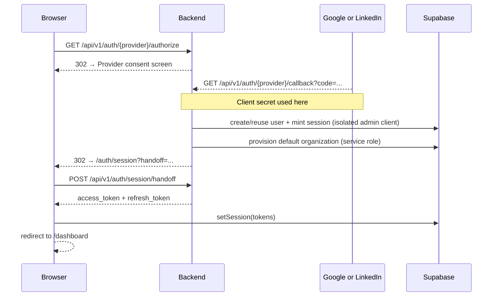

# Backend redirect OAuth sign-in

Both Google and LinkedIn use the same **full-window redirect** flow. There are
no popups and no Supabase-hosted OAuth redirects.

## Flow (Google and LinkedIn)



1. Sign-in buttons link to `{API_BASE_URL}/api/v1/auth/google/authorize` or
   `{API_BASE_URL}/api/v1/auth/linkedin/authorize`.
2. The backend redirects to the provider, then handles the callback on
   `{API_BASE_URL}/api/v1/auth/{provider}/callback`.
3. After OAuth completes, the backend mints a Supabase session using an
   **isolated** admin client (so the shared service-role client is never
   downgraded to a user JWT for database writes).
4. The backend provisions a default organization when the user has none.
5. The browser lands on `/auth/session?handoff=<signed-token>`; the page
   exchanges the handoff once via `POST /api/v1/auth/session/handoff`, calls
   `supabase.auth.setSession`, and redirects to `/dashboard`.

> **Why not URL hashes?** Browsers ignore fragments on HTTP 302 redirects, so
> `#access_token=...` never reaches the frontend after an OAuth callback.

## Redirect URIs to register

Register these **backend** callback URLs in each provider console (exact match
required):

| Provider | Local | Production |
|----------|-------|------------|
| Google | `http://localhost:8000/api/v1/auth/google/callback` | `https://api.247ai.live/api/v1/auth/google/callback` |
| LinkedIn | `http://localhost:8000/api/v1/auth/linkedin/callback` | `https://api.247ai.live/api/v1/auth/linkedin/callback` |

Remove legacy frontend callback URLs such as
`http://localhost:3000/auth/linkedin/callback` unless you still need them for
an old deployment.

## Environment variables

Selected root environment file (Docker Compose): use `.env.local` for local
development, `.env.staging` for staging, or `.env.prod` for production.

```text
APP_BASE_URL=http://localhost:3000
API_BASE_URL=http://localhost:8000
NEXT_PUBLIC_API_URL=http://localhost:8000

SUPABASE_AUTH_EXTERNAL_GOOGLE_CLIENT_ID=...
SUPABASE_AUTH_EXTERNAL_GOOGLE_CLIENT_SECRET=...

SUPABASE_AUTH_EXTERNAL_LINKEDIN_OIDC_CLIENT_ID=...
SUPABASE_AUTH_EXTERNAL_LINKEDIN_OIDC_CLIENT_SECRET=...
LINKEDIN_OAUTH_SCOPES=openid profile email
```

Production: set `APP_BASE_URL` to the public frontend origin and `API_BASE_URL`
to the public backend origin (for example `https://www.247ai.live` and
`https://api.247ai.live`).

## Email/password signup (aligned backend path)

Email signup uses the same backend org provisioning as OAuth:

1. Browser calls `POST /api/v1/auth/signup`.
2. Backend creates the Supabase user, processes optional invitations, and calls
   `ensure_default_organization_for_user()`.
3. If Supabase **requires email confirmation** (no session returned), the API
   responds with `email_verification_required: true` and **no tokens** — the
   client must not sign the user in until they verify and sign in.
4. If confirmation is **disabled** locally, the API returns session tokens; the
   client calls `setSession` and redirects to `/dashboard`.
   - **Self-signup (no invite):** a normal org is provisioned (name-based slug) →
     `OrganizationCheck` sends **org admins** of unfinished orgs to `/onboarding`.
   - **Invited signup:** invitation is processed first so personal-org
     provisioning is skipped; the invitee lands on the dashboard with that org
     selected (soft welcome toast) and does **not** enter founder onboarding.

Google/LinkedIn OAuth uses the same invite-before-provision ordering inside
`OAuthSessionService.complete_oauth_sign_in()`. The session redirect includes
`organization_id` / `organization_name` when an invite was accepted so the
frontend selects the invited tenant as current.

## API routes

| Method | Path | Purpose |
|--------|------|---------|
| POST | `/api/v1/auth/signup` | Email signup + default org provisioning |
| GET | `/api/v1/auth/google/authorize` | Redirect to Google |
| GET | `/api/v1/auth/google/callback` | Complete Google OAuth |
| GET | `/api/v1/auth/linkedin/authorize` | Redirect to LinkedIn |
| GET | `/api/v1/auth/linkedin/callback` | Complete LinkedIn OAuth |
| POST | `/api/v1/auth/session/handoff` | Exchange one-time OAuth handoff token |

## Frontend handoff

`/auth/session` reads the signed `handoff` query parameter (from `window.location`
as well as Next.js search params), exchanges it once via
`POST /api/v1/auth/session/handoff`, calls `supabase.auth.setSession`, processes
optional `invitation_token` values, then navigates to `/dashboard` with a full-page
redirect.

Implementation notes:

- **No URL hash tokens** — browsers drop fragments on HTTP 302 redirects from OAuth
  callbacks.
- **Module-level handoff guard** — prevents React Strict Mode from running the
  exchange twice during development.
- **Session recovery** — if a session already exists (or was stored during a race),
  the page redirects to `/dashboard` instead of showing a false error.

## Related docs

- [OAuth setup](../../02_core_systems/oauth_setup.md)
- [Social OAuth architecture](social-oauth-architecture.md)
