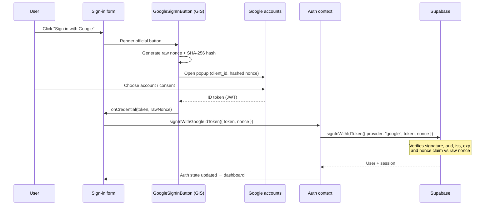

# Google Identity Services (GIS) sign-in

> **Status: legacy — not used for web sign-in**
>
> Google and LinkedIn now both use [Backend redirect OAuth](backend-redirect-oauth.md).
> Sign-in buttons link to `GET /api/v1/auth/google/authorize` instead of loading
> the GIS JavaScript SDK. This document is kept for historical context and security
> notes about the previous popup-based integration.

This document describes how Google web sign-in **was** implemented with GIS, what
**GIS** means, and a security review of that approach.

For a comparison with LinkedIn (including why LinkedIn needs a backend client secret but
Google does not), see [Social OAuth architecture](social-oauth-architecture.md).

## What is GIS?

**Google Identity Services (GIS)** is Google's current JavaScript library for web
authentication. It is loaded from:

```text
https://accounts.google.com/gsi/client
```

GIS provides:

- The **official branded** "Sign in with Google" button
- **Popup** or **One Tap** UX modes
- A JavaScript **callback** with a Google **ID token** (JWT)

It replaces older approaches (`gapi.auth2`, legacy Google Sign-In platform library) that
Google has deprecated.

GIS is **Google's recommended** integration for consumer web apps that need Google
sign-in without a full-page redirect.

## End-to-end flow



At no point does the main window navigate to a Supabase OAuth URL.

## Implementation map

| Layer | File | Responsibility |
| ----- | ---- | -------------- |
| UI button | `frontend/src/components/auth/google-sign-in-button.tsx` | Load GIS script, generate nonce, render button, receive ID token |
| Forms | `frontend/src/components/auth/signin-form.tsx`, `signup-form.tsx` | Wire `onCredential` → `signInWithGoogleIdToken` |
| Session | `frontend/src/contexts/auth-context.tsx` | Call `supabase.auth.signInWithIdToken`, process invitations |
| Supabase (local) | `supabase/config.toml` `[auth.external.google]` | Enable provider, client ID/secret, nonce validation |
| Telemetry | `frontend/src/lib/opentelemetry-helpers.ts` | Metrics/traces for `google_id_token_signin` |

## Nonce handling (security-critical)

Replay protection binds the ID token to this specific browser sign-in attempt:

1. Generate a cryptographically random **raw nonce** (32 bytes → hex string).
2. Compute **SHA-256(raw nonce)** and pass the hash to GIS as `nonce`.
3. Google embeds the hash in the ID token's `nonce` claim.
4. Pass the **raw nonce** to Supabase in `signInWithIdToken`.
5. Supabase verifies the token's `nonce` claim matches SHA-256(raw nonce).

This matches [Supabase's Google ID-token guidance](https://supabase.com/docs/guides/auth/social-login/auth-google)
and is covered by unit tests in `google-sign-in-button.test.tsx` (raw ≠ hashed).

Local Supabase keeps `skip_nonce_check = false` for Google in `supabase/config.toml`.

## Environment variables

```bash
# Frontend — public Web OAuth client ID (Authorized JavaScript origins in GCP)
NEXT_PUBLIC_GOOGLE_CLIENT_ID=your-client-id.apps.googleusercontent.com

# Supabase — same client ID + secret for ID token validation
SUPABASE_AUTH_EXTERNAL_GOOGLE_CLIENT_ID=your-client-id.apps.googleusercontent.com
SUPABASE_AUTH_EXTERNAL_GOOGLE_CLIENT_SECRET=your-client-secret
```

After changing values, restart local Supabase and the dev stack:

```bash
supabase stop && supabase start
./start.sh restart dev
```

GCP **Authorized JavaScript origins** must include every app origin (e.g.
`http://localhost:3000`, production domain). Redirect URIs for Supabase callback can
remain registered for any legacy/tool flows but are not used by GIS sign-in.

## Security review (current implementation)

### Recommended and secure ✅

| Practice | Status | Notes |
| -------- | ------ | ----- |
| Official GIS library + branded button | ✅ | Reduces phishing risk vs custom buttons |
| Popup UX (`ux_mode: "popup"`) | ✅ | User stays on app domain |
| Nonce generation via Web Crypto | ✅ | `crypto.getRandomValues` + `subtle.digest` |
| Raw vs hashed nonce split | ✅ | Correct Supabase + Google contract |
| Client secret only in Supabase | ✅ | Never in frontend or backend auth code |
| `skip_nonce_check = false` (Google) | ✅ | Nonce validated server-side |
| FedCM flag (`use_fedcm_for_prompt: true`) | ✅ | Aligns with browser privacy direction |
| GIS cleanup on unmount | ✅ | `cancel()` + `replaceChildren()` |
| No `signInWithOAuth("google")` for web | ✅ | Avoids Supabase OAuth UI |
| Unit tests for failure paths | ✅ | Missing credential, script load error, nonce |

### Not issues (by design)

- **No backend route for Google sign-in** — GIS returns the ID token in the browser; a
  backend code exchange would add complexity without benefit for this provider.
- **Client ID is public** — OAuth Web client IDs are designed to be embedded in frontend
  code; security relies on origin restrictions in GCP + short-lived ID tokens + nonce.
- **No One Tap** — We use the button only. One Tap could be added later for returning
  users; it is optional and has different UX/consent implications.

### Optional future improvements (not required)

These are enhancements, not fixes for incorrect behavior:

1. **Content-Security-Policy documentation** — If a strict CSP is added, allow
   `script-src https://accounts.google.com` and frames as required by GIS.
2. **One Tap** — Optional secondary entry point for returning users (`prompt` API).
3. **`login_hint`** — Pre-fill email when deep-linking from an invitation email.
4. **`hosted_domain`** — Only if the product ever restricts sign-in to a Google Workspace
   domain.

## Troubleshooting

| Symptom | Likely cause |
| ------- | ------------- |
| "Google sign-in is not configured" | `NEXT_PUBLIC_GOOGLE_CLIENT_ID` missing in frontend env |
| "no registered origin" (Google error 401) | Origin not in GCP Authorized JavaScript origins |
| "Provider … is not enabled" | Google provider disabled in Supabase or missing `config.toml` block |
| Nonce / invalid token errors | Mismatch between hashed nonce sent to Google and raw nonce sent to Supabase |
| Button does not render | GIS script blocked (network, CSP, or ad blocker) |

## Related documentation

- [Social OAuth architecture](social-oauth-architecture.md) — Google vs LinkedIn comparison
- [OAuth provider setup](../../02_core_systems/oauth_setup.md) — GCP and Supabase dashboard steps
- [Direct LinkedIn OIDC sign-in](linkedin-direct-oidc.md) — LinkedIn counterpart
