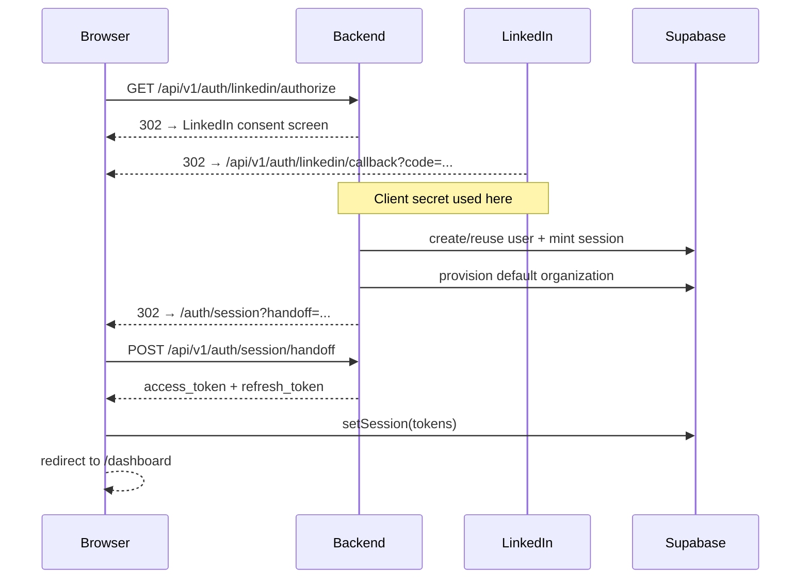

# LinkedIn sign-in (backend redirect)

> **Canonical doc:** [Backend redirect OAuth](backend-redirect-oauth.md) covers the
> shared Google + LinkedIn flow, handoff tokens, and redirect URIs.

LinkedIn sign-in uses a **full-window backend redirect**. The browser never opens
a popup, never hits a frontend OAuth callback, and never navigates through
Supabase's hosted OAuth URL.

## Flow



1. Sign-in buttons link to `GET /api/v1/auth/linkedin/authorize`.
2. The backend creates signed OAuth `state` and redirects to LinkedIn.
3. LinkedIn returns to `{API_BASE_URL}/api/v1/auth/linkedin/callback`.
4. The backend exchanges the code with LinkedIn using the confidential client
   secret, verifies email claims, mints a Supabase session, and provisions a
   default organization when needed.
5. The backend redirects to `/auth/session?handoff=<signed-jwt>`.
6. The frontend exchanges the handoff once and calls `setSession`.

## LinkedIn application settings

In the LinkedIn Developer Portal, enable **Sign In with LinkedIn using
OpenID Connect** and request these scopes:

```text
openid profile email
```

Register the **backend** callback URL (exact match required):

| Environment | Redirect URI |
|-------------|--------------|
| Local | `http://localhost:8000/api/v1/auth/linkedin/callback` |
| Production | `https://api.247ai.live/api/v1/auth/linkedin/callback` |

Do **not** register `http://localhost:3000/auth/linkedin/callback` for the
current sign-in flow. That URL was used by the legacy popup integration.

## Environment variables

Selected root environment file (Docker Compose): use `.env.local` for local
development, `.env.staging` for staging, or `.env.prod` for production.

```text
APP_BASE_URL=http://localhost:3000
API_BASE_URL=http://localhost:8000
NEXT_PUBLIC_API_URL=http://localhost:8000

SUPABASE_AUTH_EXTERNAL_LINKEDIN_OIDC_CLIENT_ID=...
SUPABASE_AUTH_EXTERNAL_LINKEDIN_OIDC_CLIENT_SECRET=...
LINKEDIN_OAUTH_SCOPES=openid profile email
JWT_SECRET_KEY=...
SUPABASE_URL=...
SUPABASE_SERVICE_KEY=...
```

Legacy aliases `LINKEDIN_CLIENT_ID` / `LINKEDIN_CLIENT_SECRET` are also
accepted by the backend settings layer.

After updating the selected environment file, restart the dev stack:

```bash
./start.sh restart dev
```

## Security notes

- The LinkedIn client secret is exchanged only by the backend.
- Signed OAuth `state` is validated before any LinkedIn network request.
- Session tokens are delivered via a short-lived handoff JWT (not URL hashes).
- Session tokens are never written to telemetry attributes or logs.
- Do not replace this flow with Supabase-hosted OAuth; that reintroduces
  Supabase's authorization UI.

## Legacy popup flow

The following remain in the codebase for tests and backward compatibility but
are **not** wired to the sign-in UI:

- `frontend/src/app/auth/linkedin/callback/page.tsx`
- `POST /api/v1/auth/linkedin/exchange`

## Related documentation

- [Backend redirect OAuth](backend-redirect-oauth.md)
- [Social OAuth architecture](social-oauth-architecture.md)
- [Environment configuration](../../05_operations/environment_configuration.md)
