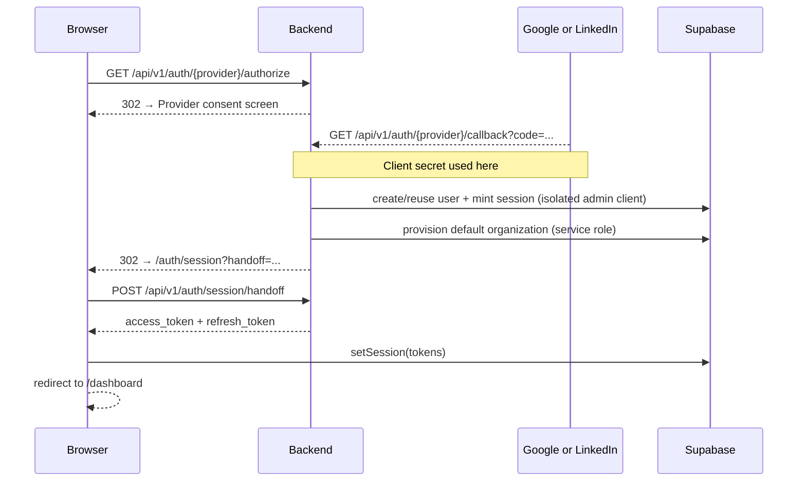

# Social OAuth architecture (Google and LinkedIn)

Both Google and LinkedIn web sign-in use the same **backend redirect** pattern.
There are no popups, no Google Identity Services (GIS) SDK, and no
Supabase-hosted OAuth redirects.

See [Backend redirect OAuth](backend-redirect-oauth.md) for the canonical flow,
environment variables, and redirect URIs.

## Design goals

| Goal | How we achieve it |
| ---- | ----------------- |
| Same UX on mobile and desktop | Full-window redirect (no popups) |
| Branded provider consent | Official Google / LinkedIn OAuth screens |
| Client secret never in the browser | Secrets stay in backend env only |
| Supabase session at the end | Backend mints session; frontend stores via handoff |
| Default organization on first sign-in | Service-role provisioning after OAuth |

## Unified flow (Google and LinkedIn)



## Where credentials live

| Credential | Exposed to browser? | Used by | Required? |
| ---------- | ------------------- | ------- | --------- |
| Google client ID | No | Backend OAuth + Supabase admin | Yes |
| Google client secret | No | Backend OAuth (code exchange) | Yes |
| LinkedIn client ID | No | Backend OAuth + Supabase admin | Yes |
| LinkedIn client secret | No | Backend OAuth (code exchange) | Yes |
| `JWT_SECRET_KEY` | No | Backend (handoff token signing) | Yes |
| `API_BASE_URL` | Yes (authorize links) | Frontend `OAuthRedirectButton` | Yes |
| `APP_BASE_URL` | No | Backend (post-OAuth redirect) | Yes |

The frontend only links to `{NEXT_PUBLIC_API_URL}/api/v1/auth/{provider}/authorize`.
It never sees provider client secrets.

## Provider differences

| Aspect | Google | LinkedIn |
| ------ | ------ | -------- |
| Backend authorize route | `/api/v1/auth/google/authorize` | `/api/v1/auth/linkedin/authorize` |
| Backend callback route | `/api/v1/auth/google/callback` | `/api/v1/auth/linkedin/callback` |
| OAuth grant | Authorization code | Authorization code (OIDC) |
| Scopes | `openid email profile` | `openid profile email` |
| Redirect URI to register | `{API_BASE_URL}/api/v1/auth/google/callback` | `{API_BASE_URL}/api/v1/auth/linkedin/callback` |

After the provider callback, both paths converge on `OAuthSessionService` for
session minting and `ensure_default_organization_for_user()` for org provisioning.

## Key frontend files

| File | Role |
| ---- | ---- |
| `oauth-redirect-button.tsx` | Links to backend authorize URLs |
| `app/auth/session/page.client.tsx` | Handoff exchange + `setSession` + dashboard redirect |
| `services/oauth-session-service.ts` | `POST /api/v1/auth/session/handoff` client |

## Key backend files

| File | Role |
| ---- | ---- |
| `google_oauth.py` / `linkedin_oauth.py` | Provider-specific code exchange |
| `oauth_session.py` | Isolated Supabase admin client for session minting |
| `oauth_handoff.py` | Short-lived signed handoff JWT (query param delivery) |
| `oauth_redirect.py` | Builds `/auth/session?handoff=...` redirect URLs |
| `organization/provisioning.py` | Default org creation (service role) |

## Legacy approaches (removed from sign-in UI)

These are **not** used for web sign-in anymore:

- **Google Identity Services (GIS) popup** — see
  [Google Identity Services sign-in](google-identity-services.md) (historical)
- **LinkedIn popup + frontend callback** — `/auth/linkedin/callback` and
  `POST /api/v1/auth/linkedin/exchange` remain for tests/compat but sign-in
  buttons use backend redirect
- **Supabase `signInWithOAuth`** — exposes Supabase-hosted OAuth UI

## What we deliberately avoid

```typescript
// Do NOT use for web sign-in — exposes Supabase OAuth UI
await supabase.auth.signInWithOAuth({ provider: "google" });
await supabase.auth.signInWithOAuth({ provider: "linkedin" });
```

## Related documentation

- [Backend redirect OAuth](backend-redirect-oauth.md) — setup and API routes
- [OAuth provider setup (GCP / LinkedIn)](../../02_core_systems/oauth_setup.md)
- [Environment configuration](../../05_operations/environment_configuration.md)
