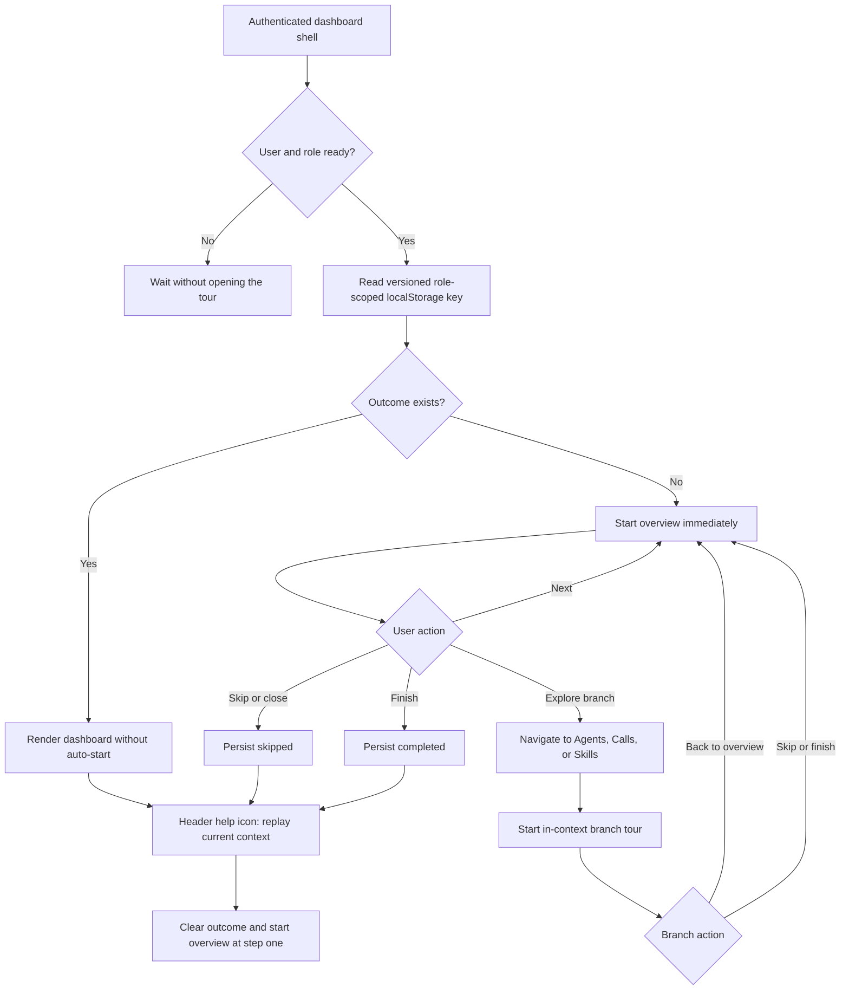

# Role-aware product walkthrough

The product walkthrough is a post-login tour of the dashboard shell. It is
separate from `/onboarding`, which is the founder flow for creating and
configuring an organization.

## Goals

- Start automatically for a user/role combination with no saved outcome.
- Explain the capabilities visible to the current role.
- Let the user skip the tour at any point.
- Let the user replay it from the help icon in the dashboard header.
- Start immediately without requiring a beacon click.
- Let users open focused in-context tours inside Agents, Calls, and Skills.
- Let users return from any branch to the overview tour.
- Keep steps as ordered data so new steps can be inserted without changing the
  tour renderer.

## Role coverage

| Effective role | Walkthrough coverage |
| --- | --- |
| Regular user (`member`) | Workspace, organization switcher, agents, phone numbers, skills, calls, and account menu |
| Organization admin (`org_admin`) | Regular-user coverage plus members, billing, and organization management |
| Platform user (`platform_admin`) | Organization-admin coverage plus organizations, all users, platform skills, platform tools, voice presets, notifications, phone-number settings, and plan catalog |

The effective role is resolved from the existing permission facade. Platform
admins inherit organization-admin steps because the dashboard already treats
them as having both capabilities.

## Runtime flow

## Implementation

- Step definitions: `frontend/src/lib/product-tour.ts`
- Tour provider and Joyride lifecycle: `frontend/src/components/product-tour/product-tour-provider.tsx`
- Dashboard integration and stable DOM anchors: `frontend/src/components/layout/dashboard-layout.tsx`, `frontend/src/components/layout/nav-config.ts`, `frontend/src/app/(dashboard)/agents/page.tsx`, `frontend/src/app/(dashboard)/agents/[agentId]/page.tsx`, `frontend/src/app/(dashboard)/calls/page.tsx`, `frontend/src/components/skills/skill-editor.tsx`
- Replay action: `frontend/src/components/layout/dashboard-layout.tsx`
- Library: [`react-joyride`](https://react-joyride.com/), selected for its React 19 support, lifecycle events, async target handling, keyboard/focus behavior, and custom tooltip support. The provider disables the beacon and starts the tour explicitly once the first target is available.

## Overview and branch tours

The overview is intentionally limited to the dashboard-level information
architecture. Agents, Calls, and Skills each have a focused branch that
navigates to the real route and highlights the controls inside that view. A
short Agent Settings orientation tour starts on the first visit to an agent's
detail page; the existing agent creation widget remains the creation guide.
The branch action is optional, and its steps are filtered by the user's
effective role so members are not shown admin-only controls. The first visit
to a contextual page auto-starts its branch once, while the header help icon
can replay the current page's branch at any time. Branches opened from the
overview can return to it; contextual branches stay on the current page after
finishing or skipping.

To add a new branch, define its ordered steps and route in
`frontend/src/lib/product-tour.ts`, add stable `data-tour` anchors to the
target view, and expose the branch from an overview step. The provider waits
for the route and target to render before starting Joyride, so route changes do
not produce a blank or beacon-only tour. The custom tooltip uses the
application's popover, border, foreground, accent, and primary theme tokens,
so the walkthrough follows light and dark mode.

Step selectors use `data-tour` attributes rather than visual class names. When
adding a step, add its ordered definition and stable anchor together, then add
or update the role-matrix test in
`frontend/src/lib/__tests__/product-tour.test.ts`.

Tour outcomes are currently stored in browser localStorage and scoped by tour
version, effective role, and user ID. This keeps the first iteration client
only; backend-backed preferences should replace it when cross-device onboarding
state becomes a product requirement.
