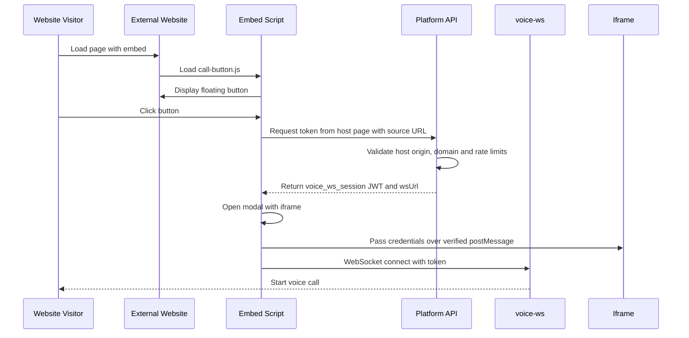

# Embed Call Button Feature

## Overview

The Embed Call Button feature allows users to add a customizable voice call button to any external website. Visitors can click the button to start a real-time voice conversation with an AI agent over a **Pipecat WebSocket** session, without leaving the website.

## Key Features

- **Customizable Appearance**: Button text, colors, size, position, and style
- **One-Click Embed**: Copy-paste ready embed code
- **Secure Access**: Time-limited tokens with optional host-domain validation
- **Call Traceability**: Captures the host page URL and source domain in call logs
- **Rate Limiting**: Configurable daily call limits
- **Real-Time Calls**: WebSocket-based voice conversations (Pipecat + `@pipecat-ai/client-js`)

## Getting Started

### 1. Configure the Embed Button

Navigate to your agent's detail page and click the "Embed Button" button to open the configuration panel.

### 2. Customize Appearance

Configure the following settings:

| Setting | Description | Default |
|---------|-------------|---------|
| Button Text | Text displayed on the button | "Call Us" |
| Primary Color | Button background/border color | #3b82f6 |
| Text Color | Button text color | #ffffff |
| Border Radius | Corner roundness (0-50px) | 8 |
| Button Size | small, medium, or large | medium |
| Position | Location on the page | bottom-right |
| Button Style | filled or outline | filled |

### 3. Set Security Options

- **Allowed Domains**: Restrict which domains can use the embed (optional). Leave empty for an open embed; enter one or more hostnames to restrict it. In the dashboard, press Space, comma, or Enter after each hostname to create a removable pill.
- **Daily Call Limit**: Maximum calls per day from this embed (default: 100)
- **Enable/Disable**: Toggle the embed on/off

### 4. Copy the Embed Code

After saving, copy the generated embed code and paste it into your website's HTML, just before the closing `</body>` tag.

## Embed Code Structure

```html
<!-- AI Voice Agent Call Button -->
<script
  src="https://your-platform.com/embed/call-button.js"
  data-agent-id="your-agent-id"
  data-api-url="https://api.your-platform.com"
  data-button-text="Call Us"
  data-button-color="#3b82f6"
  data-button-text-color="#ffffff"
  data-button-border-radius="8"
  data-button-size="medium"
  data-button-position="bottom-right"
  data-button-style="filled"
></script>
```

The generated `data-api-url` is a static API endpoint, not a configuration
lookup. It is included because the frontend that serves the public embed script
and the backend that issues voice tokens may use different origins. In a
same-origin deployment, it can point to the platform origin. Public embed
endpoints support cross-origin browser requests, while the token endpoint still
checks the request origin against the configured allowed domains before issuing
a voice token; other API routes keep the normal application CORS policy.

## User Flow



## Security

### Token-Based Access

- Tokens are generated on-demand when a visitor clicks the button
- Tokens expire after 1 hour
- Each token is scoped to a specific agent and session (`voice_ws_session` JWT)

### Domain Validation

When allowed domains are configured:
- The embed script requests its token from the top-level host page, not from the platform iframe.
- The browser `Origin` is used for authorization; `Referer` is the fallback when a browser omits `Origin`.
- Requests from unauthorized domains are rejected before a voice token is issued.
- Subdomains of allowed domains are permitted.
- The iframe URL alone cannot bypass the configured allowlist.

The host page URL is sent with the token request for traceability. The server
stores only an HTTP(S) URL with query parameters and fragments removed, along
with its canonical hostname, in the unified call log.

### Rate Limiting

- Daily call limits prevent abuse
- Limits are tracked per embed configuration
- When exceeded, visitors see a friendly error message

## API Endpoints

### Public Endpoints (No Authentication)

| Endpoint | Method | Description |
|----------|--------|-------------|
| `/api/v1/embed/agent/{id}/info` | GET | Get public agent info |
| `/api/v1/embed/agent/{id}/token?source_url=...` | POST | Validate the host page and generate an embed token |

### Authenticated Endpoints

| Endpoint | Method | Description |
|----------|--------|-------------|
| `/api/v1/agents/{id}/embed-config` | GET | Get embed configuration |
| `/api/v1/agents/{id}/embed-config` | POST | Create/update configuration |
| `/api/v1/agents/{id}/embed-config` | DELETE | Delete configuration |

## Configuration Reference

### EmbedConfigCreate

```typescript
interface EmbedConfigCreate {
  buttonText: string;           // Button label
  buttonColor: string;          // Hex color (e.g., "#3b82f6")
  buttonTextColor: string;      // Hex color for text
  buttonBorderRadius: number;   // 0-50 pixels
  buttonSize: 'small' | 'medium' | 'large';
  buttonPosition: 'bottom-right' | 'bottom-left' | 'bottom-center' | 
                  'top-right' | 'top-left' | 'top-center' | 'center';
  buttonStyle?: 'filled' | 'outline';
  allowedDomains?: string[];    // Optional canonical domain restrictions; empty = all
  customCss?: string;           // Optional custom CSS
  isActive: boolean;            // Enable/disable
  dailyCallLimit: number;       // Max calls per day
}
```

## Updating Embed Code

When you update your embed configuration:

1. The platform shows a warning to copy the new embed code
2. Replace the old script tag on your website with the new one
3. Changes take effect immediately after the page refresh

**Note**: The embed code does NOT automatically update on external websites. You must manually update the code when configuration changes.

## Troubleshooting

### Button Not Appearing

- Verify the script URL is accessible
- Check browser console for errors
- Ensure `data-agent-id` is correct
- Ensure `data-api-url` points to the backend API, not only the frontend host

### Call Not Connecting

- Verify the agent is active
- Check if daily limit is exceeded
- Ensure domain is in allowed list (if configured)

### Domain Validation Failing

- Add your domain to the allowed domains list
- Use a hostname or HTTP(S) origin, for example `example.com`
- `www.example.com` is canonicalized to `example.com`
- Subdomains are automatically allowed when the parent domain is listed
- Ensure the call button script is installed on the allowed host page; opening the platform iframe URL directly is not an allowed-origin request

## Related Documentation

- [Voice Agents Overview](./overview.md)
- [Implementation Plan](../../03_implementation/EMBED_CALL_BUTTON_PLAN.md)
- [Testing Guide](../../04_development_guides/testing.md)
