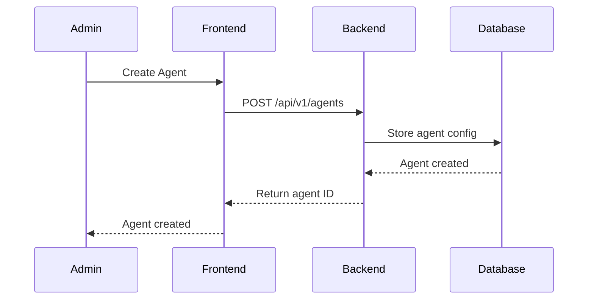
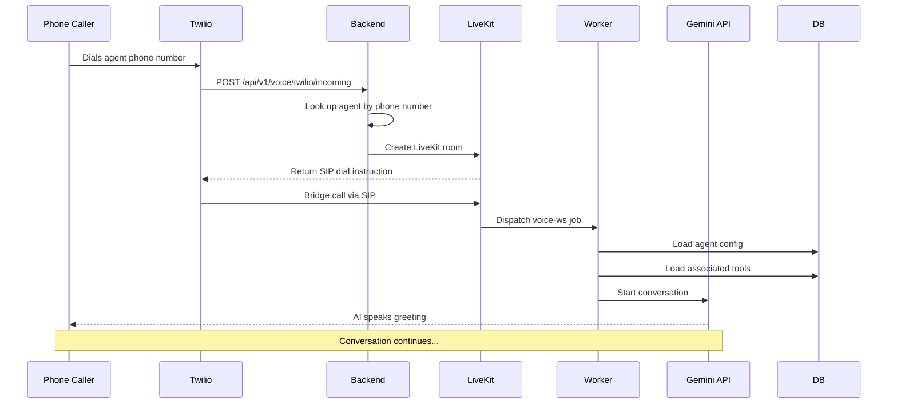
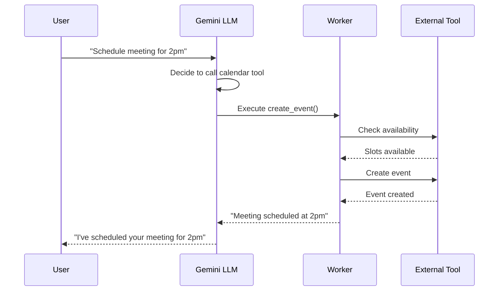
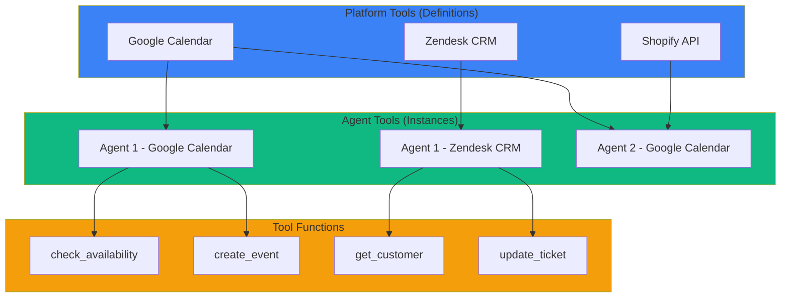
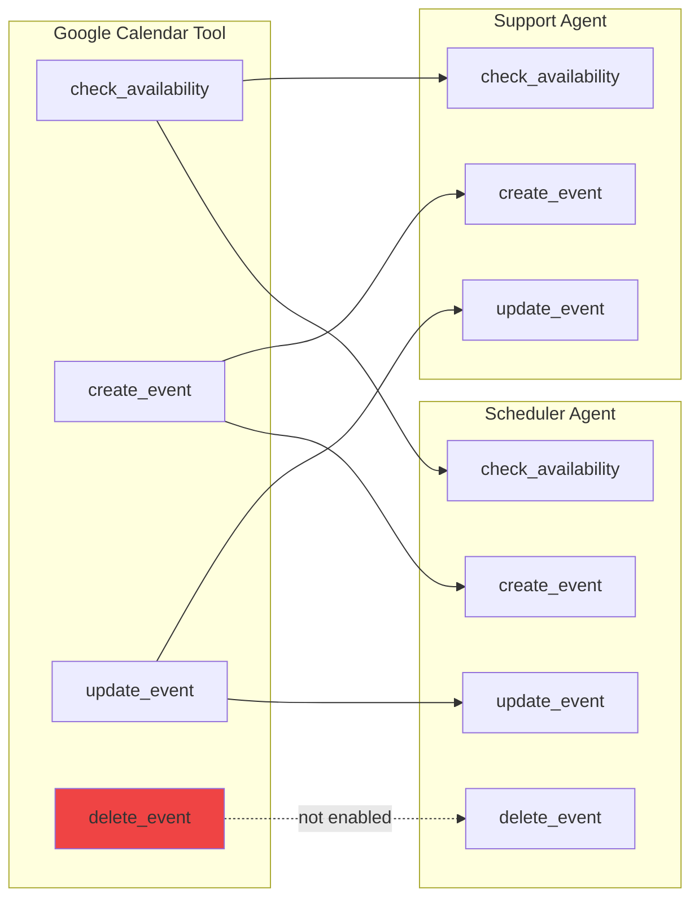
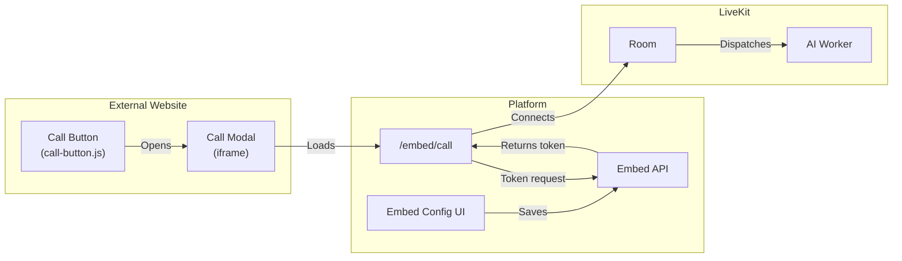

# Voice Agents Feature

> **Current runtime note:** The supported implementation uses the `voice-ws`
> Pipecat WebSocket runtime (`/ws` for browser calls and `/twilio` for Twilio
> Media Streams). The room/SIP and `worker/` examples that remain later in this
> historical feature document are retained for context only; use the [current
> system architecture](../../01_architecture/system_architecture.md) and the
> [`voice-ws` README](../../../voice-ws/README.md) for implementation and
> deployment guidance.

## Overview

Voice agents are AI-powered assistants that handle real-time voice conversations
through Pipecat and Large Language Models (LLMs). Agents can be configured with
custom system prompts and integrated with external tools to perform actions like
scheduling appointments, looking up customer information, or processing orders.

## What Makes It Work

### Core Components

1. **AI Model**: Google Gemini Realtime API for voice understanding and generation
2. **Real-Time Communication**: Pipecat WebSocket transports for low-latency audio streaming
3. **Tool System**: Dynamic tool loading for external integrations
4. **Agent Configuration**: Per-agent system prompts and settings
5. **Session Management**: Call handling and state tracking

### Key Capabilities

- ✅ **Real-time voice conversations** with natural language understanding
- ✅ **Dynamic tool integration** - connect to external APIs and services
- ✅ **Custom system prompts** - define agent personality and behavior
- ✅ **Multi-agent support** - create different agents for different use cases
- ✅ **Phone number binding** - each agent can have dedicated phone number
- ✅ **Function-level tool control** - enable/disable specific tool functions per agent, with an All functions toggle for bulk changes
- ✅ **OAuth integration** - secure authentication with external services (Google Calendar, etc.)
- ✅ **Agent greeting** - personalized greeting when agent enters conversation
- ✅ **Embed call button** - add voice calling to any external website
- ✅ **Public organization showcase** - publish selected active agents at `/o/{slug}`
- ✅ **Platform demo agents** - expose credit-exempt demos at `/demo/{demo_slug}`

## Architecture

```mermaid
graph TB
    subgraph UserLayer["User Layer"]
        Caller[Phone Caller]
        Dashboard[Admin Dashboard]
    end

    subgraph Platform["Platform Services"]
        Backend[Backend API]
        Worker[voice-ws]
        LLM[Gemini Realtime API]
        DB[(Supabase Database)]
    end

    subgraph External["External Services"]
        Twilio[Twilio]
        LiveKit[voice-ws (Pipecat)]
        Calendar[Google Calendar]
        CRM[CRM/API]
        Billing[Billing API]
    end

    Caller --> Twilio
    Twilio --> Backend
    Dashboard --> Backend
    Backend --> DB
    Backend --> LiveKit
    LiveKit --> Worker
    voice-ws --> LLM
    voice-ws --> DB

    voice-ws --> Calendar
    voice-ws --> CRM
    voice-ws --> Billing

    style Caller fill:#3b82f6
    style voice-ws fill:#ef4444
    style LLM fill:#f59e0b
    style DB fill:#10b981
```

## Voice Agent Lifecycle

### 1. Agent Creation

Admin user creates a voice agent through dashboard:



**Agent Configuration**:

- Name and description
- Organization assignment
- System prompt (personality, behavior)
- Phone number (optional)
- Tool associations
- Active/inactive status

### 2. Incoming Call Flow



**Key Steps**:

1. Caller dials Twilio phone number
2. Twilio webhook hits backend
3. Backend validates agent and creates LiveKit room
4. Twilio bridges call to LiveKit SIP trunk
5. LiveKit dispatches job to worker
6. voice-ws loads agent configuration and tools
7. voice-ws starts AI conversation with greeting
8. Call proceeds with real-time voice interaction

### 3. Tool Execution During Call



## Dashboard Organization Scope

The dashboard's `/agents` page follows the organization selected in the left
navigation switcher:

- Organization users load agents through the organization-scoped API and see
  only agents belonging to the active organization.
- The organization selector is hidden for organization users because changing
  scope is handled by the shared organization switcher.
- Platform admins retain the cross-organization list and organization filter.
- Agent configuration is kept while switching Persona, Skills, Tools, and
  Settings tabs. Editors use the page-level **Save Changes** action below the
  tabs; tool and skill attachment actions continue to save independently.

The organization-scoped API remains the authorization boundary. The frontend
also filters the returned list defensively so stale data cannot appear under a
different active organization.

## Public organization and demo pages

Public surfaces are documented in [Public Organization and Demo Agent Pages](./public_agent_pages.md).
An organization can publish individual active agents on `/o/{slug}` and may
protect that list with a passphrase. Platform admins can separately mark an
active agent as a demo, assign a unique slug, provide visitor-facing copy, and
set a remaining-call budget plus a per-call duration cap for `/demo/{demo_slug}`.
Use `-1` for either limit to make that dimension unlimited; setting remaining
calls to `0` disables new demo calls. Demo calls bypass credit/concurrency
admission and final voice-minute billing, while regular public organization
calls use normal entitlements.

## Tool System

### What Are Tools?

Tools are modular components that enable agents to perform actions:

- **Google Calendar**: Check availability, create events, update events, delete events
- **Gmail**: Read latest emails, get unread emails, get starred emails, search emails, manage labels, draft emails
- **CRM Integration**: Look up customer data, update records
- **E-commerce**: Check order status, process returns
- **Custom APIs**: Any HTTP endpoint you define

### Tool Architecture



### Tool Levels

1. **Platform Tool**: Tool definition available to all organizations

   - Name, description, configuration schema
   - Function definitions with parameters
   - OAuth requirements (if any)

2. **Agent Tool**: Instance of tool for specific agent

   - Per-agent configuration (e.g., calendar_id = "primary")
   - OAuth tokens (encrypted)
   - Function enable/disable flags
   - Active/inactive status

3. **Tool Function**: Individual callable method
   - Parameters and types
   - Description for LLM
   - Can be enabled/disabled per agent

### Two-Tier Tool Service

Different data for different security needs:

**API Layer (Frontend/Backend)**:

```python
# Returns safe metadata - NO secrets
tools = await tool_service.get_tools_by_organization(org_id, safe=True)
# Response: {name, description, config_schema, functions}
# Does NOT include: OAuth tokens, API keys
```

**voice-ws Layer (Execution)**:

```python
# Returns full tool instance WITH secrets
tool_instance = await tool_service.get_tool_instance(tool_id, org_id)
# Returns: Instantiated tool with:
# - config (calendar_id, etc.)
# - sensitive_config (access_token, refresh_token, etc.)
# - All methods callable by LLM
```

### Creating a New Tool

1. **Define Tool Class**:

   ```python
   from shared.voice_agents.tools.base.base_tool import BaseTool
   from livekit.agents import function_tool, RunContext

   class MyTool(BaseTool):
       @property
       def metadata(self):
           return ToolMetadata(
               name="MyTool",
               description="My tool description",
               requires_auth=True,
               auth_type="oauth2"
           )

        # Methods with RunContext parameter are considered as tools / functions for LLM Model
       async def my_action(
           self,
           context: RunContext,
           param1: str,
           optional_param: str | None = None
       ) -> dict:
           """Action description for LLM."""
           # Implementation
           return {"result": "..."}
   ```

2. **Place in Directory**: `shared/voice_agents/tools/implementations/`

3. **Auto-Registered**: voice-ws discovers tool automatically

4. **Sync to Database**: Backend startup syncs tool metadata to database

See [Tool System Documentation](tool_system.md) for detailed guide.

## LiveKit Tool Wrapping

### The Challenge

Tool methods have `self` parameter for instance state:

```python
async def check_availability(
    self,  # ❌ Can't pass to LiveKit
    context: RunContext,
    start_time: str
) -> dict:
    pass
```

LiveKit's `@function_tool` decorator cannot accept methods with `self`.

### The Solution

Create dynamic wrapper functions with exact same signature (excluding `self`):

```python
async def check_availability(
    context: RunContext,
    start_time: str
) -> dict:
    """Wrapper for check_availability."""
    kwargs = {'start_time': start_time}
    return await bound_method(context=context, **kwargs)
```

### Benefits

- ✅ Works with any tool method signature
- ✅ Preserves type hints for LLM schema
- ✅ Delegates to bound method with all parameters
- ✅ Generic and maintainable

See [Dynamic Tool Architecture](03_implementation/dynamic_tool_architecture.md) for implementation details.

## Voice Preset Catalog

Platform admins manage reusable voice profiles at `/platform/presets`. Each
catalog row can be edited, published, unpublished, deleted when unused, or
copied. Copy opens the same right-side author drawer in create mode with the
source description and validated voice configuration prefilled. The new preset
starts as a draft and receives a collision-safe name such as `Copy of Support
Voice` or `Copy of Support Voice (2)`; the source preset is never modified.

## Function-Level Control

### Enable/Disable Functions Per Agent

Each agent can have different functions enabled:



**Support Agent**: Can only check and create events (no deletions)
**Scheduler Agent**: Has full calendar management capabilities

### Implementation

Database stores `unselected_functions` array:

```sql
agent_tools.unselected_functions = ['delete_event']
```

voice-ws filters functions:

```python
if func_name in unselected_functions:
    continue  # Skip this function
```

Frontend UI shows switches per function for easy toggling, plus an All functions
switch for large tool catalogs. Platform admins can inspect the
same function name, description, and parameter schema in the Platform Tools
catalog drawer for both native and MCP tools.

## Agent Greeting

### Automatic Greeting

Agents automatically greet users when entering room:

```python
class DynamicAgent(Agent):
    async def on_enter(self):
        """Agent greeting when entering room."""
        agent_name = self.session.userdata.get('agent_name', 'Assistant')
        await self.session.say(
            f"Hello, this is {agent_name}. How can I help you today?",
            allow_interruption=False
        )
```

### Benefits

- ✅ Eliminates awkward silence after connection
- ✅ Personalized with agent name
- ✅ Sets clear user expectation
- ✅ Improves user experience
- ✅ Configurable per agent

## Embed Call Button

### What Is It?

The embed call button allows you to add a customizable voice call button to any external website. Visitors can click the button to start a real-time voice conversation with your agent directly from your website.

### How It Works

1. **Configure**: Customize button appearance (colors, text, size, position)
2. **Generate**: Get copy-paste ready embed code
3. **Embed**: Paste the code into your website's HTML
4. **Connect**: Visitors click to start voice calls via WebRTC

### Key Features

- **Customizable Appearance**: Button text, colors, size, position, and style (filled/outline)
- **Secure Access**: Time-limited tokens with optional domain validation
- **Rate Limiting**: Configurable daily call limits to prevent abuse
- **Real-Time Calls**: WebRTC-based voice conversations with AI agent

### Architecture



### Security

- Tokens expire after 1 hour
- Optional domain allowlist for restrictions
- Daily call limits prevent abuse
- No API keys exposed to browser

See [Embed Button Documentation](./embed_button.md) for detailed usage guide.

## Configuration

### Agent Configuration

**Fields**:

- `name`: Agent display name
- `organization_id`: Owner organization
- `system_prompt`: Personality and behavior instructions
- `phone_number`: Associated Twilio phone number (optional)
- `is_active`: Enable/disable agent

**Example System Prompt**:

```
You are a helpful customer support assistant for Acme Corp.
Be polite, professional, and empathetic.
Your role is to:
1. Understand customer issues
2. Look up order information
3. Provide helpful solutions
4. Escalate to human if needed

Always speak clearly and at a moderate pace.
```

### Tool Configuration

**Per-Agent Configuration**:

- Calendar ID (e.g., "primary", "work", "sales")
- API endpoints
- Authentication settings
- Function enable/disable flags

**OAuth Integration**:

- Admin clicks "Connect [Service Name]"
- Redirect to OAuth provider
- User authorizes access
- OAuth tokens stored encrypted in database
- voice-ws uses tokens for tool execution

## Available Tool Sets

### Google Calendar

**Functions**:
- `check_availability`: Check if time slots are free
- `create_event`: Create new calendar event
- `update_event`: Update existing event
- `delete_event`: Delete an event

**Authentication**: OAuth2

**Configuration**:
- `user_id`: Gmail address or "primary" (default)

**Use Cases**:
- Appointment scheduling
- Meeting coordination
- Availability checking

### Gmail

**Functions**:
- `get_latest_emails`: Get the latest emails from inbox
- `get_emails_from_user`: Get emails from a specific sender
- `get_unread_emails`: Get unread emails
- `get_starred_emails`: Get starred emails
- `get_emails_by_context`: Get emails matching search query
- `create_draft_email`: Create a new email draft
- `get_emails_by_label`: Get emails with a specific label
- `get_labels`: List all Gmail labels
- `apply_label`: Apply label to emails matching a query
- `remove_label`: Remove label from emails matching a query

**Authentication**: OAuth2

**Configuration**:
- `user_id`: Gmail address (used for API calls)

**Response Size Limits**:
- Default: 5 emails per operation
- Maximum: 10 emails per operation
- Email body truncated to 500 characters

**Use Cases**:
- Email management
- Customer inquiry handling
- Email search and filtering

### Future Tool Sets

Potential integrations:
- **CRM Systems**: Salesforce, HubSpot, Zendesk
- **E-commerce**: Shopify, WooCommerce, Magento
- **Communication**: Slack, Microsoft Teams, Discord
- **Custom APIs**: Any REST endpoint

## API Endpoints

### Agent Management

```
POST   /api/v1/agents                          Create agent
GET    /api/v1/agents/organization/{org_id}     List org agents
GET    /api/v1/agents/{agent_id}                Get agent details
PUT    /api/v1/agents/{agent_id}               Update agent
DELETE /api/v1/agents/{agent_id}               Delete agent
```

### Tool Management

```
POST   /api/v1/tools/platform                   Create platform tool (admin)
GET    /api/v1/tools/platform                  List platform tools
POST   /api/v1/tools/agent                    Configure tool for agent
GET    /api/v1/tools/agent/{agent_id}           Get agent tools
PUT    /api/v1/tools/agent/{agent_tool_id}      Update agent tool config
GET    /api/v1/tools/auth/{tool_name}           Start OAuth flow
GET    /api/v1/tools/callback                   Handle OAuth callback
```

### Voice Endpoints

```
POST   /api/v1/voice/twilio/incoming            Twilio webhook
```

## Use Cases

### Customer Support Agent

**Tools**:

- CRM integration (look up customer data)
- Order management API
- Knowledge base search
- Ticket creation

**System Prompt**: Focus on empathy, quick resolution, escalation when needed

**Phone Number**: Dedicated support line

### Appointment Scheduler

**Tools**:

- Google Calendar
- CRM integration (customer lookup)
- Email service (confirmation)

**System Prompt**: Focus on scheduling, confirmation, reminders

**Phone Number**: Booking line

### Lead Qualification Agent

**Tools**:

- CRM integration (create lead, update lead)
- Calendar integration (schedule demos)
- Sales routing

**System Prompt**: Focus on qualification criteria, routing to appropriate team

**Phone Number**: Inbound lead capture line

## Troubleshooting

### Agent Not Responding

**Check**:

1. voice-ws is running: `./start.sh logs voice-ws-dev`
2. LiveKit connection is healthy
3. Agent is marked `is_active: true`
4. Phone number is correctly configured

### Tools Not Working

**Check**:

1. Tool is enabled for agent
2. Required functions are enabled
3. OAuth tokens are valid (not expired)
4. Tool configuration is correct

### Greeting Not Playing

**Check**:

1. Agent has a name set
2. voice-ws is correctly loading greeting from database
3. LiveKit room is created successfully

### Tool Calls Failing

**Check**:

1. Tool function signature is correct
2. Optional parameters use `type | None = None` pattern
3. External service is accessible from worker
4. OAuth tokens are valid

## Related Documentation

- [Embed Call Button](embed_button.md) - Add voice calling to external websites
- [Tool System](tool_system.md) - Creating and managing tools
- [Dynamic Tool Architecture](03_implementation/dynamic_tool_architecture.md) - Implementation details
- [System Architecture](../../01_architecture/system_architecture.md) - Overall architecture
- [voice-ws README](../../../voice-ws/README.md) - voice-ws service details
- [Shared Module](../../shared/README.md) - Shared code architecture

## Next Steps

1. **Create Your First Agent**: Use dashboard to create an agent
2. **Add Tools**: Connect Google Calendar or custom API
3. **Test Agent**: Make test call to verify functionality
4. **Add to Website**: Generate embed code for your website
5. **Customize**: Adjust system prompt and tool configuration
6. **Deploy**: Connect phone number and go live

---

For detailed implementation guides, see the [Development Guides](../../03_development/).
