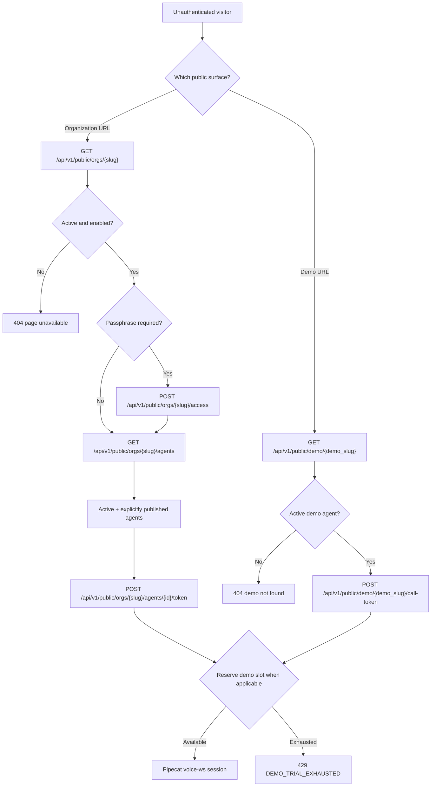

# Public Organization and Demo Agent Pages

## Overview

24x7 AI exposes two unauthenticated voice-agent surfaces:

- **Organization showcase**: `/o/{organization-slug}` lists agents that an
  organization explicitly publishes. An organization may optionally require a
  passphrase before visitors can see the list.
- **Demo showcase**: `/demo/{demo-slug}` exposes one active agent marked as a
  platform demo. Demo calls are intended for product showcasing and bypass
  voice credit and concurrency checks, while optional call-count and
  per-call-duration limits protect the public surface.

These are separate controls. Publishing an agent on an organization's page
does not make it a demo, and marking an agent as a demo does not require the
organization showcase to be enabled.

## Configuration and permissions

| Setting | Purpose | Who can change it | Public requirement |
| --- | --- | --- | --- |
| Organization `public_page_enabled` | Enables `/o/{slug}` | Organization admin or platform admin | Organization must be active and enabled |
| Agent `is_published_on_public_page` | Lists the agent on `/o/{slug}` | Organization admin or platform admin | Agent must also be active |
| Agent `is_demo` | Enables the dedicated demo surface and billing bypass | Platform admin only | Agent must have a unique `demo_slug` and be active |
| Agent `demo_slug` | Stable URL identifier for a demo | Platform admin only | Lowercase letters, numbers, and hyphens; unique across demo slugs |
| Agent `public_description` | Visitor-facing demo copy | Platform admin only | Optional; falls back to mission, then persona |
| Agent `demo_calls_remaining` | Number of trial call reservations left | Platform admin only | `0` disables new calls; positive values decrement at token issuance; `-1` is unlimited |
| Agent `demo_max_call_duration_seconds` | Maximum duration of each demo call | Platform admin only | Positive seconds cap the call; `-1` is unlimited; `0` is invalid |

Safety rules are enforced in both the dashboard and API layer:

- Deactivating an agent clears `is_published_on_public_page`.
- Turning off `is_demo` clears `demo_slug`.
- An organization admin cannot set demo status, a demo slug, or demo copy by
  sending a direct API request.
- An organization admin cannot change either demo budget. Platform admins can
  set a new positive count at any time to re-enable an exhausted demo, or use
  `-1` to remove the count limit. The duration setting also uses `-1` for no
  per-call cap.
- Public API responses contain only visitor-safe agent metadata.

## Visitor request flow



## API contract

### Organization showcase

| Method | Endpoint | Auth | Description |
| --- | --- | --- | --- |
| `GET` | `/api/v1/public/orgs/{slug}` | None | Returns safe organization metadata and `passphrase_required` |
| `POST` | `/api/v1/public/orgs/{slug}/access` | None | Verifies the passphrase and returns a short-lived access token |
| `GET` | `/api/v1/public/orgs/{slug}/agents` | Optional `X-Public-Access-Token` | Lists active, explicitly published agents |
| `POST` | `/api/v1/public/orgs/{slug}/agents/{agent_id}/token` | Optional `X-Public-Access-Token` | Issues a visitor voice-session token after organization and agent checks |

The frontend routes are `/o/{slug}` and `/o/{slug}/call/{agentId}`. A public
organization call still uses the normal credit and concurrency entitlement
check unless the selected agent is a demo agent, in which case the demo
reservation policy applies.

### Demo showcase

| Method | Endpoint | Auth | Description |
| --- | --- | --- | --- |
| `GET` | `/api/v1/public/demo/{demo_slug}` | None | Returns safe metadata for an active demo agent |
| `POST` | `/api/v1/public/demo/{demo_slug}/call-token` | None | Issues a visitor voice-session token for the demo |

Demo metadata includes `demo_calls_remaining` and
`demo_max_call_duration_seconds`. Successful token responses include the
post-reservation remaining count and the duration captured for that call.
When the count is exhausted, token endpoints return HTTP `429` with the safe
error code `DEMO_TRIAL_EXHAUSTED`; public clients should show that the demo has
used its available trial calls and direct visitors to contact the platform
administrator for further details or to have the demo re-enabled, rather than
exposing internal billing details or suggesting a retry window.

When calls remain, the public surfaces label the two independent settings
explicitly on separate lines. Once a demo is exhausted, those details are
hidden because the exhausted message already explains the state and next step:

- `Calls: 3 trial calls remaining`
- `Duration: Maximum 1 minute per call`

These rows are omitted when the demo has no calls remaining because the
exhausted message already explains the state and directs visitors to the
platform administrator.

The duration is the maximum length of each individual call; it does not add to
or subtract from the number of calls remaining. When either setting is `-1`,
the corresponding public summary identifies it as unlimited.

The frontend route is `/demo/{demo_slug}`. The page supports the two final
visualizer choices used during rollout:

- `?visualizer=radial` (default)
- `?visualizer=lk-bars`

Missing or obsolete visualizer values resolve to `radial`.

## Billing and call lifecycle

Demo behavior is applied at both sides of the call boundary:

1. Every demo token path atomically decrements `demo_calls_remaining` when a
   call reservation is issued. The count is decremented for a call attempt,
   so concurrent public requests cannot oversubscribe the configured budget.
2. The reservation id and `demo_max_call_duration_seconds` are signed into the
   short-lived voice-session JWT. `voice-ws` consumes the reservation exactly
   once before admitting the WebSocket, preventing token replay.
3. A positive duration cap starts when the WebSocket client connects and
   cancels the Pipecat pipeline at the limit. `-1` leaves the duration
   unlimited. Changing settings affects new reservations; active calls keep
   their captured duration.
4. The shared entitlement check bypasses credit-headroom and concurrency
   admission for demo agents, and `voice-ws` checks `voice_agents.is_demo` at
   call teardown and records
   `credits_consumed = 0` without creating a credit ledger debit.
5. Non-demo public organization calls continue through normal entitlement and
   final settlement rules.

The demo bypass is intentionally derived from the database agent flag rather
than from a caller-controlled query parameter.

## Database fields and migration history

The `voice_agents` table stores:

- `is_published_on_public_page` — organization showcase publish flag.
- `is_demo` — platform-admin-controlled demo flag, default `false`.
- `demo_slug` — nullable unique slug for demo lookup.
- `public_description` — nullable visitor-facing demo copy.
- `demo_calls_remaining` — remaining reservations or `-1` for unlimited calls;
  `0` makes new token requests unavailable.
- `demo_max_call_duration_seconds` — positive per-call duration cap or `-1`
  for unlimited duration.

The internal `demo_call_reservations` table records the session id and one-time
`reserved` → `consumed` transition used by `voice-ws`. It is protected by RLS;
only the service role can execute the reservation RPCs.

The schema details and migration history are maintained in
[`docs/DATABASE_SCHEMA.md`](../../DATABASE_SCHEMA.md):

- `20260731000001_add_public_org_page.py`
- `20260820000001_add_demo_flag_to_voice_agents.py`
- `20260820000002_add_public_description_to_voice_agents.py`
- `20260827000001_add_demo_call_limits.py` (merge migration for the existing
  `20260820000002` and `20260821000001` heads)

## Testing coverage

The feature is covered at each boundary:

- **Model tests** validate defaults, slug normalization/validation, and public
  description trimming.
- **Service tests** validate demo transitions, slug clearing, demo lookup, and
  active/published organization queries.
- **Route tests** validate public listing/token behavior, passphrase handling,
  demo token bypass, reservation/error handling, and platform-admin-only demo
  writes and budget overrides.
- **Runtime tests** validate reservation claim signing, one-time WebSocket
  admission, and duration-timer cancellation.
- **Frontend service tests** validate public metadata/token requests and safe
  error translation. Component tests validate the disabled exhausted-demo
  state and finite/unlimited limit copy.
- **Playwright E2E tests** cover open and passphrase-protected organization
  pages, public demo rendering, exhausted-demo messaging, visualizer
  selection/defaulting, and the dashboard workflow that publishes and marks an
  agent as a demo with a three-call/ten-minute budget.

Run the focused backend and frontend suites with:

```bash
cd backend
pytest -q \
  tests/organization/test_public_routes.py \
  tests/voice_agents/test_demo_agent_routes.py \
  tests/voice_agents/test_embed_routes.py \
  tests/voice_agents/test_test_token_transport.py \
  tests/voice_agents/test_voice_routes.py \
  tests/shared/voice_agents/test_agent_service.py \
  tests/shared/voice_agents/test_models.py \
  tests/shared/voice_agents/test_voice_session_service.py

cd ../shared
pytest -q tests/test_demo_call_reservations.py tests/test_voice_session_entitlement.py

cd ../frontend
npm run test:run -- \
  src/services/__tests__/demo-public-service.test.ts \
  src/services/__tests__/public-org-page-service.test.ts \
  src/components/public-org/__tests__/public-agent-card.test.tsx \
  src/components/agents-ui/__tests__/demo-visualizer-config.test.ts \
  src/lib/__tests__/demo-call-limits.test.ts \
  src/lib/__tests__/voice-call-messages.test.ts
```

Run the isolated browser suite from the repository root with
`./scripts/run-e2e.sh`. The suite applies all migrations to a disposable E2E
database and tears that stack down after the run.

## Related documentation

- [Voice Agents Overview](./overview.md)
- [Embed Call Button](./embed_button.md)
- [Testing Guidelines](../../04_development_guides/testing.md)
- [Database Schema](../../DATABASE_SCHEMA.md)
