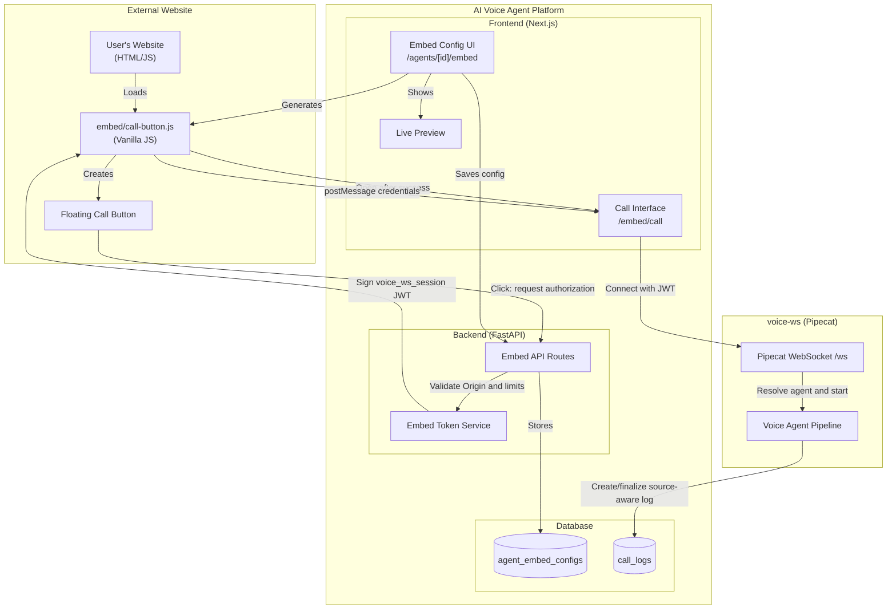
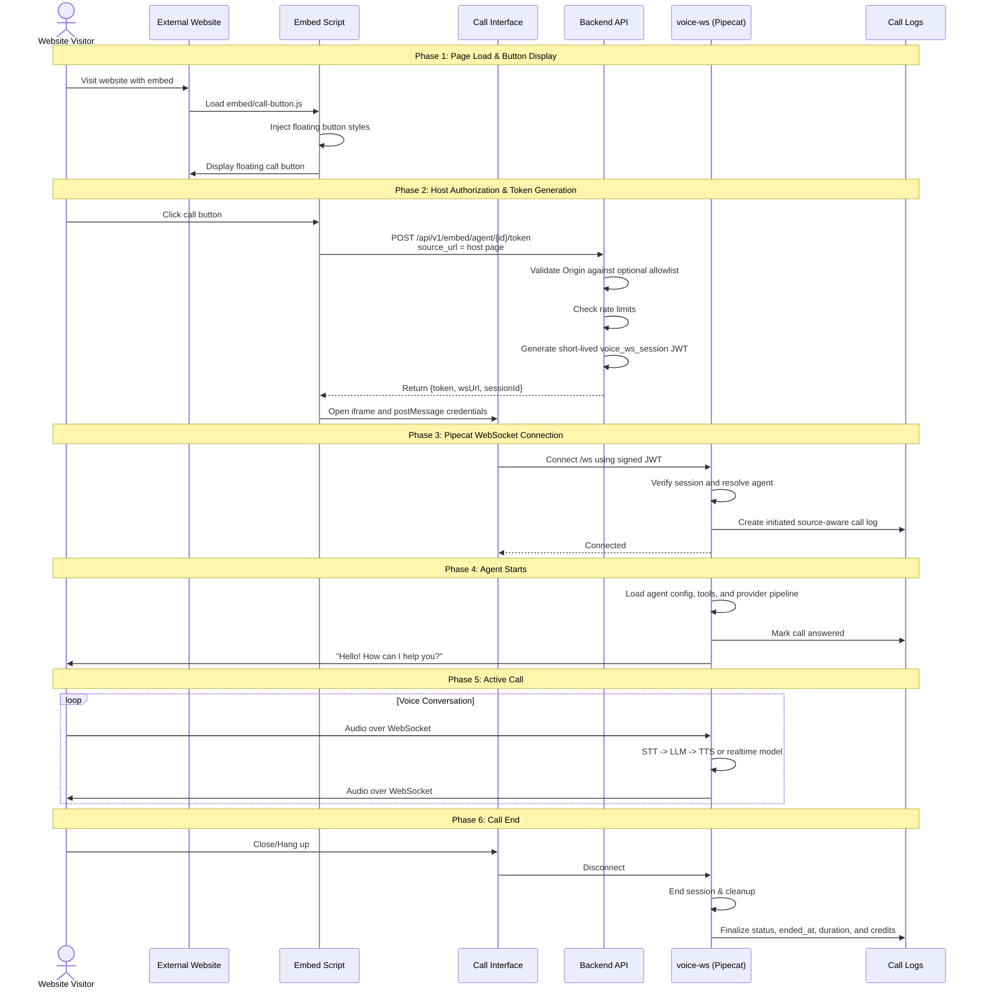
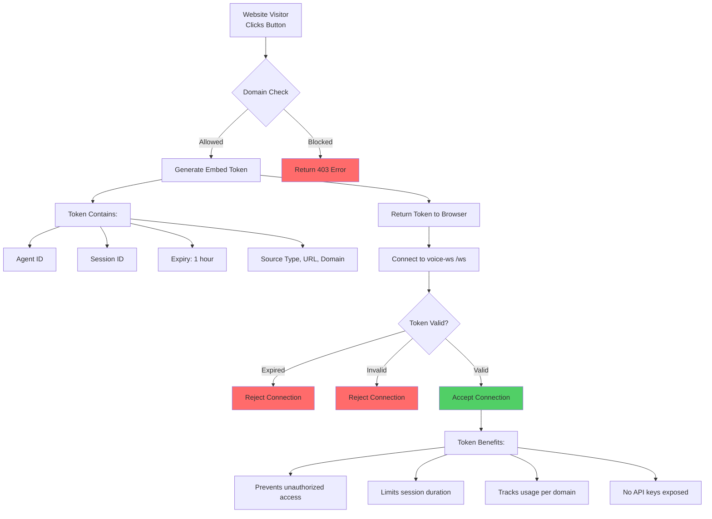

# Embed Call Button Feature - Implementation Plan

> **Current transport (2026-09):** Embed calls use the Pipecat WebSocket runtime
> (`voice-ws`) and short-lived `voice_ws_session` JWTs. The host page requests
> authorization, the platform validates the request `Origin` against the optional
> allowlist, and the authorized iframe receives credentials through a same-origin
> `postMessage` handshake. See `shared/voice_agents/embed_service.py`,
> `frontend/public/embed/call-button.js`, and `frontend/src/app/embed/call/page.tsx`.

**Status:** Completed  
**Created:** 2026-02-17  
**Completed:** 2026-02-20
**Priority:** High

---

## Overview

Allow users to generate embeddable call button code for their websites. Visitors can click the button to initiate voice calls with configured agents directly from external sites.

---

## Goals

- [x] Enable one-click call initiation from external websites
- [x] Provide customizable button appearance (colors, size, text, style)
- [x] Support customizable agent link/connection
- [x] Generate copy-paste ready embed code
- [x] Ensure secure, rate-limited access

---

## Technical Architecture

### Frontend Components

#### 1. Embed Configuration UI
**Location:** `frontend/src/components/agents/embed-button-config.tsx`

- [x] Button preview with real-time updates
- [x] Customization controls:
  - Background color
  - Text color
  - Border radius
  - Button text
  - Size (small/medium/large)
  - Style (filled/outline)
  - Position (bottom-right, bottom-left, etc.)
- [x] Copy-to-clipboard functionality
- [x] Embed code preview
- [x] Configuration persistence

#### 2. Embeddable Script
**Location:** `frontend/public/embed/call-button.js`

- [x] Self-contained vanilla JS (no framework dependencies)
- [x] Creates floating call button
- [x] Handles click-to-call flow
- [x] Carries the static backend API endpoint separately from the script host
- [x] Opens modal/popup with call interface
- [x] Minimal bundle size (<10KB gzipped)

#### 3. Call Interface (Embed Version)
**Location:** `frontend/src/app/embed/call/page.tsx`

- [x] Simplified call UI (no dashboard navigation)
- [x] Receives signed credentials from the host-page handshake
- [x] Connects to the Pipecat WebSocket runtime
- [x] Mute/unmute controls
- [x] Waveform visualization
- [x] Hang-up to close

### Backend Components

#### 1. Embed Configuration Endpoints
**Location:** `backend/src/voice_agents/routes.py`

- [x] `GET /api/v1/agents/{agent_id}/embed-config` - Get config
- [x] `POST /api/v1/agents/{agent_id}/embed-config` - Create/update config
- [x] `DELETE /api/v1/agents/{agent_id}/embed-config` - Delete config

#### 2. Public Embed Token Endpoint
**Location:** `backend/src/voice_agents/embed_routes.py`

- [x] `POST /api/v1/embed/agent/{agent_id}/token` - Generate token
- [x] `GET /api/v1/embed/agent/{agent_id}/info` - Get agent info
- [x] Validates the request origin against the optional domain allowlist
- [x] Records the initiating page URL after removing query and fragment data
- [x] Rate limiting per agent/config

#### 3. Token Validation Service
**Location:** `shared/voice_agents/embed_service.py`

- [x] Generate embed tokens
- [x] Validate embed tokens
- [x] Check domain allowlist
- [x] Carry source type, source URL, and source domain into the voice-session JWT

### Database Schema

**Table: `agent_embed_configs`**

```sql
CREATE TABLE agent_embed_configs (
    id UUID PRIMARY KEY DEFAULT gen_random_uuid(),
    agent_id UUID NOT NULL REFERENCES voice_agents(id) ON DELETE CASCADE,
    button_text VARCHAR(50) DEFAULT 'Call Us',
    button_color VARCHAR(7) DEFAULT '#3b82f6',
    button_text_color VARCHAR(7) DEFAULT '#ffffff',
    button_border_radius INTEGER DEFAULT 8,
    button_size VARCHAR(20) DEFAULT 'medium',
    button_position VARCHAR(20) DEFAULT 'bottom-right',
    button_style VARCHAR(20) DEFAULT 'filled',
    allowed_domains TEXT[],
    custom_css TEXT,
    is_active BOOLEAN DEFAULT true,
    daily_call_limit INTEGER DEFAULT 100,
    created_at TIMESTAMPTZ DEFAULT NOW(),
    updated_at TIMESTAMPTZ DEFAULT NOW()
);
```

The resulting voice session creates or updates a `call_logs` row with
`source_type = 'web_embed'`, the sanitized `source_url`, and the canonical
`source_domain`. The same call-log contract is used by phone, dashboard-test,
public-page, and demo-page calls.

---

## User Flow

```
1. User navigates to Agent Settings > Embed Button
2. Configures button appearance (live preview)
3. Optionally restricts domains
4. Clicks "Generate Embed Code"
5. Copies HTML snippet
6. Pastes into their website
7. Website visitors see button and can initiate calls
```

---

## Security Considerations

- [x] Embed tokens expire after 1 hour
- [x] Rate limiting: configurable daily call limit per embed config
- [x] Domain validation (optional allowlist)
- [x] No voice token in the iframe URL; credentials cross the boundary only after authorization
- [x] Query and fragment data removed before a page URL is persisted
- [x] RLS policies on database tables
- [x] Service role key used for backend operations (bypasses RLS)

---

## API Endpoints

| Method | Endpoint | Description |
|--------|----------|-------------|
| GET | `/api/v1/agents/{id}/embed-config` | Get current config |
| POST | `/api/v1/agents/{id}/embed-config` | Create/update embed config |
| DELETE | `/api/v1/agents/{id}/embed-config` | Delete embed config |
| POST | `/api/v1/embed/agent/{id}/token` | Generate temporary token (public) |
| GET | `/api/v1/embed/agent/{id}/info` | Get agent info (public) |

---

## Implementation Phases

### Phase 1: Core Infrastructure ✅
- [x] Database migration for embed configs
- [x] Backend token generation endpoint
- [x] Basic embed script scaffold

### Phase 2: UI Components ✅
- [x] Embed configuration panel
- [x] Button preview component
- [x] Copy-to-clipboard functionality

### Phase 3: Embed Script ✅
- [x] Vanilla JS embed script
- [x] Call modal/popup implementation
- [x] Styling injection

### Phase 4: Security & Polish ✅
- [x] Rate limiting
- [x] Domain validation
- [x] RLS policies
- [x] Documentation

---

## Open Questions (Resolved)

1. ~~Should we support WebRTC directly in embed or redirect to our domain?~~ 
   **Resolution:** Uses iframe with `/embed/call` page for better isolation
   
2. ~~Do we need an iframe-based approach for better isolation?~~
   **Resolution:** Yes, iframe approach implemented for security and isolation
   
3. ~~What's the maximum number of concurrent calls per embed?~~
   **Resolution:** Configurable via `daily_call_limit` per embed config
   
4. ~~Should embed calls be billed differently than regular calls?~~
   **Resolution:** They use the normal voice-session entitlement and credit
   ledger path; `embed_call_logs` remains the request/rate-limit audit table.

---

## Tests

- [x] Backend unit tests (`backend/tests/voice_agents/test_embed_routes.py`)
- [x] Backend service tests (`backend/tests/shared/voice_agents/test_embed_service.py`)
- [x] Frontend service tests (`frontend/tests/services/test-agent-service-embed.test.ts`)
- [x] E2E tests (`e2e/tests/test_embed_button_flow.py`)

---

## Dependencies

- Existing: Pipecat WebSocket voice-ws infrastructure
- Existing: Agent test-call connection helpers
- New: None (vanilla JS for embed script)

---

## Success Metrics

- Time to generate embed code: < 30 seconds
- Embed script size: < 10KB
- Button click-to-connect time: < 3 seconds
- Support for 1000+ concurrent embed loads

---

## Related Documentation

- [Agent Direct Test Feature](./AGENT_DIRECT_TEST_FEATURE.md)
- [Pipecat voice runtime](../01_architecture/ADR_VOICE_WS_PIPECAT.md)
- [API Guidelines](../04_development_guides/api_guidelines.md)

---

## Architecture Diagrams

### High-Level System Architecture

This diagram shows all components involved in the embed call button feature:



### Embed Button Sequence Diagram

This sequence diagram illustrates the complete flow when a website visitor clicks the embed call button:



### Token Lifecycle Flow

This flowchart explains why we need tokens and how they provide security:



---

## Step-by-Step Flow Explanation

### Phase 1: Configuration (Platform User)

**What happens:**
The agent owner (platform user) configures and generates the embed code.

**Step 1: Access Embed Settings**
- User navigates to Agent Settings → Embed Button
- Frontend loads existing embed config (if any)

**Step 2: Customize Button**
- User selects colors, text, size using UI controls
- Live preview updates in real-time
- Changes saved to `agent_embed_configs` table

**Step 3: Domain Restrictions (Optional)**
- User can specify allowed domains (e.g., `example.com`)
- The dashboard converts each hostname into a removable pill when the user
  presses Space, comma, or Enter
- If set, embed only works on those domains
- If empty, works on any domain (less secure)

**Step 4: Generate Embed Code**
- System generates unique embed code snippet:
  ```html
  <script src="https://platform.com/embed/call-button.js" 
          data-agent-id="123"
          data-api-url="https://api.platform.com"
          data-config="{button_config_json}">
  </script>
  ```
- User copies and pastes into their website HTML

---

### Phase 2: Page Load (Website Visitor)

**What happens:**
The embed script loads and displays the call button on the external website.

**Step 1: Script Loading**
- Visitor loads website containing embed code
- Browser fetches `call-button.js` from our CDN/server
- Script is ~5KB vanilla JavaScript (no dependencies)

**Step 2: Button Injection**
- Script reads `data-agent-id`, the static `data-api-url`, and button attributes
- Creates floating button element with custom styles
- Positions button (bottom-right corner by default)
- Applies user's color scheme and branding

**Step 3: Ready State**
- Button displays with label (e.g., "Call Us", "Talk to AI")
- Script waits for click event
- No connection established yet (token not generated)

---

### Phase 3: Button Click & Call Initiation

**What happens:**
Visitor clicks button, triggering the call flow.

**Step 1: Popup Opens**
- The script requests authorization from the host page before creating the iframe
- The token request includes the current page URL for call-source traceability
- The backend validates the browser `Origin` against the configured allowlist

**Step 2: Token Request**
- The script requests an embed token from the backend
- API validates:
  - Domain is in allowlist (if configured)
  - Rate limits not exceeded
  - Agent is active
  - Voice-session entitlement is available

**Step 3: Token Generation**
- Backend generates JWT token with:
  - `agent_id`: Which agent to connect
  - `session_id`: Unique voice session identifier
  - `exp`: Expiration time (1 hour from now)
  - `source_type`: `web_embed`
  - `source_url` and `source_domain`: Sanitized page metadata
- Token is short-lived to minimize security risk

**Step 4: Return Token**
- Backend returns: `{token, wsUrl, sessionId}`
- The script opens the platform iframe and transfers these credentials with
  `postMessage` after checking the iframe origin
- The iframe URL contains only the agent id; no voice token is placed in the URL

---

### Phase 4: Pipecat WebSocket Connection

**What happens:**
Browser establishes a real-time audio connection with `voice-ws`.

**Step 1: Connect to voice-ws**
- Call interface uses the signed session token to connect to `/ws`
- Pipecat establishes the browser audio transport
- Requests microphone permission from visitor

**Step 2: Session Admission**
- voice-ws verifies the short-lived JWT
- It resolves the agent, organization, tools, and provider configuration
- It creates or reuses the organization-scoped call-log row
- Connection state: "Connecting..."

**Step 3: Call Start**
- The transport connection changes the log from `initiated` to `answered`
- `started_at`, `source_type`, `source_url`, and `source_domain` are already
  present before the greeting begins

---

### Phase 5: Agent Starts & Call Begins

**What happens:**
The AI agent pipeline starts and begins the conversation.

**Step 1: Agent Initialization**
- voice-ws fetches agent configuration from database
- Loads persona, voice settings, tools
- Initializes LLM connection (OpenAI, Google, etc.)

**Step 2: Start Pipeline**
- voice-ws starts the Pipecat transport and voice pipeline
- Publishes agent audio over the WebSocket
- Connection state: "Connected"

**Step 3: Welcome Message**
- Agent sends greeting based on persona
- Visitor hears: "Hello! How can I help you today?"
- Call is now active

---

### Phase 6: Active Conversation

**What happens:**
Real-time voice conversation between visitor and AI agent.

**Audio Flow:**
1. Visitor speaks → Microphone captures audio
2. Audio sent to voice-ws over the Pipecat WebSocket transport
3. voice-ws performs Speech-to-Text (STT) when using the modular pipeline
4. Text sent to LLM for processing
5. LLM generates response
6. voice-ws performs Text-to-Speech (TTS)
7. Audio sent back to visitor over the WebSocket

**Parallel Processing:**
- Audio visualizers show for both user and agent
- Real-time transcription (optional)
- Tool calls executed in background
- Conversation context maintained

---

### Phase 7: Call End

**What happens:**
Call terminates and resources are cleaned up.

**Step 1: Hang Up**
- Visitor clicks "End Call" or closes popup
- Browser disconnects from the Pipecat WebSocket
- Microphone access released

**Step 2: Agent Cleanup**
- voice-ws detects participant left
- Ends LLM session
- Finalizes `ended_at`, duration, status, failure details, and credit linkage
- Persists recording artifact metadata when recording is enabled

**Step 3: Post-Call**
- The dashboard displays start/end times, duration, status, source, credits,
  failure details, and recording availability
- Future transcript/summary processing can attach `call_artifacts` rows
- Embed button returns to ready state

---

## Why Tokens Are Essential

### Problem Without Tokens

If we simply exposed API keys or allowed direct connections:

```
RISK: Anyone could connect to any agent
RISK: No way to track usage or abuse
RISK: API credentials exposed in browser
RISK: Calls could last indefinitely
RISK: No domain validation
```

### Solution: Time-Limited Tokens

**What tokens provide:**

1. **Authorization**: Only valid tokens can connect
2. **Scoping**: Token only works for the specific agent and voice session
3. **Expiration**: Token becomes invalid after 1 hour
4. **Audit Trail**: Track which domain initiated call
5. **Rate Limiting**: Count tokens per domain/agent
6. **Security**: No long-lived credentials exposed

**Token Flow Summary:**

```
User configures embed → Generates static HTML snippet
                              ↓
Website loads → Script displays button (no token yet)
                              ↓
Visitor clicks → Script requests token (one-time use)
                              ↓
Backend validates → Generates time-limited JWT
                              ↓
Browser uses token → Connects to voice-ws `/ws` (valid for 1 hour)
                              ↓
Token expires → Connection remains, but no new connections
```

---

## Data Flow Summary

### Static Assets (No Authentication Required)
- `call-button.js` - Public script, no token needed
- Button styles - Embedded in script

### API Calls (Require Validation)
- `POST /api/v1/embed/agent/{id}/token` - Validates origin, returns JWT
- `GET /api/v1/embed/agent/{id}/info` - Returns public agent info

### Voice Connection (Requires Token)
- `voice-ws /ws` - Verifies the JWT and runs the voice session
- Source metadata travels inside the signed JWT and is persisted in `call_logs`

---

## Notes

*Implementation completed on 2026-02-20. See [Embed Button Feature Documentation](../02_features/voice_agents/embed_button.md) for usage guide.*
