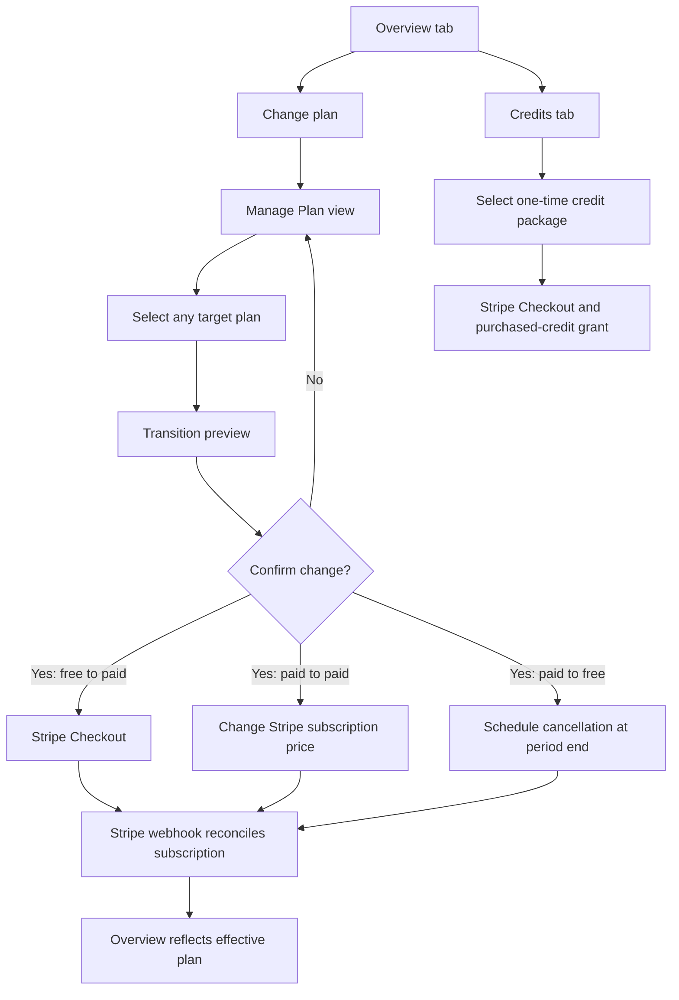

# Billing Plan Management and Credit Purchase UX

Status: Implemented baseline in the isolated billing worktree; catalog data
normalization and durable pending-transition hardening remain follow-up work.

This document defines the customer-facing billing experience for changing plan products, managing an active subscription, and purchasing additional credits. It is based on the internal `plan_products`, `plan_versions`, entitlement, subscription, and Stripe mapping systems.

## Implemented baseline

The isolated worktree now includes the first implementation slice described by
this specification:

- `CustomerPlanVersion` exposes `tier_rank`, and the customer catalog is sorted
  by tier rank rather than price.
- Active subscribers see an Overview tab with a Change plan action and a Plans
  view where the current plan is highlighted while other eligible plans remain
  selectable.
- Plan changes use read-only preview and confirmation endpoints. Free-to-paid
  changes continue through Stripe Checkout; paid-to-paid changes use Stripe
  subscription price changes; paid-to-free changes are scheduled for period end.
- The preview shows price, timing, proration, included-credit delta, and the
  fact that purchased credits are preserved.
- Known legacy tier slugs with the old shared default rank are normalized in
  the customer response, while explicit administrator ranks remain unchanged.
- Free subscriptions no longer show Stripe billing or cancellation actions.
- Overview exposes both Change plan and Buy credits actions. Credits opens with
  the balance summary and purchase packages before the detailed usage panel and
  full ledger; the free-plan payment note is kept in card footers.

The implementation currently records the pending transition in subscription
metadata and revalidates the catalog during confirmation. A durable transition
table, replacement/cancellation UI for pending changes, and normalization of
existing staging tier ranks are intentionally left for the next hardening pass.

## Decision summary

The billing experience will use a simple two-level navigation model:

1. **Overview**: shows the current plan, billing status, renewal or cancellation state, credit balance, and a prominent **Change plan** button.
2. **Manage Plan**: shows every available plan card. The current plan is highlighted, and the user may select any other eligible plan. The UI does not need to label cards as “upgrade” or “downgrade”; the transition preview explains the effect after selection.

The existing **Credits** area remains separate because credit top-ups are one-time purchases and are not plan changes.

Only one pending plan transition may exist for an organization at a time. A new selection must either replace the existing pending transition after an explicit confirmation or be blocked with a clear explanation.

## Goals

- Always use internal plan products and published plan versions as the source of truth.
- Allow an organization to move directly to any eligible target plan.
- Clearly identify the current plan without disabling all other plans.
- Explain price, effective date, entitlement, feature, and credit effects before confirmation.
- Keep Stripe responsible for payment collection and subscription billing, not plan discovery.
- Preserve purchased credits when a plan changes.
- Make cancellation and reactivation understandable and reversible where possible.

## Non-goals

- Exposing Stripe Products or Stripe Prices in the customer UI.
- Automatically creating arbitrary upgrade relationships for every possible future pricing model.
- Combining one-time credit purchases with recurring subscription changes.
- Allowing customers to edit plan catalog definitions.

## Existing capabilities and gaps

### Already available

- Published internal plan versions are returned through `GET /api/v1/billing/plans/available`.
- Plan versions contain entitlements, billing mode, billing interval, price, and Stripe Price mapping.
- Free plan activation is handled internally without Stripe.
- Paid plan signup resolves the Stripe Price from the selected internal plan version.
- Organization subscriptions bind to `plan_version_id`.
- Entitlement resolution exposes limits, features, and migration information.
- Stripe subscription price changes already exist for internal version migrations.
- Cancellation and reactivation are available for Stripe-backed subscriptions.
- Credit balances have separate plan and purchased pools.

### Missing or incomplete

- Existing staging catalog rows can still be normalized administratively so the
  stored `sort_order` values match the compatibility ranks shown to customers.
- Existing migration support is for published versions of a plan family, not Free → Starter → Pro → Enterprise transitions.
- A durable transition table and pending-change replacement/cancellation UI are
  still needed before this flow is considered fully hardened.
- Monthly and annual plans are still represented as separate product families
  in some staging data, such as `starter-plan-month` and `starter-plan-year`.

## Proposed user experience



### Overview tab

Rename the current `Manage` tab to **Overview**. It should contain:

- Current plan name and version label.
- Current subscription status.
- Current billing interval and price.
- Next billing date or scheduled cancellation date.
- Current included-credit balance and purchased-credit balance.
- A primary **Change plan** button that opens the Manage Plan view.
- A secondary **Manage billing** action for payment methods, invoices, and billing address.
- Cancel or reactivate actions for Stripe-backed subscriptions.
- A clear “No recurring payment” message for the free plan instead of a cancel button.

The Stripe customer portal should not be presented as the plan-selection experience. It is only for payment administration and invoice history until the platform owns those surfaces fully.

### Manage Plan view

This view should display all available plan products in catalog order. It should not calculate or display labels such as “Upgrade to Pro” on the cards.

Each card should show:

- Plan product name and description.
- Monthly or annual price, controlled by the existing interval toggle.
- The current plan badge when the card matches the active `plan_product_id` derived from the active `plan_version_id`.
- Key entitlement values and features.
- A neutral action such as **Select plan** or **Choose plan**.
- A disabled or hidden action only when the plan is unavailable, lacks a Stripe Price, or is the current product and billing interval.

The current plan should be visually distinct through a badge, border, and supporting text. The other cards remain selectable regardless of whether they are higher or lower in the catalog.

### Transition preview

Selecting a different plan opens a confirmation dialog or dedicated preview panel. It should explain:

- Current plan and target plan.
- Current price and target price.
- Whether the change is immediate or takes effect at the next billing period.
- Proration or next-invoice behavior.
- Entitlements being added, removed, or changed.
- Included credits granted under the target plan.
- Treatment of existing purchased credits.
- Any feature or limit reductions that could affect the organization.
- The final action: `Confirm plan change`, `Continue to payment`, or `Schedule change`.

Example copy:

> You are changing from Starter to Pro. Your Pro access begins immediately. Stripe will prorate the remaining period. Your included credits will change to the Pro allowance at the effective time. Purchased credits remain available and are not removed.

The preview should use entitlement keys and resolved values from the platform catalog rather than hard-coded plan names or limits.

#### Transition confirmation and failure states

- A preview is read-only. It must not change the local subscription, create a Stripe Checkout session, or change a Stripe subscription.
- Free-to-paid access and included credits become active only after successful Stripe payment and webhook reconciliation. An abandoned, cancelled, or failed Checkout leaves the organization on its previous plan and can be retried.
- Paid-to-paid changes update the local plan only after the corresponding Stripe subscription change succeeds. A Stripe error or webhook failure leaves the previous plan active and shows a retryable error.
- A period-end downgrade is shown as scheduled in Overview, with the current plan and end date visible until the effective webhook arrives.
- If a pending change already exists, the preview must show it and offer either `Replace scheduled change` or `Keep current change`; silently creating a second transition is not allowed.

## Plan transition rules

| Current plan | Target plan | Customer action | Billing behavior | Entitlement behavior |
| --- | --- | --- | --- | --- |
| Free | Paid | Confirm, then continue to Stripe Checkout | Create a new Stripe subscription | Apply after successful webhook reconciliation |
| Paid | Paid | Confirm plan change | Change the existing Stripe subscription Price; prorate upgrades | Apply at the effective time |
| Paid | Free | Confirm scheduled downgrade | Cancel the Stripe subscription at period end | Keep paid access until period end, then bind Free |
| Paid | Paid, different interval | Confirm interval change | Apply the selected interval with an explicit proration policy | Apply at the effective time |
| Any | Same plan/version | No action | No billing change | No entitlement change |
| Any | Unavailable or missing Stripe mapping | Do not allow selection | No billing action | No entitlement change |

The initial product decision should be:

- For a single billing interval, an upgrade means a target `tier_rank` greater than the current rank and a downgrade means a lower rank. A monthly-to-annual or annual-to-monthly change at the same tier is an interval change, not an upgrade or downgrade.
- Upgrades take effect immediately with Stripe proration.
- Downgrades take effect at the end of the current billing period.
- Paid-to-free changes are treated as a period-end downgrade.
- Purchased credits are never removed by a plan change.
- Monthly-to-annual and annual-to-monthly changes are explicit interval changes. The initial policy applies them at the next billing period unless the preview says otherwise; they must not be inferred from tier rank.
- Unused included Free credits do not carry into the first paid period. Included plan credits are replaced at the target plan's effective time and do not receive a full retroactive grant unless a later billing policy explicitly chooses that behavior.
- An immediate paid upgrade receives the target plan's included-credit allowance for the new effective period, with any prorated credit delta shown in the preview. A period-end downgrade keeps the current allowance until the scheduled effective time.
- Included credits do not roll over between periods unless the target entitlement explicitly enables rollover. Plan credits are consumed before purchased credits.

## Catalog and plan ordering

The existing `plan_products.sort_order` can serve as the initial tier rank, but the catalog needs normalization before it can reliably drive a plan ladder:

- One plan product should represent one tier: `free`, `starter`, `pro`, and `enterprise`.
- Monthly and annual prices should be represented by versions or price variants under the same tier, not separate tier products.
- The customer catalog response should include `sort_order` or a semantically named `tier_rank`, plus a stable product identifier for matching the current-plan badge.
- The admin catalog should allow the rank to be edited and validate that active tiers have an unambiguous order.
- The frontend should sort by tier rank and then select the requested billing interval. It should not infer the ladder from price or choose “Most Popular” using the median price.
- The current-plan badge should match the active `plan_product_id`; the selected monthly or annual version is the billing variant shown within that product card.
- An eligible target is published, active, supported by the requested billing mode and currency, and mapped to a valid Stripe Price when paid. Missing prices, unpublished products, and unsupported interval or currency combinations remain visible only as unavailable with an explanation.

An explicit relationship table is not required for the initial linear ladder. It becomes appropriate only if the business later introduces branching plans, audience-specific paths, or plans that are not comparable by rank.

## Backend and API work

### Plan catalog

- Extend `CustomerPlanVersion` with the catalog rank and any customer-safe display metadata.
- Normalize staging and future catalog data around one product family per tier.
- Return current plan context where useful so the UI does not need to reconstruct it from unrelated responses.

### Plan change preview and confirmation endpoints

Use separate preview and confirmation operations so the UI can show the complete consequence of a selection before any billing mutation:

```text
POST /api/v1/billing/subscription/plan-change/preview
POST /api/v1/billing/subscription/plan-change/confirm
```

Preview request:

```json
{
  "organization_id": "...",
  "target_plan_version_id": "..."
}
```

The preview response should include a short-lived `transition_id`, current and target plan context, price and credit deltas, effective date, proration behavior, entitlement changes, eligibility warnings, and any pending transition that would be replaced.

Confirmation request:

```json
{
  "organization_id": "...",
  "transition_id": "...",
  "success_url": "...",
  "cancel_url": "..."
}
```

The backend must:

1. Authorize billing access for the organization.
2. Resolve the target from the internal published plan catalog.
3. Reject the current plan as a no-op.
4. Validate billing mode, interval, currency, active status, and Stripe Price mapping.
5. Determine whether the change is free-to-paid, paid-to-paid, or paid-to-free.
6. Return a read-only preview with no Stripe or local subscription mutation.
7. Confirm an unexpired preview and execute the correct Stripe operation only after confirmation.
8. Persist the local target state through an idempotent workflow and Stripe webhook reconciliation.

The implementation should introduce an explicit pending-change state rather than relying on the UI to infer that a change is in progress. This state should include the target plan version, effective date, Stripe subscription or checkout session, and cancellation/reversal status.

At minimum, the durable state should include the organization, current and target plan versions, transition type and interval, Stripe subscription or Checkout identifiers, effective date, preview/confirmation identifiers and expiry, and one of `pending`, `checkout_pending`, `scheduled`, `applied`, `failed`, `cancelled`, or `replaced`. Customer-facing errors should be safe and actionable; raw Stripe details belong in logs.

### Stripe behavior

- Keep Stripe Price resolution entirely on the backend.
- Add idempotency keys for checkout creation and subscription price changes.
- Use a deliberate proration policy instead of silently applying a no-proration price swap.
- For period-end downgrades, use Stripe's supported scheduling mechanism or a durable pending-change record that is applied at renewal.
- Reconcile subscription state from webhooks and make webhook processing safe to replay.

### Cancellation and reactivation

- Hide cancellation for Free.
- For paid plans, show the period-end access date before confirmation.
- Show a persistent pending-cancellation state with `Reactivate`.
- When a paid subscription expires after a paid-to-free downgrade, activate the Free plan version automatically and preserve purchased credits.

## Credit purchase assessment

The credit system is conceptually in good shape and should remain separate from plan management:

- The plan pool and purchased pool are separated.
- Purchased credits are preserved across plan changes.
- Credit top-ups are gated by the `credit_topup_enabled` entitlement.
- The usage panel exposes total, plan, purchased, and used balances.
- Credit products are fixed one-time packages rather than recurring plans.

Recommended improvements:

- Keep the **Credits** tab separate from Manage Plan.
- Show the purchase package, price, cost per credit, and whether the purchased credits expire before checkout.
- Show a clear post-purchase confirmation and refresh the balance from the backend.
- Prevent duplicate checkout attempts with a client loading guard and backend idempotency.
- Use the backend-provided checkout URL consistently so the browser does not need to understand Stripe session mechanics.
- Clarify consumption order: included plan credits are consumed before purchased credits, if that remains the intended policy.
- Show low-balance guidance that distinguishes “buy credits” from “change plan.”
- Explain that a plan change affects included credits, not purchased credits.

The initial credit policy should be explicit in both the preview and the credit UI:

- Purchased credits are one-time balance, are not removed or recalculated by a plan change, and follow the existing expiry policy shown at purchase.
- Included credits are tied to the active plan period; they are replaced at the target plan's effective time and do not roll over unless the entitlement says so.
- Included plan credits are consumed before purchased credits. Any change in the included balance is shown separately from the purchased balance.
- A plan change is not a top-up. Users who need temporary capacity should use Credits; users who need recurring limits or features should use Manage Plan.

Credit purchasing does not need a new plan relationship model. It needs clearer balance messaging, reliable checkout reconciliation, and a visible distinction between recurring included credits and one-time purchased credits.

## Frontend implementation phases

### Phase 1: Navigation and catalog presentation

- Rename Manage to Overview.
- Add the Change plan entry point.
- Keep Manage Plan cards accessible for active subscriptions.
- Highlight the current plan.
- Add catalog rank and normalize monthly/annual presentation.
- Remove the invalid Free-plan cancellation action.

### Phase 2: Preview and transition state

- Add entitlement comparison logic.
- Add the transition preview dialog.
- Add loading, pending, success, cancellation, and failure states.
- Show effective dates and billing consequences.
- Show abandoned or failed Checkout as still on the previous plan with a retry action.

### Phase 3: Backend transition execution

- Add the change-plan API and transition models.
- Implement free-to-paid checkout changes.
- Implement paid-to-paid price changes with proration policy.
- Implement paid-to-free period-end changes.
- Add idempotency and webhook reconciliation.
- Make pending transitions visible and prevent duplicate or conflicting changes.

### Phase 4: Credits refinement

- Improve purchase package explanations and balance messaging.
- Standardize checkout redirect handling.
- Add duplicate-purchase protection and post-checkout reconciliation.

## Acceptance criteria

- An organization with an active Free plan can open Manage Plan and select any paid plan.
- An organization with an active paid plan can select any other available plan.
- The current plan is clearly marked and cannot be selected again.
- Every non-trivial plan change shows a preview before mutation or checkout.
- The preview explains price, timing, proration, entitlement changes, and credit treatment.
- Free-plan users do not see a misleading cancellation action.
- Paid-to-free changes preserve paid access through the current period and then activate Free.
- Purchased credits survive every plan transition.
- Abandoned or failed paid checkout leaves the previous plan active and does not grant paid entitlements or included credits.
- Only one pending plan transition exists at a time, and interval changes explain their effective date and billing treatment.
- Preview and confirmation are separate operations; previewing never mutates billing state.
- Included credits are consumed before purchased credits, and purchased credits remain separate from plan-credit changes.
- Stripe products and prices are never used as the customer-facing catalog.
- Webhook retries do not create duplicate subscriptions, grants, or plan changes.
- Credit purchases remain a separate, understandable one-time purchase flow.

## Related implementation files

- `frontend/src/app/(dashboard)/organization/billing/page.tsx`
- `frontend/src/components/billing/plan-selection.tsx`
- `frontend/src/components/billing/subscription-management.tsx`
- `frontend/src/components/billing/plan-migration-banner.tsx`
- `frontend/src/components/billing/credit-purchase.tsx`
- `frontend/src/components/billing/credit-usage-panel.tsx`
- `frontend/src/services/billing-service.ts`
- `frontend/src/types/billing.ts`
- `backend/src/billing/routes.py`
- `backend/src/billing/versioned_subscription_service.py`
- `backend/src/billing/plan_migration_service.py`
- `backend/src/billing/stripe_service.py`
- `backend/src/billing/webhook_handler.py`
