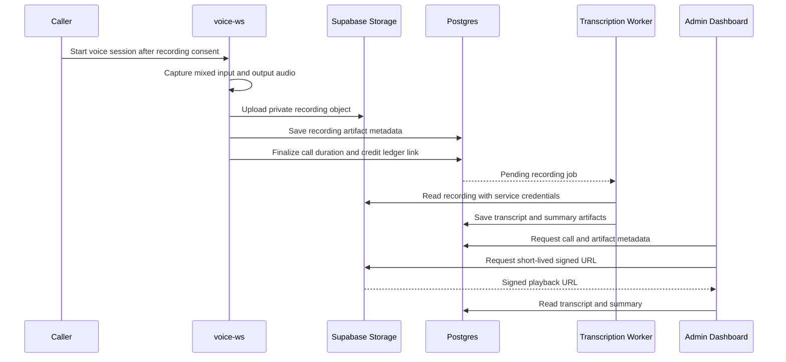

# Call Recording, Transcription, and Playback

## Current state

Call usage reporting is now wired to the existing `call_logs` and
`credit_transactions` tables. A completed voice session records its duration,
debits the `voice_call_minute` event using a one-minute minimum and rounded-up
minutes, and links the ledger row back to the call.

Audio capture is intentionally not enabled yet. `voice-ws/src/recording.py`
still contains a pass-through tee; it does not persist audio. The new
`call_artifacts` table is the metadata boundary for the next phase, not proof
that recordings already exist.

## Storage decision

Use Supabase Storage for audio bytes and Postgres for searchable metadata and
text artifacts:

| Artifact | Storage | Reason |
| --- | --- | --- |
| Mixed call audio | Private Supabase Storage bucket `call-recordings` | Durable object storage, private by default, signed playback URLs |
| Recording metadata | `call_artifacts` row | Organization/call ownership, status, path, MIME type, size, duration |
| Transcript | `call_artifacts.text_content` | Searchable and directly available to the reporting UI |
| Summary and key takeaways | `call_artifacts.text_content` plus JSON `metadata` | Small, structured, and easy to render/export |

Objects must use an organization-scoped path:

```text
{organization_id}/{call_log_id}/recording.wav
```

Never return the object path as a public URL. The backend should verify
organization access, create a short-lived signed URL (for example, five
minutes), and return it only to an org admin or platform admin viewing that
organization.

## Processing flow



## Runtime implementation plan

1. Add a real Pipecat audio processor in place of the current no-op tee. Keep
   separate input/output buffers until the final mux so debugging can tell the
   caller and agent channels apart.
2. On normal or abnormal session teardown, flush the buffer to a temporary
   file/stream, upload it to the private bucket, and upsert the `recording`
   artifact row. Recording failures must not prevent call finalization or credit
   accounting.
3. Enqueue transcription after the recording row is committed. The worker
   should retry transient provider failures and make the artifact status
   visible as `pending`, `processing`, `completed`, or `failed`.
4. Generate a concise summary, key takeaways, and action items from the
   transcript. Store those as separate `summary` content with model/version
   metadata for reproducibility.
5. Add an authorized artifact endpoint that returns metadata, transcript, and a
   signed recording URL. Do not proxy or expose service-role credentials in the
   browser.

## Security, consent, and retention

- Recording must be an explicit organization/agent setting with a clear caller
  disclosure before capture begins. The product owner must define jurisdiction
  coverage for two-party and international calls before enabling it in
  production.
- Keep the bucket private and enforce organization ownership in the API. Do not
  rely on a client-supplied organization id or storage path for authorization.
- Store only the minimum phone-number and provider metadata needed for support;
  mask numbers in list views.
- Define a retention policy before launch (for example, 30 or 90 days for
  audio, longer for transcripts only if the customer opts in). A scheduled
  cleanup job should delete both the object and its artifact row together.
- Record provider, model, prompt/version, and processing timestamps in
  `call_artifacts.metadata` so summaries can be audited or regenerated.

## Credit semantics

Calls are billed at teardown from the `voice_call_minute` credit event. The
ledger metadata includes the `call_log_id`, duration, and plan/purchased pool
allocation. The call log exposes `credits_consumed` and
`credit_transaction_id`, which lets the dashboard explain both the call and
the balance change without guessing from duration alone.

The voice debit and ledger insert are performed by an idempotent PostgreSQL
operation keyed by `call_log_id`, so a worker retry cannot create a duplicate
charge. Recording upload and the final presentation link remain best-effort
around worker teardown and should be retried from their visible call/artifact
statuses.
