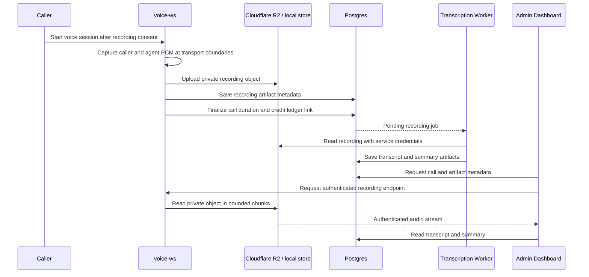

# Call Recording, Transcription, and Playback

## Current state

Call usage reporting is now wired to the existing `call_logs` and
`credit_transactions` tables. A completed voice session records its duration,
debits the `voice_call_minute` event using a one-minute minimum and rounded-up
minutes, and links the ledger row back to the call.

Recording capture and authenticated playback are now implemented. Recording is
opt-in at the agent level through `voice_agents.call_recording_enabled`, which
defaults to `FALSE`; the runtime `VOICE_RECORDING_ENABLED` flag remains a
platform-level safety gate for staged rollout. A call is recorded only when
both gates allow it and consent/disclosure have been configured for the
jurisdiction in which the organization operates. Transcription and summaries
remain a later processing phase.

## Call-log traceability

Every voice session is represented by an organization-scoped `call_logs` row.
The row records `started_at`, `ended_at`, duration, status, failure details,
credit usage, and recording availability. Phone calls use `source_type =
'phone'` and retain the called number; browser calls use a stable web source
type plus the initiating page's canonical hostname and sanitized HTTP(S) URL.
The URL has query parameters and fragments removed before persistence. Embed
calls additionally validate the host-page origin against the optional
`agent_embed_configs.allowed_domains` allowlist before a voice token is issued.

## Storage decision

Use a private object store for audio bytes and Postgres for searchable metadata
and text artifacts. Local development uses an ignored filesystem directory;
staging and production use two environment-specific buckets in one Cloudflare
R2 account:

| Artifact | Storage | Reason |
| --- | --- | --- |
| Mixed call audio (local) | `.local-data/call-recordings/` | Fast local testing; ignored by Git and mounted into backend/voice-ws |
| Mixed call audio (staging/prod) | Private R2 bucket per environment | Durable object storage, provider-encrypted at rest, authenticated backend streaming |
| Recording metadata | `call_artifacts` row | Organization/call ownership, status, path, MIME type, size, duration |
| Transcript | `call_artifacts.text_content` | Searchable and directly available to the reporting UI |
| Summary and key takeaways | `call_artifacts.text_content` plus JSON `metadata` | Small, structured, and easy to render/export |

Objects must use an organization-scoped, date-partitioned path:

```text
{organization_id}/calls/{yyyy}/{mm}/{dd}/{call_log_id}/recording.wav
```

Never return the object path as a public URL. The backend verifies organization
ownership and streams both local and R2 recordings through the authenticated
backend endpoint in bounded chunks. This avoids requiring browser CORS rules on
the private R2 buckets and works for localhost, staging, and production
frontends. Only an org admin or platform admin can request a recording.

The Cloudflare account is shared for operational simplicity, but the buckets
remain separate (`247ai-call-recordings-staging` and
`247ai-call-recordings-production`) and credentials are bucket-scoped. This
keeps accidental cross-environment access out of normal application paths;
Cloudflare account-level access is still a shared administrative blast radius.

## Processing flow



## Runtime implementation plan

1. `RecordingAudioTap` captures raw caller frames immediately after
   `transport.input()` and raw agent frames immediately before
   `transport.output()`. This keeps model latency and output playback pacing
   out of the recording clock. The browser `LevelMediaManager` and
   `WebSocketTransport` must both use the 16 kHz browser-input contract;
   `WavMediaManager`'s 24 kHz default must not be used for this path.
2. On teardown, `RecordingCoordinator` resamples each complete mono track once
   at the lowest native track rate, interleaves caller-left/agent-right stereo,
   encodes the result as WAV, and uploads it through the configured local/R2
   adapter. It retains only genuine timing gaps observed at the transport
   boundary; downstream model or pipeline backpressure cannot add silence to
   the caller track. Captured audio frame lengths determine duration. Recording
   failures do not prevent call finalization or credit accounting; the artifact
   is marked `failed` for support/retry tooling.
3. The voice-ws Pipecat dependency is pinned to `1.11.0` (reviewed on
   2026-09-22 for Gemini 3.8 Live support). Upgrade it only after comparing
   the baseline and candidate voice suites, including browser-rate and
   telephony-rate recording paths;
   the browser Pipecat packages are a separate compatibility surface.
4. Enqueue transcription after the recording row is committed. The worker
   should retry transient provider failures and make the artifact status
   visible as `pending`, `processing`, `completed`, or `failed`.
5. Generate a concise summary, key takeaways, and action items from the
   transcript. Store those as separate `summary` content with model/version
   metadata for reproducibility.
6. Add an authorized artifact endpoint that returns metadata and streams the
   recording. Do not proxy storage credentials or object paths to the browser.

## Audio regression guard

The previous implementation placed Pipecat's `AudioBufferProcessor` after the
output transport. That made caller audio pass through the output sample-rate
conversion and measured caller gaps after downstream processing. In affected
calls, those behaviors produced caller artifacts and synthetic silence, making
the WAV longer than the call. The transport-adjacent taps avoid both failure
modes. A browser recorder that emits 24 kHz samples while the WebSocket frame
declares 16 kHz produces the same symptom in a different form: caller audio is
stretched by 1.5x and loses its expected voice bandwidth. The browser recorder
rate and frame label are therefore tested as one contract. The Pipecat version
is pinned so future audio-runtime changes require the recording regression
suite.

## Security, consent, and retention

- Recording must be an explicit agent setting with a clear caller disclosure
  before capture begins. The product owner must define jurisdiction
  coverage for two-party and international calls before enabling it in
  production.
- Keep the bucket private and enforce organization ownership in the API. Do not
  rely on a client-supplied organization id or storage path for authorization.
- Use bucket-scoped R2 Object Read/Write credentials, never a public bucket or
  a browser-held secret. The browser receives only an authenticated audio
  stream through the backend.
- Store only the minimum phone-number and provider metadata needed for support;
  mask numbers in list views.
- The default retention window is 90 days and is stored on each artifact as
  `retention_expires_at`. A scheduled cleanup job should delete both the object
  and its artifact row together before production recording is enabled.
- Record provider, model, prompt/version, and processing timestamps in
  `call_artifacts.metadata` so summaries can be audited or regenerated.

## Encryption decision

Provider-managed encryption is the default. R2 encrypts objects and metadata at
rest, and all access is over TLS. This gives small and medium organizations
durable recovery without making them responsible for key custody. The
configuration already records `encryption_mode` on each artifact and routes
storage through a strategy boundary, but `customer_managed` is intentionally
rejected until we implement key provisioning, rotation, access recovery,
deletion, and a documented lost-key policy. That avoids a dangerous mode that
silently behaves like provider-managed encryption.

If customer-managed keys become necessary later, add the key provider behind
the same storage/encryption boundary and require an explicit organization-level
opt-in. Customer-managed encryption should be an enterprise/compliance feature,
not the default for SMB customers.

## Platform-managed key operations

There is no customer-facing or platform-admin UI for R2 key management today.
Platform-managed recording encryption is enabled by setting
`RECORDING_ENCRYPTION_MODE=provider_managed`; the application does not receive
or rotate an R2 encryption key because R2 manages encryption at rest. Operators
configure the private R2 endpoint, environment bucket, bucket-scoped access key,
secret key, and presigned URL lifetime through the deployment secret store or
the environment variables documented in the local, staging, and production
templates. `ENCRYPTION_KEY` remains the application Fernet key for database
secrets and is not an R2 recording-encryption key.

Customer-managed keys are intentionally not selectable until provisioning,
rotation, recovery, revocation, and lost-key behavior can be managed end to
end. A future admin workflow should never expose R2 secrets to browsers or
organization admins.

## Credit semantics

Calls are billed at teardown from the `voice_call_minute` credit event. The
ledger metadata includes the `call_log_id`, duration, and plan/purchased pool
allocation. The call log exposes `credits_consumed` and
`credit_transaction_id`, which lets the dashboard explain both the call and
the balance change without guessing from duration alone.

The voice debit and ledger insert are performed by an idempotent PostgreSQL
operation keyed by `call_log_id`, so a worker retry cannot create a duplicate
charge. Recording upload and the final presentation link remain best-effort
around worker teardown and should be retried from their visible call/artifact
statuses.
