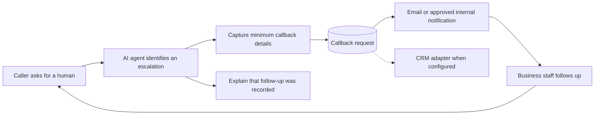
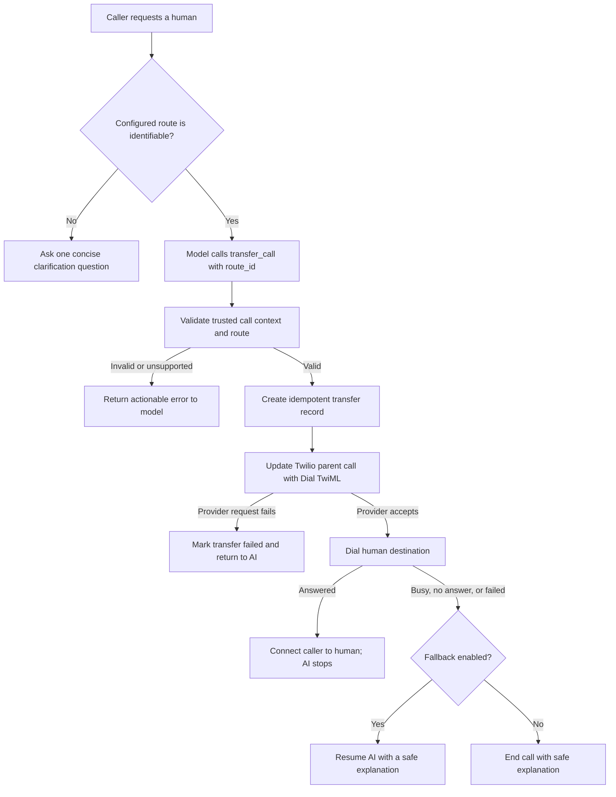
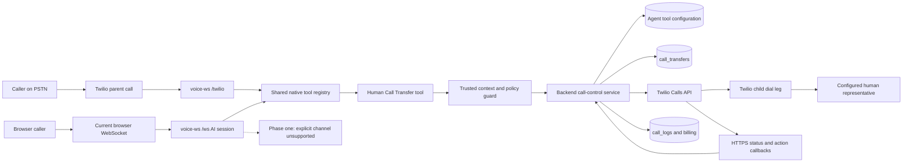
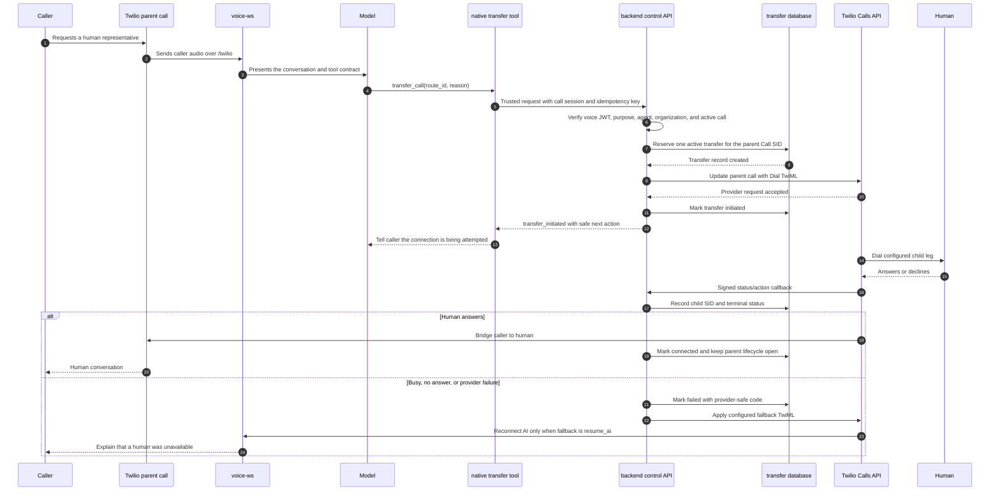
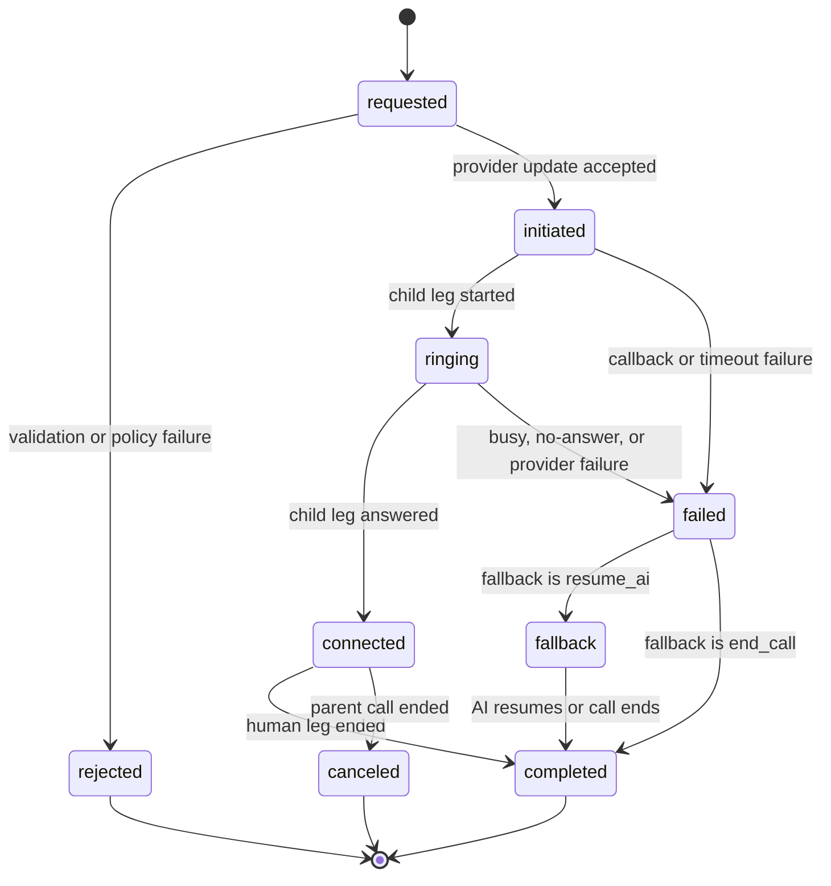
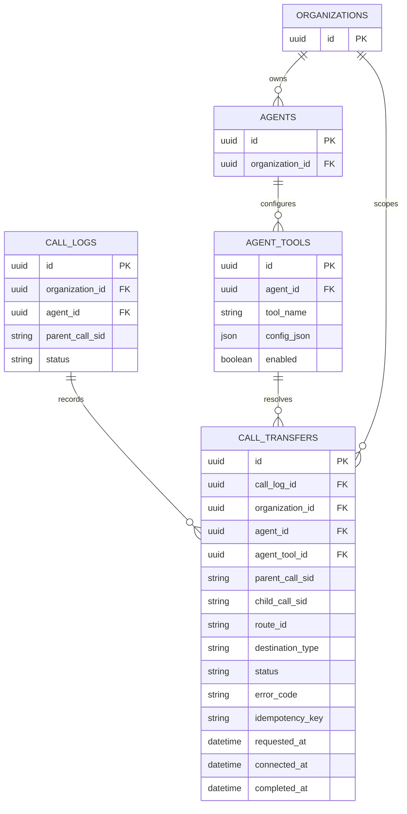

# Human Call Transfer

> Execution-ready design for transferring an active AI voice call to a
> configured human representative. This document is a proposal; it does not
> claim that the feature is implemented.

**Status:** Deferred pending validated customer demand; phone-first execution plan retained for future implementation

**Primary decision:** Implement this as a native platform tool backed by a
server-side call-control service. Store named transfer destinations in
structured agent-tool configuration. Do not put phone numbers in prompts and
do not allow the model to supply an arbitrary destination number.

## 1. Executive decision

The first production-capable version should support:

- An inbound Twilio/PSTN call that is currently connected to the AI.
- A model-facing `transfer_call` tool with a named `route_id`, not a phone
  number.
- Cold transfer to a configured E.164 PSTN destination using Twilio `<Dial>`.
- Sales, support, front-desk, billing, and other agent-specific routes.
- One active transfer per call, idempotent retries, provider status tracking,
  and a safe fallback to the AI when the human cannot be reached.
- Explicit, actionable tool results. The model must never claim that a human
  answered until the provider reports that outcome.
- Transfer-aware call logging, billing, authorization, and observability.

The first version should not pretend that a browser WebSocket call is already
equivalent to a Twilio call. The current browser path has no Twilio `CallSid`
or PSTN media leg. Browser-to-PSTN transfer therefore requires a separate
bridge or a browser transport decision and should be a separately gated phase.

The first version should also avoid warm-transfer complexity, AI whispering,
SIP/Client destinations, and a promise of one continuous recording unless the
recording path is implemented and tested end to end.

### Product prioritization and interim strategy

The technical design is sound, but the product decision is to **defer the full
live-transfer feature** until a validated customer or paid design partner makes
it important. This is a prioritization decision, not a statement that the
feature is impossible.

The reason is the combined cost of:

- Twilio voice-leg and recording charges, plus ongoing Gemini/worker cost if
  the AI remains active during a handoff.
- Provider-specific call lifecycle, parent/child correlation, callbacks,
  fallback behavior, and browser-versus-PSTN differences.
- Recording consent, privacy, healthcare/compliance, caller-ID, and retention
  decisions.
- A substantial PSTN/browser test matrix that cannot be validated reliably by
  unit tests alone.
- The risk of building a broad abstraction before any customer has confirmed
  the workflow, destination types, or required service-level behavior.

The immediate product alternative should be a lightweight **human follow-up
workflow**, not a partial live-transfer implementation:

1. Detect that the caller wants a human or that the agent cannot complete the
   request.
2. Capture only the information needed for a callback: caller name, callback
   number, request summary, urgency, and any business-approved details.
3. Persist a callback request or lead with an idempotent status.
4. Notify the business through a configured internal channel and/or create a
   record in the configured CRM when one exists.
5. Tell the caller that the request was recorded and state the configured
   expectation honestly. Never promise a callback time that the system cannot
   guarantee.



This workflow should reuse existing platform capabilities where they are
actually appropriate. The current repository contains a Gmail tool and a
Telegram service used for platform-admin alerts; the Telegram service should
not be repurposed as a general customer-data channel without a separate
tenant-scoped design. There is no generic CRM tool that should be assumed to be
available. If no customer channel is configured, an internal callback-request
record is still preferable to claiming that a live transfer occurred.

### Roadmap and demand gates

For restaurants, gyms, HVAC companies, and similar local businesses, treat the
following as hypotheses to validate rather than assumptions to encode into the
platform:

1. Reliable voice experience, business context, hours, and escalation-safe
   responses.
2. Lead/callback capture and internal follow-up.
3. Appointment or booking workflows where customers actually use them.
4. Integration with the customer’s existing system of record, such as a CRM,
   scheduling system, or dispatch system.
5. Live transfer only when the business has staffed destinations and a proven
   need for immediate connection.

Resume the live-transfer implementation when at least one of these is true:

- A paid customer or design partner requires it for launch or renewal.
- Multiple independent prospects request it with the same workflow and
  destination shape.
- Callback follow-up is demonstrably losing qualified leads or revenue.
- A target segment’s operating model requires immediate human escalation and
  has a clear owner, number, availability policy, and compliance posture.

A single customer request can justify a narrowly scoped pilot, but it should
not automatically justify a generalized multi-provider, browser, SIP, warm
transfer platform feature.

## 2. Goals and non-goals

### Goals

1. Let a caller say “connect me to sales” or “I need a human about billing”
   and reach the configured destination for that route.
2. Let an agent choose among several destinations without exposing sensitive
   phone numbers in prompts, transcripts, tool arguments, or model output.
3. Keep the operation safe under model retries, duplicate tool calls, provider
   timeouts, WebSocket disconnects, and callback retries.
4. Preserve tenant isolation and enforce the route configured for the active
   agent and organization.
5. Make the behavior testable without requiring a live model for every
   regression. Add deterministic tool/evaluation tests and a provider-backed
   PSTN release gate.
6. Give operators enough state to explain whether a transfer was requested,
   ringing, connected, rejected, failed, or returned to the AI.

### Non-goals for the first implementation

- Transferring an arbitrary number chosen by the model or caller.
- A conference where the AI listens or speaks to the human representative.
- Whispering caller context to the human before connecting the caller.
- SIP, Twilio Client, or arbitrary external telephony providers as destinations.
- DTMF menus. They may be added later as another route-selection mechanism.
- A browser-to-PSTN transfer using the current direct Pipecat WebSocket path.
- Claiming a single merged recording until recording continuity is proven.

## 3. Current platform facts and gaps

The implementation should extend the existing boundaries rather than create a
second voice runtime.

| Area | Current behavior | Required change |
| --- | --- | --- |
| Twilio inbound call | `backend/src/voice_agents/voice_routes.py` verifies the webhook, resolves the agent, creates or updates a call log, issues a voice-session JWT, and returns `<Connect><Stream>`. | Preserve the parent call identity and add transfer callbacks/control. |
| Phone media | `voice-ws/src/main.py` accepts `/twilio`; `voice-ws/src/bot.py` builds the Pipecat pipeline and registers tools. | Add a transfer-aware lifecycle so a provider-controlled handoff is not treated as an ordinary failure. |
| Native tools | `voice-ws/src/tools/assembly.py` registers native tools from the shared registry and injects `ToolContext`. | Add a native `Human Call Transfer` tool and a trusted call-control boundary. |
| Runtime context | `shared/voice_agents/tools/base/tool_context.py` carries organization and session metadata. | Add only trusted call-channel metadata needed for eligibility; never accept `call_sid` or organization identity from model arguments. |
| Call tracking | `voice-ws/src/call_tracking.py` finalizes and bills when the AI session ends. | Make finalization transfer-aware and idempotent; provider callbacks remain authoritative for the parent call. |
| Twilio integration | `backend/src/phone_numbers/twilio_service.py` manages phone-number operations. | Add a focused call-control service or module for updating active calls, generating TwiML, and validating callbacks. |
| Tool configuration UI | `frontend/src/components/tools/tool-config-drawer.tsx` assumes simple string properties. | Add a route-list editor or a typed configuration form for destinations. |
| Local environments | `backend/src/worktree_seed.py` provisions deterministic organizations, users, agents, and tool attachments. | Add safe fixture configuration without copying real phone numbers or credentials. |
| Browser calls | Browser calls use direct Pipecat `/ws`; they are not Twilio calls. | Return a clear unsupported-channel result in phone-first scope, or implement a separate bridge phase. |

## 4. Provider semantics that shape the design

These details are implementation constraints, not optional prompt guidance.

### 4.1 Twilio uses parent and child call legs

Updating an active parent call with `<Dial>` creates a dialed child call leg.
The child has its own Call SID and references the parent through
`parentCallSid`. A transfer record must therefore store both identifiers when
available. It must not assume that the original `CallSid` remains the only
provider identifier.

The backend should use the Twilio Calls API to update the active parent call
with generated TwiML. The tool must not call Twilio directly from the model or
from a browser.

### 4.2 Stream parameters cannot be query strings

Twilio `<Stream>` WebSocket URLs do not support arbitrary query-string
parameters. If a reconnect token or transfer phase is needed, pass it through
Twilio `<Parameter>` custom parameters and validate it server-side. Do not
design a reconnect flow around `wss://.../twilio?token=...`.

### 4.3 Cold transfer is the reliable first step

`<Dial>` should connect the caller to the human and remove the AI from the
conversation. A monitor stream that keeps the AI silently listening is a
different topology with additional lifecycle, recording, privacy, and
billing risks. It should not be the MVP dependency.

### 4.4 Public callbacks require a real HTTPS endpoint

Twilio status and action callbacks must use a publicly reachable HTTPS URL in
staging and production. Local HTTP callbacks are suitable only for the
documented local/test launcher path. Callback signatures must be verified.

### 4.5 Browser calls are a different channel

The current browser `/ws` transport has no Twilio parent Call SID. To support
browser-to-PSTN transfer, choose one of these later:

1. Move browser calling to the Twilio Voice JavaScript SDK so the browser has
   a Twilio call identity and can use the same provider call-control model.
2. Build a media bridge that originates a Twilio call and bridges its media to
   the existing browser session. This is more flexible but materially more
   complex and must handle codecs, backpressure, disconnection, and billing.

The recommendation is to make phone transfer production-ready first, then
choose the browser transport based on product requirements.

## 5. User-facing behavior

The intended interaction is:

1. The caller asks for a person or for a department.
2. The model identifies the configured route from the tool description and
   calls `transfer_call` with the route ID.
3. The tool validates the active call and starts the transfer.
4. The model says only that it is connecting the caller; it does not say that
   the transfer succeeded yet.
5. Twilio dials the configured destination.
6. If the representative answers, the caller is connected and the AI stops
   participating.
7. If the destination is busy, unavailable, or unanswered, the configured
   fallback returns the caller to the AI or ends the call politely.



## 6. Native tool contract

### 6.1 Identity and registration

| Item | Proposed value |
| --- | --- |
| Display name | **Human Call Transfer** |
| Stable platform-tool name | `Human_call_transfer` |
| Model-facing function | `transfer_call` |
| Implementation style | Native shared tool, registered through the existing platform-tool registry |
| Initial provider | Twilio Voice |
| Initial destination type | `phone` with E.164 target |

The stable internal name should not be tied to one department. Department
selection belongs in configuration. If the existing registry has a naming
convention that requires a different identifier, preserve the display name and
make the internal name stable before implementation begins.

### 6.2 Function arguments

```json
{
  "route_id": "sales",
  "reason": "Caller requested help with a new policy"
}
```

| Argument | Type | Required | Meaning |
| --- | --- | --- | --- |
| `route_id` | string | Yes | Stable ID of an enabled configured route, such as `sales` or `front_desk`. The model must choose from the routes described by the tool. |
| `reason` | string | No | Short operational reason for the audit record. It is not used to select a destination and must not contain unnecessary sensitive data. |

The function must not accept `phone_number`, `organization_id`, `agent_id`,
`call_sid`, `user_confirmed`, or caller identity fields. These values either
come from trusted runtime context or are not needed for transfer.

### 6.3 Model-facing description

The tool description must be generated from the enabled route configuration
for the active agent and contain:

- What the tool does and that it transfers the current call to a human.
- The enabled route IDs and human-readable labels.
- The rule that the tool is for an existing active call, not a callback promise.
- The rule that the model must use this tool for any requested human handoff.
- The rule that changing a destination, adding a person, or inventing a number
  is not supported.
- The rule to report the exact actionable error when the tool rejects a call.
- The rule to say “I’m connecting you” rather than claim success before the
  provider confirms it.

This is tool-specific contract text, not default platform prompt content. The
agent’s configurable instructions may add business-specific routing policy,
but phone numbers and security rules remain server-owned.

### 6.4 Result contract

Every result must be structured and model-readable. A representative shape is:

```json
{
  "status": "transfer_initiated",
  "transfer_id": "tr_01J...",
  "route_id": "sales",
  "message": "The sales representative is being called.",
  "next_action": "Wait for the transfer outcome; do not claim that the representative has answered."
}
```

| Status | Meaning | Model-safe next action |
| --- | --- | --- |
| `transfer_initiated` | Twilio accepted the provider update and dialing has started. | Tell the caller the connection is being attempted. |
| `transfer_connected` | Provider callback confirms the human leg answered. | Do not continue AI conversation unless the runtime explicitly resumes it. |
| `transfer_failed` | Provider or platform failure prevented the transfer. | Explain briefly and offer the configured fallback. |
| `transfer_unavailable` | Route is missing, disabled, not authorized, or unsupported for this channel. | Do not retry unchanged; use `next_action`. |
| `transfer_in_progress` | An active transfer already exists for this call. | Do not create another transfer; wait for the existing outcome. |
| `transfer_completed` | The human leg ended and the parent call is finalized or returned to AI. | Continue only if the runtime says the AI session is active. |

Errors must include a stable `error_code`, a safe `message`, a `retryable`
boolean, the incorrect field when applicable, and a `next_action`. Example:

```json
{
  "status": "transfer_unavailable",
  "error_code": "CHANNEL_NOT_SUPPORTED",
  "message": "Human transfer is currently available for phone calls only.",
  "retryable": false,
  "next_action": "Continue helping the caller or explain that a human transfer is unavailable on this call."
}
```

## 7. Structured route configuration

Routes belong to the agent-tool configuration because different agents can
route the same department differently. The UI should edit this structure; the
model should see route IDs and labels, never the target numbers.

```json
{
  "routes": [
    {
      "id": "sales",
      "label": "Sales",
      "type": "phone",
      "target": "+15551234567",
      "enabled": true
    },
    {
      "id": "customer_support",
      "label": "Customer Support",
      "type": "phone",
      "target": "+15557654321",
      "enabled": true
    }
  ],
  "fallback": "resume_ai",
  "ring_timeout_seconds": 30,
  "caller_id_policy": "business_number"
}
```

### Configuration rules

- `id` is stable, lowercase, and unique within the tool configuration.
- `label` is user-facing and safe to expose to the model.
- `type` is `phone` in phase one. Reserve `twilio_client` and `sip` for later
  rather than accepting them before their call-control paths exist.
- `target` is validated as an E.164 number and never accepted from a tool
  invocation.
- `enabled` allows an operator to disable a route without deleting history.
- `fallback` initially supports `resume_ai` and `end_call`.
- `ring_timeout_seconds` is bounded by server policy; the model cannot change it.
- `caller_id_policy` initially resolves to the organization’s configured
  business number or another explicitly approved Twilio number.
- Configuration changes take effect on new transfer attempts and do not mutate
  an existing transfer record’s destination snapshot.

The configuration editor must validate required fields, E.164 format, unique
route IDs, at least one enabled route, bounded timeout, and allowed enum
values. It must not display or log provider credentials.

## 8. Target architecture

The native tool is an intent boundary. Twilio credentials and provider call
control remain in the backend. The voice runtime supplies trusted call context
and receives an actionable result.



The dotted browser path is intentional. It prevents an agent from pretending
that a direct browser session was transferred when no PSTN bridge exists.

## 9. Phone transfer sequence



The exact callback ordering must be verified against a Twilio trial account.
The implementation must tolerate callbacks arriving more than once or out of
order and must not bill or finalize twice.

## 10. Transfer lifecycle



`requested` and `initiated` are distinct so a database reservation is not
mistaken for provider acceptance. The API and tool results should expose the
stable status names, while provider-specific statuses remain in redacted
diagnostic fields.

## 11. Backend control boundary

The suggested boundary is an internal authenticated endpoint, called by the
voice runtime and never exposed as a model-facing HTTP tool:

```text
POST /api/v1/internal/voice/calls/{call_sid}/transfers
POST /api/v1/voice/twilio/transfer-status
```

The exact route names may follow the repository’s existing conventions, but
the separation is required:

1. `voice-ws` receives the model tool call and passes trusted runtime context.
2. Backend verifies the signed voice-session token or an equivalent internal
   service credential. The request must bind `call_sid`, `agent_id`, and
   `organization_id` to the same active session.
3. Backend loads the current agent-tool configuration and resolves `route_id`.
4. Backend creates or reuses the idempotent transfer record.
5. Backend generates provider TwiML and updates the Twilio parent call.
6. Twilio calls the public HTTPS callback; backend verifies the signature and
   updates state.
7. Backend applies fallback and finalization exactly once.

The backend must not trust a caller-supplied organization ID, agent ID, target
number, or ownership claim. The model never gets Twilio credentials.

## 12. Data model and ownership

Use a separate transfer table instead of overloading `call_logs`. A call can
have a transfer attempt, a retry after a terminal failure, a parent leg, and a
child leg. Keeping transfer history separate makes the lifecycle auditable.



### `call_transfers` requirements

- Foreign keys to the call log, organization, agent, and configured tool when
  those relationships exist in the current schema.
- Unique idempotency key for one logical attempt.
- An index on `(parent_call_sid, status)` and organization-scoped lookup keys.
- A partial uniqueness rule or transactional lock preventing two active
  transfers for the same parent call.
- A destination snapshot containing route ID and safe display label; avoid
  putting the raw number in application logs or model-visible output.
- Provider diagnostics stored separately from user-facing message and redacted
  before logs/traces.
- Timestamps for requested, provider accepted, ringing, connected, completed,
  failed, and fallback where applicable.

The migration must document indexes, constraints, RLS, retention, and downgrade
behavior in `docs/DATABASE_SCHEMA.md` before implementation is released.

## 13. Lifecycle, billing, and recording rules

### 13.1 Call finalization

The current AI WebSocket can close when Twilio replaces `<Connect><Stream>`
with `<Dial>`. That disconnect is not necessarily the end of the parent call.
The finalizer must:

- Detect an active `requested`, `initiated`, `ringing`, or `connected` transfer.
- Mark the AI segment as paused or handed off rather than finalizing the whole
  parent call immediately.
- Let the Twilio parent status callback or transfer coordinator finalize the
  parent call.
- Use an atomic idempotent transition/RPC so reconnects and duplicate callbacks
  cannot double-bill or double-close the call.
- Preserve a clear reason when the call ends during a transfer.

### 13.2 Billing and concurrency

The product decision should remain “one parent call, one billable call” unless
pricing explicitly says otherwise. The child dial leg must not consume a second
AI voice credit or bypass concurrent-call accounting. The transfer state must
be included in entitlement and active-call queries.

### 13.3 Recording

The existing voice-ws recording path captures audio available to the AI
pipeline. A cold Twilio `<Dial>` leg is not automatically guaranteed to appear
in that local mixer. Therefore:

- Do not advertise “one continuous recording” until it is proven.
- Preserve the AI segment as the current artifact.
- Decide whether the human leg is recorded by Twilio, a server-side monitor
  stream, or not recorded. Each option has consent, retention, and cost
  implications.
- If Twilio recording is selected, ingest its recording callback into the
  existing private artifact path, correlate it by parent/child Call SID, and
  test retention and playback permissions.
- The Calls UI should show transfer status and recording completeness rather
  than implying that a missing human segment is present.

## 14. Security and privacy

- Validate Twilio webhook signatures on incoming and transfer callbacks.
- Keep Twilio credentials and destination numbers server-side.
- Do not put numbers in prompts, tool descriptions, transcripts, logs,
  screenshots, eval fixtures, or error messages.
- Redact phone numbers and provider request bodies in structured logs.
- Enforce organization and agent ownership in backend services, not only in
  the configuration UI.
- Treat route configuration as sensitive operational data and protect it with
  the existing tenant/RLS model.
- Use short-lived, purpose-bound session credentials for runtime control. Do
  not make the transfer endpoint a general-purpose call-control API.
- Add rate limits and an active-transfer guard to prevent model loops or abuse.
- Preserve a caller-consent/recording policy hook even if transfer itself does
  not require a second confirmation.
- Never expose internal error details such as Twilio credentials, SQL errors,
  JWT contents, or organization IDs to the caller.

## 15. Observability and operations

Emit structured events and traces with stable non-sensitive identifiers:

```text
transfer.requested
transfer.rejected
transfer.provider_accepted
transfer.ringing
transfer.connected
transfer.failed
transfer.fallback_started
transfer.completed
```

Each event should include organization ID, agent ID, call-log ID, transfer ID,
route ID, parent Call SID hash or redacted value, provider status, latency, and
retry classification. Do not include the raw destination number or transcript.

Create dashboards/alerts for:

- Transfer success rate by route and provider status.
- Time from request to provider acceptance and to human answer.
- Busy/no-answer/provider-failure rates.
- Fallback rate and AI-resume success rate.
- Duplicate/idempotency conflicts.
- Calls incorrectly finalized or billed during transfer.
- Missing or incomplete recording artifacts.

The runbook must explain how to correlate a call log, parent Call SID, child
Call SID, transfer record, provider callback, and recording artifact without
exposing secrets.

## 16. Implementation map

The following files are likely touch points. Confirm names and existing service
conventions before coding; do not create parallel registries or runtimes.

### Shared/native tool

- Add a native implementation under
  `shared/voice_agents/tools/implementations/`.
- Register it through the existing shared platform-tool registry.
- Define typed input/output models and the docstring contract.
- Use `ToolContext` only for trusted runtime metadata. Prefer a narrowly typed
  call-control capability/context over passing a raw bearer token through
  generic tool state.

### Voice runtime

- Extend `voice-ws/src/tools/assembly.py` only as needed to expose route IDs and
  pass trusted context.
- Add a small transfer coordinator/client with bounded timeouts and explicit
  error mapping.
- Update `voice-ws/src/call_tracking.py` and `voice-ws/src/bot.py` so a Twilio
  handoff is not treated as an ordinary AI-session failure.
- Keep `/ws` behavior explicit: return `CHANNEL_NOT_SUPPORTED` until a browser
  bridge exists.

### Backend/provider control

- Add a focused Twilio call-control service next to the existing phone-number
  service, or a clearly separated module within it.
- Add authenticated internal transfer initiation and public signed callback
  routes under the existing voice route conventions.
- Generate TwiML server-side; never concatenate an unvalidated model string
  into TwiML.
- Add parent/child call correlation and idempotent callback handling.

### Database and configuration

- Add an Alembic migration for `call_transfers`, indexes, constraints, RLS,
  and any call-log status additions.
- Update `docs/DATABASE_SCHEMA.md` and relevant implementation docs.
- Add a typed configuration validator shared by API and runtime paths.
- Add safe deterministic worktree seed data with fake E.164 numbers only, or
  leave the tool unattached by default if the local fixture cannot safely run a
  provider transfer.

### Frontend

- Add a typed route-list editor to the tool configuration UI.
- Show validation, enabled/disabled routes, and safe labels; never reveal a
  provider secret or include raw numbers in client logs.
- Add permission, loading, empty, and invalid-configuration states.

### Documentation and release

- Update `docs/03_implementation/` with the final contract and provider flow.
- Update `docs/02_features/` only if the product behavior is enabled for users.
- Update testing/evaluation docs with the scenario matrix.
- Update environment/deployment docs for callback URLs, TLS, secrets, and
  Twilio trial/staging setup.
- Do not enable the feature in production until the PSTN release gate passes.

## 17. Phased execution plan

### Phase 0: provider and contract spike

1. Confirm Twilio account capabilities, caller-ID policy, recording policy, and
   staging callback URL.
2. In a disposable Twilio trial flow, update an in-progress parent call with
   `<Dial>` and verify the child Call SID, parent correlation, action callback,
   status callbacks, and fallback TwiML.
3. Verify that the current `/twilio` WebSocket closes during handoff and that
   call tracking does not bill/finalize prematurely.
4. Capture provider callback ordering and exact status values in a fixture;
   do not hard-code assumptions from a single happy-path call.

**Exit criteria:** parent/child lifecycle and callback behavior are documented
from an actual trial call, with no production data or credentials in fixtures.

### Phase 1: phone-first production feature

1. Implement the typed tool contract and structured route config.
2. Implement backend initiation, TwiML generation, provider callbacks, and
   idempotency.
3. Implement transfer-aware call lifecycle, billing, and fallback.
4. Add migration, RLS, audit fields, metrics, and redacted logs.
5. Add configuration UI and safe local seed behavior.
6. Add unit, API, integration, deterministic eval, and PSTN smoke coverage.

**Exit criteria:** all acceptance criteria in section 20 pass, including
provider failure and duplicate callback scenarios.

### Phase 1.5: recording continuity

Choose and implement the approved recording strategy. Correlate human-leg
recordings with the parent call, enforce retention/consent policy, and expose
recording completeness in the Calls UI. This phase is required before claiming
full-call recording.

### Phase 2: browser-to-PSTN transfer

Choose the browser transport, then implement and test the bridge. The design
must cover media codecs, browser disconnects, PSTN answer/failure, transfer
billing, browser permissions, and recording. Do not silently route browser
calls through the phone implementation.

### Phase 3: warm transfer and additional destinations

Only after cold transfer is reliable, consider human context handoff,
conference/whisper behavior, Twilio Client destinations, SIP, DTMF routing,
and multi-destination escalation policies.

## 18. Test and evaluation matrix

### Unit and contract tests

- Route schema accepts valid E.164 phone destinations and rejects malformed,
  duplicate, disabled, and unsupported routes.
- Tool schema exposes route IDs/labels but never target numbers.
- Missing `call_sid`, wrong purpose, expired session, and mismatched agent/org
  return `CHANNEL_NOT_SUPPORTED` or an authorization error without provider
  calls.
- Invalid `route_id` returns a non-retryable actionable error.
- A second request while a transfer is active returns `transfer_in_progress`.
- A terminal failure can be retried with a new idempotency key; the same key
  cannot create a second provider call.
- Provider timeout, 4xx, 5xx, malformed callback, and signature failure map to
  safe stable error codes.
- The model-facing result never says connected for `transfer_initiated`.

### Backend/API/integration tests

- Organization A cannot resolve or use organization B’s route.
- Agent A cannot use agent B’s configured destination.
- TwiML is generated only from validated server configuration.
- Parent and child Call SIDs are correlated correctly.
- Duplicate and out-of-order callbacks converge to one terminal state.
- No-answer/busy/failed status applies the selected fallback exactly once.
- AI WebSocket disconnect during transfer does not double-finalize or double-bill.
- Parent call completion finalizes the call even when the AI session is gone.
- Transfer callback authentication, rate limiting, and replay handling work.

### Deterministic agent/tool evaluations

Add scenarios to the repository’s evaluation framework for:

| Scenario | Expected tool behavior |
| --- | --- |
| “Connect me to sales.” | One `transfer_call(route_id="sales")`; no invented number. |
| “I need a person about billing.” | Correct configured billing route. |
| “Call this number instead: …” | Refuse arbitrary destination and explain the supported routes. |
| Ambiguous “someone from the office.” | Ask a concise route clarification. |
| Tool unavailable on a browser call. | Do not claim transfer; give the configured unsupported-channel response. |
| Duplicate model tool call. | One transfer attempt and an in-progress/idempotent result. |
| Provider initiation failure. | Explain failure and follow fallback; no false success. |
| Human answers. | No additional AI speech after handoff. |
| Human does not answer. | Resume AI or end call according to configuration. |
| Sensitive route configuration. | Never expose the target number. |

Record tool sequence, arguments, result status, error code, prompt/schema
hashes, latency, and outcome. These evaluations test platform behavior, not
live Gemini/realtime provider latency.

### Browser and PSTN release gates

- Browser UI can configure, validate, enable, and disable routes.
- Authenticated phone call reaches Twilio, AI, transfer tool, human number,
  callback, call log, billing, and safe terminal state.
- Busy, no-answer, wrong number, timeout, caller hang-up, duplicate request,
  and provider outage are tested.
- Recording behavior is explicitly verified and labeled complete/incomplete.
- Logs show correlation without secrets or raw destination numbers.
- Existing non-transfer browser, PSTN, tool, and call-history tests remain green.

## 19. Open questions and recommended decisions

These decisions should be resolved before implementation starts. The
recommendation is the default execution path unless product or provider
constraints override it.

| ID | Question | Recommendation | Decision needed |
| --- | --- | --- | --- |
| OQ-1 | Is browser-to-PSTN transfer required in the first release? | No. Ship phone-first and make browser behavior explicitly unsupported. | Product owner |
| OQ-2 | Should the first transfer be cold or warm? | Cold transfer. Add monitor/whisper only after lifecycle and privacy are proven. | Product/engineering |
| OQ-3 | What should happen when the human does not answer? | Resume AI by default; allow an org-configured `end_call` fallback. | Product owner |
| OQ-4 | Which caller ID should the human see? | Use an approved business Twilio number, not the caller’s personal number. | Telephony/compliance |
| OQ-5 | Must the human leg be recorded? | Decide by organization/consent policy before enabling production transfer. | Product/compliance |
| OQ-6 | Is a single continuous recording mandatory? | Do not promise it in phase one; require phase 1.5 if mandatory. | Product/compliance |
| OQ-7 | Where should routes be configured? | Per-agent native tool configuration; add org defaults only when inheritance is needed. | Product/engineering |
| OQ-8 | Does transfer require a second caller confirmation? | No repeated confirmation by default; require explicit caller intent and honor an org policy hook. | Product/compliance |
| OQ-9 | Is the feature entitlement-controlled? | Add a feature/entitlement gate before production if transfer has telephony cost. | Billing/product |
| OQ-10 | Should one call allow multiple transfer attempts? | One active attempt; permit a new attempt only after a terminal failure. | Product/engineering |
| OQ-11 | How should voice-ws authenticate the internal endpoint? | Use a purpose-bound voice-session JWT or a narrowly scoped service credential; bind it to the call and agent. | Security/engineering |
| OQ-12 | Are Twilio Client or SIP destinations needed now? | No. Reserve destination types and reject them until implemented. | Product |
| OQ-13 | Should a caller be able to request a named employee? | Not in phase one; use configured departments/routes to avoid directory and privacy complexity. | Product |

## 20. Acceptance criteria

The implementation is ready for review only when all of the following are
true:

- The native tool is discoverable only when enabled and has a precise typed
  schema/docstring.
- The model receives route IDs and labels, never target phone numbers.
- A phone call can transfer to each enabled route using a validated Twilio
  parent call.
- Parent and child Call SIDs, route, status, callback outcome, and timestamps
  are correlated in `call_transfers`.
- Duplicate model calls, retries, callbacks, and WebSocket disconnects are
  idempotent.
- A provider failure returns a meaningful actionable error and follows the
  configured fallback without a false success message.
- Organization, agent, channel, entitlement, and active-call authorization is
  enforced server-side.
- Billing and call finalization happen exactly once for the parent call.
- Recording behavior is documented and visible as complete/incomplete; no
  unsupported single-recording claim is made.
- Browser calls receive an explicit unsupported result until a tested bridge is
  implemented.
- Configuration UI, migration/schema documentation, tool docs, tests, evals,
  runbooks, and environment examples are updated together.
- Focused tests, affected suites, deterministic evaluations, and the PSTN
  release gate pass; live-provider latency is reported separately.

## 21. References

### Repository references

- `backend/src/voice_agents/voice_routes.py` — Twilio inbound and status
  callback boundaries.
- `voice-ws/src/main.py` — `/ws` and `/twilio` WebSocket entry points.
- `voice-ws/src/bot.py` — pipeline, tool registration, recording, and cleanup.
- `voice-ws/src/tools/assembly.py` — native tool assembly and result handling.
- `voice-ws/src/call_tracking.py` — call lifecycle and billing finalization.
- `shared/voice_agents/tools/base/tool_context.py` — trusted runtime context.
- `shared/voice_agents/voice_session_service.py` — voice-session JWT claims.
- `backend/src/phone_numbers/twilio_service.py` — existing Twilio service
  boundary.
- `frontend/src/components/tools/tool-config-drawer.tsx` — current generic
  tool configuration UI.
- `docs/03_implementation/call_recording_and_transcription.md` — recording
  constraints and artifact handling.
- `docs/01_architecture/twilio_call_flow.md` — current Twilio call flow.
- `docs/04_development_guides/agent-evaluations.md` — deterministic eval
  conventions.
- `docs/05_operations/deployment/` — callback TLS, secrets, and release gates.

### Provider references

- [Twilio Call resource](https://www.twilio.com/docs/voice/api/call-resource)
  — active call updates and parent/child call relationships.
- [Modify calls in progress](https://www.twilio.com/docs/voice/tutorials/how-to-modify-calls-in-progress)
  — updating an active call with new TwiML.
- [Twilio `<Dial>`](https://www.twilio.com/docs/voice/twiml/dial) — dialing a
  human destination, answer behavior, and action/status callbacks.
- [Twilio `<Stream>`](https://www.twilio.com/docs/voice/twiml/stream) — stream
  direction, custom parameters, and WebSocket constraints.
- [Twilio Voice JavaScript SDK](https://www.twilio.com/docs/voice/sdks/javascript)
  — possible future browser transport for a Twilio-backed call identity.
