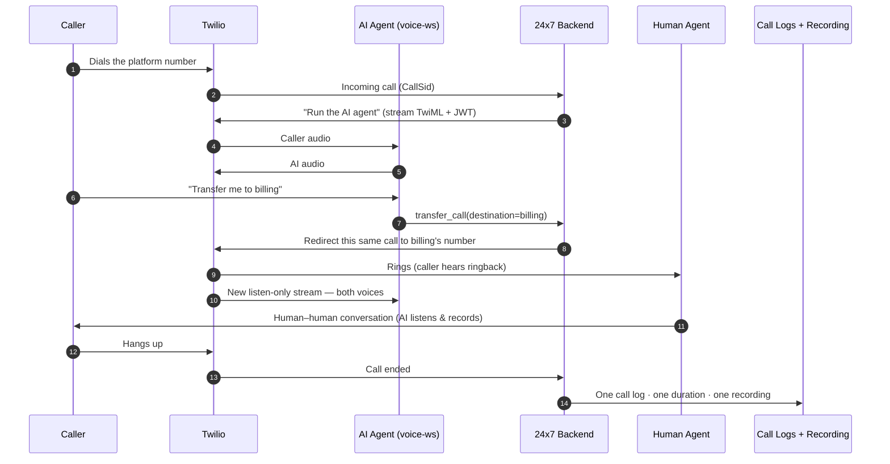
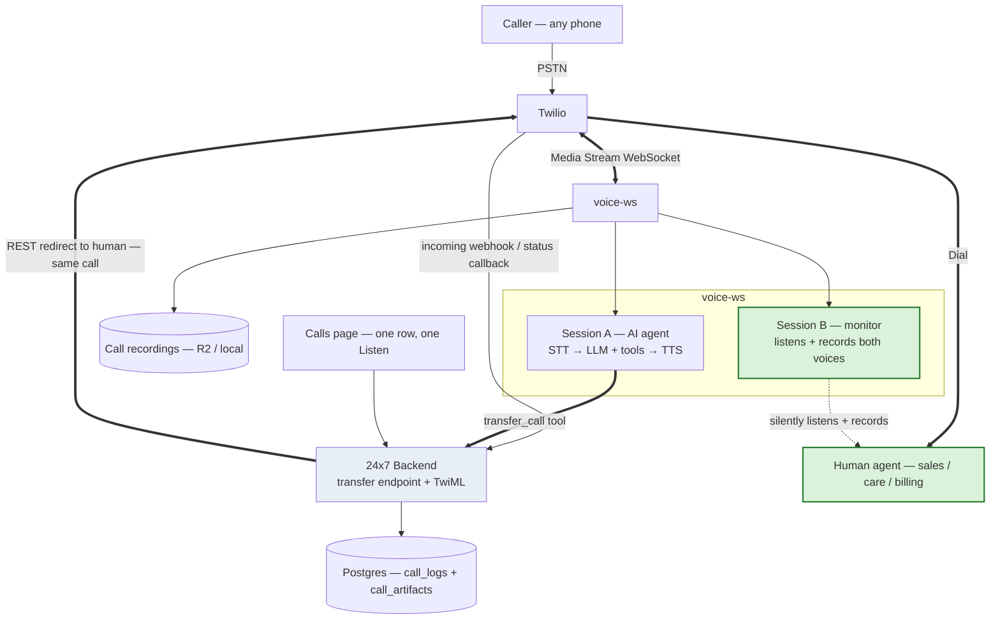
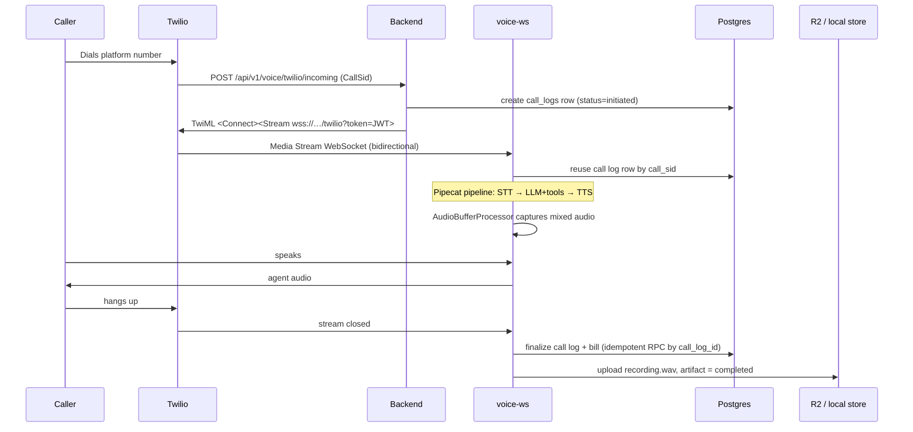

# Call Transfer to a Human (AI Router + Silent Monitor)

> Feasibility analysis and target architecture for routing an in-progress AI
> voice call to a human agent while keeping the AI on the call silently, and
> recording the entire call as one auditable unit under call logs.

## Verdict

**Feasible — yes.** The platform already has ~80% of the required plumbing:

- **Call lifecycle:** inbound Twilio → backend webhook → one `call_logs` row
  keyed by `CallSid` → voice-ws Media Stream session → status callback
  finalizes the same row (`backend/src/voice_agents/voice_routes.py`,
  `voice-ws/src/call_tracking.py`).
- **Call recording:** voice-ws `RecordingCoordinator` + `AudioBufferProcessor`
  mixed-audio capture, private R2/local storage, `call_artifacts` metadata,
  authenticated playback in the Calls page (`voice-ws/src/recording.py`,
  `shared/call_recordings/`, `frontend/src/app/(dashboard)/calls/page.tsx`).
- **Session JWT** already carries `call_sid`; the token is a plain signed JWT
  (reusable, not single-use) — reconnect-safe
  (`shared/voice_agents/voice_session_service.py`).
- **Entitlement pre-check** already excludes the in-progress call's own
  `call_sid` from the active-call count
  (`shared/billing/voice_session_entitlement.py`).
- **Tool system:** agents already invoke platform tools from speech; the
  `ToolContext` passed to every tool is explicitly reserved for session/call
  metadata (`shared/voice_agents/tools/base/tool_context.py`).

The genuinely new pieces are the **transfer mechanism** on the Twilio leg and
**single-recording continuity** across the pre/post-transfer sessions. Both
have clean, provider-supported designs (below).

Notable: the marketing site already promises this behavior (`index.html` FAQ:
"24x7 AI recognizes escalation signals and transfers the call to you... You
configure the fallback number in your dashboard"), and a `call-transfer` skill
was seeded then retired as a stub ("no concrete transfer mechanism to integrate
with" — `docs/02_features/voice_agents/skills_library.md`). This design is that
missing mechanism.

---

## How it works — the 60-second version

Plain-language walkthrough of the end-to-end behavior once this lands:

1. **One call already has one identity.** Routing, AI conversation, and
   wrap-up (call log, recording, billing) are all keyed to one provider call ID
   (`CallSid`). The platform already treats one phone call as one auditable
   unit — that is the foundation everything below builds on.
2. **The AI learns a new tool: `transfer_call`.** The org configures named
   destinations — e.g. `sales: +1…`, `customer-care: +1…`, `billing: +1…` — on
   the agent, the same way any tool is configured today. When the caller asks
   to speak to a person (or the AI decides the intent needs one), the AI calls
   this tool with the destination name.
3. **The transfer is a *redirect*, not a new call.** The backend tells
   Twilio to keep the caller's existing call and now dial the destination
   number — one REST instruction, **same CallSid**. The caller hears the
   human's line ring; the human answers; the original caller and the human are
   now talking on what is still the *same platform call*.
4. **The AI goes silent — guaranteed.** For the human phase, Twilio connects
   a **listen-only** stream carrying both humans' audio. The AI can hear and
   record everything, and it physically cannot speak: the stream type forbids
   it. There is no "remember to mute the AI" logic to get wrong.
5. **One recording for audit.** The AI phase (session A) and the human phase
   (session B) are recorded as two audio segments, then merged into a single
   WAV attached to the same call-log entry. The Calls page keeps one row per
   call with one Listen button — plus a new "Transferred to +1…" badge.
6. **Billing and limits don't change.** One call = one duration = one credit
   debit (idempotent by call), counted once against the concurrent-call limit,
   whether or not a transfer happened.

What it looks like end to end:



## What changes — at a glance

| Area | Today | After this feature |
| --- | --- | --- |
| Twilio call instructions | `<Connect><Stream>` — AI only | Same + one REST update to `<Start><Stream track="both_tracks">` + `<Dial>` when transferring |
| Call identity | One CallSid per call | Unchanged — transfer is a redirect of the same call |
| voice-ws | One Pipecat session per call | Session A (AI, unchanged) + optional session B (monitor: listens and records only, no LLM/TTS) |
| Agent capabilities | Tools: calendar, sheets, MCP, skills… | New `call_transfer` platform tool; destinations configured per agent |
| Recording | One WAV per session, one artifact row | Two segments merged into one WAV; still one artifact row per call |
| Call logs / Calls page | Status, duration, Listen playback | Same + "Transferred to +1…" badge and new audit columns |
| Billing | One idempotent credit debit per call at teardown | Unchanged — one final debit covering the full duration |
| Concurrency limits | Counted from active call-log rows | Unchanged — the same call counts once across both phases |
| Web (browser) calls | Transfer not applicable | Unchanged in v1 (see §7 for the v2 bridge) |

## Architecture — high level

New pieces are green; existing components keep their current shape.



> The rest of this document is the deep technical design behind these two
> diagrams: exact TwiML, reconnect mechanics, recording continuity, billing
> edge cases, and the build plan.

---

## 1. Requirements mapped to current state

| Requirement | Feasible? | Basis |
| --- | --- | --- |
| AI asks caller for intent, routes to sales/care/billing number | Yes | New `call_transfer` platform tool; LLM decides; destinations in tool config |
| Transfer keeps caller on the same call | Yes | Twilio REST `POST /Calls/{CallSid}` with new TwiML — same CallSid, caller leg never disconnects |
| AI stays on the call silently (listening, not speaking) | Yes | Provider-enforced: `<Start><Stream track="both_tracks">` is **unidirectional** — the WebSocket cannot inject audio |
| Human–human audio recorded too | Yes | `both_tracks` stream delivers both parties to voice-ws; existing recorder captures it; segments merged into one file |
| One call log entry / one recording / one audit unit | Yes | Same `CallSid` throughout → same `call_logs` row → same `call_log_id` → one `call_artifacts.recording` row (merged WAV) |
| Web (browser) calls transfer to a human phone | No (v1) | Browser WebSocket has no PSTN leg; needs a second dial-out leg bridged into the session (v2, §7) |

---

## 2. Current call flow (what exists today)



---

## 3. Target architecture

### 3.1 Transfer mechanics (the keystone)

Twilio constraint (verified against current Twilio docs):

- `<Stream>` is only valid inside `<Start>` (unidirectional, listen-only) or
  `<Connect>` (bidirectional). It **cannot** be nested inside `<Dial>`.
- `<Connect><Stream>` receives only the caller track and takes control of the
  call — it blocks any subsequent `<Dial>` until it ends.
- `<Start><Stream track="both_tracks">` followed by `<Dial>` streams **both**
  participants of the bridged human call and is **listen-only by design**.

Transfer therefore uses a **REST TwiML update** on the in-progress call
(`POST /2010-04-01/Accounts/{sid}/Calls/{CallSid}.json` with `Twiml=…`):

```xml
<Response>
  <Start>
    <Stream name="human-leg" track="both_tracks"
            url="wss://{VOICE_WS_TWILIO_URL}/twilio?token={JWT}">
      <Parameter name="token" value="{JWT}"/>
    </Stream>
  </Start>
  <Dial answerOnBridge="true" timeout="30">+15551234567</Dial>
</Response>
```

Effects:

- **Same CallSid** — the caller's call is redirected to dial the human agent.
  One call, one call log, one duration, one bill.
- Executing new TwiML ends the old `<Connect><Stream>` leg → voice-ws session A
  tears down; Twilio immediately opens a **new** WebSocket to the same
  `/twilio` endpoint with the same JWT (same `call_sid` claim). Session B =
  "monitor session".
- Session B's stream is unidirectional, so the AI **cannot speak** into the
  human call — "silent AI" is enforced by the provider, not by application
  discipline. The AI still receives both parties' audio (record; optionally
  transcribe).
- `<Start>` connects **before** the human answers, so there is no recording gap
  at the hand-off. The caller hears ringback while the human's phone rings.

Why not `<Conference>`? A conference enables whisper/barge-in (AI hears one
party while speaking to the other) but requires restructuring the call into a
conference room plus a separate media participant leg. It is the right upgrade
path for "coaching/barge-in" later (§7); overkill for routing + silent monitor
now.

### 3.2 Two-phase session: AI phase → monitor phase

```mermaid
sequenceDiagram
    participant Caller
    participant Twilio
    participant Backend
    participant WS as voice-ws
    participant DB as Postgres
    participant R2 as R2 / local store

    Note over Caller,WS: Phase A — AI agent (existing flow)
    Caller->>WS: "please transfer me to billing"
    WS->>WS: LLM calls transfer_call(destination=billing)
    WS->>Backend: POST /api/v1/voice/twilio/transfer (session JWT, billing)
    Backend->>Twilio: POST /Calls/{CallSid} TwiML=&lt;Start&gt;&lt;Stream both_tracks/&gt;+&lt;Dial&gt;
    Backend->>DB: call_logs.transfer_status=initiated, transfer_destination
    Twilio->>WS: (close old stream) — session A teardown
    WS->>R2: upload segment A (segments/000.wav), artifact stays pending
    Note over WS: run_bot teardown SKIPS finalize + billing (flagged)
    Twilio->>WS: new stream (both_tracks) — session B, monitor mode
    Note over WS: monitor handler: decode mulaw, capture audio, no LLM/TTS
    Caller->>Human: conversation (human answered)
    Human->>Caller: conversation
    WS->>WS: capture both tracks into RecordingCoordinator
    Caller->>Twilio: hangs up
    Twilio->>WS: stream closed — session B teardown
    WS->>R2: upload segment B, read A, merge → recording.wav
    WS->>DB: artifact=completed, finalize call log + bill (full duration)
```

### 3.3 Call identity, billing, audit — all single-unit

| Concern | Behavior |
| --- | --- |
| Call identity | One Twilio `CallSid` for the whole call (REST update, not hangup+redial). Backend webhook and status callback keep working unchanged. |
| Call log | One row. `start_call_tracking` already reuses the row by `call_sid` (`voice-ws/src/call_tracking.py`); status callback maps `in-progress`/`completed` onto the same row. |
| Duration | Final `end_call_tracking` computes from `started_at` (original call start) — covers AI + human phases. |
| Billing | One debit via the idempotent `consume_voice_call_credits` RPC keyed by `call_log_id`. **Critical:** session A's teardown must NOT run `end_call_tracking` when a transfer is pending — an early finalize would bill the mid-call duration and the idempotent RPC would then no-op on the correct final duration. |
| Concurrency limit | The same call counts once: session B's pre-check excludes its own `call_sid` (`_count_active_calls`), and the row stays in an ACTIVE status across the gap (never marked completed between phases). |
| Recording | One artifact row `(call_log_id, artifact_type='recording')`; one final WAV (merged segments, same mulaw 8 kHz mono on both phases). |
| Audit view | Unchanged Calls page: `recording_available` + "Listen" playback + consent banner already implemented; add a "Transferred to +1…" indicator. |

### 3.4 Recording continuity (segment + merge)

Each voice-ws session owns its own in-memory audio buffer and uploads at
teardown. Two sessions → two objects. Design:

1. Session A (AI phase): upload `segments/000.wav`; artifact row upsert stays
   `pending` with `metadata.segments = ["segments/000.wav"]`.
2. Session B (monitor phase): capture starts at stream connect (before the
   human answers); at teardown upload `segments/001.wav`, read `000`, merge
   (same codec/params — both Twilio mulaw 8 kHz mono; WAV concat is
   header-recompute + byte append), upload final `recording.wav`, upsert
   artifact `completed` with merged sha256/size/duration.
3. **Gap case:** caller hangs up while the human's phone is still ringing or
   nobody answers — session B may be brief or never start. The backend status
   callback (`completed`) becomes the finalizer: if the artifact is still
   `pending` with segments, merge what exists (even a single segment is a valid
   recording).
4. **Failure case:** merge or final upload fails → artifact marked `failed`
   with `metadata.parts` retained so support/retry tooling can finish it. The
   call log and billing are unaffected (recording is best-effort by design).
5. Merge logic lives in `shared/call_recordings/` so voice-ws and backend share
   one implementation.

Browser calls (session A only, no transfer) keep today's single-upload path
unchanged. A future web→PSTN bridge (§7, v2) crosses codecs (16 kHz PCM browser
vs 8 kHz mulaw Twilio) and needs resampling at merge — out of scope for v1.

---

## 4. What needs to be built

### 4.1 Backend

1. **`POST /api/v1/voice/twilio/transfer`** — authenticated with the
   `voice_ws_session` JWT (verified via shared `voice_session_service`, same as
   voice-ws). Validates: session purpose=phone, claims' `call_sid` matches the
   body, org owns the agent. Builds the transfer TwiML (reuses
   `resolve_twilio_stream_base_url`) and calls Twilio REST
   `client.calls(call_sid).update(twiml=…)` via the existing `TwilioService`
   credentials. Records `transfer_status=initiated`, `transfer_destination`,
   `transferred_at` on the call log row. Idempotent: a second call for the same
   `call_log_id` no-ops.
   - Alternative (documented, not recommended): voice-ws calls Twilio REST
     directly — it already holds `TWILIO_ACCOUNT_SID`/`AUTH_TOKEN` for
     `auto_hang_up`. Keeps TwiML + public-URL resolution in one place
     (backend) instead, which is why the endpoint is preferred.
2. **Alembic migration** for audit columns (after user review/approval, per
   repo policy):
   - `call_logs.transfer_destination VARCHAR(30) NULL`
   - `call_logs.transferred_at TIMESTAMPTZ NULL`
   - `call_logs.transfer_status VARCHAR(20) NULL` (`initiated | connected |
     failed | none`)
   - Update `docs/DATABASE_SCHEMA.md` (table, indexes, migration history,
     ER diagram) when the migration lands.
3. **Status-callback finalizer** (§3.4 gap case): on `completed`/`no-answer`,
   if artifact is `pending` with segments → merge + mark completed/failed.
4. Optional: `call_logs.direction` column — already moot for transfers
   (inbound), so defer unless the outbound feature lands.

### 4.2 voice-ws

1. **`call_transfer` tool wiring.** The transfer decision is an LLM tool call.
   Two layers:
   - `shared/voice_agents/tools/implementations/call_transfer.py` — new
     `BaseTool`; config = named destinations (`{"billing": "+1…", "sales":
     "+1…", "default": "+1…"}`) via the standard agent-tool config drawer (no
     new table). Function: `transfer_call(destination: str)`.
   - **Session context:** the tool needs `call_sid` + `session_id` + `purpose`.
     `ToolContext` is the designed extension point — populate it in
     `assemble_agent_tools`/handler creation with claims data. Guard: if
     `purpose != "phone"` or no `call_sid`, return
     `{"error": "transfer unavailable on this channel"}` and the LLM tells the
     caller the platform can't transfer web calls yet.
2. **Transfer orchestration in `run_bot`.** When the tool fires:
   1. Set a session flag `transfer_pending` and record the destination.
   2. Let the LLM finish its closing line ("I'm transferring you to billing
      now…") — the REST update must be **deferred until the assistant turn's
      TTS completes**, otherwise the stream teardown cuts the announcement off.
      Implementation: a frame processor that triggers the transfer on
      `LLMFullResponseEndFrame` (or a small configurable grace delay).
   3. POST to the backend transfer endpoint; on success set
      `transfer_initiated=True`.
3. **Teardown guard (critical):** in `run_bot`'s `finally`, if
   `transfer_initiated` → upload segment A, **skip** `end_call_tracking` and
   billing; session B owns finalization. If the tool fired but the REST call
   failed → finalize normally (call continues as AI-only).
4. **Monitor session** (session B): the reconnect hits the existing `/twilio`
   endpoint with the same JWT. Instead of `run_bot`, a lightweight handler:
   - Reuses `parse_telephony_websocket` for the Start handshake and
     `resolve_session_token`.
   - Decodes mulaw chunks (`audioop.ulaw2lin`) into PCM and feeds the existing
     `RecordingCoordinator.capture_audio` — **no Pipecat pipeline, no LLM, no
     TTS** (stream is listen-only anyway; this guarantees silence and avoids
     serializer assumptions about `track="outbound"` chunks).
   - Looks up the call log row by `call_sid`, prepares the coordinator with the
     same `call_log_id`, uploads segment B, runs the shared merge, marks
     artifact completed, then `end_call_tracking` (finalize + bill).
   - Optional but cheap: pipe both tracks to the same STT provider for a
     human-phase transcript (transcription itself is still a future phase per
     `call_recording_and_transcription.md`).

### 4.3 Frontend

1. Agent tools drawer: `call_transfer` tool appears automatically via the
   platform tool registry (`platform-tools-manager.tsx` pattern); config UI =
   the standard `config_schema` form (destinations, optional intro message).
2. Calls page: show transfer badge (`Transferred → +1…`, transferred_at) when
   `transfer_destination` is set; playback unchanged.

### 4.4 Config / env

- No new required env for v1 (reuses `TWILIO_ACCOUNT_SID`/`AUTH_TOKEN`,
  `VOICE_WS_TWILIO_URL`, `VOICE_RECORDING_ENABLED`).
- Optional tunables: transfer grace delay (ms), `Dial timeout`, "transfer
  allowed" org feature flag (maps cleanly onto the existing entitlement
  definitions if the product wants it gated).
- Document in `docs/ENV_VARS.md` and the `.env.*.example` templates.

---

## 5. Feasibility caveats and risks

| Risk | Severity | Mitigation |
| --- | --- | --- |
| Twilio stream teardown semantics on TwiML update (old `<Connect>` WS close timing) | Medium | Documented Twilio behavior; confirm in the P0 spike with Twilio trial number before building. The design tolerates either order (session B connects independently; segments merge regardless). |
| Announcement cut off at transfer ("I'm transferring you…") | Medium | Defer REST update until `LLMFullResponseEndFrame`/grace delay; verify in spike. |
| Double-billing if session A finalizes mid-transfer | High | Teardown guard (§4.2.3); integration test asserting the second teardown is the only bill. |
| Recording gap if monitor stream fails to connect | Low | `<Start>` connects before dial; artifact keeps segment A + `failed` state if B never uploads; gap is seconds at worst. |
| Merge across differing formats (future web bridge) | Medium | v1 is phone-only (mulaw 8 kHz both phases); guard + documented limitation for v2. |
| Two-party consent for recording human agents | Medium | Existing recording consent banner + org opt-in (`VOICE_RECORDING_ENABLED`) extend to transferred calls; product owner must confirm jurisdiction coverage (already flagged in `call_recording_and_transcription.md`). |
| `call_transfer` tool available on web calls | Low | Tool returns channel-unavailable; prompt instructions tell the agent. |
| Session JWT 15-minute TTL on very long calls | Low | Pre-existing limitation; transfer issues a fresh token with the same `call_sid`/`session_id` (and a `mode=monitor` claim for session B). |
| Human deadline — 15-min TTL reapplies to monitor phase | Low | Monitor mode doesn't need the LLM; if it expires mid-call, recording continues (already connected); document. |
| Cost | — | The dialed human leg is a normal Twilio outbound leg (seconds billed), plus one extra Media Stream per transferred call; voice minutes billed to the org as today (product decision: transfer minutes billable? Probably yes — platform owns monitoring/recording). |

---

## 6. Testing strategy (repo TDD requirements)

1. **Unit:** transfer TwiML builder (params, both_tracks, wss base resolution);
   mulaw decode + WAV segment merge (equal/unequal lengths, single segment,
   missing part); `transfer_call` tool (valid/invalid destination, non-phone
   purpose, missing call_sid); teardown guard (transfer skips finalize &
   billing; failed transfer finalizes); idempotent transfer endpoint.
2. **Integration (mocked Twilio):** incoming webhook → transfer endpoint →
   asserts REST `calls.update` payload and call-log audit columns; status
   callback finalizer merges pending segments.
3. **E2E-style manual (grey-box, mirror `run-e2e.sh`):** local Twilio trial
   number (ngrok, `VOICE_WS_TWILIO_URL`) → call agent → say "transfer to
   billing" → human answers a second phone → verify: single call log row,
   single merged WAV containing both phases (AI + human dialogue), correct
   duration/billing, playback in Calls UI.
4. **Release gate:** the existing browser/PSTN calling release gate must pass
   with transfer enabled; `1006` on the transferred call is *expected* at the
   phase boundary — assert the monitor stream reconnects and the artifact
   completes.

## 7. Phased plan

| Phase | Scope | Notes |
| --- | --- | --- |
| P0 spike (½–1 day) | Twilio trial: REST TwiML update of an in-progress `<Connect><Stream>` call → verify old WS closes, new `both_tracks` WS opens with same token, audio arrives, `<Dial>` rings human | De-risks §5 items 1–2; no code |
| P1 MVP | Backend transfer endpoint + migration + finalizer; `call_transfer` tool + `ToolContext` session data; voice-ws teardown guard + monitor session + segment merge; Calls-page badge; docs (DATABASE_SCHEMA, ENV_VARS, this doc) | PSTN-only; silent AI + full-call recording = done |
| P2 | Web→PSTN bridge (second dial-out leg joined into the session) with codec conversion at merge; DTMF routing ("press 1 for sales") in addition to LLM routing; conference-based whisper/barge-in for live agent coaching; transcript of human phase via the future transcription worker | Each independently shippable |

## 8. Explicitly out of scope (v1)

- Browser/embed/public-page call transfer to a phone human (needs P2 bridge).
- Whisper/barge-in (AI speaks only to the human agent, or interrupts).
- Warm transfer with context handoff to the human ("the caller is asking
  about…, here's the summary") — easy to add later: the LLM can emit a summary
  into the monitor session's transcript; surfaced to the human via SMS/UI
  notification. Product candidate.

---

## References

- `docs/03_implementation/call_recording_and_transcription.md` — recording
  pipeline this feature extends (capture, R2, artifacts, retention, consent).
- `docs/03_implementation/outbound_phone_calls.md` — the same `<Connect><Stream>`
  pattern for outbound; the transfer's `<Dial>` leg is the mirror image.
- `docs/01_architecture/twilio_call_flow.md` — inbound flow diagram.
- Twilio docs: `<Start>`/`<Stream>`, `track` semantics (`both_tracks`),
  `<Dial>`, updating in-progress calls via REST, call recording.
- Code: `backend/src/voice_agents/voice_routes.py`,
  `voice-ws/src/bot.py`, `voice-ws/src/recording.py`,
  `voice-ws/src/call_tracking.py`, `voice-ws/src/main.py`,
  `shared/call_recordings/storage.py`,
  `shared/voice_agents/tools/base/tool_context.py`.