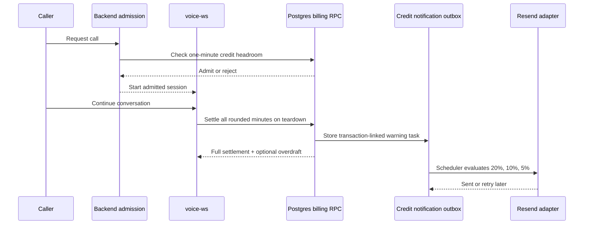

# Credit Usage Enforcement and Low-Balance Notifications

## Decision summary

Usage prices are system-wide runtime rules, not plan entitlements. The platform
currently charges for only these activities:

| Activity | Meter | Runtime behavior |
| --- | --- | --- |
| Voice call | Connected whole minutes | Duration is rounded up; a call shorter than one minute costs one unit. |
| Local number rental | Active number / month | Charged at purchase and at each monthly renewal. |
| Mobile number rental | Active number / month | Same lifecycle as a local number, with its own rate. |
| Toll-free number rental | Active number / month | Same lifecycle as a local number, with its own rate. |

The platform-admin UI for these rates lives at **Plan Catalog → Usage pricing**
alongside plans and entitlements. The table is intentionally finite: admins
edit the credit cost and description, while the runtime owns the activity,
meter, and billing interval. A zero rate means the activity is currently free.
Call recording is a plan feature with one month of free retention for now; it is
not a metered usage charge.

## Call admission and settlement

The system uses prepaid admission for new calls. Before a voice session starts,
the backend checks that the organization can cover at least one billable minute
and that plan entitlements allow another concurrent call. If the check fails,
the new call is rejected.

Once a call is admitted, it is never dropped just because the balance reaches
zero during the conversation. On teardown, `voice-ws` calculates the complete
rounded duration and calls the atomic `consume_voice_call_credits` RPC. The RPC
settles the full amount, even if that creates a temporary negative plan-credit
balance. It records any `overdraft_credits` in the ledger metadata and places a
low-credit evaluation in the notification outbox. The negative balance blocks
the next call until credits are restored.

## Phone-number lifecycle

The Twilio number is purchased only after the initial credit check. If the
credit debit fails after the provider purchase, the provider number is
released and the local row is not retained. Monthly renewals use the current
system rate. A failed renewal moves the number to `past_due`, starts a seven-day
grace period, and is retried by the daily rental scheduler. If payment is still
not possible at the end of grace, the number is released from Twilio and the
local record is cancelled. This avoids silently absorbing provider costs while
giving business owners time to recharge.

## Notification behavior

Low-credit warnings are relative to the current plan version's included credits,
not to the absolute credit price. The thresholds are 20%, 10%, and 5%, each sent
at most once per billing cycle. Organization admins are the recipients. A grant
or purchase clears the threshold marker and re-arms the sequence.

Every successful debit creates one idempotent `credit_notification_outbox` row.
The notification scheduler runs every five minutes by default and processes
both this outbox and failed provider delivery logs. A successful recipient
delivery is protected by its stable idempotency key; failures remain pending and
record attempt diagnostics for a later retry. Provider errors never turn a
successful usage debit into a failed user action.

Resend is the initial provider, configured through `EMAIL_PROVIDER`,
`RESEND_API_KEY`, `RESEND_FROM_EMAIL`, and `RESEND_FROM_NAME`. The billing and
notification services depend on the provider-neutral adapter contract, so a
future SendGrid adapter can be added without changing pricing or template
logic.

## Operations and testing

Apply migrations with `cd backend && alembic upgrade head`. Migration
`20260811000004` seeds the required `credits.low_balance` event so production
does not depend on a manual seed script. The seed script remains useful for
backfilling the rest of the built-in notification registry.
Migration `20260812000001` enables RLS on the service-owned outbox. Migration
`20260812000002` keeps phone-rental and other regular debits compatible with a
negative plan balance left by a completed voice call: positive admin and
purchased pools remain spendable, while the call debt is preserved.
Migration `20260812000003` updates the seeded notification registry so the
stored event metadata matches the 20/10/5 policy.

The behavior is covered at three boundaries:

- Backend unit tests cover threshold transitions, outbox idempotency, retry
  behavior, provider delivery, phone-rental grace handling, and scheduler
  coordination.
- Migration contract and staging checks verify the seeded event, outbox table,
  and final-call RPC are present at the migration head.
- Playwright browser smoke coverage verifies the consolidated Plan Catalog URL,
  usage-pricing rows, system billing rules, and activity explanations/tooltips.
