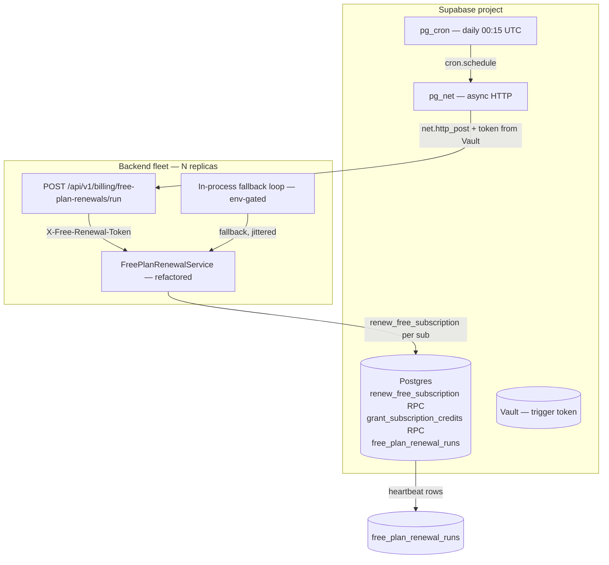
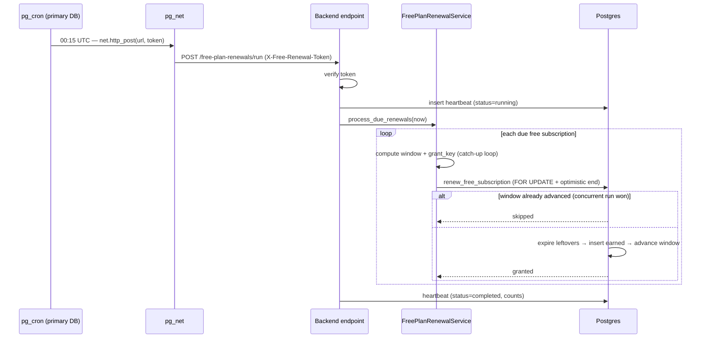

# Free-Tier Monthly Credit Refresh — Implementation Plan

> How to reliably refresh the free plan's monthly credit allocation, choosing
> between Supabase `pg_cron` and external triggers, with a race-condition
> analysis for a horizontally scalable backend. Plan only — no code changes in
> this document.

## TL;DR

The **mechanism already exists and is wired up** — the missing piece is a
**deterministic, race-free trigger**. Recommended design:

1. **Primary trigger: Supabase `pg_cron`** (daily, fixed UTC time) → `pg_net`
   `net.http_post` → a new backend endpoint that runs the renewal pass.
   The database is always up when the backend is reachable, so the schedule is
   deterministic and survives backend deploys/restarts.
2. **Race hardening: one new atomic SQL RPC** (`renew_free_subscription`) so
   each subscription renewal (due-check → grant → period advance) commits as a
   single row-locked transaction. This makes concurrent runs — cron retry,
   manual ops run, multiple backend replicas — structurally incapable of
   double-granting or clobbering the period window.
3. **Keep the existing in-process asyncio loop** as a fallback (env-gated),
   now harmless because the RPC serializes per-subscription work.
4. **Observability:** heartbeat table (`free_plan_renewal_runs`) + existing
   OpenTelemetry logs; cron execution is visible in `cron.job_run_details`.
5. **Data repair:** migration that backfills `billing_mode` /
   `credit_grant_policy` / period windows on legacy free subscriptions that the
   current scheduler silently skips.

External cron services are rejected: none exists today, and a billing-critical
schedule should not depend on a third-party or CI scheduler.

---

## 1. Current state (evidence from the codebase)

The refresh path is **partially built**:

| Piece | Status | Location |
| --- | --- | --- |
| Free plan version + `included_credits_per_billing_period` entitlement | Done | `backend/alembic/versions/20260808000011_make_free_plan_usable.py` |
| Free plan activation (binds org, sets `current_period_start/end`, grants initial credits) | Done | `backend/src/billing/versioned_subscription_service.py` → `activate_free_plan()`; UI: onboarding + plan selection |
| Atomic idempotent grant RPC (`grant_subscription_credits`, `FOR UPDATE` + `grant_key`) | Done | `backend/alembic/versions/20260808000012_add_atomic_subscription_credit_grant_rpc.py` |
| Renewal service: due scan, multi-period catch-up, idempotent grant keys | Done | `backend/src/billing/free_plan_renewal_scheduler.py` |
| Renewal loop wired into backend startup | Done | `backend/main.py` lifespan (`start_free_plan_renewal_scheduler`) |
| Tests (due renewal, downtime catch-up) | Done | `backend/tests/billing/test_credit_grant_service.py` |
| **Deterministic trigger (wall-clock schedule)** | **Missing** | loop sleeps 24 h from process boot — no fixed time |
| **Cross-instance atomicity of the period advance** | **Missing** | grant is atomic, the window `UPDATE` is a separate unconditional write |
| **DB-level trigger (runs even if backend fleet restarts at renewal time)** | **Missing** | nothing schedules at the database |
| **Observability of runs** | **Missing** | no heartbeat/run-log table |
| **Legacy free subscriptions** | **Broken** | pre-versioning rows lack `metadata.billing_mode=free` → scheduler skips them forever |

### How a renewal works today (per subscription)

```mermaid
sequenceDiagram
    participant Loop as Backend loop (per instance)
    participant DB as Postgres
    participant Ledger as credit_transactions

    Loop->>DB: select active subscriptions
    Loop->>Loop: filter billing_mode=free, policy=recurring, period_end <= now
    Loop->>Loop: catch-up: advance past missed periods (grant only the current one)
    Loop->>DB: grant_subscription_credits RPC (row lock + idempotency key)
    DB->>Ledger: expire leftovers, insert earned row (one transaction)
    Loop->>DB: UPDATE organization_subscriptions (period window)  ← separate txn, unconditional
```

### Why it feels "not implemented"

- **Timing is boot-relative, not wall-clock:** each instance starts its loop at
  boot and sleeps 24 h; nothing guarantees a daily renewal at a fixed time.
- **Instance-bound:** if every backend replica is down/restarting at the
  boundary, renewal is late (recovered on next run — acceptable but not
  deterministic).
- **Multi-instance duplication:** every replica runs the same pass. Safe today
  *only* by two subtle invariants: (a) the grant RPC is atomic + idempotent,
  and (b) concurrent replicas compute identical catch-up sets from identical
  snapshots. The period-window `UPDATE` has no `WHERE current_period_end =
  …` guard — a slow replica could theoretically overwrite a newer window.
  This is fragile-by-accident, not designed.
- **No observability:** you can't tell from the DB when a renewal ran, how many
  orgs were granted, or why one was skipped.

---

## 2. Options analysis

| Option | Scheduler location | Race exposure (horizontal scaling) | Determinism | Existing infra? | Verdict |
| --- | --- | --- | --- | --- | --- |
| **A. Supabase `pg_cron` → `net.http_post` → backend endpoint** (recommended) | Postgres (single primary) | Single trigger; endpoint additionally idempotent via new atomic RPC → zero duplicate-grant risk even on manual/retry runs | Fixed wall-clock (e.g. 00:15 UTC daily); job history in `cron.job_run_details` | Yes — `pg_cron` + `pg_net` ship with Supabase (enable per project); no new services | **Recommended** |
| B. Pure-SQL renewal function scheduled by `pg_cron` (no HTTP hop) | Postgres | Same single-trigger guarantee | Highest (DB-only) | Yes | Strong, but duplicates calendar/state logic into PL/pgSQL and is hard to test in this pytest-based repo; keep as fallback design |
| C. Keep only the in-process asyncio loop (current), hardened with advisory locks | Each backend replica | Requires cross-instance locking (session-level advisory locks are awkward through a pooled Supabase client); still instance-bound | No fixed time; no run if fleet is down | Yes | Interim/fallback only |
| D. Lazy refresh on balance read / call start (no scheduler) | Hot path | Needs its own locking; moves billing writes into call-start/read paths | N/A | Yes | Backstop concept; not primary — complicates hot paths and period semantics |
| E. External cron (GitHub Actions, cron-job.org, Cloud Scheduler, Edge Functions) | Third party / extra infra | Depends on external availability + credentials | Depends on provider | **No** — none exists | Rejected: new ops dependency for a billing-critical schedule; Edge Functions add another runtime for no benefit |

`pg_cron` runs on the **primary** database node only — a single executor by
construction, which is exactly the property needed for a monthly-refresh job.
Supabase's documented pattern is `pg_cron` scheduling a `net.http_post`
(`pg_net`), with secrets kept in Supabase Vault; job runs and HTTP responses
are inspectable (`cron.job`, `cron.job_run_details`, `net._http_response`).

---

## 3. Recommended design

### 3.1 Architecture



### 3.2 The atomic renewal RPC — the race-condition fix

Today the grant and the period advance are two transactions. Replace both with
one RPC so every renewal is atomic:

```sql
renew_free_subscription(
    p_subscription_id   uuid,
    p_expected_end      timestamptz,   -- optimistic check: current_period_end
    p_credits           int,           -- resolved from plan entitlement
    p_grant_key         text,          -- free-subscription:{id}:{period_start}
    p_new_start         timestamptz,
    p_new_end           timestamptz
) RETURNS jsonb
```

Behavior (one transaction):

1. `SELECT … FROM organization_subscriptions WHERE id = … FOR UPDATE`
2. Re-check under the lock: `status IN ('active','trial')`,
   `metadata->>'billing_mode' = 'free'`,
   `metadata->>'credit_grant_policy' = 'recurring'`,
   `current_period_end <= now`, **and `current_period_end = p_expected_end`**.
   Any mismatch → `{skipped: true, reason: …}` (another run already won).
3. Call the existing `grant_subscription_credits` (same transaction, same
   idempotency semantics — row is already locked).
4. Advance `current_period_start/end` to the new window.
5. Return `{success, granted, balance_after}`.

Why this kills every race:

- **Cron retry / manual run / two replicas at once:** the first run wins the
  row lock, advances the window; the second sees
  `current_period_end != p_expected_end` (or already future) and skips. No
  double grant, no window clobbering.
- **Catch-up after downtime:** Python still owns the calendar math
  (`_next_period_end`, the `while` loop) and passes the exact window — SQL
  stays a pure state machine, keeping all policy logic testable in pytest.

### 3.3 Trigger wiring

- **Endpoint** `POST /api/v1/billing/free-plan-renewals/run` — internal-only
  auth via `X-Free-Renewal-Token` (env `FREE_PLAN_RENEWAL_TRIGGER_TOKEN`,
  random UUID; stored in Supabase Vault so it never appears in `cron.job`).
  Runs `FreePlanRenewalService.process_due_renewals()` and writes a heartbeat
  row. Idempotent by construction (§3.2).
- **Cron bootstrap at backend startup** (`ensure_free_renewal_cron_job()`):
  idempotent upsert of `cron.schedule('free-plan-renewal', '15 0 * * *',
  net.http_post(url := env FREE_PLAN_RENEWAL_ENDPOINT, headers :=
  {…token from vault…}))`. Per-environment URL comes from the app env (local,
  staging, prod), not from a migration — one code path, correct URL everywhere.
  If `pg_cron`/`pg_net` extensions are unavailable (e.g. not yet enabled on a
  managed project), log a warning and continue with the fallback loop.
- **Fallback:** keep `start_free_plan_renewal_scheduler()` (env
  `FREE_PLAN_RENEWAL_SCHEDULER_ENABLED`, default `true`) with a boot jitter
  (0–30 min). Duplicates are harmless now: the RPC serializes per subscription.
  After the cron path is proven in prod, ops can disable the loop.

### 3.4 Sequence — normal monthly renewal



---

## 4. Implementation steps

1. **Alembic migration** (new revision, reviewed before running — per repo
   policy):
   - `CREATE OR REPLACE FUNCTION renew_free_subscription(...)` (§3.2).
   - `CREATE TABLE free_plan_renewal_runs` (id, started_at, finished_at,
     status, processed/granted/skipped/errors, triggered_by, error_detail).
   - **Data repair:** for active subscriptions whose
     `metadata->>'billing_mode' IS NULL` joined to a `plan_versions` row with
     `billing_mode='free'`, backfill
     `metadata = jsonb_set(metadata, '{billing_mode}', '"free"')` (+
     `credit_grant_policy` from the version, `billing_interval`, and
     `current_period_start/end` windows from `started_at`/now). Without this,
     legacy free orgs are skipped forever.
   - Note: `CREATE EXTENSION IF NOT EXISTS pg_cron/pg_net` is **not** part of
     the migration — extension availability differs per environment (managed
     dashboard enable vs local image); the startup bootstrap handles it.
2. **Backend:**
   - Refactor `FreePlanRenewalService.process_due_renewals()` to call
     `renew_free_subscription` (Supabase `rpc()` call) instead of
     grant-then-update; keep calendar math + catch-up loop in Python.
   - New route `POST /api/v1/billing/free-plan-renewals/run` (token check,
     heartbeat write, run, heartbeat finalize; returns `FreeRenewalRunResult`).
   - `ensure_free_renewal_cron_job()` in startup (idempotent, vault lookup,
     warning on missing extensions).
   - Add `free_plan_renewal_check_interval_hours`,
     `FREE_PLAN_RENEWAL_TRIGGER_TOKEN`-backed settings,
     `free_plan_renewal_scheduler_enabled` to `shared/config/settings.py`
     (the first is currently read via `getattr` with a default — formalize it).
3. **Config:** `.env.local/staging/prod` example templates + `docs/ENV_VARS.md`
   (`FREE_PLAN_RENEWAL_ENDPOINT`, `FREE_PLAN_RENEWAL_TRIGGER_TOKEN`,
   `FREE_PLAN_RENEWAL_SCHEDULER_ENABLED`). On managed projects, enable
   `pg_cron` + `pg_net` extensions and store the token in Vault.
4. **Docs:** `docs/DATABASE_SCHEMA.md` (new table + RPC + migration history),
   `docs/SUMMARY.md` link, this plan's "Done" checklist.
5. **Deploy:** run migration with user approval → rollout → verify heartbeat
   rows + `cron.job_run_details`; optionally disable the in-process loop later.

## 5. Testing strategy (repo TDD requirements)

- **SQL/unit (pytest):**
  - `renew_free_subscription`: due → granted + advanced; already-advanced
    (optimistic mismatch) → skipped; cancelled org → skipped; multi-period
    catch-up grants exactly one period; idempotent grant_key replay.
  - Service: same results via mocked RPC; heartbeat rows written/finalized.
  - Endpoint: wrong/missing token → 401; valid token → 200 + result; two
    concurrent requests → one grants, one skips (mocked RPC returning
    `skipped`).
  - Bootstrap: `cron.schedule` upsert idempotency (same jobname → no dup),
    graceful degradation without extensions.
- **Integration (grey-box, isolated stack):** free org activated → period_end
  backdated → POST the endpoint → assert one earned ledger row, advanced
  window, heartbeat `completed`; second POST → no new grant.
- **Manual:** verify `cron.job_run_details` shows the daily run and
  `net._http_response` status 200 on staging before prod rollout.

## 6. Failure modes and recovery

| Failure | Effect | Recovery |
| --- | --- | --- |
| Backend down when cron fires | HTTP 4xx/5xx in `net._http_response`; no grant that day | Next daily run; service catch-up loop advances missed periods (grants the current one only — by design, no accrual) |
| Endpoint double-invoked (retry/manual) | Second run skips everything | Atomic RPC optimistic check |
| Extensions not enabled on managed project | Bootstrap warning; cron job absent | Enable `pg_cron`/`pg_net` in dashboard; restart backend |
| Cron job deleted | No trigger | Bootstrap re-creates on next deploy/restart; fallback loop still runs |
| Grant RPC fails for one org | That org skipped, error counted | Per-subscription try/except continues the pass; visible in heartbeat + logs |
| Local dev: cron container cannot reach backend network | Job errors locally | Fallback loop covers dev; documented (cron URL is compose-network-dependent) |

## 7. Open questions before implementation

1. Confirm `pg_cron`/`pg_net` are enabled on the managed staging/prod projects
   (dashboard → Database → Extensions); local image ships both.
2. Confirm the desired renewal time (00:15 UTC suggested — quiet hours,
   outside typical billing actions).
3. Legacy free-subscription repair: confirm no orgs that *should* stay
   one-time-grant exist among rows without `billing_mode` metadata (repair is
   conservative — only touches active subs bound to a free plan version).
4. Keep the in-process loop permanently as fallback, or disable after cron is
   proven? (Default: keep, env-gated.)

## References

- Code: `backend/src/billing/free_plan_renewal_scheduler.py`,
  `backend/src/billing/credit_grant_service.py`,
  `backend/src/billing/versioned_subscription_service.py`,
  `backend/alembic/versions/20260808000012_add_atomic_subscription_credit_grant_rpc.py`,
  `backend/alembic/versions/20260808000011_make_free_plan_usable.py`,
  `backend/main.py` (lifespan).
- Supabase docs: pg_cron scheduling + pg_net `net.http_post`, cron job
  inspection (`cron.job`, `cron.job_run_details`), Vault for secrets.
- Precedent for DB-level locking in this repo:
  `docs/03_implementation/token_refresh_lock.md`.