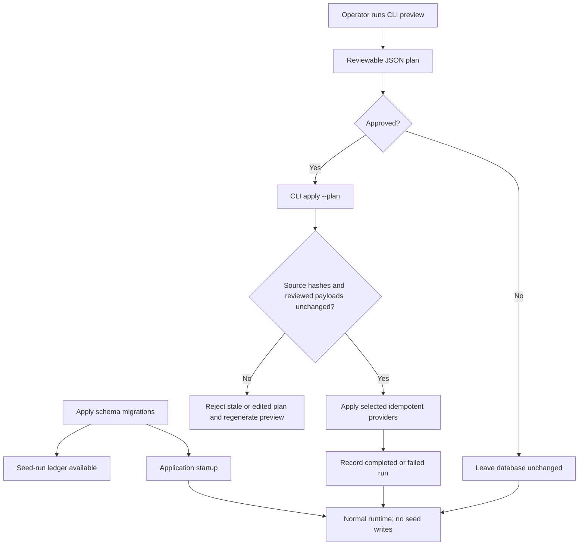

# Master data catalog and seeding

Status: implemented CLI foundation; launch-market and paid-plan decisions remain
review-gated.

This document defines the platform-owned data inventory and the production-safe
workflow for reviewing and applying it. Master data is version-controlled, but
it is not written by application startup and is not managed through a browser
page.

## Scope inventory

| Domain | Current source of truth | Current shape | Seed policy | Launch decision |
| --- | --- | --- | --- | --- |
| Platform skill templates | `backend/src/voice_agents/skill_seeds.py` | 15 markdown skills plus reference files across dental, restaurant, and HVAC | CLI plan and explicit apply; content-hash idempotent; normal apply never deletes | In scope for launch; review content and safety gates per [launch strategy](../05_operations/master_data_launch_strategy.md) |
| Platform tool schemas | `shared/voice_agents/tools/implementations` and `PlatformToolRegistry` | Runtime-discovered tools and function schemas | CLI plan and explicit schema resync | In scope; schema changes must be intentional |
| System usage pricing | `backend/src/billing/system_pricing.py` | Four finite runtime meters: voice minute and three monthly phone-number rentals | CLI apply creates missing rows and preserves existing rates; reset is non-production only | In scope; rates are hypotheses until measured COGS is available |
| Notification events | `backend/src/notifications/templates.py` | Nine built-in event keys with template variables | CLI apply creates missing rows; existing rows remain administrator-owned | In scope |
| Plans and prices | Plan/entitlement migrations plus admin plan catalog | Free plan is migration-managed; no approved paid launch catalog in code | Review-only inventory; blocked from this CLI | Review required; do not seed paid plans from staging data |
| Credit top-up products | `credit_products` plus Stripe catalog | Legacy table with no approved production source definition | Review-only inventory; blocked from this CLI | Review required |
| Entitlement definitions | `20260807000002_add_plan_versioning_and_entitlements.py` | Runtime-enforced limit and feature keys | Migration-managed | In scope as inventory, not a second seeder |
| Onboarding voice templates | `20260329000001_add_onboarding_and_voice_templates.py` | Five starter templates: dental, HVAC, salon, real estate, plumbing | Migration-managed | In scope as inventory; align with industry rollout later |
| Voice pipeline presets | `20260729000002_add_pipeline_presets_is_default.py` | One system-default realtime preset | Migration-managed | In scope as inventory |
| RBAC catalog | RBAC migrations | System roles, permissions, role grants | Migration-managed | Must exist before CLI apply can be used |
| Platform singleton settings | Phone-number and notification settings migrations | Two singleton configuration rows | Migration-managed | Not re-seeded by this tool |

Organization agents, forks, subscriptions, usage transactions, notification
logs, and customer-owned credentials are not master-data seed targets. They must
never be reset by this mechanism.

## Source and lifecycle model

The source definitions are assembled by `MasterDataService.preview()`. The CLI
serializes the full source payload, current counts, source hashes, and all
domain metadata into a review plan. The plan is read-only until an operator
explicitly runs `apply --plan`.



The `master_data_seed_runs` table records the definition version, source hash,
operation (`seed` or `reset`), status, result, and timestamps. A CLI run has no
browser user ID; its explicit plan file and ledger entry provide the operator
audit trail.

## CLI workflow

The default command is a read-only Markdown review printed to the terminal:

```bash
cd backend
python -m src.master_data.cli
```

Create a navigable Markdown review artifact:

```bash
python -m src.master_data.cli preview \
  --format markdown --output master-data-review.md
```

Create the machine-readable JSON plan used by `apply`:

```bash
python -m src.master_data.cli preview \
  --format json --output /app/.local-data/master-data-plan.json
```

Inspect one domain or render a compact summary:

```bash
python -m src.master_data.cli preview --domain platform_skills --format text
```

Apply only the reviewed plan:

```bash
python -m src.master_data.cli apply \
  --plan /app/.local-data/master-data-plan.json
```

For the isolated Docker stack used for review, keep the plan on the host so it
can be inspected before copying that exact file back into the container:

```bash
SEED_CONTAINER=247ai-master-data-seeding-backend-dev-1
docker exec "$SEED_CONTAINER" python -m src.master_data.cli preview --format text
docker exec "$SEED_CONTAINER" python -m src.master_data.cli preview \
  --format markdown > /tmp/master-data-review.md
docker exec "$SEED_CONTAINER" python -m src.master_data.cli preview \
  --format json > /tmp/master-data-plan.json
jq '.catalog[] | {key, status, seedable, payload}' /tmp/master-data-plan.json
docker cp /tmp/master-data-plan.json "$SEED_CONTAINER:/tmp/master-data-plan.json"
docker exec "$SEED_CONTAINER" python -m src.master_data.cli apply \
  --plan /tmp/master-data-plan.json
```

The CLI rejects the apply if a source definition hash or reviewed payload changed
after preview. This prevents an operator from reviewing one version or payload
and applying another.

Reset is a separate, confirmed operation for local or staging recovery only:

```bash
python -m src.master_data.cli apply \
  --plan /app/.local-data/master-data-plan.json \
  --reset --yes
```

Production reset is rejected. Production corrections should be new,
forward-only, reviewed data changes. For a Docker deployment, run the command
as a one-off backend task (`docker compose run --rm backend-dev ...`); for a
container orchestrator, run it as a completion-tracked release/bootstrap Job.

## Safety rules

- Preview is read-only and is the default behavior.
- Apply requires a plan generated from the current source checkout.
- Normal apply creates missing rows, updates source-backed changes where
  supported, and preserves administrator-owned values where documented.
- Normal platform-skill apply never deletes obsolete rows. Orphan pruning is
  only available through explicit reset behavior and is not supported in
  production.
- Reset requires `--yes` and is rejected in production.
- No operation deletes organization skills, agent configurations, active plan
  subscriptions, credit balances, logs, or credentials.
- Migration-owned rows remain migration-owned. If a new default is required,
  add a migration rather than adding a competing runtime provider.
- The ledger is retained for auditability and to prevent overlapping operations;
  it is not a trigger for application startup writes.

## Provider boundaries

### Code-backed providers

- Platform skills call the existing `skill_service.seed_platform_skills()`.
  Content hashes skip unchanged skills; normal runs do not prune old rows.
- Platform tools call runtime registry discovery and database schema sync.
- System pricing derives from the finite `SYSTEM_PRICING` tuple. A normal seed
  creates missing rows, skips unchanged rows, and preserves administrator-set
  credit rates and activation state; reset restores source defaults.
- Notification events create only missing rows from `TEMPLATE_REGISTRY`.

### Migration-backed providers

RBAC, plan entitlement definitions, the free plan, voice templates, the system
pipeline preset, and platform singleton settings remain migration-owned. If
these need a new default, add a migration and update this inventory.

### Review-gated providers

Paid plan versions and credit top-up products are deliberately not seeded. The
repository does not yet contain an approved launch catalog backed by market
research, measured COGS, Stripe price IDs, support policy, and margin approval.
Staging rows are not a production source of truth.

## Testing and rollout checklist

- Unit tests cover dry-run behavior, reviewed-plan hash validation, explicit
  reset guards, provider idempotency, and non-destructive normal skill apply.
- The existing skill seed-definition tests remain the content-quality gate.
- Apply database migrations through the normal version-controlled release
  process.
- In staging, back up the database, generate and review the plan, apply only
  approved domains, inspect the ledger, and restart the app to confirm startup
  performs no seed writes.
- Before production, generate the plan from the exact release artifact and run
  the apply command as a separately approved one-off release task.
