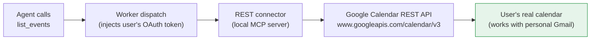
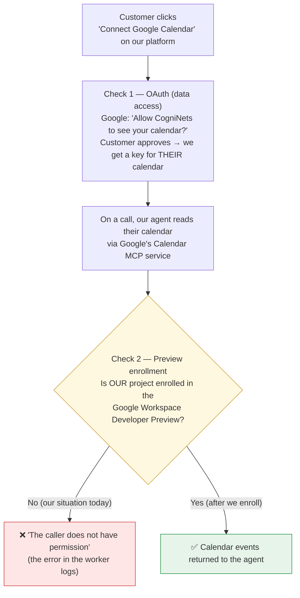
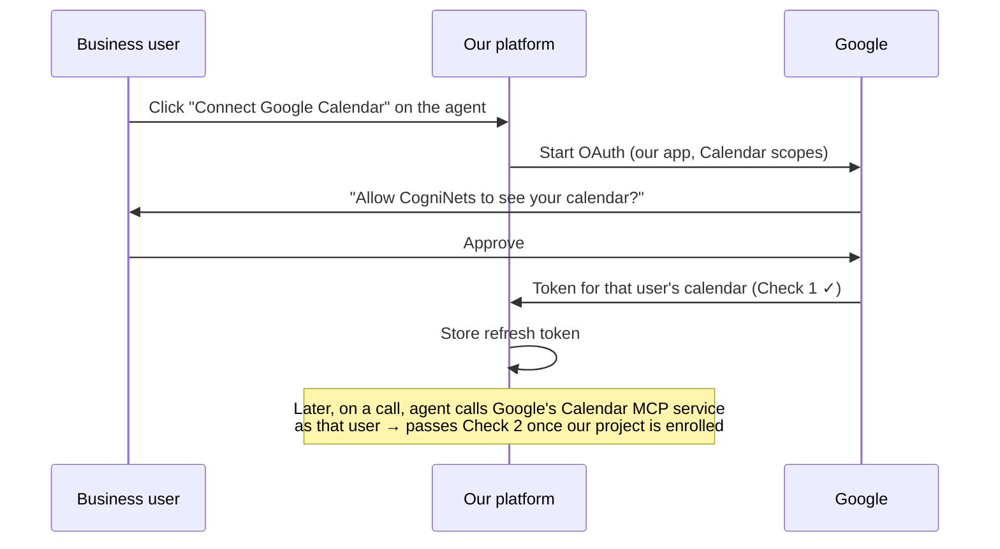

# Connecting Google Tools (Calendar, Gmail, Drive, Chat) to an Agent — Access Model

> **Status:** Decision record (updated 2026-07-22 — added the REST connector, the
> path that works with a personal Gmail today).
> This records *what* we do, in plain language, with diagrams.
> Companion to [`mcp_integration_rfc.md`](./mcp_integration_rfc.md) (the plumbing).

## What works today (personal Gmail, no Workspace)

Google's *remote* Calendar MCP server (`calendarmcp.googleapis.com`) is gated by
the Workspace Developer Preview (needs a Workspace account — see below), so a
personal Gmail **cannot** use that remote server yet.

Instead we run our own small **Google Calendar REST connector**
([`shared/voice_agents/tools/mcp/reference_servers/google_calendar_rest.py`](../../shared/voice_agents/tools/mcp/reference_servers/google_calendar_rest.py))
— a local MCP server that wraps Google's plain **Calendar REST API**
(`www.googleapis.com/calendar/v3`). The REST API is GA and **not** gated by the
Preview, so it works with a personal Gmail token. The `Google_calendar_mcp`
`platform_tools` row points at this connector (not at Google's gated remote
server). The user does the same 1–2 click OAuth Connect; their token is injected
into the connector, which forwards it to the REST API.

**Verified 2026-07-22** with a personal Gmail (`gauravd.chd@gmail.com`): the
agent's `list_calendars` returns the user's real calendars through the full
platform path (DB row → dispatch token injection → connector → Google REST).
No Workspace account, no Preview enrollment.



When Google's Workspace MCP reaches GA (or we get Preview access), we can
repoint the row at `calendarmcp.googleapis.com` with **no platform change** — the
dispatch layer is server-agnostic. Owning the connector is also the better
long-term design: we control the tool schemas (clean, Gemini-friendly — no
sanitization hack) and the error handling.

### Running the connector (local dev)

The connector runs as a separate process in the worker container. It dies if
the worker container restarts — restart it with:

```bash
docker exec -d -e MCP_HOST=127.0.0.1 -e MCP_PORT=8733 -w /app \
  a1-voice-agent-platform-worker-dev-1 \
  python -m shared.voice_agents.tools.mcp.reference_servers.google_calendar_rest
```

The `Google_calendar_mcp` row's `mcp_server_url` is
`http://127.0.0.1:8733/mcp`. The five exposed tools: `list_calendars`,
`list_events`, `get_event`, `create_event`, `check_availability`. The existing
OAuth scopes (`calendar.events` read-write + `calendar.calendarlist.readonly`
+ `calendar.events.freebusy` + `calendar.events.readonly`) cover all five, so
the user's current token works with no re-auth.

## Plain-language summary

- **Goal:** a business user connects their Google Calendar / Gmail to a voice
  agent in **1–2 clicks on our platform** — never touching the Google Cloud
  console. We (the platform team) do the Google Cloud setup **once**.
- **What we do once:** enable the Google APIs, set up our OAuth app + permission
  scopes, and **enroll our project in the Google Workspace Developer Preview
  Program** (the one step that was missing).
- **What the customer does:** 1–2 clicks — the standard "Allow CogniNets to see
  your calendar?" Google popup.
- **There is no per-user IAM setup.** That was a wrong earlier diagnosis (see
  the Appendix).

## Key terms (plain)

- **Principal** — simply *who* is making the call to Google. Usually the
  customer's own Google account (the call is made *as them*, with *their*
  permission).
- **OAuth** — the standard "Allow CogniNets to access your calendar?" popup.
  Gives our app a key for *that one user's* data. This is the 1–2 click flow.
- **MCP** — the standard protocol our agent uses to call tools like Google
  Calendar. Google runs an MCP service in front of Calendar/Gmail.
- **Developer Preview** — Google's early-access stage. Calendar/Gmail/Drive/Chat
  MCP are in **Developer Preview**; using them requires enrolling our project
  in the **Google Workspace Developer Preview Program**. This is the gate that
  blocked us.

## The two checks Google makes



- **Check 1 (OAuth)** — we already built this and it works (the customer's token
  is valid; the base Calendar API works with it).
- **Check 2 (Preview enrollment)** — this is the blocker. It is a *project-level*
  gate, **not** per-user. The earlier "IAM role" fix was aimed at the wrong
  product (see Appendix) and changed nothing.

## What WE do, once (platform-level, in Google Cloud)

Project ID: `encoded-obelisk-445207-k6`.

1. **Enable the APIs** (done ✅):
   `calendar-json.googleapis.com` and `calendarmcp.googleapis.com`.
2. **OAuth app + scopes** (done ✅): consent screen with the Calendar scopes,
   our Web OAuth client, redirect URI `http://localhost:8000/api/v1/tools/callback`.
3. **Enroll in the Google Workspace Developer Preview Program** (the missing
   step ❗) — Google-gated, one-time:
   - Apply (Google Form, one-time):
     **https://docs.google.com/forms/d/e/1FAIpQLSd7BiMXXHDlUDkF7G0TSY5zfJbQwFNH3m6K_ZYFi3vCHLFbng/viewform**
   - Provide our Workspace account + Cloud project (`encoded-obelisk-445207-k6`).
   - Google adds us to a Google Group and registers the project — "within a
     couple of days." If no reply in a week: `workspace-dpp-mod@google.com`.
4. After enrollment, **re-test the live call** — the existing stored token works
   (no re-auth needed).

> **Product constraint:** while Calendar/Gmail MCP is in Developer Preview,
> Google's terms say integrations built with these preview features **cannot be
> shared with external customers before GA**. Usable for our testing now;
> shipping to paying customers waits on Google's GA announcement.

## What the customer does (1–2 clicks, on our platform)



The customer never sees Google Cloud, IAM, or any project — only the familiar
Google permission popup (same as connecting Google in Calendly, Zoom, etc.).

## Scaling (other customers, other Google tools)

- **More customers:** no extra Google Cloud work. Each does the 1–2 click
  Connect. No per-user IAM. (The earlier per-user / "broad-allow" IAM work was
  based on a misdiagnosis — it does not apply here; see Appendix.)
- **Other Google tools (Gmail, Drive, Chat):** same model — enable the matching
  `*mcp.googleapis.com` API, add the right OAuth scopes, and the same Developer
  Preview enrollment covers them (enrollment grants all preview features).

## Appendix — the IAM diagnosis that was WRONG (kept so we don't repeat it)

Earlier I diagnosed "The caller does not have permission" as a missing **IAM
`mcp.tools.call`** role (`roles/mcp.toolUser`), and proposed granting
`allAuthenticatedUsers` + a deny-by-OAuth-client-id policy. **That was wrong for
our tools.** Here is the correction, recorded so it isn't re-derived:

- **Google Workspace MCP** (Calendar, Gmail, Drive, Chat) = a **Developer
  Preview** product. Its only project-level gate is **Preview enrollment**
  (above). The official setup guide lists **no IAM role**. No `mcp.tools.call`.
- **Google Cloud MCP** (BigQuery, Storage, Compute, etc.) = a *different*
  product that **does** use the `mcp.tools.call` IAM gate / `roles/mcp.toolUser`
  / `allAuthenticatedUsers`-or-group broad-allow model.
- We do **not** currently use any Google Cloud MCP server, so none of that IAM
  work is needed. If we ever add a Cloud MCP tool (e.g., BigQuery), revisit the
  IAM broad-allow + deny-by-client-id model at that point — and it would still
  be subject to our project's org policy (`allAuthenticatedUsers` is currently
  blocked; a Google Group would be the policy-respecting option).
- The `roles/mcp.toolUser` grant added to `user:gauravd.chd@gmail.com` is
  harmless (it only affects Cloud MCP servers we don't use) and can be left or
  removed.

## Out of scope / notes

- **Non-Google MCP tools** (Slack, Notion, CRM): not Google services at all —
  only the per-org OAuth Connect applies; no Preview enrollment, no IAM.
- **Billing/quota:** our project bears Google API usage cost for all
  customers; recovered via subscription/credits — a product/billing decision.
- **Service accounts / domain-wide delegation:** the Preview program notes
  service accounts **cannot** be enrolled and suggests domain-wide delegation
  as a workaround — relevant only if we later serve Workspace orgs via a
  service account; not the current OAuth-user flow.