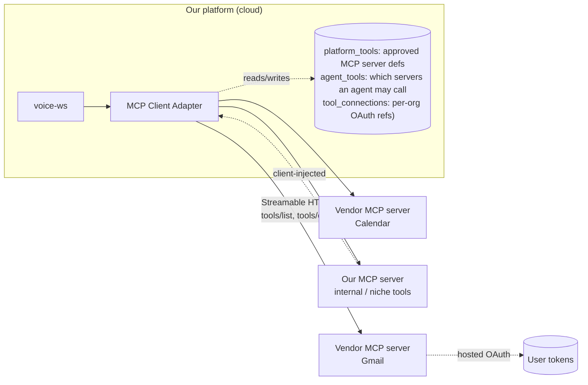
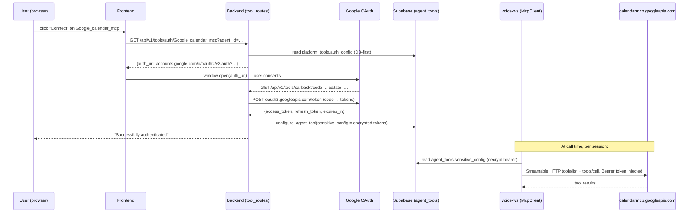
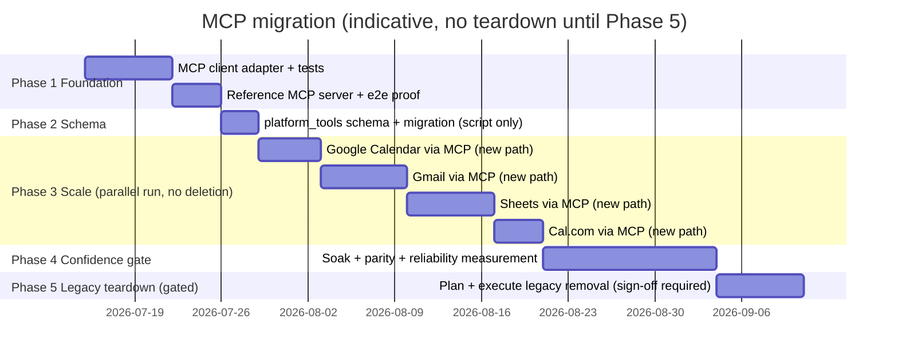

# RFC: MCP-Based Tool Integration for Scalable Third-Party Platform Support

> **Implementation note (2026-08):** MCP runs in **`voice-ws`** via `voice-ws/src/tools/mcp_pipecat.py` and `shared/voice_agents/tools/mcp/dispatch.py`. The LiveKit adapter was removed; historical RFC text below references the old worker path.

**Status:** Proposed; **Phases 1–3 implemented** — MCP client + Pipecat adapter +
worker dispatch + Google Calendar reference MCP tool all shipped and tested.
**Phase 2 migration RUN** (user-approved 2026-07-16; alembic head `20260715000001`).
**Real Google Calendar MCP path wired (2026-07-16):** the `Google_calendar_mcp`
`platform_tools` row is repointed at Google's **official remote Calendar MCP
server** (`https://calendarmcp.googleapis.com/mcp/v1`) with a real Google
OAuth web-app `auth_config`, and `start_oauth` / `oauth_callback` are now
**DB-driven** so MCP-sourced tools flow through the same OAuth endpoints as
legacy tools (legacy registry kept as a fallback — coexistence per §1.1).
`GOOGLE_OAUTH_TOOL_REDIRECT_URI` corrected to the backend callback
`http://localhost:8000/api/v1/tools/callback`. End-to-end testable once the
GCP OAuth client is configured (see §6.4 checklist).
Legacy `BaseTool` mechanism untouched.
**Date:** 2026-07-14
**Author:** Architecture review
**Related docs:**
- [`dynamic_tool_architecture.md`](./dynamic_tool_architecture.md)
- [`tool_implementation_summary.md`](./tool_implementation_summary.md)
- [`tool_calling_challenges.md`](./tool_calling_challenges.md)
- [`dynamic_tool_architecture.md`](./dynamic_tool_architecture.md)
- [`02_features/voice_agents/tool_connection_states.md`](../02_features/voice_agents/tool_connection_states.md)
- [`05_business/VOICE_AI_TOOL_INTEGRATION_RECOMMENDATIONS.md`](../05_business/VOICE_AI_TOOL_INTEGRATION_RECOMMENDATIONS.md)

---

## 1. TL;DR

Adopt **MCP (Model Context Protocol)** as the platform's tool-integration layer,
using **remote MCP servers over Streamable HTTP** as the execution transport. This
replaces the current pattern of hand-rolling one `BaseTool` subclass per vendor
(~3,500 lines for 4 tools today) with a **generic MCP client** in the LiveKit
worker that calls **vendor / community-maintained MCP servers** over plain HTTP.

This is purpose-built for the problem we have, sidesteps the cloud-CLI sandboxing
problem entirely, and lets us delete most of the per-vendor code we maintain
today — including, for servers that host their own OAuth, the
`TokenRefreshService` burden.

**NCP is the wrong layer** (agent-to-agent context sharing, not agent-to-tool).
**CLIs are the wrong shape** for a cloud-deployed agent (per-call sandboxing,
process lifecycle, secrets handling).

### 1.1 Hard constraint — coexistence, no teardown until proven

> **Until at least one MCP tool is proven working end-to-end in production-like
> conditions, we DO NOT tear down or remove any functionality from the existing
> `BaseTool` tool mechanism.** Both mechanisms must live side by side for as long
> as it takes to build confidence. Only once the new approach is proven to work
> seamlessly do we plan (separately) the removal of the old mechanism.

This is a deliberate, explicit decision (recorded 2026-07-14) to de-risk the
migration. Concretely:

1. **Implement first.** Build the MCP client adapter and get **at least one MCP
   tool working end-to-end** through the new path.
2. **Then scale.** Add more MCP tools / vendor servers — still without removing
   anything old.
3. **Then, and only then, cleanup.** Plan a separate, dedicated teardown phase
   for the legacy `BaseTool` mechanism, gated on measured confidence (parity of
   behavior, test coverage, observed reliability).

The existing `BaseTool` files (`gmail.py`, `google_sheets.py`,
`google_calendar.py`, `calcom.py`), `LiveKitToolRegistry`,
`TokenRefreshService`, and the `platform_tools` / `agent_tools` schema are
**frozen, not deleted** during Phases 1–3. Any migration step that says "retire"
below means "route new traffic through MCP," **not** "delete the old file." File
deletion belongs to the dedicated cleanup phase (Phase 5), and only after
sign-off.

### 1.2 Implementation status (live)

| Phase | State |
|---|---|
| 1 — MCP client adapter | ✅ `McpClient` + models shipped; 17 tests, 100% coverage. |
| 1 — LiveKit `function_tool` synthesis | ✅ `mcp/livekit_adapter.py` builds a `RawFunctionTool` (via `raw_schema`) per `McpToolDef`; 8 tests green. |
| 1 — Reference MCP server | ✅ In-process FastMCP `calculator` proven end-to-end (real HTTP, `tools/list` + `tools/call`). |
| 2 — `platform_tools` schema extension | ✅ Migration `20260715000001` **RUN** (user-approved 2026-07-16; alembic head now `20260715000001`); `ToolSource` enum + `mcp_server_url` / `mcp_server_headers` / `mcp_server_name` added to `PlatformTool`; existing 4 tools default to `legacy`; `DATABASE_SCHEMA.md` updated; 7 model tests green. A live `Google_calendar_mcp` row is seeded in local dev, repointed at the **real** remote server (see 3c). |
| 3a — voice-ws dispatch branch | ✅ Additive MCP branch in `worker.py` (`_integrate_mcp_agent_tool`), `mcp/dispatch.py` (`mcp_server_config_from_agent_tool`, `build_mcp_livekit_tools`, `build_livekit_tools_for_agent_tool`); legacy `BaseTool`/`LiveKitToolRegistry` path unchanged; fail-soft (a broken MCP server never blocks other tools). **MCP client lifecycle (fixed 2026-07-16):** the entrypoint returns right after `agent_session.start()` while the session runs on, so clients are handed to the job lifecycle via `ctx.add_shutdown_callback` (`_hand_off_mcp_clients_to_session`) and closed on job shutdown — NOT in the entrypoint `finally`, which now only closes clients when setup failed before handoff (`_cleanup_mcp_clients`). (Earlier the `finally` closed them at return time, so every MCP tool failed with `RuntimeError: McpClient is closed` at call time.) 13 tests green (dispatch + voice-ws branch incl. fail-soft + lifecycle). |
| 3b — First working MCP tool (Google Calendar, in-memory) | ✅ In-memory Google Calendar MCP reference server at `shared/voice_agents/tools/mcp/reference_servers/google_calendar.py` (`list_events` / `create_event` / `get_event` / `check_availability`); full-pipeline e2e (discover → synthesize → invoke) green. Proves the platform plumbing with no third-party OAuth. |
| 3c — Real Google Calendar MCP (remote server + DB-driven OAuth) | ✅ `Google_calendar_mcp` row repointed at Google's official remote server `https://calendarmcp.googleapis.com/mcp/v1` with `auth_type=oauth2`, `requires_auth=true`, and a real Google OAuth `auth_config` (4 scopes). `start_oauth` / `oauth_callback` in `tool_routes.py` made **DB-driven** (`_resolve_tool_auth_config`: DB-first, legacy registry fallback) so MCP-sourced tools reuse the existing OAuth endpoints; `TokenRefreshService` already reads the same `auth_config` column, so MCP tokens auto-refresh with no extra wiring. 5 new backend tests (`test_tool_oauth_mcp.py`) + 14 existing tool_routes tests green (19 total); 305 green across voice_agents + token-refresh + tool-service suites. Frontend `PlatformTool` type extended with `tool_source` / `mcp_server_url` / `mcp_server_name` / `mcp_server_headers` (3 vitest tests). End-to-end against the real Google API pending the one-time GCP client config (§6.4). |
| 3d — Configure any MCP server from the UI | ✅ See §6.6. **Revised 2026-07-26 to the publish-lifecycle model:** custom MCP authoring is now **platform-admin-only** (author → test → publish to global catalog); org admins **attach** published servers with their **own** API key (`{{KEY}}` template, org key overrides platform test key at runtime). The org-scoped custom tier is **retired**. Migration `20260726000001` adds `is_published` (backfills existing rows TRUE); `20260725000001` (encrypted secret headers) already applied. SSRF guard + `mcpServers` parser unchanged; new publish/unpublish/edit/delete endpoints + platform-admin gating on discover/parse/create; dispatch substitutes `{{KEY}}` (no platform fallback). Frontend `/platform/tools` nav page (parallel to `/platform/skills`) rendering an inline `<PlatformToolsManager>` (Configure MCP server + Manage existing tools views, no catalog tab); platform-admin-gated. 62 backend route/service + 18 voice-ws dispatch + 67 frontend vitest green. |
| 4–5 | Not started (gated per §7). |

**What shipped (no legacy code touched):**
- `shared/voice_agents/tools/mcp/`
  - `client.py` — `McpClient` (`list_tools`, `call_tool`, `close`, async ctx mgr).
  - `models.py` — `McpServerConfig`, `McpToolDef`, `McpToolResult`.
  - `livekit_adapter.py` — `_build_raw_schema`, `_make_mcp_handler`,
    `mcp_tool_to_livekit_tool` (synthesizes LiveKit `RawFunctionTool` from an
    `McpToolDef` JSON Schema).
  - `dispatch.py` — `mcp_server_config_from_agent_tool` (merges server-level
    headers with the per-user OAuth bearer from decrypted `sensitive_config`),
    `build_mcp_livekit_tools`, `build_livekit_tools_for_agent_tool`.
  - `reference_servers/google_calendar.py` — the first working MCP tool; an
    in-memory FastMCP server mirroring the legacy `GoogleCalendarTool` contract.
- `shared/voice_agents/tool_models.py` — additive `ToolSource` enum +
  `mcp_server_*` fields on `PlatformTool` (defaults preserve legacy rows).
- `worker/src/worker.py` — additive MCP branch in the per-agent tool-assembly
  loop (`_integrate_mcp_agent_tool`), `mcp_clients` tracked + closed in `finally`.
  The legacy `LiveKitToolRegistry` loop is unchanged.
- `backend/alembic/versions/20260715000001_add_mcp_source_columns_to_platform_tools.py`
  — additive migration (written, **not run**).
- Tests (all in `worker/tests/`, run in voice-ws dev container):
  `test_mcp_client.py` (17), `test_mcp_livekit_adapter.py` (8),
  `test_mcp_dispatch.py` (9), `test_mcp_platform_tool.py` (7),
  `test_worker_mcp_branch.py` (3), `test_mcp_google_calendar_e2e.py` (5).
  Legacy suites (`test_tool_wrapper.py`, `test_base_tool.py`) stay green —
  coexistence verified (99 tests green together).
- `worker/requirements.txt` — added `mcp>=1.28.1,<2` + explicit `httpx`.
- `worker/requirements-dev.txt` — added `pytest`, `pytest-asyncio`, `pytest-cov`.
- `worker/pytest.ini` — added `asyncio_mode = auto` (matches backend).
- `docs/DATABASE_SCHEMA.md` — `platform_tools` columns + migration history.

**How to run the MCP tests** (worker dev container):
```bash
docker exec -w /app a1-voice-agent-platform-voice-ws-dev-1 \
  python -m pytest tests/test_mcp_client.py tests/test_mcp_livekit_adapter.py \
    tests/test_mcp_dispatch.py tests/test_mcp_platform_tool.py \
    tests/test_worker_mcp_branch.py tests/test_mcp_google_calendar_e2e.py \
    -o addopts="" -p no:cacheprovider
```

**Next sub-step (still no teardown):**
1. **Get user approval and run migration `20260715000001`** (`alembic upgrade
   head`). It is additive and reversible; existing rows default to `legacy`, so
   the legacy path is unaffected.
2. **Seed an MCP `platform_tools` row** pointing at the Google Calendar
   reference server (e.g. `INSERT INTO platform_tools (name, tool_source,
   mcp_server_url, mcp_server_name, ...) VALUES ('Google_calendar_mcp', 'mcp',
   'http://<calendar-mcp-host>/mcp', 'google-calendar', ...)`), then attach it to
   an agent via `agent_tools`. voice-ws will route it through MCP
   automatically; the legacy `Google_calendar` row keeps working for any agent
   still using it.
3. **Deploy the reference server** as its own container (FastMCP +
   `streamable_http_app()` behind uvicorn) and point the row at it. The
   reference server module is runnable as-is; the real Google OAuth swap is
   documented in its module docstring.
4. **Phase 4** confidence-gate measurement once a real agent is live with the
   MCP tool (parity checks, reliability), then **Phase 5** gated teardown.

---

## 2. Problem statement

Today every third-party integration is a hand-written Python class inside our
repository:

| File | Lines | What it hand-rolls |
|---|---:|---|
| `shared/voice_agents/tools/implementations/gmail.py` | 1,209 | OAuth config, Gmail REST client, MIME parsing, LiveKit schema |
| `shared/voice_agents/tools/implementations/google_sheets.py` | 1,134 | OAuth config, Sheets REST client, range parsing, LiveKit schema |
| `shared/voice_agents/tools/implementations/google_calendar.py` | 346 | OAuth config, Calendar REST client, LiveKit schema |
| `shared/voice_agents/tools/implementations/calcom.py` | 387 | Cal.com REST client, LiveKit schema |
| `shared/voice_agents/tools/base/` (OAuth plumbing) | ~360 | `BaseTool`, `GoogleAuthConfig`, `oauth_provider_utils` |
| **Total** | **~3,500** | |

Supporting machinery we own forever:

- `LiveKitToolRegistry` introspects `@function_tool`-decorated methods off these
  classes at import time to build the agent's tool schema.
- `ToolService` (two-tier) stores per-user encrypted OAuth tokens in Supabase.
- `TokenRefreshService` runs a 5-minute cron refreshing every vendor's OAuth
  tokens before they expire.

**Cost of the Nth integration:** another 500–1,200 lines of in-tree code, plus
permanent ownership of that vendor's OAuth lifecycle. Linear, unbounded, and
duplicated across vendors. This does not scale.

---

## 3. Options considered

| Option | What it is | Verdict |
|---|---|---|
| **Custom per-vendor tools (status quo)** | Hand-write a `BaseTool` subclass + OAuth + REST client per vendor | ✗ Does not scale; we re-implement the world |
| **MCP (Model Context Protocol)** | Open standard (Linux Foundation) for *model → tool* calls. JSON-RPC over Streamable HTTP (remote) or stdio (local). Vendor/community ships an **MCP server**; our agent is a generic **MCP client**. | ✅ **Recommended** — the problem MCP was built to solve |
| **NCP (Neural Context Protocol)** | An *agent-to-agent* memory/context bus that rides **on top of** MCP | ✗ Wrong layer — for multiple agents sharing state, not for calling SaaS tools. MCP-native, so adopting MCP does not foreclose it |
| **CLIs** | Agent shells out to a vendor CLI per call | ✗ Wrong for cloud: per-call sandboxing (gVisor/Firecracker), process lifecycle, stdin/stdout parsing, secrets-in-argv, cold-start. Only justified for a "computer-use" agent that *must* run shell commands |

> **Note on terminology:** "NCP" and "MCP" sound similar but standardize
> different things. **NCP** standardizes how agents talk to *each other*
> (bounded, trust-weighted context sharing). **MCP** standardizes how an agent
> talks to *tools/data sources*. This RFC is about the latter.

---

## 4. Why MCP fits a cloud-deployed voice agent

The **2026-07-28 MCP specification** made the remote transport **stateless
Streamable HTTP**: a single `POST /mcp` endpoint, no `initialize` handshake, no
sticky sessions, no shared session store. Concrete consequences for us:

- **No sandboxing.** Tools are remote HTTP services, not local subprocesses. The
  voice-ws Pipecat voice-ws makes authenticated HTTP calls — exactly what it already does
  when calling vendor REST APIs directly. The "run CLIs in cloud agents" problem
  disappears entirely.
- **Horizontally load-balanced by default.** Stateless servers work behind plain
  round-robin load balancers (Cloud Run, GKE, ALB). No session affinity needed.
- **We stop owning integration code.** For Gmail, Google Calendar, Sheets,
  Slack, GitHub, Salesforce, Notion, etc. there are already maintained MCP
  servers. We connect to them instead of re-implementing `gmail.py`. The ~3,500
  lines become a few hundred lines of MCP-client glue.
- **Dynamic schema.** `tools/list` returns JSON-Schema tool definitions at
  runtime. `LiveKitToolRegistry`'s static import-time introspection becomes a
  runtime enumeration — adding a tool requires **zero code in our repo**, just a
  connection config row in the DB.
- **Auth aligns with OAuth 2.0 / OIDC.** Six SEPs in the new spec harden
  authorization. We can offload the per-user OAuth + token-refresh burden
  (`TokenRefreshService`) onto MCP servers that host their own OAuth.

---

## 5. Target architecture



### 5.1 Mapping onto the existing data model

Our data model is already close to the right shape — we keep it and change only
what sits behind each row.

| Today | After |
|---|---|
| `platform_tools` row = a `BaseTool` subclass in our repo | `platform_tools` row = an **approved MCP server endpoint** (URL, transport, auth mode, allowed-tool allowlist) |
| `agent_tools` = which in-repo tools an agent enables | `agent_tools` = which MCP servers an agent may call (semantics unchanged) |
| `LiveKitToolRegistry` introspects `@function_tool` methods at import time | Registry calls `tools/list` on each enabled server per session and synthesizes LiveKit `@function_tool` wrappers |
| `TokenRefreshService` refreshes every vendor's OAuth on a cron | Server-managed OAuth servers hold their own tokens; we store only a connection ref. Client-injected-credential servers keep the existing encrypted-token + refresh path |
| Per-vendor `gmail.py` / `sheets.py` (~3.5k lines) | Deleted; replaced by community/vendor MCP servers |

The **governance** surface (which tools are approved, which agents get which
tools, per-org enablement, RBAC) stays in our DB and our existing
`require_permission` / `agent_tools` model. Only the **execution** backend
changes from "in-process Python class" to "remote MCP call."

---

## 6. The two hard parts

### 6.1 Auth

Two models, chosen per server:

- **Server-managed OAuth (preferred for SaaS).** The user OAuths *with the MCP
  server* through its own consent flow; the server stores the tokens; we hold
  only a connection ID. This **deletes `TokenRefreshService`'s responsibility
  for that vendor**. The 2026-07-28 spec's OAuth hardening makes this clean.
- **Client-injected credentials (for API-key or bring-your-own-token tools).**
  We store the secret (encrypted, as today) and pass it as a header /
  `x-mcp-header` on each call. Keep this for tools where the vendor MCP server
  does not host OAuth.

### 6.2 Trust & governance (do not skip)

An MCP server runs third-party code that calls third-party APIs with user
credentials. Required controls:

- **Allowlist** approved MCP servers in `platform_tools`. End-users must **not**
  be able to paste arbitrary MCP URLs — that is a data-exfiltration vector.
- **Per-org enablement + RBAC** on which servers an agent may call (our existing
  `require_permission` / `agent_tools` model already supports this).
- **Audit log** every `tools/call`. We already have OpenTelemetry — emit a span
  per tool call with `mcp.server`, `mcp.tool`, `org_id`, `agent_id`.
- **Schema pinning.** Cache `tools/list` and diff on changes so a server cannot
  silently add a destructive tool between sessions.
- **Rate limiting + timeouts** per server per org.

### 6.3 Voice-latency note

Tool calls are model-initiated, **not** on the streaming voice path, so the
added HTTP hop is bounded by the *tool's own* API latency (which we already pay
when calling vendor REST directly). Mitigations:

- Cache `tools/list` per session rather than re-fetching per turn.
- For latency-critical tools, run an MCP server as a **sidecar** in the same pod
  (stdio or localhost HTTP) — same protocol, no cloud-CLI sandboxing.

### 6.4 Real Google Calendar MCP — end-to-end OAuth path (implemented)

Google publishes an **official remote Calendar MCP server** at
`https://calendarmcp.googleapis.com/mcp/v1` (Streamable HTTP, Developer
Preview). It is a standard Google **resource server**: it does **not** host its
own OAuth or expose an MCP-spec `.well-known` endpoint. Authentication is the
ordinary Google OAuth 2.0 web-app flow — we acquire a user OAuth token through
our existing consent + callback, then send it as `Authorization: Bearer <token>`
on every MCP call. This is the **client-injected credentials** model from §6.1,
reusing the platform's existing OAuth plumbing end-to-end:



**What changed in code (Phase 3c, no legacy teardown):**
- `backend/src/voice_agents/tool_routes.py` — `_resolve_tool_auth_config()`
  resolves the OAuth config **DB-first** (from `platform_tools.auth_config`)
  with the legacy `LiveKitToolRegistry` kept as a fallback. `start_oauth` and
  `oauth_callback` use it, so MCP-sourced tools (which have no in-tree
  `BaseTool` subclass) flow through the same endpoints as legacy tools.
- `TokenRefreshService` is **already DB-driven** (reads
  `agent_tool.tool.auth_config`), so MCP tokens auto-refresh with no extra
  wiring once `auth_config` is populated.
- `shared/voice_agents/tools/mcp/dispatch.py` injects the decrypted per-user
  bearer from `agent_tools.sensitive_config` as `Authorization: Bearer` on the
  MCP Streamable HTTP call (unchanged from Phase 3a).
- Frontend `PlatformTool` type carries `tool_source` / `mcp_server_url` /
  `mcp_server_name` / `mcp_server_headers`; the OAuth "Connect" button renders
  purely on `auth_type === "oauth2"`, so no frontend change was needed for the
  button to appear for the MCP tool.

**Scopes requested** (in `auth_config.scopes`):
`calendar.calendarlist.readonly`, `calendar.events.freebusy`,
`calendar.events.readonly`, and `calendar.events` (read-write superset so the
write tools — `create_event` / `update_event` / `delete_event` — also work).

**One-time GCP setup checklist (operator — required before live test):**

> The dev OAuth client already exists (`427746670167-….apps.googleusercontent.com`,
> read from `GOOGLE_OAUTH_TOOL_CLIENT_ID/SECRET` in the selected root environment
> file). The only remaining
> steps are on the GCP console side.

1. **Enable the APIs** in the GCP project that owns the OAuth client:
   ```bash
   gcloud services enable calendar-json.googleapis.com --project=PROJECT_ID
   gcloud services enable calendarmcp.googleapis.com   --project=PROJECT_ID
   ```
2. **OAuth consent screen** (APIs & Services → OAuth consent screen): add the
   four scopes above to the consent screen's authorized scopes, and add the test
   user (`platform-admin@dev.local` / your Google account) as a **test
   user** while the app is in "Testing" status (the Calendar MCP server is in
   Developer Preview — keep the app in testing until approved).
3. **Authorized redirect URI** (APIs & Services → Credentials → the OAuth 2.0
   web client → Authorized redirect URIs): add
   `http://localhost:8000/api/v1/tools/callback`
   (this is the backend `oauth_callback` route; must equal
   `GOOGLE_OAUTH_TOOL_REDIRECT_URI` in the selected root environment file,
   already corrected). For a
   non-local deploy, add the public equivalent
   (`https://<backend-host>/api/v1/tools/callback`).
4. **Restart the backend container** so the corrected `GOOGLE_OAUTH_TOOL_REDIRECT_URI`
   is loaded: `docker compose -f docker-compose.dev.yml up -d --no-deps backend-dev`.
5. **End-to-end test** from the UI: open `http://localhost:3000`, log in, open an
   agent's tool drawer, click "Connect" on **Google Calendar (MCP)**, complete
   Google consent. On success the tool's connection status flips to
   `connected_auth_valid` and a real `access_token` + `refresh_token` are stored
   (encrypted) in `agent_tools.sensitive_config`. Trigger a voice call to that
   agent and ask it to list/create calendar events — voice-ws will call the
   real `calendarmcp.googleapis.com` with the injected bearer.

**Notes / guardrails:**
- The MCP server is a **resource server**, not an auth server — there is no
  PKCE / `.well-known` discovery here; do not wire MCP-spec OAuth protection.
- `access_type=offline` + `prompt=consent` are set in `auth_config` so Google
  returns a `refresh_token` on first consent (required for auto-refresh).
- The legacy `Google_calendar` (non-MCP) row is untouched; agents still on it
  keep working (coexistence per §1.1).

### 6.5 Tool-schema sanitization for the Gemini realtime plugin (implemented)

**Symptom (the silent-agent bug):** after OAuth succeeds and voice-ws builds
the MCP tools, the Gemini realtime session never starts and the agent never
speaks. voice-ws logs show `failed to generate a reply: generate_reply timed out
waiting for generation_created event`, preceded by a crash inside
`_main_task` → `_build_connect_config` → `create_tools_config`:

```
pydantic_core._pydantic_core.ValidationError: 2 validation errors for FunctionDeclaration
parameters.properties.eventType.items.x-google-enum-descriptions
  Extra inputs are not permitted [type=extra_forbidden, input_value=[...], input_type=list]
parameters.properties.eventTypeFilter.deprecated
  Extra inputs are not permitted [type=extra_forbidden, input_value=True, input_type=bool]
```

**Root cause:** LiveKit's Google (Gemini) realtime plugin validates every tool
schema strictly via `google.genai.types.FunctionDeclaration.model_validate(schema)`
with `extra_forbidden`. The official Google Calendar MCP server's `inputSchema`
(as returned by `tools/list`) carries non-standard JSON Schema keys — a Google
**vendor extension** `x-google-enum-descriptions` and the standard-but-unmodelled
`deprecated` — that Gemini's `Schema` pydantic model does not accept. A single
forbidden key raises `ValidationError` inside `_main_task`, so the realtime
session never connects and the greeting `generate_reply` times out. The adapter
(`_build_raw_schema`) was passing the server's `inputSchema` **verbatim** into
LiveKit's `function_tool(raw_schema=...)`, which is what surfaced those keys to
the strict validator.

**Fix:** `shared/voice_agents/tools/mcp/livekit_adapter.py` now sanitizes the
MCP `inputSchema` through `_sanitize_schema_for_gemini()` before handing it to
`function_tool`. The sanitizer keeps **only** the keys Gemini's `Schema` model
accepts (its field aliases, introspected from `google.genai.types.Schema`):

```
type, enum, description, items, properties, required, anyOf, format, nullable,
default, example, title, pattern, minimum, maximum, minLength, maxLength,
minItems, maxItems, minProperties, maxProperties, propertyOrdering,
additionalProperties, defs, ref
```

and recurses into `properties`, `items`, `anyOf`, `defs`, and
`additionalProperties` so nested vendor extensions are stripped too. The
**allowlist** approach is deliberate — a denylist could miss a future
non-standard key and still crash the session; keeping only what Gemini accepts
guarantees the validator never sees a forbidden key.

**Why this is the adapter's job, not the client's:** the MCP client/model layer
should preserve the server's declared schema faithfully (it is
protocol-faithful); the Gemini-specific constraint is a property of the LiveKit
plugin boundary, so the sanitization lives in `livekit_adapter.py`.

**Tested (TDD red-green):** `worker/tests/test_mcp_livekit_adapter.py::TestSchemaSanitization`
(4 tests) reproduces the exact crash (a schema with
`eventType.items.x-google-enum-descriptions`, `eventTypeFilter.deprecated`, and a
top-level `x-google-vendor-ext`), asserts the forbidden keys are stripped at
every depth while standard keys (`type`, `enum`, `description`, `required`,
`format`) survive, and — the real proof — asserts the sanitized schema passes
`types.FunctionDeclaration.model_validate(...)` without raising. Full MCP
worker suite (58 tests) green; `py_compile` clean.

**Known limitations / TODOs (recorded in the code):**
- `oneOf` / `allOf` are **not** in Gemini's allowlist (it models only `anyOf`).
  They are dropped today. If a future MCP tool relies on `oneOf`/`allOf` for
  correctness, map `oneOf`→`anyOf` in the sanitizer instead of dropping. No known
  Google Calendar tool uses them.
- `$ref` / `$defs` (standard JSON Schema references) are not accepted by Gemini
  (it uses `ref`/`defs` without the `$` prefix) and are dropped. Remote MCP
  servers in practice inline their schemas (no `$ref` seen across Google
  Calendar's 9 tools); if a `$ref`-using server appears, resolve references
  *before* sanitizing rather than renaming the prefix (Gemini's `ref` semantics
  differ).

---

### 6.6 MCP authoring + publish lifecycle + org-level keys (implemented)

> **Revision note (2026-07-26):** This section supersedes the earlier
> "Configure any MCP server from the UI" design. The model was **reversed**:
> custom MCP servers are no longer org-admin-authored and org-scoped. They are
> **platform-admin-authored, published to a global catalog, and attached by org
> admins with their own keys**. The org-scoped custom tier is **retired** (the
> `organization_id` column is kept dormant for a future org-private-publish
> tier). The decision rationale is recorded below so future readers understand
> *why* the model changed, not just *what* changed.

#### The decision (high-level requirements → design)

The product serves mostly non-technical org users who cannot reliably
configure MCP servers. Letting every org author servers (the previous model)
produced two problems: (1) quality/correctness — orgs would misconfigure
servers and have no one to fix them; (2) an org-isolation leak surface we had
to harden per-endpoint. The reversal centralizes authoring with platform
admins, who configure, **test**, then **publish** a server to the global
catalog, where any org admin can attach it to their agents.

Three roles map to three actions:

| Action | Who | Gate |
|---|---|---|
| Author / test / publish / edit / delete an MCP server | **platform admin** | `assert_platform_role(user_profile, "platform_admin")` (org-agnostic) |
| Attach a published server to an agent | **org admin** | existing `assert_has_permission("agent", "update", agent.organization_id)` — unchanged |
| Read the catalog (attach-able tools) | any org user | published-only (`is_published=true AND is_active=true`) |

No new `tool:*` permission resource was needed — create/publish = platform
role; attach = existing `agent:update`. This resolves the long-deferred "WHO"
question.

#### Publish lifecycle

`platform_tools.is_published BOOLEAN NOT NULL DEFAULT FALSE` (migration
`20260726000001`, down_revision `20260725000001`). The migration **backfills
`is_published = TRUE`** for all existing rows so the live catalog (Google
Calendar, Gmail, CalCom, Sheets, etc.) is unaffected.

- `is_published=false` → **draft**: visible only to platform admins (the
  authoring/management view).
- `is_published=true` + `is_active=true` → **published**: a normal tool card
  in every org user's agent tool panel, attachable by org admins.
- **Unpublish** hides a server from new attaches; existing `agent_tools`
  attachments keep working (documented) — voice-ws loads an agent's tools by
  joining `agent_tools` → `platform_tools` with **no `is_published` filter**, so
  unpublish is safe and reversible. The Manage view surfaces the usage count
  (an info toast) so the admin learns unpublish ≠ "remove from agents".
- **Delete** is a guarded, audited hard-delete — see §6.6 *Delete guardrails*.

`tool_service.get_platform_tools(only_active, *, include_drafts=False)`:
returns `is_published=true AND is_active=true` by default (the org-user
catalog); all rows (drafts + published) when `include_drafts=True`. The
org-scoped per-org filter is **gone** — all published servers are global.

#### Org-level static keys override platform test keys (the core auth refinement)

For static-key MCP servers, **the platform owns the integration (URL, header
mapping); each org owns its keys.** This mirrors how per-user OAuth already
works for Google Calendar. The mechanism reuses existing storage and UX —
**no new schema for the org key**:

1. **Author/test** — a platform admin writes a secret-header **template**
   containing a `{{KEY}}` placeholder (e.g. `{"Authorization": "Bearer {{KEY}}"}`,
   `{"X-API-Key": "{{KEY}}"}`), stored encrypted at rest in
   `mcp_server_secret_headers` (Fernet via `shared/common/security.py`). A
   transient **Test API key** is substituted into `{{KEY}}` for the one-shot
   in-memory `McpClient` discover call. The test key is **never persisted**.
2. **Publish** — stores the template (with `{{KEY}}`) encrypted, sets
   `auth_type="api_key"`, `requires_auth=true`.
3. **Attach** — an org admin attaches the published tool and supplies their
   **own** API key via the existing tool-config-drawer "Configure API Key"
   path → `POST /tools/agent/{id}/api-key` →
   `agent_tools.sensitive_config = {"api_key": "<org-key>"}` (existing
   endpoint, reused).
4. **Runtime** — `shared/voice_agents/tools/mcp/dispatch.py::
   mcp_server_config_from_agent_tool` substitutes `{{KEY}}` → the org key
   from `sensitive_config["api_key"]` into the template. Precedence:
   public `mcp_server_headers` → `{{KEY}}`-templated
   `mcp_server_secret_headers` (org key) → per-user OAuth bearer (only if no
   `Authorization` is set). **A templated header with no org key is DROPPED —
   there is no platform-fallback**: the tool is left in an "API key required"
   state rather than sending the bare `{{KEY}}` marker or a stale platform
   test key. The platform test key is **never** used at runtime.

Literal secret-header values (no `{{KEY}}`) pass through unchanged as fixed
shared headers (optional shared-key mode, platform-admin's responsibility).

Per-user OAuth (Google Calendar) is unchanged for native/seeded servers.

#### UI

The platform-admin catalog surface lives on a dedicated **`/platform/tools`**
page (parallel to `/platform/skills`), registered as a "Platform Tools" item
in the `platform_admin` section of `nav-config.ts` (`requiredPermission:
"platform:admin"`). The page renders an inline `<PlatformToolsManager>` —
**authoring + management only**, no "From catalog" tab (published servers
already render as normal `ToolCard`s in the main tool panel for everyone,
with the MCP badge; org admins attach via the existing card connect flow and
supply their key via the existing drawer).

This surface was previously a Sheet dialog opened by a "Manage MCP servers"
button on every agent's Tools tab. That conflated a global, platform-admin
concern (catalog authoring/publishing) with a per-agent, org-admin concern
(attaching a published tool). It now has its own nav page; the agent Tools
tab keeps only the attachment UI (published-tool cards + connect drawer),
unchanged for org/regular admins. The page H1 is "Platform Tools" because the
**Manage existing tools** view lists *every* platform tool (legacy
code-backed + authored MCP), not just MCP servers. The manager has two views,
toggled inline (no Sheet/drawer). **Manage existing tools is the first toggle
and the default active view** (`initialView` defaults to `manage`) — the page
lands the admin on the tool list; authoring a new server is opt-in via the
second toggle:

- **Manage existing tools** (internal state `manage`, default): drafts +
  published list (native + MCP) with Draft/Published badges and
  publish/unpublish/delete actions.
- **Configure MCP server** (internal state `author`): auth-mode select
  (No auth / Static API key), Name, URL, public Headers (JSON), `{{KEY}}`
  secret-header template + transient Test API key (api-key mode only),
  `mcpServers` JSON paste + parse, "Test & discover", "Save draft"
  (`is_published=false`) / "Publish" (`is_published=true`). On a successful
  save the inline form resets so the admin can author another (the dialog
  predecessor closed itself on save; an inline panel has no dialog to close).
  The "Save draft" / "Publish" buttons are `w-full sm:w-auto` so they sit
  side-by-side at `sm+` (two `w-full` buttons in a `sm:flex-row` row overflow
  horizontally — they used to render outside the panel).
  - **Mandatory fields are marked**: Name and Server URL (the save guard) carry
    a red `*`; optional fields (Public headers, Description) do not.
  - **Publish is gated on a successful "Test & discover"**: the Publish button
    stays disabled (`canPublish = discoveredTools.length > 0`) until the admin
    runs "Test connection & discover tools" and at least one tool is found,
    with an inline hint "Run Test connection & discover tools before
    publishing so the tool list is captured." Publishing without discover left
    the agent tool-config drawer empty (`tool_functions_schema` null → no tool
    list on the published card). Save draft remains allowed without discover
    (drafts aren't shown to org users, so an empty tool list is fine for a
    work-in-progress draft). A defense-in-depth guard in `handleSave` rejects a
    publish with zero discovered tools even if the button is bypassed.

#### Delete guardrails (implemented 2026-07-28)

A platform admin can strip a tool from *other orgs'* agents with a delete, so the
delete action is gated behind three layers (defense-in-depth — the backend
enforces the guard even if the frontend is bypassed):

1. **Type-to-confirm for every delete.** The Manage view's MCP delete button opens
   the shared `DeleteConfirmationDialog` (keyword `"Delete"`, exact match) — the
   same pattern used for agent / org deletes. This applies **even when the tool is
   not in use**, so an accidental click on an unused server still requires
   deliberate confirmation. Implemented in
   `frontend/src/components/tools/mcp-tool-delete-dialog.tsx`, a thin wrapper that
   pre-fetches usage (`usePlatformToolUsage`) and turns it into the dialog's
   `warnings` list.
2. **In-use block + audited force-override.** The dialog pre-fetches usage; when
   the tool is in use the shared dialog's `warnings` carry the summary lines
   (`Every agent listed below loses this tool on their next call` + `This action
   cannot be undone`) and an `extraContent` slot renders the affected agents as
   **links** to each agent's Tools tab (`/agents/{agentId}?tab=tools` — the agent
   page reads `?tab=tools` on mount) so the platform admin can navigate directly
   to review an agent before force-deleting. Confirm sends `force = count > 0`.
   The backend (`tool_service.delete_platform_tool`) refuses an in-use delete
   with `in_use` (route → **409** with `{error, count, agents[]}`) unless
   `force=true`, in which case it explicitly deletes the `agent_tools` rows first
   (so the detached agent count/ids are logged) then the `platform_tools` row.
   The force path is audited via a structured `logger.info` (actor, tool id/name,
   detached agent count + ids) + OpenTelemetry span attributes. There is **no
   `audit_logs` table today** — a durable queryable audit trail is a follow-up.
3. **Legacy (code-backed) tools are not hard-deletable.** The backend refuses with
   **400** (`legacy_tools_cannot_be_deleted`) and steers the admin to unpublish;
   the Manage view renders **no Delete button** for `tool_source === "legacy"`.
   Hard-deleting a legacy row is partly futile — `LiveKitToolRegistry.sync_with_db`
   re-seeds it (upsert by name) on every voice-ws startup.

`GET /api/v1/tools/platform/{id}/usage` (platform-admin) returns the agents using a
tool; it backs both the delete-confirm warnings and the unpublish info toast.

> **Unpublish** is intentionally **not** gated — it is safe and reversible
> (existing attachments keep the tool); the UI only surfaces the usage count
> informationally so the admin understands the difference from delete.

#### Unpublished-but-connected tools surface in the agent Tools tab (implemented 2026-07-28)

Unpublish hides a tool from **new** attaches (the published-only catalog) but
does **not** strip it from agents already using it — voice-ws loads an agent's
tools by joining `agent_tools` → `platform_tools` with **no `is_published`
filter**, so the agent keeps the tool at runtime. Before this change the Tools
tab UI hid that reality: the card vanished from the grid on unpublish even
though the agent still used it, leaving the org admin with no visibility into
the still-mapped tool.

The Tools tab now merges the published catalog with the agent's
connected-but-unpublished tools (`buildAgentToolsDisplay` in
`frontend/src/components/tools/tools-display.ts`, consumed by the agent detail
page). Those tools render **inline in the existing grid** (no separate section;
the All / Connected / Not connected pills are unchanged) with a distinct visual
treatment so they read as different from normal connected cards:

- An amber **"Unpublished"** pill next to the tool name (mirroring the MCP pill
  on `ToolCard`), plus an inline amber note — *"No longer in the catalog — still
  mapped to this agent."*
- The `tool-config-drawer` shows an amber **"Unpublished — still mapped to this
  agent"** banner at the top while editing/disconnecting, reinforcing that the
  tool is mapped but no longer attachable by new agents.

Rules:

- **Connected + unpublished** → rendered inline, flagged `isUnpublished`
  (the card pill + note, the drawer banner).
- **Not mapped + unpublished** → never in `agent_tools`, so never rendered
  (unchanged behavior — the catalog already hides it).
- Editing/disconnecting still works on the `agent_tool` row regardless of
  publish state; the drawer's Disconnect is the way to remove an unpublished
  tool from an agent.

No backend change: `get_agent_tools` already joins `platform_tools(*)` and sets
`agent_tool.tool` (including `is_published`), so `useAgentTools` carries
`agentTool.tool.is_published` — the merge is purely frontend.

#### Tool list for the agent drawer + runtime error shaping (implemented 2026-07-28)

Two follow-ups to the publish lifecycle that close the gap between custom MCP
tool cards and native tool cards:

- **Persist the discovered tool list at author time.** The Author view's "Test
  & discover" button probes the server and renders the tool list in-memory;
  `buildSavePayload` now maps those discovered tools into
  `platform_tools.tool_functions_schema = {functions: [{name, description,
  parameters: input_schema}]}` on save/publish. The agent `tool-config-drawer`
  reads `tool.tool_functions_schema.functions` to render each tool with an
  enable/disable `Switch` (parity with native tool cards). voice-ws still
  re-discovers tools **live** via `tools/list` at call time and filters by
  `agent_tools.unselected_functions` — the stored schema is display-only, but
  must be present for the drawer to show anything. Omitted when no tools were
  discovered (the drawer then shows no list, as before).
- **Publish-time self-heal.** `publish_platform_tool` best-effort backfills
  `tool_functions_schema` via a live `tools/list` when an MCP row is published
  with a null schema (rows authored before the authoring-dialog fix, or
  published without discovering). `{{KEY}}`-templated secret headers are
  **dropped** at backfill time (no org API key exists in the platform-admin
  publish context — same rule as runtime dispatch). Discovery failure is
  **non-fatal**: the row keeps its existing (null) schema and the publish
  still succeeds. Unpublish never triggers discovery. This is the path that
  backfills existing catalog rows (e.g. DeepWiki) on next publish.
- **Actionable runtime errors.** `mcp_tool_to_livekit_tool` threads the tool's
  accepted parameter names (from `inputSchema.properties`) into the LiveKit
  handler. When the MCP server rejects a call (`is_error`), the `ToolError`
  text is suffixed with `— accepted arguments: <names>` so the model can
  self-correct on retry (drop an unsupported arg, or switch to a different
  tool) instead of surfacing a cryptic server-side validation string. Real-
  world motivation: the model called DeepWiki's `read_wiki_contents` (which
  accepts only `repoName`) with an extra `question`; DeepWiki's server-side
  pydantic model (`extra='forbid'`) rejected it with a bare
  `unexpected_keyword_argument`, and the model gave up. The accepted-args hint
  lets it recover.

#### Accepted `mcpServers` JSON format (unchanged)

Parsed by the backend (single source of truth):

```json
{
  "mcpServers": {
    "my-server": {
      "url": "https://example.com/mcp",
      "headers": { "Authorization": "Bearer ..." }
    }
  }
}
```

A bare single-server object is also accepted. Entries with `command`/`args`
(**stdio**) are rejected with a per-entry error — arbitrary subprocess
execution is not supported in a hosted multi-tenant SaaS. Only `url`/`headers`
(HTTP Streamable transport) entries are accepted. If multiple servers are
pasted, the first is used (v1).

#### Security model

- **SSRF guard** (`shared/voice_agents/tools/mcp/security.py::validate_mcp_server_url`):
  https-only (plain http to loopback gated by `MCP_ALLOW_LOCAL_URLS` for
  dev/test); blocks private/loopback/link-local/metadata IPs (127/8, 10/8,
  172.16/12, 192.168/16, 169.254.169.254, ::1, fc00/7). Enforced at discover
  time and save time. Runtime re-validation is deferred (TODO in
  `dispatch.py`) — it would add a per-session DNS resolve and break loopback
  dev/test servers; save-time validation is the gate.
- **Authoring is platform-admin-only** (`assert_platform_role`) on every
  authoring endpoint: `POST /tools/platform` (create), `POST /tools/platform/{id}/publish`
  + `/unpublish`, `PUT /tools/platform/{id}` (edit), `DELETE /tools/platform/{id}`,
  `POST /tools/mcp/discover`, `POST /tools/mcp/parse`. Org admins and regular
  users get 403. This also **fixes the prior over-restriction** where
  discover/parse gated on the unset `current_organization_id` and org admins
  got a spurious 403 — that path is removed.
- **MCP rows are global** — `tool_service.upsert_platform_tool` forces
  `organization_id = None` for `tool_source='mcp'` (the payload org is
  ignored). The org-scoped custom code paths are removed; the column is kept
  dormant. UUID serialization uses `model_dump(exclude_none=True, mode="json")`.
- **Read-side visibility** — `GET /tools/platform` takes `include_drafts: bool
  = Query(False)`; a non-platform-admin passing `include_drafts=true` is
  rejected (403). Org users always get published-only.
- **Server-level secrets encrypted at rest** — `mcp_server_secret_headers`
  holds the encrypted `{{KEY}}` template; decrypted values never return to the
  frontend (only a `mcp_secret_headers_configured: bool` flag).
- **No RLS policy in v1** (service-layer `is_published` filter; RLS hardening
  is a follow-up TODO).

#### Backend endpoints (`tool_routes.py`)

- `POST /api/v1/tools/mcp/discover` — platform-admin only; body `{url, headers}`;
  validates URL, opens a one-shot `McpClient`, returns sanitized
  `[{name, description, input_schema}]`. In-memory only. 502 on connect failure.
- `POST /api/v1/tools/mcp/parse` — platform-admin only; body `{raw}`; returns
  `{servers, errors}` (per-entry stdio/malformed errors).
- `POST /api/v1/tools/platform` (create) — platform-admin only; accepts MCP
  fields + `mcp_secret_headers_input` (plaintext template input, encrypted at
  rest, never persisted as plaintext) + `is_published` (draft vs publish);
  forces `organization_id = NULL`.
- `POST /api/v1/tools/platform/{id}/publish` + `/unpublish` — platform-admin
  only; flips `is_published` (404 if not found).
- `PUT /api/v1/tools/platform/{id}` (edit) — platform-admin only; validates
  MCP URL.
- `DELETE /api/v1/tools/platform/{id}` — platform-admin only. Guarded:
  `?force=true` cascade-detaches `agent_tools` then removes the row; without
  `force`, an MCP tool referenced by any agent returns **409 `in_use`** with
  `{error, count, agents[]}`; a legacy (code-backed) tool is refused with
  **400** (steer to unpublish — it is re-seeded by voice-ws on startup, so a
  hard-delete is partly futile). The force path is audited (structured log +
  OpenTelemetry span attrs: `tool.force_delete`, `tool.detached_agent_count`).
- `GET /api/v1/tools/platform/{id}/usage` — platform-admin only; returns
  `{count, agents: [{agent_id, agent_name, organization_id}]}` — the agents
  currently using a tool. Powers the delete-confirm dialog warnings and the
  unpublish info banner.
- `GET /api/v1/tools/platform` — `include_drafts` query; published-only for
  org users, drafts+published for platform admins with `include_drafts=true`.

#### Auth modes supported in v1

No-auth, static-API-key (per-org, `{{KEY}}` template), and per-user OAuth
(existing flow, for native/seeded servers like Google Calendar where we hold
the OAuth config). **Per-user OAuth authoring for custom remote servers is
Phase B** — v1 custom authoring is No-auth + Static-API-key only; the native
Google Calendar connector already demonstrates per-user OAuth end-to-end and
the existing `start_oauth`/`oauth_callback` reads `auth_config` from the row.
**Server-side OAuth** (the platform does the OAuth dance with the MCP server)
is on the back burner.

#### Deferred / out of scope

Per-user OAuth authoring for custom servers (Phase B), server-side OAuth,
stdio servers, and a future org-private-publish tier (the dormant
`organization_id` column).

#### Build note

The backend image already bakes `mcp` in (the earlier `pydantic>=2.11.0,<3`
loosening + `supabase_auth` rename are unchanged). No `requirements.txt` change
in this revision, so a `./start.sh restart dev` suffices (no image rebuild).

---

## 7. Migration path (incremental, no big-bang, no teardown until proven)

> Governed by the **coexistence hard constraint** in §1.1. "Retire" below means
> *route new traffic through MCP*, **never** delete the old file in Phases 1–3.
> Legacy file deletion is a separate, gated Phase 5.

Each step is independently shippable; the test suite stays green at every step
(red-green TDD per `CLAUDE.md`).

### Phase 1 — Foundation (no behavior change)

1. **MCP client adapter** alongside `LiveKitToolRegistry` — a new component that
   connects to a remote MCP server, calls `tools/list` and `tools/call` over
   Streamable HTTP, and synthesizes LiveKit `@function_tool` wrappers. The
   existing registry keeps working untouched. Build against the **stateless
   Streamable HTTP** target (not the deprecated HTTP+SSE transport), using an
   official SDK so spec churn is absorbed by the SDK.
2. **Reference MCP server** (small, under our control — e.g. a `calculator` /
   `echo` server in a sidecar or local container). This lets us prove the
   end-to-end pipeline (adapter → `tools/list` → `tools/call` → LiveKit tool)
   **deterministically**, with no third-party OAuth or network flakiness. This
   is the "at least one working MCP tool" milestone. **Old mechanism untouched.**

### Phase 2 — Schema extension (additive only)

3. **Extend `platform_tools` schema** with MCP endpoint / transport / auth
   fields and a `tool_source` enum (`native` | `mcp_remote`) so both kinds
   coexist in one table. Alembic migration **script only** — run only with
   explicit user approval. Existing rows default to `tool_source = 'native'`,
   so nothing about today's tools changes.

### Phase 3 — Scale to real vendors (parallel run, no deletion)

4. **Add real vendor MCP servers** one at a time (Google Calendar first, then
   Gmail, Sheets, Cal.com) as **new** `platform_tools` rows with
   `tool_source = 'mcp_remote'`. The legacy `BaseTool` versions stay in place
   and remain selectable. Per-org/agent enablement decides which path a given
   agent uses. **No legacy file is deleted in this phase.**
5. **Shrink `TokenRefreshService`'s *new* usage** to client-injected-credential
   servers only — but **do not remove** its handling of the legacy native tools.
   Server-managed-OAuth MCP servers handle their own refresh.
6. **For internal/niche tools with no community MCP server**, write a **thin**
   MCP server (FastMCP in Python is ~tens of lines per tool) and deploy it as
   its own small service.

### Phase 4 — Confidence gate (observe, measure)

7. **Run both mechanisms in parallel** for a defined soak period. Measure:
   parity of behavior vs. the legacy path, end-to-end reliability, latency,
   auth/refresh success rate, audit completeness. Define explicit exit
   criteria (e.g. N successful real tool calls across M orgs, zero parity bugs
   open for K weeks). **No code removal yet.**

### Phase 5 — Legacy teardown (separate, gated) — ONLY after sign-off

8. **Plan legacy removal as a dedicated phase**, opened only after the Phase 4
   exit criteria are met and the user signs off. This is where the
   `gmail.py` / `google_sheets.py` / `google_calendar.py` / `calcom.py` files,
   the legacy `LiveKitToolRegistry` path, and `TokenRefreshService`'s native-tool
   branch are actually deleted. Until that sign-off, **all legacy code stays**.



---

## 8. Tradeoffs (honest assessment)

- **MCP is not "zero integration work."** For any vendor *without* a community
  server, someone writes an MCP server. The win is that it is a **thin adapter**
  over the vendor's REST API, it can be community/vendor-maintained, and our
  voice-ws stays generic. We trade in-tree code for an out-of-tree dependency.
- **New runtime dependency** on remote servers' availability. Mitigate with
  timeouts, retries (we already have `_with_retry` in `tool_service.py`), and
  graceful degradation in the voice loop.
- **Spec is mid-transition.** The 2026-07-28 spec is a release candidate (final
  ~2 weeks out as of this writing). Build against the stateless Streamable HTTP
  target and use an official SDK so we are not hand-parsing the protocol.
- **New attack surface.** Remote MCP servers are third-party code calling
  third-party APIs with user credentials. Section 6.2 controls are mandatory,
  not optional.

---

## 9. Out of scope / deferred

- **NCP adoption.** Agent-to-agent context sharing is a separate concern; revisit
  only if we build multi-agent orchestration.
- **Custom-roles-aware tool permissions.** Tool-level RBAC beyond the current
  `agent_tools` enablement model waits on the "Define roles & permissions"
  feature (already deferred per the N1 sprint board).
- **CLI / computer-use agent.** Not this platform's use case; no sandboxing work
  planned.

```markdown
<!-- TODO: [Architecture] Decide SDK choice (Python vs TypeScript MCP client)
     Rationale: voice-ws is Python; Python SDK is the natural fit, but TS SDK
     maturity should be checked at implementation time. Priority: Medium.
     Timeline: Phase 1 kick-off. -->

<!-- TODO: [Security] Author the MCP server allowlist governance policy
     Rationale: End-user arbitrary MCP URLs = data exfiltration vector.
     Priority: High. Timeline: Before any non-platform-admin can enable a
     tool connection. -->
```

---

## 10. Decision needed

1. Approve MCP (Streamable HTTP, remote servers) as the tool-integration
   direction.
2. Approve the phased, incremental migration (no big-bang rewrite).
3. Confirm the pilot vendor (recommended: Google Calendar).

On approval, the first concrete deliverable is the **MCP client adapter +
tests** (Phase 1) and the **`platform_tools` schema extension** migration script
(Phase 2, run only with explicit user approval).

---

## 11. References

- [Streamable HTTP — MCP Specification (2026-07-28 draft)](https://modelcontextprotocol.io/specification/draft/basic/transports/streamable-http)
- [The 2026-07-28 MCP Specification Release Candidate](https://blog.modelcontextprotocol.io/posts/2026-07-28-release-candidate/)
- [Host MCP servers on Cloud Run — Google Cloud](https://docs.cloud.google.com/run/docs/host-mcp-servers)
- [Build and Deploy a Remote MCP Server to GKE — Google Cloud Blog](https://cloud.google.com/blog/topics/developers-practitioners/build-and-deploy-a-remote-mcp-server-to-gke-in-30-minutes)
- [MCP TypeScript SDK — Server docs](https://ts.sdk.modelcontextprotocol.io/documents/server.html)
- [Neural Context Protocol (NCP) — agent-to-agent, MCP-native](https://github.com/kulkarni2u/neural-context-protocol)
- [AI Agent Protocols Explained: MCP, A2A, ACP — Tyk](https://tyk.io/learning-center/agent-protocols-a-complete-guide-to-mcp-a2a-and-acp/)
