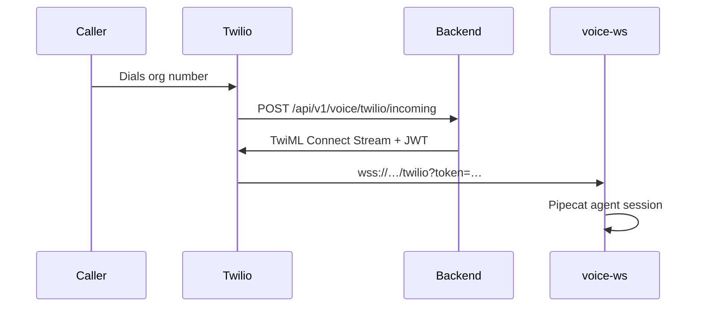
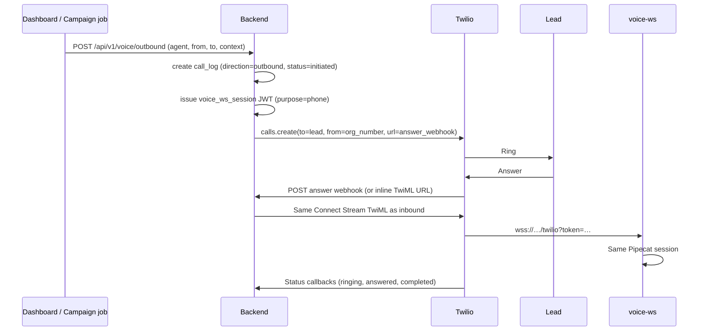

# Outbound phone calls (planned)

**Status:** Not implemented — design reference for a future sprint  
**Transport:** Pipecat WebSocket (`voice-ws`) + Twilio Media Streams (same as inbound)  
**Related:** [Twilio call flow](../01_architecture/twilio_call_flow.md), [voice-ws phase 2](voice_ws_phase2.md), [PRD phone numbers](../PRD-phone-numbers.md)

## Summary

Outbound PSTN calls (sales, reminders, campaigns) use the **same voice runtime** as inbound: Twilio phone audio connects to `voice-ws` via a **bidirectional Media Stream WebSocket** on `/twilio`. For outbound, the only new work is **originating** the call from the backend and returning the same Stream TwiML when the callee answers.

Once the stream is connected, `voice-ws` runs the same Pipecat session (realtime or pipeline preset, tools, MCP, skills) as an inbound call.

## Current state (inbound only)

Implemented in:

- `backend/src/voice_agents/voice_routes.py` — TwiML + session JWT
- `shared/voice_agents/voice_session_service.py` — `voice_ws_session` tokens
- `voice-ws/src/bot.py` — Twilio serializer + session setup

## Target state (outbound)

## What to build (checklist)

### 1. Backend API — originate call

- New route, e.g. `POST /api/v1/voice/outbound` (RBAC: org admin / campaign permission).
- Inputs: `agent_id`, `to_number` (E.164), optional `from_number` (must be org-owned Twilio number with `is_outgoing_enabled=true`), optional campaign/lead metadata.
- Use Twilio REST `client.calls.create()` with:
  - `to`, `from`
  - `url` — webhook that returns Stream TwiML (or TwiML Bin / inline TwiML with `<Connect><Stream>`)
  - `status_callback` — existing or extended status webhook
- Reuse `build_pipecat_stream_twiml()` and `voice_session_service.create_session_token()` from inbound flow.
- Enforce `VOICE_WS_TWILIO_URL` (public `wss://`) — same constraint as inbound.

### 2. Answer webhook

- Option A: Dedicated `POST /api/v1/voice/twilio/outbound-answer` that reads `CallSid` / custom params and returns Stream TwiML.
- Option B: Single answer handler parameterized by query token embedded in `calls.create` URL.
- Pass `agent_id`, `organization_id`, lead context via Stream `<Parameter>` tags (already supported in `build_pipecat_stream_twiml`).

### 3. Call logs & UI

- Extend `call_logs` with `direction: inbound | outbound` (if not already present).
- Calls page: “Start call” on agent or lead row; show outbound status (initiated → ringing → in-progress → completed/failed).
- Phone number model already has `is_outgoing_enabled` — wire UI + API validation.

### 4. Campaign / batch (later)

- Job queue (worker process or backend background task) that rate-limits outbound dials.
- Idempotency + retry policy; compliance hooks (consent, quiet hours, DNC list).

### 5. Compliance (product, not transport)

- TCPA / consent tracking, recording disclosure, opt-out — product/compliance concerns independent of the Pipecat transport.

## Reuse map (minimal new voice code)

| Inbound (exists) | Outbound (reuse) |
|------------------|------------------|
| `build_pipecat_stream_twiml()` | Same TwiML on answer |
| `voice_session_service.create_session_token()` | JWT with `purpose=phone`, outbound metadata |
| `voice-ws` `/twilio` handler | Unchanged — one stream per call |
| `assemble_agent_tools()` / presets | Same agent config |
| Twilio status webhook | Extend for outbound lifecycle |

## Environment variables

Same as inbound Pipecat phone path:

| Variable | Role |
|----------|------|
| `VOICE_WS_TWILIO_URL` | Public `wss://` base Twilio uses for Media Streams |
| `VOICE_WS_PUBLIC_URL` | Fallback / browser test calls |
| `JWT_SECRET_KEY` | Shared backend + voice-ws session signing |
| `TWILIO_ACCOUNT_SID` / `TWILIO_AUTH_TOKEN` | REST `calls.create` + webhooks |

No LiveKit or `VOICE_TRANSPORT` variables — see [ENV_VARS.md](../ENV_VARS.md) for `VOICE_WS_*` and `JWT_SECRET_KEY`.

## Non-goals for v1

- Browser-only outbound to PSTN without Twilio (still requires a telephony provider).
- Separate outbound voice voice-ws — scale `voice-ws` horizontally instead.

## Testing strategy (when implemented)

1. **Unit:** TwiML builder with outbound parameters; JWT claims; phone number `is_outgoing_enabled` guard.
2. **Integration:** Mock Twilio REST + webhook chain; assert Stream URL and token present.
3. **Manual:** Twilio trial number → ngrok `VOICE_WS_TWILIO_URL` → single test outbound dial.

## References

- Twilio: [Media Streams](https://www.twilio.com/docs/voice/media-streams), [Outbound Calls API](https://www.twilio.com/docs/voice/api/call-resource)
- In-repo: `docs/01_architecture/ADR_VOICE_WS_PIPECAT.md`, `docs/03_implementation/voice_ws_phase2.md`
