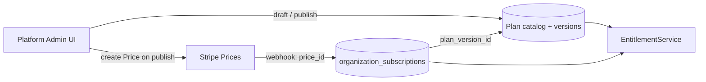
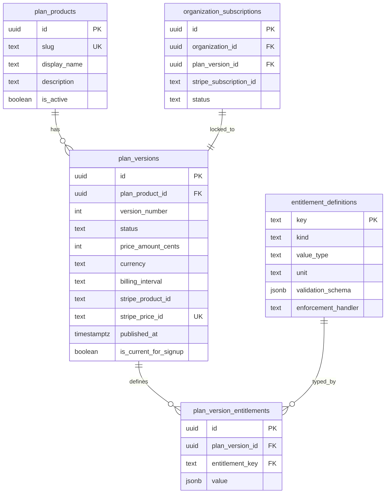
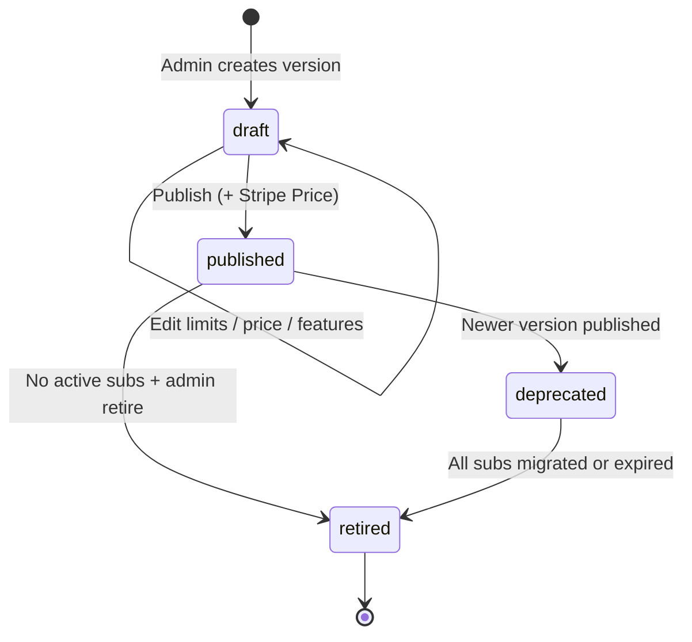
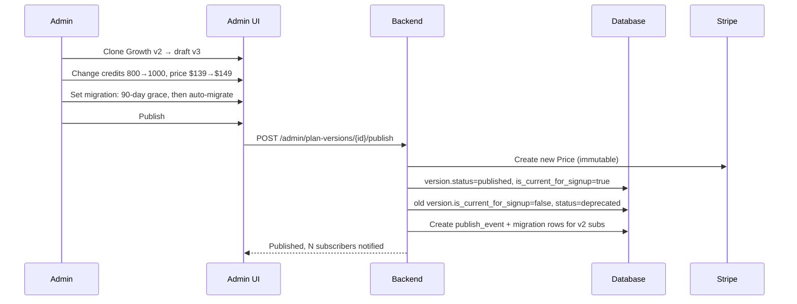
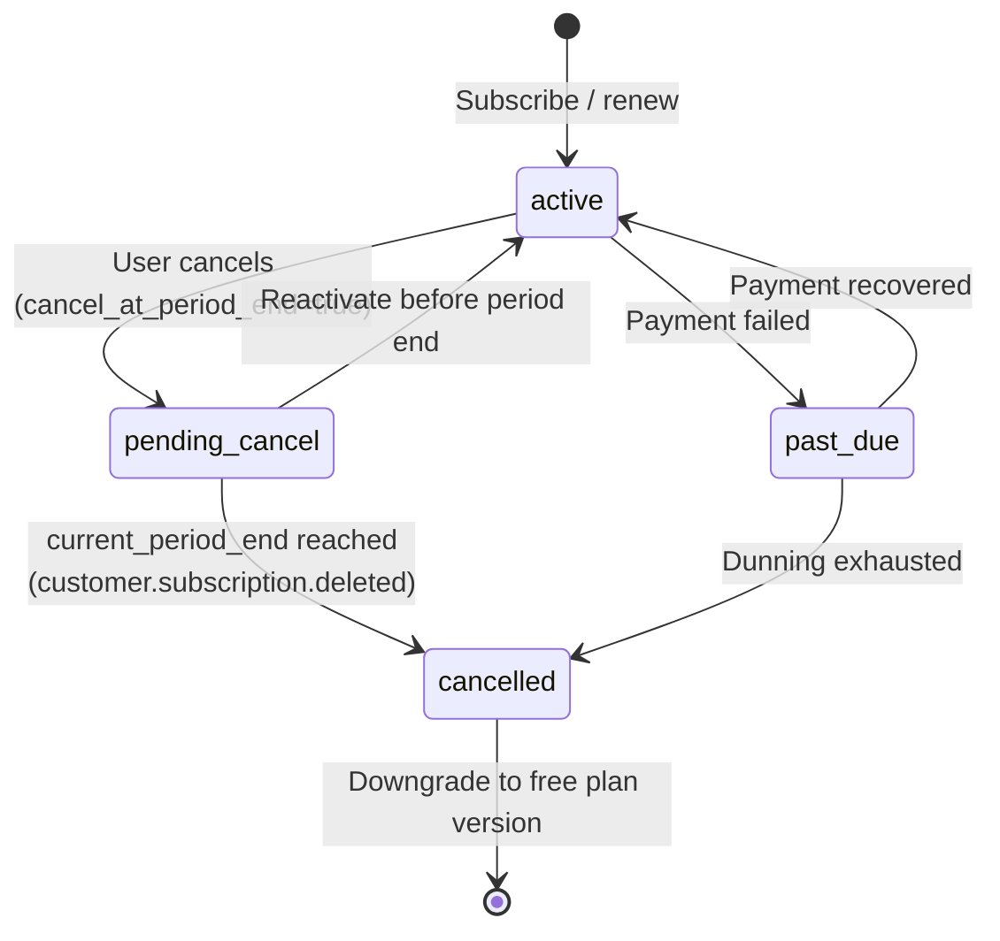
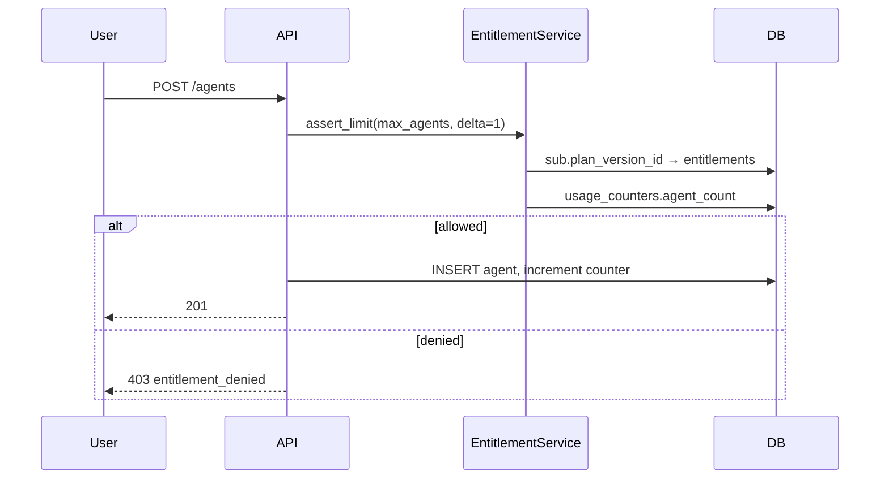

# Plan: Subscription Entitlements, Limits & Plan Versioning

**Status:** Draft (architecture plan — v2 with versioning & grandfathering)  
**Last updated:** 2026-08-07  
**ADR:** [ADR: Plan Versioning & Entitlements](../01_architecture/ADR_PLAN_VERSIONING_AND_ENTITLEMENTS.md)  
**Related:** [Billing Overview](../02_features/billing/overview.md), [Billing System](../02_core_systems/billing_system.md), [Stripe Integration](./stripe_integration.md), [DATABASE_SCHEMA.md](../DATABASE_SCHEMA.md)

---

## 1. Goals & Non-Goals

### Goals

1. **Flexible catalog** — Any number of plan products; each version may attach **any subset** of limits and features from a platform-wide catalog.
2. **Typed, extensible limits** — Support integers, booleans, unlimited, decimals, enums, durations; new types via definition + handler registration.
3. **Admin-friendly** — Platform admins manage products, versions, limits, features, pricing, and migration policy from UI (no SQL).
4. **Enforceable** — Every configured limit/feature has a registered enforcement path in backend and voice-ws.
5. **Grandfathering** — Subscribers keep the **exact version** they signed up for (price + limits + features).
6. **Controlled migration** — When publishing a new version, optionally give legacy subscribers a **configurable grace period** before required migration.

### Non-Goals (initial phases)

- Multi-currency price optimization
- Stripe Entitlements API as primary enforcement
- Per-user (vs per-org) entitlements
- Real-time Stripe metered billing (Phase 4+ optional)

---

## 2. Problem Statement

Today:

- `subscription_plans` mixes catalog, pricing, and loose `features` JSONB
- No enforcement of agent limits or plan-specific caps
- Editing a plan row would silently change terms for **all** subscribers
- No model for "Starter v1 vs Starter v2" or migration windows

Required example:

| Plan product | Version | Agents | Credits/mo | Price | Who gets it |
|--------------|---------|--------|------------|-------|-------------|
| Starter | v1 | 1 | 500 | $49 | Existing subs until migrated |
| Starter | v2 | 1 | 750 | $59 | New signups after publish |
| Growth | v3 | 5 | 1,000 | $149 | New signups; v2 subs get 90-day grace then migrate |

---

## 3. Design Principles

| # | Principle | Implication |
|---|-----------|-------------|
| P1 | **Stripe bills; platform entitles** | Price IDs sync to Stripe; limits enforced locally |
| P2 | **Published versions are immutable** | "Edit plan" = new draft version → publish |
| P3 | **Subscriptions bind to versions** | `organization_subscriptions.plan_version_id` |
| P4 | **Sparse entitlements** | Version rows only for limits/features that apply |
| P5 | **Catalog drives admin UI** | Adding a limit type = one definition row + handler |
| P6 | **Enforcement is centralized** | `EntitlementService` only; no scattered plan JSON |
| P7 | **Grandfather by default** | Publish never mutates existing subscriber terms |
| P8 | **Migration is explicit** | Policy recorded per publish event; jobs enforce deadlines |
| P9 | **Cancel at period end, no refunds** | Voluntary cancellation never triggers refunds; entitlements stay until `current_period_end` |

---

## 4. Where Things Live (Stripe vs Platform)

| Concern | Source of truth | Notes |
|---------|-----------------|-------|
| Payment collection | Stripe | Checkout, invoices, cards |
| Subscription payment status | Stripe → webhooks | `active`, `past_due`, etc. |
| **Price amount** | **Plan version** (+ Stripe Price mirror) | New price = new version |
| **Limits & features** | **Plan version entitlements** | Never read "latest" for existing subs |
| Usage metering | Platform `credit_transactions` | Credits ledger |
| Runtime enforcement | `EntitlementService` | Reads bound version + usage |



**Stripe metadata role:** Display-only mirror (`plan_product_slug`, `plan_version_number`) for debugging and webhook resolution. **Not** used for enforcement.

---

## 5. Core Architecture

### 5.1 Entity model: Product → Version → Entitlements



**Terminology:**

- **Plan product** — Logical tier family (`starter`, `growth`, `enterprise`). Stable marketing identity.
- **Plan version** — Immutable snapshot (`starter` v1, v2, …). Carries price + entitlements + Stripe Price.
- **Entitlement** — Generic term for both **limits** (`max_agents`) and **features** (`premium_tools`).

### 5.2 Version lifecycle states



| Status | Signup allowed | Editable | Subscribers |
|--------|----------------|----------|-------------|
| `draft` | No | Yes (full) | None |
| `published` | Yes if `is_current_for_signup` | **No** (immutable) | Yes |
| `deprecated` | No | No | Yes (grandfathered) |
| `retired` | No | No | None |

**Critical rule:** Once `published_at` is set, the version row and its `plan_version_entitlements` rows are **append-only / immutable**. Corrections require a new version.

### 5.3 Subscription binding

On successful checkout / subscription create:

1. Resolve `stripe_price_id` → `plan_versions.id`
2. Set `organization_subscriptions.plan_version_id` = that version (frozen)
3. Optionally write `subscription_entitlement_snapshot` JSONB (audit copy; see §5.5)
4. Grant initial credits from version's `included_credits_per_billing_period` limit

**All enforcement reads `plan_version_id` from the subscription** — never "latest version for product slug".

### 5.4 Extensible entitlement catalog

Single table `entitlement_definitions` for both limits and features (`kind = 'limit' | 'feature'`).

| Column | Purpose |
|--------|---------|
| `key` | Stable identifier, e.g. `max_agents`, `premium_tools` |
| `kind` | `limit` or `feature` |
| `value_type` | `integer`, `boolean`, `unlimited`, `decimal`, `enum`, `duration_seconds` |
| `unit` | Display: `count`, `credits`, `minutes`, `usd` |
| `validation_schema` | JSON Schema for admin input & API validation |
| `enforcement_handler` | Code registry key, e.g. `limit.max_count`, `feature.flag`, `limit.credits_monthly` |
| `default_enforcement` | `hard` (block), `soft` (warn), `none` (informational) |
| `is_active` | Hide from admin if deprecated |

**Sparse assignment:** Plan version only has rows for entitlements it uses.

Example — two plans, different shapes:

| Entitlement key | Starter v2 | Growth v3 |
|-----------------|------------|-----------|
| `max_agents` | `{ "type": "integer", "value": 1 }` | `{ "type": "integer", "value": 5 }` |
| `included_credits_per_billing_period` | `{ "type": "integer", "value": 500 }` | `{ "type": "integer", "value": 1000 }` |
| `premium_tools` | *(absent = false)* | `{ "type": "boolean", "value": true }` |
| `credit_topup_enabled` | *(absent = false)* | `{ "type": "boolean", "value": true }` |
| `max_phone_numbers` | *(absent = 0 or platform default)* | `{ "type": "integer", "value": 2 }` |

**Default when absent:** Defined per entitlement in catalog (`default_when_absent`: `false`, `0`, `unlimited`, or `deny`).

### 5.5 Optional entitlement snapshot (audit & dispute)

Table `organization_subscription_entitlement_snapshots`:

| Column | Description |
|--------|-------------|
| `organization_subscription_id` | FK |
| `plan_version_id` | Version at snapshot time |
| `snapshot_json` | Full resolved entitlements |
| `snapshot_reason` | `subscribe`, `renew`, `migrate`, `manual` |
| `created_at` | |

Written on subscribe, migration, and renewal. Runtime still uses live version FK + entitlements tables; snapshot is legal/audit trail.

---

## 6. Plan Change & Grandfathering Workflows

### 6.1 Admin publishes a new version



### 6.2 Migration policy (per publish event)

Table `plan_version_publish_events`:

| Column | Description |
|--------|-------------|
| `id` | PK |
| `from_plan_version_id` | Previous version being superseded (nullable for first publish) |
| `to_plan_version_id` | New published version |
| `migration_mode` | See below |
| `grace_period_days` | e.g. 60, 90, 120 (nullable if no migration) |
| `auto_migrate_on_expiry` | If true, job moves subs when grace ends |
| `allow_indefinite_legacy` | If true, subs may opt out of migration forever |
| `stripe_migration_timing` | `immediate`, `at_period_end`, `at_grace_end` |
| `published_by` | Admin user id |
| `published_at` | |

**Migration modes:**

| Mode | Behavior |
|------|----------|
| `new_signups_only` | Legacy subs stay on old version forever unless they self-upgrade |
| `grace_then_optional` | Grace period + reminders; after grace, **offer** migration (can stay if `allow_indefinite_legacy`) |
| `grace_then_required` | After grace, **auto_migrate_on_expiry** moves them to new version (+ Stripe price swap) |
| `immediate_required` | Rare; migrate all subs on publish (use with care + comms) |

### 6.3 Per-subscriber migration tracking

Table `organization_subscription_migrations`:

| Column | Description |
|--------|-------------|
| `organization_subscription_id` | FK |
| `publish_event_id` | FK |
| `from_plan_version_id` | |
| `to_plan_version_id` | |
| `status` | `pending`, `grace_active`, `migrated`, `declined_legacy`, `cancelled` |
| `grace_period_ends_at` | Computed from publish_event |
| `notified_at` | JSONB array of notification timestamps |
| `migrated_at` | |
| `migration_type` | `auto`, `self_service`, `admin_forced` |

**Scheduler job (daily):**

1. Find migrations where `grace_period_ends_at < now()` and `status = grace_active`
2. If `auto_migrate_on_expiry`: update sub's `plan_version_id`, call Stripe to change price (per `stripe_migration_timing`)
3. Send final notification
4. If subscriber exceeds new limits post-migration, apply **compliance policy** (§6.5)

### 6.4 User-facing migration UX

- Billing dashboard shows: current plan **version label** ("Growth v2 — legacy"), grace countdown if applicable
- CTA: "Upgrade to Growth v3" (self-service migrate before deadline)
- Email notifications at configurable intervals (60, 30, 7, 1 days before grace end)

### 6.5 Post-migration compliance (downgrade scenario)

If new version has **lower** limits (e.g. agents 5 → 3) and org has 5 agents:

| Policy | Behavior |
|--------|----------|
| `soft_block` (default) | Existing agents stay; cannot create new until compliant |
| `deactivate_excess` | Deactivate newest agents over limit |
| `admin_review` | Flag org for platform admin |

Configurable on `publish_event.compliance_policy`.

---

## 7. EntitlementService (Runtime)

### 7.1 Resolution algorithm

```python
async def resolve_entitlements(org_id: UUID) -> OrgEntitlements:
    sub = await get_organization_subscription(org_id)
    if not sub or sub.status not in ACTIVE_STATUSES:
        version = await get_default_free_plan_version()
    else:
        version = await get_plan_version(sub.plan_version_id)  # FROZEN binding

    catalog = await get_entitlement_definitions()  # cached
    assigned = await get_version_entitlements(version.id)  # sparse rows

    resolved = EntitlementResolver(catalog, assigned).resolve()
    resolved.usage = await get_usage_counters(org_id)
    resolved.credit_balance = await get_credit_balance(org_id)
    resolved.migration = await get_active_migration(sub.id)  # grace UI
    return resolved
```

**Never** resolve via `plan_products.slug` + "latest published" for subscribed orgs.

### 7.2 Handler registry (extensibility)

```python
# backend/src/billing/entitlement_handlers.py

HANDLERS: dict[str, EntitlementHandler] = {
    "limit.max_count": MaxCountHandler(),       # max_agents, max_phone_numbers
    "limit.credits_monthly": CreditsMonthlyHandler(),
    "limit.credits_balance": CreditsBalanceHandler(),
    "limit.concurrent": ConcurrentSessionsHandler(),
    "feature.flag": FeatureFlagHandler(),       # premium_tools, credit_topup_enabled
}

async def check(org_id, key: str, op: str, amount: int = 1) -> LimitCheckResult:
    definition = await get_definition(key)
    handler = HANDLERS[definition.enforcement_handler]
    entitlements = await resolve_entitlements(org_id)
    return await handler.check(entitlements, definition, op, amount)
```

**Adding a new limit type:**

1. Admin creates `entitlement_definitions` row (or seed migration)
2. Developer implements handler (or reuses generic `limit.max_count`)
3. Register handler key
4. Admin assigns to plan versions via UI

No schema migration needed for new keys if `value` JSON supports the type.

### 7.3 Enforcement registration map

Each `entitlement_definitions.key` maps to **call sites**:

| Key | Handler | Enforced at |
|-----|---------|-------------|
| `max_agents` | `limit.max_count` | `POST /agents` |
| `max_org_members` | `limit.max_count` | member invite |
| `max_phone_numbers` | `limit.max_count` | phone purchase |
| `included_credits_per_billing_period` | `limit.credits_monthly` | renewal webhook grant |
| `max_concurrent_calls` | `limit.concurrent` | voice-ws session start |
| `premium_tools` | `feature.flag` | tool connect routes (`POST /tools/agent` → 403) |
| `credit_topup_enabled` | `feature.flag` | credit checkout routes (`/checkout/credits`, `POST /credit-products/checkout` → 403) |
| `embed_widget` | `feature.flag` | embed config |

**Plugin discovery:** `entitlement_definitions.enforcement_call_sites` JSONB lists route names for docs/tests; CI test ensures each active key with `default_enforcement=hard` has ≥1 call site.

### 7.4 Error contract

```json
{
  "error": "entitlement_denied",
  "code": "MAX_AGENTS",
  "kind": "limit",
  "limit": 1,
  "current": 1,
  "plan_product": "starter",
  "plan_version": 2,
  "upgrade_target_version_id": "uuid-of-current-signup-version",
  "message": "Your plan allows 1 agent."
}
```

---

## 8. Credits, Minutes & Credit Pools

(No pay-as-you-go: runtime credit headroom is strictly prepaid.)

- **Credits** = internal ledger unit
- **Minutes** = UI derived via `credit_events.voice_call_minute.credit_cost`
- **`included_credits_per_billing_period`** = entitlement on version; granted on invoice paid into `organizations.credit_balance`

### Two-pool consumption model

| Pool | Column | Expiry | Drain order |
|------|--------|--------|-------------|
| **Plan credits** | `organizations.credit_balance` | Expire at period end; expire + replace on renewal (`_expire_plan_credits` then grant) | 1st |
| **Purchased credits** | `organizations.purchased_credit_balance` | Never expire (`expires_at IS NULL` on the transaction) | 2nd |

Consumption always drains the **plan pool first**, then purchased:

```text
(plan_used, purchased_used) = allocate_consumption(plan_balance, purchased_balance, cost)
if plan_balance + purchased_balance >= cost: debit both pools via debit_organization_credits RPC (row lock)
else: deny 402
```

`allocate_consumption` is a pure static function in `backend/src/billing/service.py`; runtime debits call the `debit_organization_credits` Postgres function (migration `20260807000007`) so concurrent consumers serialize on the organization row (`SELECT … FOR UPDATE`). The ledger rows record which pool each debit came from. Combined balance for runtime checks (`shared/billing/voice_session_entitlement.py`) is `credit_balance + purchased_credit_balance`.

### Low-balance alerts

When credits are consumed, `_maybe_notify_low_balance` emails org admins at most once per threshold per billing cycle when the **remaining combined balance** (plan + purchased) drops to 20%, 10%, or 5% of the period's included credits:

- Thresholds: `LOW_CREDIT_WARNING_THRESHOLDS = (20, 10, 5)` (percent of `included_credits_per_billing_period`)
- Dedup: `organizations.low_credit_threshold_notified` stores the highest threshold already emailed; lower thresholds fire as balance drops
- Re-arm: set NULL on any grant or purchase (`_reset_low_credit_notification`), so the cycle starts fresh
- Email: `LOW_CREDITS_TEMPLATE` / `credits.low_balance` via `SendNotificationRequest`; vars `current_credits` (string), `organization_name`, `purchase_credits_url` (`{app_base_url}/organization/billing`)

### Credit top-ups

- **`credit_topup_enabled`** = feature on version. When off, both checkout paths return **403** with an upgrade message: `POST /checkout/credits` (frontend purchase page) and `POST /credit-products/checkout`
- Purchase UI hides the "buy credits" entry point entirely when the feature is off

---

## 8.1 Subscription cancellation policy (no refund, active until period end)

### Business rule

When a customer cancels their subscription:

1. **No refund** — We do not issue prorated or full refunds for the current billing period (voluntary cancellation).
2. **Access continues** — The subscribed **plan version**, limits, features, and remaining credits stay in effect until **`current_period_end`**.
3. **No renewal** — Stripe is set to `cancel_at_period_end=true`; the customer is not charged again.
4. **Reactivation allowed** — Before period end, the customer may undo cancellation (`cancel_at_period_end=false`).
5. **After period end** — Entitlements revert to the **free/default plan version** (or read-only mode — product decision at implementation).

This simplifies billing operations: no refund workflows, chargebacks from proration math, or partial credit clawback on cancel.

### Alignment with existing code

The platform already implements the Stripe side of this policy:

- `POST /api/billing/subscription/cancel` → `stripe.Subscription.modify(cancel_at_period_end=True)`
- `POST /api/billing/subscription/reactivate` → clears `cancel_at_period_end`
- `organization_subscriptions.cancel_at_period_end` persisted locally

The entitlement architecture **must preserve full access** while `cancel_at_period_end=true` and subscription status is still `active` (Stripe keeps status `active` until the period ends).

### Subscription status model (cancellation-aware)



| State | DB signals | Entitlements | Billing |
|-------|------------|--------------|---------|
| **Active** | `status=active`, `cancel_at_period_end=false` | Full bound `plan_version_id` | Renews normally |
| **Pending cancel** | `status=active`, `cancel_at_period_end=true` | **Same** — full plan until `current_period_end` | No next charge |
| **Cancelled** | `status=cancelled`, after period end | Free/default plan version | None |

**Important:** `pending_cancel` is not a separate enum value — it is `active` + `cancel_at_period_end=true`. `EntitlementService` must **not** downgrade entitlements when cancel is requested; only when period ends or subscription is deleted.

### EntitlementService rule (cancellation)

```python
def is_entitled(sub: OrganizationSubscription) -> bool:
    # Full plan access while Stripe subscription is active — including pending cancel
    return sub.status in (SubscriptionStatus.ACTIVE, SubscriptionStatus.TRIAL)
    # TRIAL: same rule until trial_end

async def resolve_plan_version(sub: OrganizationSubscription) -> PlanVersion:
    if sub.status in (SubscriptionStatus.ACTIVE, SubscriptionStatus.TRIAL):
        return await get_plan_version(sub.plan_version_id)  # unchanged on cancel request
    return await get_default_free_plan_version()
```

`cancel_at_period_end` affects **UI copy** (badge: "Cancels on {date}") and **renewal**, not runtime limits mid-period.

### Credits on cancellation

| Credit type | On cancel request | At period end |
|-------------|-------------------|---------------|
| **Included subscription credits** (current period) | Remain usable until period end | Expire per existing expiry rules (no refund) |
| **Purchased credit packs** | Remain usable | Remain usable (never expire) |

No clawback of credits already granted for the paid period.

### Stripe configuration

| Setting | Value |
|---------|-------|
| Cancellation mode | **At period end only** (`cancel_at_period_end=true`) |
| Proration on cancel | **None** — do not use immediate cancel with refund |
| Customer portal | Configure Stripe portal to "cancel at end of billing period" if portal cancel is enabled |
| Refunds | Manual admin-only exception (support tooling); not exposed in self-service cancel flow |

Do **not** call `stripe.Subscription.cancel()` (immediate) for self-service user cancellation.

### Webhook handling

| Event | Action |
|-------|--------|
| `customer.subscription.updated` with `cancel_at_period_end=true` | Set local `cancel_at_period_end=true`; **keep** `status=active`; **do not** change `plan_version_id` |
| `customer.subscription.updated` with `cancel_at_period_end=false` | Reactivation — clear flag |
| `customer.subscription.deleted` | Set `status=cancelled`; move org to free plan version; invalidate entitlement cache; optional notification |

At `subscription.deleted`, optionally snapshot final entitlements for audit.

### User-facing UX requirements

Cancel confirmation dialog must state clearly:

- No refund for the current billing period
- Plan features and limits remain until `{current_period_end}`
- No charge on the next billing date
- Reactivate option before that date

**Note:** The current `CancelSubscriptionDialog` incorrectly says "All access to premium features will be removed" immediately — update during implementation to match this policy.

Billing dashboard should show:

- Badge: **Active — cancels on {date}** when `cancel_at_period_end=true`
- Countdown to access end date
- **Reactivate subscription** button

### API response (cancel)

```json
{
  "message": "Subscription cancelled. No refund will be issued. Your plan remains active until 2026-09-07.",
  "cancel_at_period_end": true,
  "access_until": "2026-09-07T00:00:00Z",
  "refund_policy": "none"
}
```

### What we explicitly do not support (self-service)

- Immediate cancellation with prorated refund
- Partial refund for unused days in period
- Automatic credit refund on cancel

Platform admin may still issue **manual** refunds via Stripe Dashboard for exceptional cases — outside automated flows.

### Testing checklist (cancellation)

| Test | Expected |
|------|----------|
| User cancels mid-period | `cancel_at_period_end=true`, status still `active` |
| Create agent after cancel | Allowed if under plan limit (still entitled) |
| Consume credits after cancel | Allowed until period end |
| Reactivate before period end | Full subscription continues; next renewal proceeds |
| Period ends | `subscription.deleted` → free plan; limits enforced |
| No Stripe refund created | Cancel API never creates Refund objects |

---

## 9. Stripe Integration

### 9.1 One Price per published version

| Event | Stripe action |
|-------|---------------|
| Publish draft version | `Product` reuse or create; **new** `Price` (Prices immutable) |
| New signup | Checkout with version's `stripe_price_id` |
| Webhook | Map `price_id` → `plan_versions.id` → set `plan_version_id` |
| Auto-migration | `Subscription.modify` with `items[0].price` + `proration_behavior` per policy |

### 9.2 Webhook resolution (updated)

```python
price_id = subscription["items"]["data"][0]["price"]["id"]
version = await plan_version_repo.get_by_stripe_price_id(price_id)
await org_sub_repo.update(org_id, plan_version_id=version.id)
await entitlement_cache.invalidate(org_id)
```

On **grandfathered** subs, webhook continues reporting **old** price_id → old version. No drift.

### 9.3 Relationship to existing `subscription_plans`

**Migration path:** Rename / replace `subscription_plans` with `plan_products` + `plan_versions`. Backfill:

- Each existing `subscription_plans` row → `plan_version` v1 (published)
- `organization_subscriptions.subscription_plan_id` → `plan_version_id`

Keep deprecated view `subscription_plans_v1_compat` for one release if needed.

---

## 10. Platform Admin Experience

### 10.1 Admin areas

| Area | Route | Purpose |
|------|-------|---------|
| Entitlement catalog | `/admin/entitlements` | CRUD limit/feature definitions (keys, types, handlers) |
| Plan products | `/admin/plans` | Product families |
| Plan versions | `/admin/plans/{slug}/versions` | Draft, publish, deprecate |
| Version editor | `/admin/plan-versions/{id}` | Sparse limits/features + price |
| Publish dialog | modal | Migration policy + grace period |
| Subscribers | `/admin/plan-versions/{id}/subscribers` | Who's on this version |
| Migrations | `/admin/migrations` | Pending grace / failed auto-migrate |

### 10.2 Version editor UX

Dynamic form generated from `entitlement_definitions`:

- "Add entitlement" dropdown → only keys not yet on this version
- Field widget based on `value_type` (number input, toggle, enum select, "unlimited" checkbox)
- Remove entitlement from version (draft only)
- Price + billing interval + trial days
- **Publish** button disabled until validation passes

**Clone version** — Primary workflow for plan changes:

1. Select Growth v2 → "Create new version from this"
2. Edit draft v3
3. Configure migration policy
4. Publish

### 10.3 Admin API (summary)

| Method | Path | Description |
|--------|------|-------------|
| GET/POST | `/api/v1/admin/entitlement-definitions` | Catalog CRUD |
| GET/POST | `/api/v1/admin/plan-products` | Product CRUD |
| GET/POST | `/api/v1/admin/plan-products/{slug}/versions` | List/create draft |
| GET/PUT | `/api/v1/admin/plan-versions/{id}` | Edit draft entitlements |
| POST | `/api/v1/admin/plan-versions/{id}/publish` | Publish + migration + Stripe |
| POST | `/api/v1/admin/plan-versions/{id}/retire` | Retire when no subs |
| GET | `/api/v1/admin/plan-versions/{id}/subscribers` | Subscriber list |
| POST | `/api/v1/admin/subscriptions/{id}/migrate` | Force migrate one org |

All routes: `platform_admin` RBAC.

### 10.4 What "edit plan" means (admin mental model)

| Admin intent | System behavior |
|--------------|-----------------|
| Change price for **new** customers | Publish new version with new Price |
| Change limits for **new** customers | Same |
| Keep **existing** customers unchanged | Automatic (they stay on old version) |
| Move existing customers eventually | Set grace period on publish |
| Emergency fix typo on unpublished draft | Edit draft freely |
| Emergency fix on published version | Publish corrective version + optional migration |

---

## 11. Data Model (Complete)

### 11.1 New / replaced tables

#### `plan_products`

| Column | Type | Notes |
|--------|------|-------|
| `id` | UUID PK | |
| `slug` | VARCHAR UK | `starter`, `growth` |
| `display_name` | TEXT | |
| `description` | TEXT | Marketing |
| `sort_order` | INT | Checkout display |
| `is_active` | BOOLEAN | Hide entire product line |

#### `plan_versions`

| Column | Type | Notes |
|--------|------|-------|
| `id` | UUID PK | |
| `plan_product_id` | UUID FK | |
| `version_number` | INT | Per product, monotonic |
| `status` | ENUM | draft, published, deprecated, retired |
| `display_label` | TEXT | "Growth (2026-08)" optional |
| `price_amount_cents` | INT | |
| `currency` | CHAR(3) | |
| `billing_interval` | ENUM | monthly, annual |
| `trial_period_days` | INT NULL | |
| `stripe_product_id` | VARCHAR | |
| `stripe_price_id` | VARCHAR UK | Set on publish |
| `is_current_for_signup` | BOOLEAN | At most one per product |
| `published_at` | TIMESTAMPTZ NULL | |
| `created_at`, `updated_at` | TIMESTAMPTZ | |

Unique: `(plan_product_id, version_number)`.

#### `entitlement_definitions`

(Catalog — see §5.4.)

#### `plan_version_entitlements`

| Column | Type | Notes |
|--------|------|-------|
| `id` | UUID PK | |
| `plan_version_id` | UUID FK | |
| `entitlement_key` | VARCHAR FK → definitions | |
| `value` | JSONB | Typed payload |

Unique: `(plan_version_id, entitlement_key)`.

**Example `value` shapes:**

```json
{ "type": "integer", "value": 5 }
{ "type": "unlimited" }
{ "type": "boolean", "value": true }
{ "type": "enum", "value": "premium" }
```

#### `plan_version_publish_events`

(See §6.2.)

#### `organization_subscription_migrations`

(See §6.3.)

#### `organization_subscriptions` (alter)

| Change | Description |
|--------|-------------|
| Add `plan_version_id` | UUID FK → plan_versions, NOT NULL after backfill |
| Deprecate `subscription_plan_id` | Remove after migration |
| Keep Stripe fields | unchanged |

#### `organization_usage_counters`

| Column | Type |
|--------|------|
| `organization_id` | UUID PK |
| `agent_count` | INT |
| `phone_number_count` | INT |
| `member_count` | INT |
| `concurrent_call_count` | INT |
| `period_credits_consumed` | INT |
| `period_start` | TIMESTAMPTZ |
| `updated_at` | TIMESTAMPTZ |

Updated via triggers or explicit increments in services.

#### `organization_entitlement_overrides` (enterprise)

Per-org exceptions with expiry — **overlay** on version entitlements (admin-only).

---

## 12. Enforcement Flow (End-to-End)



voice-ws calls internal `POST /internal/entitlements/check` or shared package with same service.

---

## 13. Caching & Invalidation

| Cache key | TTL | Invalidate on |
|-----------|-----|-----------------|
| `entitlements:{org_id}` | 60s | sub change, migration, override |
| `plan_version:{id}` | 5m | never (immutable after publish) |
| `definitions:catalog` | 10m | admin catalog edit |

Published versions are cache-friendly forever.

---

## 14. Migration from Current Schema

### 14.1 Phase A — Additive

1. Create new tables alongside `subscription_plans`
2. Backfill each `subscription_plans` row → `plan_products` + `plan_versions` v1
3. Copy `included_credits`, `max_users`, parse `features` → `plan_version_entitlements`
4. Add `plan_version_id` to `organization_subscriptions`; backfill from `subscription_plan_id`
5. Dual-read in `EntitlementService` (feature flag)

### 14.2 Phase B — Cutover

1. Admin UI uses new model only
2. Webhooks resolve via `plan_versions.stripe_price_id`
3. Drop dual-read; deprecate `subscription_plans`

### 14.3 Seed entitlement catalog

Initial keys: `max_agents`, `max_org_members`, `max_phone_numbers`, `max_concurrent_calls`, `included_credits_per_billing_period`, `premium_tools`, `embed_widget`, `custom_branding`, `credit_topup_enabled`.

---

## 15. Implementation Phases

### Phase 0 — Schema & catalog (1–2 weeks)

- [ ] Alembic: all tables in §11
- [ ] Seed entitlement definitions + handlers registry skeleton
- [ ] Backfill from `subscription_plans`
- [ ] Update `DATABASE_SCHEMA.md`

### Phase 1 — EntitlementService + versioning (2 weeks)

- [ ] `EntitlementService` resolves via `plan_version_id`
- [ ] `GET /organizations/{id}/entitlements` (+ migration/grace info)
- [ ] Enforce `max_agents`
- [ ] Unit tests: sparse limits, absent keys, defaults

### Phase 2 — Publish & grandfathering (2 weeks)

- [ ] Draft / publish / deprecate API
- [ ] Stripe Price creation on publish
- [ ] `plan_version_publish_events` + migration rows
- [ ] Webhook binds `plan_version_id`
- [ ] Tests: existing sub unchanged after new publish

### Phase 3 — Migration scheduler & UX (1–2 weeks)

- [ ] Daily job: grace expiry → auto-migrate
- [ ] Stripe subscription price swap
- [ ] Billing UI: legacy badge, grace countdown, self-migrate CTA
- [ ] Email notifications

### Phase 4 — Admin UI (2 weeks)

- [ ] Entitlement catalog admin
- [ ] Plan product / version editor (dynamic form)
- [ ] Publish dialog with migration policy
- [ ] Subscriber list per version

### Phase 5 — Credits, credit pools, voice-ws (2 weeks)

- [ ] Credit grant from version entitlement on renewal
- [ ] Two-pool consumption (plan first, purchased second) + expiry on renewal
- [ ] Low-balance alerts (20/10/5%) + `credit_topup_enabled` + `premium_tools` gates
- [ ] voice-ws concurrent + credit pre-check

### Phase 6 — Extended limits & enterprise (ongoing)

- [ ] More handlers as product grows
- [ ] Org overrides UI
- [ ] Stripe Billing Meters (optional, future)

---

## 16. Testing Strategy

| Scenario | Expected |
|----------|----------|
| Publish v2 while subs on v1 | v1 subs keep v1 entitlements & Stripe price |
| New signup after publish | Gets v2 |
| Grace period 60 days | Migration row with correct `grace_period_ends_at` |
| Auto-migrate on expiry | `plan_version_id` updated; Stripe price changed |
| `allow_indefinite_legacy=true` | Sub may decline; stays on v1 |
| Plan A has only `max_agents`; Plan B has agents + credits | Sparse rows enforced independently |
| New entitlement key added to catalog | Appears in admin dropdown; assignable to draft |
| Downgrade agents 5→3 with soft_block | Existing agents remain; create blocked |
| Draft edit before publish | Allowed |
| Edit published version | API returns 409; must clone |

---

## 17. FAQ

### Can two published versions be current for signup?

No — at most **one** `is_current_for_signup=true` per `plan_product_id`. Multiple deprecated versions can coexist with active subs.

### What if we only want to change marketing copy, not price/limits?

Edit `plan_products.description` or version `display_label` if unsubscribed; published version marketing can have a separate `marketing_copy` field that doesn't affect entitlements (optional column).

### Annual vs monthly — same entitlements?

Different versions (recommended): `growth_monthly` v3 and `growth_annual` v2 can share entitlements via "clone" but have distinct Stripe Prices.

### How does free/trial work?

`plan_product` = Free with published version v1; no Stripe sub. Trial = subscribe to version with `trial_period_days` on version row.

### Stripe Entitlements API?

Still optional display sync only. Platform remains enforcement source for flexibility and voice-ws.

---

## 18. Summary

| Requirement | Solution |
|-------------|----------|
| Any plans, any limits/features per plan | Product + version + sparse `plan_version_entitlements` |
| Changing limit types | Extensible `entitlement_definitions` + handler registry |
| Admin manageable | Catalog admin + version editor + publish workflow |
| Enforceable | `EntitlementService` + registered handlers at call sites |
| Existing subs not impacted | Immutable published versions; sub binds `plan_version_id` |
| New signups get new terms | `is_current_for_signup` on latest published version |
| Configurable migration buffer | `plan_version_publish_events.grace_period_days` + migration job |
| Pricing grandfathering | New Stripe Price per version; subs keep old Price until migrated |
| Cancel subscription | **At period end only; no refund;** full entitlements until `current_period_end` |

---

## 19. References

- ADR: [ADR_PLAN_VERSIONING_AND_ENTITLEMENTS.md](../01_architecture/ADR_PLAN_VERSIONING_AND_ENTITLEMENTS.md)
- Current models: `backend/src/billing/models.py`
- Credit consumption: `backend/src/billing/service.py`
- Stripe sync: `backend/scripts/stripe_manager.py`
- Agent create: `backend/src/voice_agents/routes.py`
