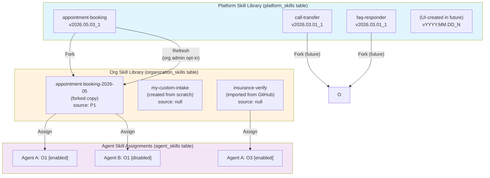
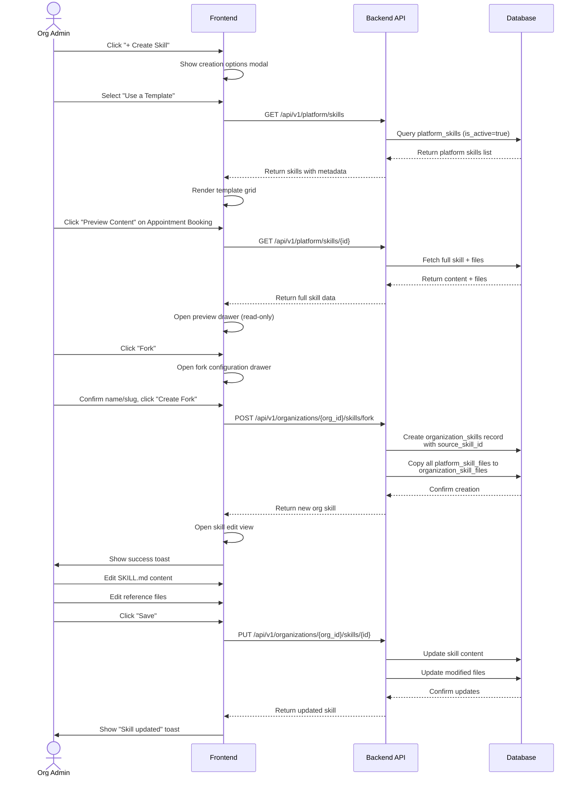
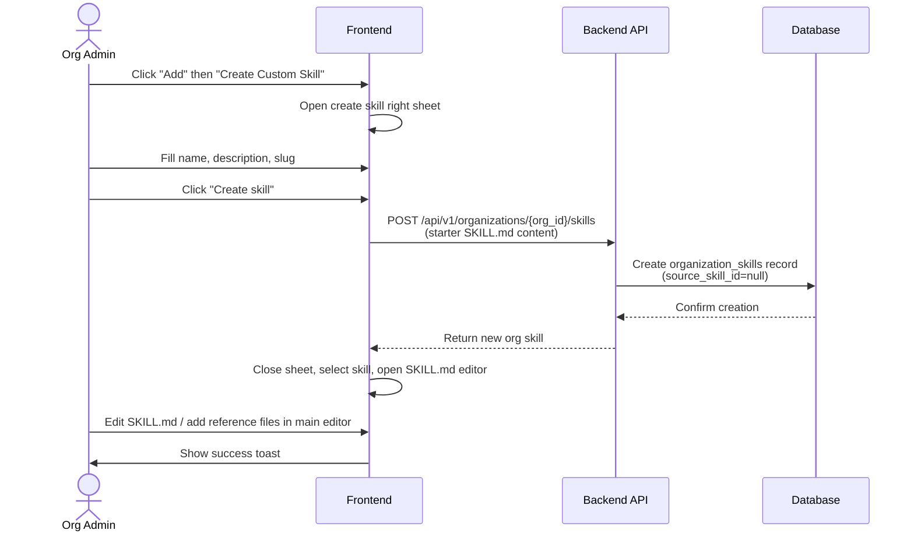
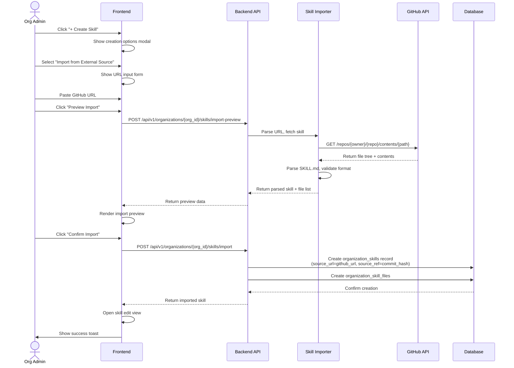
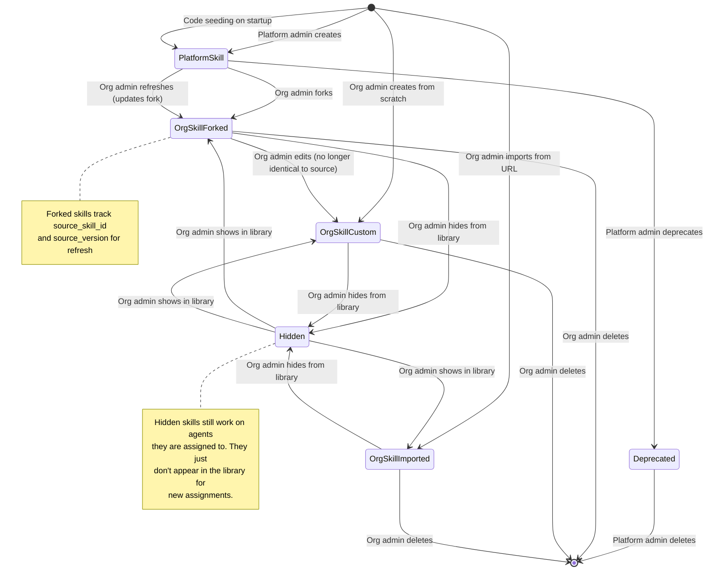
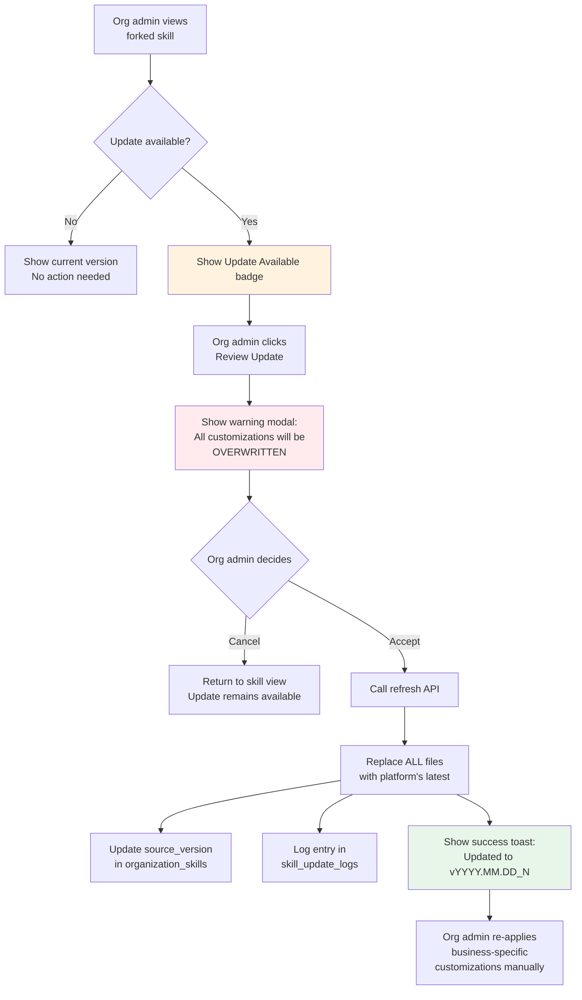

# Implementation Plan: Platform Skills & Fork/Refresh Model

## Context

This plan implements the **fork/refresh model** for skills, replacing the current "seed built-in skills directly into orgs" approach. It also introduces **platform skills** as an independent layer and supports **date-based versioning**.

**Stashed changes:** The WIP `appointment-booking` capability content (18,838 chars + 5 reference files) is stashed and will be applied as a `platform_skill` once this infrastructure is in place.

---

## Design Decisions (Locked)

| Decision | Rationale |
|----------|-----------|
| **Date-based versioning** | Format: `YYYY.MM.DD_N` (e.g., `2026.05.03_1`). Readable, chronological, no semantic-version debates. |
| **Full bundle replacement on refresh** | Simpler than merge/diff. All files replaced. Org admin re-applies customizations afterward. |
| **Warning before refresh** | Clear modal: "ALL customizations will be overwritten." No diff viewer for now (too complex). |
| **Platform skills from UI (future)** | Schema supports both code-seeded and UI-created `platform_skills`. Same fork/refresh flow. |
| **No cascade on hide** | Hiding a skill from library does NOT disable it on agents. Agents show a "Hidden" badge. |

---

## Architecture Overview



### Data Flow Summary

| Layer | Table | Owner | Lifecycle |
|-------|-------|-------|-----------|
| **Platform Skills** | `platform_skills` | Platform admin | Immutable templates. Updated via code or future UI. |
| **Org Skills** | `organization_skills` | Org admin | Forked copies, custom creations, imports. Editable. |
| **Agent Assignments** | `agent_skills` | Org admin | Toggles per agent. Points to org skills only. |

---

## Create Skill — User Journey (Detailed UI Flow)

### Entry Point: Organization Page → Skills Tab

The org admin navigates to **Organization Settings → Skills**. The page shows existing skills and a **"+ Create Skill"** button in the top-right.

### Step 1: Creation Method Selection Modal

Clicking "+ Create Skill" opens a **full-screen modal or side drawer** (consistent with the existing drawer pattern used for create/edit flows). The user sees three clear options:

```
┌─────────────────────────────────────────────────────────────────┐
│  Create a New Skill                                    [✕ close]│
├─────────────────────────────────────────────────────────────────┤
│                                                                  │
│  ┌──────────────────────────┐  ┌──────────────────────────┐    │
│  │   📝 Use a Template      │  │   🔧 Create from Scratch │    │
│  │                          │  │                          │    │
│  │  Start with a pre-built  │  │  Build your own skill    │    │
│  │  skill from the platform │  │  with your own content   │    │
│  │  library and customize   │  │  and reference files     │    │
│  │  it for your business    │  │                          │    │
│  │                          │  │                          │    │
│  │  [Browse Templates →]    │  │  [Start Building →]      │    │
│  └──────────────────────────┘  └──────────────────────────┘    │
│                                                                  │
│  ┌────────────────────────────────────────────────────────────┐│
│  │   🌐 Import from External Source                            ││
│  │                                                              ││
│  │  Import a skill from GitHub, skills.sh, or another URL       ││
│  │                                                              ││
│  │  [Paste URL →]                                             ││
│  └────────────────────────────────────────────────────────────┘│
│                                                                  │
└─────────────────────────────────────────────────────────────────┘
```

---

### Path A: Use a Template

**Step A1: Browse Platform Templates**

The user sees a filterable grid/list of available platform skills:

```
┌─────────────────────────────────────────────────────────────────┐
│  ← Back to Create Options                                        │
│  Use a Template                                                  │
├─────────────────────────────────────────────────────────────────┤
│  [Search skills...]  [Filter: All ▾]  [Sort: Popular ▾]         │
│                                                                  │
│  ┌────────────────────────────┐  ┌────────────────────────────┐ │
│  │ 📅 Appointment Booking     │  │ 📞 Call Transfer           │ │
│  │                            │  │                            │ │
│  │ Schedule, reschedule, and  │  │ Escalate calls to human    │ │
│  │ cancel appointments        │  │ agents with context        │ │
│  │                            │  │                            │ │
│  │ Version: 2026.05.03_1      │  │ Version: 2026.03.01_1      │ │
│  │ 5 reference files included │  │                            │ │
│  │                            │  │                            │ │
│  │ [Preview Content] [Fork →] │  │ [Preview Content] [Fork →] │ │
│  └────────────────────────────┘  └────────────────────────────┘ │
│                                                                  │
│  ┌────────────────────────────┐  ┌────────────────────────────┐ │
│  │ ❓ FAQ Responder           │  │ 🌙 After Hours             │ │
│  │ ...                        │  │ ...                        │ │
│  └────────────────────────────┘  └────────────────────────────┘ │
└─────────────────────────────────────────────────────────────────┘
```

**Preview Drawer:** Clicking "Preview Content" opens a side drawer showing the full SKILL.md content read-only. This lets the user evaluate the skill before forking.

**Step A2: Fork Configuration**

Clicking "Fork" opens a configuration drawer:

```
┌─────────────────────────────────────────────────────────────────┐
│  Fork: Appointment Booking                             [✕ close]│
├─────────────────────────────────────────────────────────────────┤
│                                                                  │
│  Platform Version: 2026.05.03_1                                  │
│                                                                  │
│  Your Copy Name *                                                │
│  ┌────────────────────────────────────────────────────────────┐ │
│  │ Appointment Booking (Copy)                                   │ │
│  └────────────────────────────────────────────────────────────┘ │
│  This is how the skill will appear in your library               │
│                                                                  │
│  Slug (auto-generated)                                           │
│  ┌────────────────────────────────────────────────────────────┐ │
│  │ appointment-booking-2026-05-03                               │ │
│  └────────────────────────────────────────────────────────────┘ │
│  You can customize this later                                    │
│                                                                  │
│  Files to Include (all will be copied)                             │
│  ☑ references/service-menu.md                                   │
│  ☑ references/hours.md                                          │
│  ☑ references/staff-directory.md                                │
│  ☑ references/policies.md                                       │
│  ☑ references/faqs.md                                           │
│                                                                  │
│  [Cancel]                                    [Create Fork →]     │
└─────────────────────────────────────────────────────────────────┘
```

**Validation:**
- Name must be unique within the org
- Slug must be unique within the org, auto-generated from name but editable
- All files are copied by default (checkboxes shown for transparency, but all checked and disabled — simplification: always copy all)

**Step A3: Fork Created → Edit Mode**

After creation, the user is taken directly to the **skill detail/edit view** with a success toast:
> "✅ Appointment Booking (Copy) created! Customize it for your business."

The user sees:
- SKILL.md editor (pre-filled with platform content, editable)
- File tree with all copied files (all editable)
- "Update" button to save changes

---

### Path B: Create from Scratch

**Step B1: Skill Builder Form**

The user sees a multi-section form:

```
┌─────────────────────────────────────────────────────────────────┐
│  ← Back to Create Options                                        │
│  Create Skill from Scratch                             [✕ close]│
├─────────────────────────────────────────────────────────────────┤
│                                                                  │
│  Skill Name *                                                    │
│  ┌────────────────────────────────────────────────────────────┐ │
│  │ My Custom Intake                                             │ │
│  └────────────────────────────────────────────────────────────┘ │
│                                                                  │
│  Slug *                                                            │
│  ┌────────────────────────────────────────────────────────────┐ │
│  │ my-custom-intake                                             │ │
│  └────────────────────────────────────────────────────────────┘ │
│                                                                  │
│  Description                                                       │
│  ┌────────────────────────────────────────────────────────────┐ │
│  │ Handles new patient intake and form collection             │ │
│  └────────────────────────────────────────────────────────────┘ │
│                                                                  │
│  Skill Instructions (SKILL.md) *                                 │
│  ┌────────────────────────────────────────────────────────────┐ │
│  │ # My Custom Intake                                         │ │
│  │                                                            │ │
│  │ ## When to Use                                             │ │
│  │ - ...                                                      │ │
│  │                                                            │ │
│  │ ## Procedure                                             │ │
│  │ 1. ...                                                     │ │
│  │                                                            │ │
│  └────────────────────────────────────────────────────────────┘ │
│  (Markdown supported. Use headings, lists, and decision trees)  │
│                                                                  │
│  [+ Add Reference File]                                          │
│                                                                  │
│  [Cancel]                                    [Create Skill →]  │
└─────────────────────────────────────────────────────────────────┘
```

**Validation:**
- Name: required, 1-200 chars
- Slug: required, kebab-case, unique within org
- Content: required, min 100 chars (encourage substantial skills)
- Description: optional but recommended (used in skill selection UI)

**Step B2: Add Reference Files (Optional)**

Clicking "+ Add Reference File" opens a sub-drawer:

```
┌─────────────────────────────────────────────────────────────────┐
│  Add Reference File                                      [✕ close]│
├─────────────────────────────────────────────────────────────────┤
│                                                                  │
│  File Path *                                                       │
│  ┌────────────────────────────────────────────────────────────┐ │
│  │ references/service-menu.md                                   │ │
│  └────────────────────────────────────────────────────────────┘ │
│  Must start with 'references/', 'scripts/', or 'assets/'        │
│                                                                  │
│  File Kind                                                        │
│  [Reference ●] [Script ○] [Asset ○] [Other ○]                  │
│                                                                  │
│  Content *                                                         │
│  ┌────────────────────────────────────────────────────────────┐ │
│  │ ## Services                                                 │ │
│  │ - Service A: $100                                           │ │
│  │ - Service B: $200                                         │ │
│  └────────────────────────────────────────────────────────────┘ │
│                                                                  │
│  [Cancel]                                         [Add File →]   │
└─────────────────────────────────────────────────────────────────┘
```

The user can add multiple files before saving the skill.

**Step B3: Skill Created → Library View**

After creation, the user returns to the Skills tab with the new skill visible:
> "✅ My Custom Intake created successfully."

---

### Path C: Import from External Source

**Step C1: URL Input**

```
┌─────────────────────────────────────────────────────────────────┐
│  ← Back to Create Options                                        │
│  Import from External Source                           [✕ close]│
├─────────────────────────────────────────────────────────────────┤
│                                                                  │
│  Source URL *                                                      │
│  ┌────────────────────────────────────────────────────────────┐ │
│  │ https://github.com/anthropics/skills/appointment-booking   │ │
│  └────────────────────────────────────────────────────────────┘ │
│                                                                  │
│  Supported formats:                                              │
│  • GitHub repo or tree URL                                       │
│  • skills.sh URL                                                 │
│  • GitHub shorthand: owner/repo/skill-name                       │
│                                                                  │
│  [Cancel]                                    [Preview Import →]  │
└─────────────────────────────────────────────────────────────────┘
```

**Validation:**
- URL required, must be a supported format
- Frontend validates format before API call (regex)
- Backend validates accessibility (can fetch from GitHub API?)

**Step C2: Preview & Confirm**

The backend fetches and parses the skill. The user sees a preview:

```
┌─────────────────────────────────────────────────────────────────┐
│  Import Preview: appointment-booking                 [✕ close]│
├─────────────────────────────────────────────────────────────────┤
│                                                                  │
│  ✓ Source accessible                                             │
│  ✓ SKILL.md found and parsed                                       │
│  ✓ 5 reference files found                                       │
│                                                                  │
│  Name: Appointment Booking                                       │
│  Description: Schedule, reschedule, and cancel appointments      │
│  Version from source: 1.0.0                                      │
│                                                                  │
│  Files to Import:                                                  │
│  • SKILL.md (18,838 chars)                                      │
│  • references/service-menu.md                                   │
│  • references/hours.md                                          │
│  • references/staff-directory.md                                │
│  • references/policies.md                                       │
│  • references/faqs.md                                           │
│                                                                  │
│  ⚠️ Note: This will be imported as a custom skill in your         │
│     organization. Future updates to the source will NOT            │
│     automatically update this copy.                              │
│                                                                  │
│  [Cancel]                                    [Confirm Import →]  │
└─────────────────────────────────────────────────────────────────┘
```

**Step C3: Import Complete → Edit Mode**

Same as fork: user lands in edit mode with all files pre-filled and editable.

---

### Sequence Diagram: Fork from Template



### Sequence Diagram: Create from Scratch



### Sequence Diagram: Import from External Source



---

## Skill Lifecycle State Diagram



---

## Refresh Decision Flow



---

## Phase 1: Database Schema Migration

### New Table: `platform_skills`

Stores immutable skill templates controlled by the platform.

| Column | Type | Constraints | Description |
|--------|------|-------------|-------------|
| id | UUID | PK | Unique identifier |
| slug | VARCHAR(100) | NOT NULL, UNIQUE | URL-safe identifier |
| name | VARCHAR(200) | NOT NULL | Display name |
| description | TEXT | | Short description |
| content | TEXT | NOT NULL | Full skill.md content |
| version | VARCHAR(20) | NOT NULL | Date-based version (`YYYY.MM.DD_N`) |
| content_hash | VARCHAR(64) | | SHA-256 of content |
| is_active | BOOLEAN | DEFAULT TRUE | Platform-level visibility |
| author | VARCHAR(200) | | Attribution |
| created_at | TIMESTAMPTZ | DEFAULT NOW() | |
| updated_at | TIMESTAMPTZ | DEFAULT NOW() | |

### Modified Table: `organization_skills`

**Add columns:**

| Column | Type | Default | Description |
|--------|------|---------|-------------|
| source_skill_id | UUID | NULL | FK → `platform_skills.id` (null = created from scratch/imported) |
| source_version | VARCHAR(20) | NULL | Version at time of fork |
| is_visible | BOOLEAN | TRUE | Visibility in org library |

**Modify:**
- `category` → remove `built_in` from allowed values. Only `custom` remains. All org skills are "custom" (some are forked, some created, some imported).

### New Table: `skill_update_logs`

Tracks refresh history for audit and debugging.

| Column | Type | Description |
|--------|------|-------------|
| id | UUID | PK |
| org_skill_id | UUID | FK → `organization_skills.id` |
| old_source_version | VARCHAR(20) | Version before refresh |
| new_source_version | VARCHAR(20) | Version after refresh |
| performed_by | UUID | User who triggered it |
| performed_at | TIMESTAMPTZ | Timestamp |

### One-Time Data Migration Script

For existing orgs with `category = "built_in"` skills:
1. For each unique built-in skill slug, create a `platform_skills` record
2. For each org, create a forked copy in `organization_skills`:
   - Copy content, files, name, slug
   - Set `source_skill_id` = new platform skill id
   - Set `source_version` = current version (or `1970.01.01_1` if unknown)
   - Set `category = "custom"`
3. Update `agent_skills` records to point to new forked copies
4. Delete old `category = "built_in"` records (or leave as deprecated)

**Risk:** Low. This is a data transformation, not a schema break. Rollback: reverse the mapping.

---

## Phase 2: Backend API

### 2.1 Platform Admin Endpoints

```
GET    /api/v1/platform/skills              — List platform skills (platform admin)
POST   /api/v1/platform/skills              — Create platform skill (platform admin)
PUT    /api/v1/platform/skills/{id}         — Update platform skill (bumps version)
DELETE /api/v1/platform/skills/{id}         — Deprecate platform skill
```

**Version bump logic on update:**
- Compute new version: `YYYY.MM.DD_N` where N increments if multiple updates today
- Update `content_hash`
- No org is affected (they use forked copies)

### 2.2 Org Admin Endpoints (Modified)

```
GET    /api/v1/organizations/{org_id}/skills           — List org skills + available templates
POST   /api/v1/organizations/{org_id}/skills          — Create custom skill (from scratch)
POST   /api/v1/organizations/{org_id}/skills/fork     — Fork from platform skill
PUT    /api/v1/organizations/{org_id}/skills/{id}     — Edit custom/forked skill
DELETE /api/v1/organizations/{org_id}/skills/{id}     — Delete custom/forked skill
POST   /api/v1/organizations/{org_id}/skills/{id}/refresh  — Refresh from source (opt-in)
```

**Fork endpoint:**
- Input: `platform_skill_id`, optional `custom_name`, optional `custom_slug`
- Creates new `organization_skills` record with `source_skill_id`
- Copies ALL files from platform skill to org skill files
- Returns the new org skill

**Refresh endpoint:**
- Checks: `source_skill_id` exists, `source_version` < platform's current version
- If accepted: replaces ALL content and ALL files with platform's latest
- Logs entry in `skill_update_logs`
- Returns updated org skill

### 2.3 Seeding Logic Update

**Current:** `seed_built_in_skills(org_id)` creates records directly in `organization_skills`.

**New:** `seed_platform_skills()` populates `platform_skills` on app startup (idempotent, uses `content_hash`). No per-org seeding needed.

**For new org onboarding:** No skill seeding at org level. Org admin sees "Templates" section with available platform skills and forks what they need.

---

## Phase 3: Frontend UI

### 3.1 Organization Skills Tab — Two Sections

```
┌─────────────────────────────────────────────────────────────────┐
│  Skills                              [+ Create Custom Skill]    │
├─────────────────────────────────────────────────────────────────┤
│  YOUR SKILLS                                                    │
│  ┌──────────────┐  ┌──────────────┐  ┌──────────────┐        │
│  │ appointment-  │  │ my-custom-   │  │ insurance-   │        │
│  │ booking-copy  │  │ intake       │  │ verify       │        │
│  │ ⚡ Update     │  │              │  │              │        │
│  │    available  │  │              │  │              │        │
│  └──────────────┘  └──────────────┘  └──────────────┘        │
│                                                                 │
│  TEMPLATES (from platform)                                      │
│  ┌──────────────┐  ┌──────────────┐  ┌──────────────┐        │
│  │ appointment-  │  │ call-transfer│  │ faq-responder│        │
│  │ booking       │  │              │  │              │        │
│  │ [Fork]        │  │ [Fork]       │  │ [Fork]       │        │
│  └──────────────┘  └──────────────┘  └──────────────┘        │
└─────────────────────────────────────────────────────────────────┘
```

### 3.2 Refresh Warning Modal

```
┌─────────────────────────────────────────────────────────────┐
│  ⚠️ Update Skill — appointment-booking-copy                   │
├─────────────────────────────────────────────────────────────┤
│  Current version: 2026.05.03_1                              │
│  New version:     2026.05.15_1                                │
│                                                              │
│  ⚠️ WARNING: Accepting this update will OVERWRITE all files   │
│  in this skill, including any customizations you made to:     │
│    • Skill instructions (SKILL.md)                            │
│    • Reference files (service-menu.md, hours.md, etc.)        │
│    • Any uploaded scripts or assets                            │
│                                                              │
│  After updating, you will need to re-apply any business-      │
│  specific changes manually.                                   │
│                                                              │
│  [Cancel]                              [Accept Update]        │
└─────────────────────────────────────────────────────────────┘
```

### 3.3 Agent Skills Tab — Hidden Badge

Forked skills that are `is_visible=false` but still assigned to an agent show:
- Skill name
- "Hidden from library" badge (grey)
- Toggle still works (can enable/disable)
- "Show in library" quick action

---

## Phase 4: voice-ws Integration

No changes needed to the worker. voice-ws already:
1. Queries `agent_skills` → gets `organization_skills` records
2. Loads `organization_skills.content` via `load_skill`
3. Loads reference files via `load_skill_reference`

The data source changed (forked copy instead of built-in), but the API contract is identical.

---

## Phase 5: Apply Stashed Content

Once the fork model is implemented:
1. Unstash the `appointment-booking` content
2. Create a `platform_skills` record with the exceptional content + 5 reference files
3. Set version to `2026.05.03_1` (or current date)
4. Org admins can fork it into their libraries

---

## Implementation Order

| Phase | Work | Files Touched | Est. Effort |
|-------|------|-------------|-------------|
| 1a | Alembic migration (schema changes) | `backend/alembic/versions/` | 1 day |
| 1b | Data migration script | `backend/scripts/migrate_skills.py` | 1 day |
| 2a | `platform_skills` models & service | `shared/voice_agents/skill_models.py`, `skill_service.py` | 2 days |
| 2b | Platform admin API routes | `backend/src/voice_agents/platform_skill_routes.py` | 2 days |
| 2c | Fork & refresh endpoints | `backend/src/voice_agents/skill_routes.py` | 2 days |
| 2d | Seeding logic update | `backend/src/voice_agents/skill_seeds.py`, `main.py` lifespan | 1 day |
| 3a | Frontend — creation modal (3 paths) | `frontend/src/app/(dashboard)/organization/page.tsx` | 3 days |
| 3b | Frontend — template grid + preview | New components + skill-service.ts | 2 days |
| 3c | Frontend — refresh modal | New component | 0.5 day |
| 3d | Frontend — hidden badge | `frontend/src/app/(dashboard)/agents/[agentId]/page.tsx` | 0.5 day |
| 4 | Tests (backend + frontend + E2E) | Multiple test files | 2 days |
| 5 | Documentation update | `docs/` | 0.5 day |
| **Total** | | | **~17 days** |

---

## Open Questions (Resolved)

1. **Migration safety:** Manual script with `--dry-run` option. Never auto-run on startup.
2. **Platform skill slug uniqueness:** Global unique for platform skills. Org-level unique for org skills. Forked copies get auto-generated slugs (user can override).
3. **Default file handling on fork:** Copy ALL files. No selective copy (simpler).
4. **Platform skill deprecation:** Forks keep working. New forks blocked. "Source deprecated" badge shown on org skill.

---

## Success Criteria

- [x] `platform_skills` table exists with seeded data
- [x] All existing org skills migrated to forked copies
- [x] Org admin can fork a platform skill via UI
- [x] Org admin can refresh a forked skill with warning modal
- [x] Refresh replaces ALL files (no merge)
- [x] Hidden skills show badge on agent tab, toggles still work
- [x] Platform admin can create/update platform skills via API
- [x] All existing tests pass
- [x] New tests cover fork, refresh, and migration
- [x] E2E tests cover fork + refresh flows
- [x] Stashed `appointment-booking` content applied as platform skill
