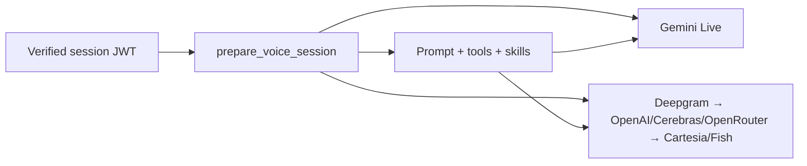

# Voice WebSocket Phase 3: parity modules

**Status:** Implemented  
**ADR:** [Pipecat transport](../01_architecture/ADR_VOICE_WS_PIPECAT.md)

Phase 3 brings the active `voice-ws` transport to functional parity for
agent-defined speech presets, legacy tools, MCP tools, and progressively
disclosed skills.

## Runtime flow

## Prompt and tool contract boundary

The model context has three deliberately separate sources:

- `PromptBuilder` combines organization context, agent instructions, assigned
  skill summaries, and the runtime date/time anchor. It does not receive
  attached tool names and must remain valid for any agent. It appends
  `GENERIC_SYSTEM_GUARDRAILS` last, making the platform boundary the final and
  highest-priority prompt section for every organization-backed agent.
- `GENERIC_SYSTEM_GUARDRAILS` defines the platform-wide scope, lawful-use,
  truthfulness, tool-integrity, privacy, high-stakes-domain, prompt-injection,
  and non-repetition rules. Agent and organization instructions may add
  business-specific or tool-specific guidance only within that boundary.
- `DEFAULT_VOICE_SYSTEM_PROMPT` contains voice-output, conversation, and
  tool-use defaults. The organization-less runtime fallback explicitly includes
  both this block and `GENERIC_SYSTEM_GUARDRAILS`, so it cannot bypass the
  platform safety boundary.
- Native function schemas are generated from native method docstrings, while
  MCP function schemas use the descriptions returned by `tools/list`. These
  schemas are passed through the model's tool-definition channel rather than
  copied into the generic platform prompt. The schema is the source of truth for
  a tool's purpose, arguments, constraints, and result contract.

Tool load failures remain in `unavailable_tools` for logs and diagnostics. They
are not rendered into the model context because exposing internal connector
names or failure details is both unnecessary and another source of prompt drift.

- `src/tools/assembly.py` discovers shared `BaseTool` implementations, injects
  `ToolContext`, and preserves function-level enablement. Failed MCP/legacy
  tools are recorded as `unavailable_tools` for logs and diagnostics only; they
  are not copied into the platform prompt. Available native function schemas and
  MCP `tools/list` descriptions remain the model-facing source of tool guidance.
- `src/tools/mcp_pipecat.py` discovers remote MCP schemas, sanitizes Gemini
  schemas, and owns MCP client lifecycle through call teardown.
- Skills expose `load_skill` and `load_skill_reference` only when assigned.
- `src/speech/factory.py` supports Gemini Live and direct Deepgram STT,
  OpenAI / Cerebras / OpenRouter LLM, Cartesia / Fish Audio TTS, and Silero VAD.
  For OpenRouter, reasoning is disabled by default via `extra_body.reasoning`
  (`effort=none`, `exclude=true`) so Gemma-style thinking channels do not stream
  into assistant content. Pipeline Cartesia/Fish TTS also attach
  `ThinkingChannelTextFilter` to strip any leaked `<|channel>…` / `<think>`
  markers before synthesis.
- Dev compose runs `voice-ws/entrypoint.dev.sh`, which co-starts the local
  Google Calendar REST MCP connector on `127.0.0.1:8733` (required for
  `Google_calendar_mcp`).

Pipeline presets must use **direct** providers only (`deepgram`, `openai`,
`cerebras`, `openrouter`, `cartesia`, `fish`, etc.). Legacy
Deprecated preset provider slug **`livekit_inference`** (removed provider name, not
the LiveKit product) stages were removed; migration
`20260803000001_remove_livekit_inference_from_presets` rewrites any remaining
DB rows to direct providers. An unmappable pipeline stage (or missing
direct-provider key) logs an error and falls back to the Gemini realtime default
so the call still connects.

## Live preset validation and runtime failure visibility

The voice runtime disables OpenRouter reasoning (`effort=none` and
`exclude=true`) to keep pipeline latency predictable. A model whose OpenRouter
catalog metadata marks reasoning as mandatory is therefore incompatible with
the current runtime configuration.

- Platform preset create/upsert, update, publication, and system-default edits
  validate OpenRouter LLM stages against `GET https://openrouter.ai/api/v1/models`.
  Successful catalog responses are cached in-process for ten minutes; the
  platform `OPENROUTER_API_KEY` is never returned or persisted.
- A draft that is not being used by a live/published preset may be authored
  without a provider network check. Publication and edits to an already-live
  configuration fail closed with an actionable admin message if the model is
  missing, requires reasoning, credentials are absent, or the catalog cannot be
  verified. Providers without an adapter are skipped so adding a provider stays
  additive.
- Runtime validation does not call the catalog on every voice session. If a
  legacy/already-published row still reaches voice-ws and the provider rejects
  it, the first Pipecat `ErrorFrame` or runner exception is classified into
  `call_logs.failure_code`/`failure_message`, and the call status becomes
  `failed`. The authenticated Calls UI renders the safe classification. Raw
  provider exceptions remain in runtime logs/telemetry and are not exposed in
  call-log responses.
- Connected failed calls still settle elapsed voice usage. A later Twilio
  callback cannot overwrite a recorded runtime failure with `completed`.

The schema fields are introduced by
`20260902000001_add_call_failure_details`.

## How to test

1. **Realtime + tools:** Assign Gmail/Calendar (or MCP) tools + a skill to an
   agent on a Gemini realtime preset. Web test call and phone call should greet,
   then execute tools / `load_skill` when asked.
2. **Pipeline preset:** Point the agent at a Deepgram → OpenRouter → Fish (or
   OpenAI/Cerebras → Cartesia) preset with **direct** providers. Confirm
   STT/LLM/TTS path speaks and tools still work.
3. Env: same as Phase 2, plus pipeline keys as needed
   (`DEEPGRAM_API_KEY`, `OPENAI_API_KEY` / `CEREBRAS_API_KEY` /
   `OPENROUTER_API_KEY`, `CARTESIA_API_KEY` / `FISH_API_KEY`).
   For Fish TTS, set the preset **voice** field to a Fish Audio voice
   `reference_id` (model e.g. `s2.1-pro-free`).
