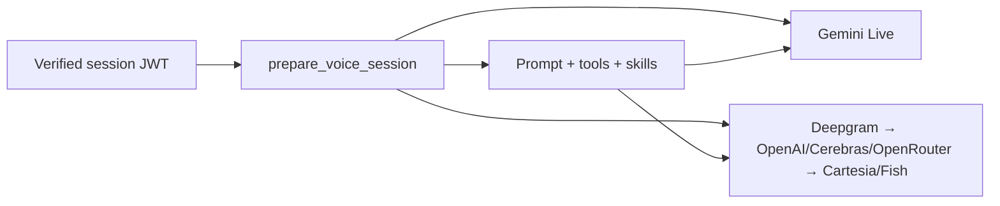

# Voice WebSocket Phase 3: parity modules

**Status:** Implemented  
**ADR:** [Pipecat transport](../01_architecture/ADR_VOICE_WS_PIPECAT.md)

Phase 3 brings the active `voice-ws` transport to functional parity with the
LiveKit worker for agent-defined speech presets, legacy tools, MCP tools, and
progressively disclosed skills.

## Runtime flow

- `src/tools/assembly.py` discovers shared `BaseTool` implementations, injects
  `ToolContext`, and preserves function-level enablement. Failed MCP/legacy
  tools are recorded as `unavailable_tools` and injected into the prompt so the
  model cannot invent booking/availability outcomes.
- `src/tools/mcp_pipecat.py` discovers remote MCP schemas, sanitizes Gemini
  schemas, and owns MCP client lifecycle through call teardown.
- Skills expose `load_skill` and `load_skill_reference` only when assigned.
- `src/speech/factory.py` supports Gemini Live and direct Deepgram STT,
  OpenAI / Cerebras / OpenRouter LLM, Cartesia / Fish Audio TTS, and Silero VAD.
  For OpenRouter, reasoning is disabled by default via `extra_body.reasoning`
  (`effort=none`, `exclude=true`) so Gemma-style thinking channels do not stream
  into assistant content. Pipeline Cartesia/Fish TTS also attach
  `ThinkingChannelTextFilter` to strip any leaked `<|channel>…` / `<think>`
  markers before synthesis.
- Dev compose runs `voice-ws/entrypoint.dev.sh`, which co-starts the local
  Google Calendar REST MCP connector on `127.0.0.1:8733` (required for
  `Google_calendar_mcp`).

Pipeline presets must use **direct** providers only (`deepgram`, `openai`,
`cerebras`, `openrouter`, `cartesia`, `fish`, etc.). Legacy
`livekit_inference` stages were removed; migration
`20260803000001_remove_livekit_inference_from_presets` rewrites any remaining
DB rows to direct providers. An unmappable pipeline stage (or missing
direct-provider key) logs an error and falls back to the Gemini realtime default
so the call still connects.

## How to test

1. **Realtime + tools:** Assign Gmail/Calendar (or MCP) tools + a skill to an
   agent on a Gemini realtime preset. Web test call and phone call should greet,
   then execute tools / `load_skill` when asked.
2. **Pipeline preset:** Point the agent at a Deepgram → OpenRouter → Fish (or
   OpenAI/Cerebras → Cartesia) preset with **direct** providers. Confirm
   STT/LLM/TTS path speaks and tools still work.
3. Env: same as Phase 2, plus pipeline keys as needed
   (`DEEPGRAM_API_KEY`, `OPENAI_API_KEY` / `CEREBRAS_API_KEY` /
   `OPENROUTER_API_KEY`, `CARTESIA_API_KEY` / `FISH_API_KEY`).
   For Fish TTS, set the preset **voice** field to a Fish Audio voice
   `reference_id` (model e.g. `s2.1-pro-free`).
