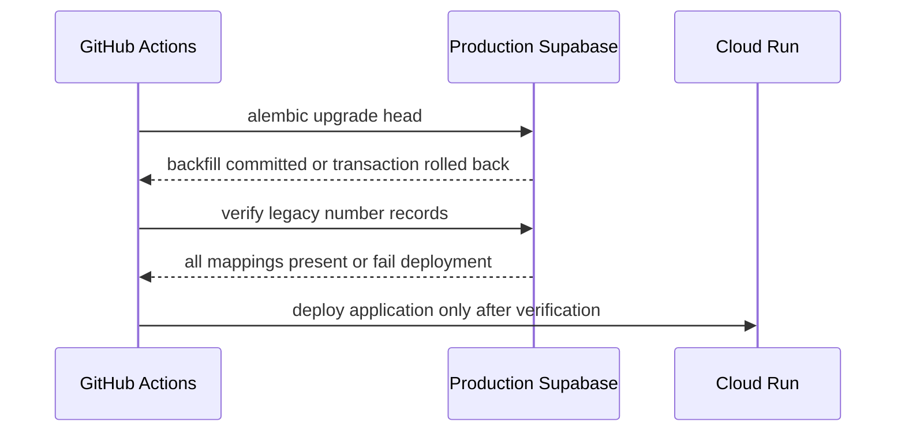

# Database Migrations

## Overview

This document outlines the process and best practices for managing schema and
data changes using migrations.

## Tools Used

- **Alembic**: For database migrations in Python applications.

## Workflow

1.  **Create a new migration script**:
    ```bash
    alembic revision --autogenerate -m "Description of changes"
    ```
2.  **Review the generated script**:
    - Verify that the `upgrade()` and `downgrade()` functions correctly reflect the intended schema changes.
    - Manually adjust the script if `autogenerate` misses anything or generates incorrect statements.
3.  **Apply the migration**:
    ```bash
    alembic upgrade head
    ```
4.  **Revert a migration (if necessary)**:
    ```bash
    alembic downgrade -1
    ```

## Best Practices

- **Small, focused migrations**: Each migration should address a single logical change.
- **Idempotency**: Migration scripts should be runnable multiple times without issues.
- **Testing**: Always test migrations in a development environment before applying to production.
- **Version Control**: Migration scripts should be committed to version control.
- **No direct schema changes**: All schema changes should go through the migration process.

## Production data migrations

Data migrations use the same Alembic chain as schema migrations and are applied
by the production `migrate-production` job before the application deployment.
This makes the database transition a release prerequisite rather than a local
or staging-only script.

For the legacy agent phone-number backfill:

1. `20260812000006_backfill_phone_numbers_from_voice_agents.py` reads legacy
   non-empty `voice_agents.phone_number` values and creates or safely reuses
   `phone_numbers` assignments.
2. It normalizes safe US formats and valid international E.164 values, but
   fails closed on ambiguous values or ownership conflicts. Historical rows do
   not contain provider number type metadata, so the migration uses `local` as
   a neutral placeholder and marks non-US numbers as country `ZZ` for review.
3. It does not call Twilio, debit credits, release numbers, or clear the legacy
   column. The migration is atomic and rerunnable.
4. `scripts/deploy/verify_phone_number_backfill.py` performs a read-only
   postcondition check after `alembic upgrade head`, requiring each legacy
   organization/number pair to have a table row. The migration itself verifies
   the initial assigned-agent mapping; the later deployment check allows users
   to unassign or release the row without blocking subsequent releases.

The automatic production path is:



Run the recovery/verification path manually with a reviewed production
environment file:

```bash
./scripts/deploy.sh migrate --env-file .env.prod
./scripts/deploy.sh verify-data --env-file .env.prod
```

The backfill downgrade is intentionally a no-op. Removing rows automatically
could delete phone-number state created after the migration. If rollback is
required, keep the legacy application path available, stop the new release,
and use a reviewed database backup or a targeted repair procedure. A future
data migration should document its own forward-only or reversible policy,
preflight conflicts, postcondition query, and production recovery command.

## Common Scenarios

- Adding a new table
- Adding/removing columns
- Modifying column types
- Renaming tables/columns
- Adding/removing indexes
- Data migrations (e.g., populating new columns)
