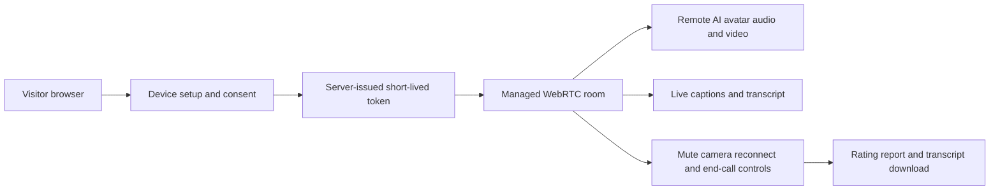
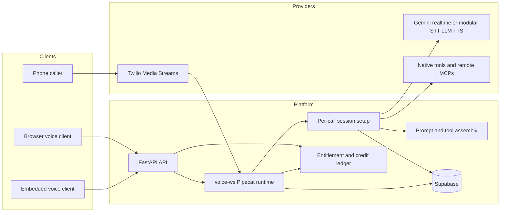
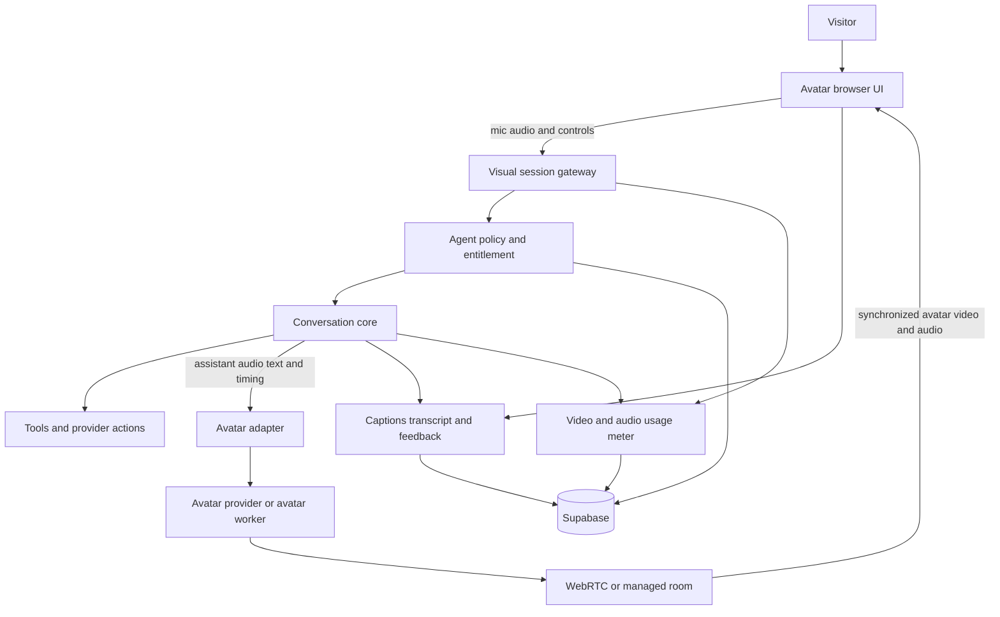
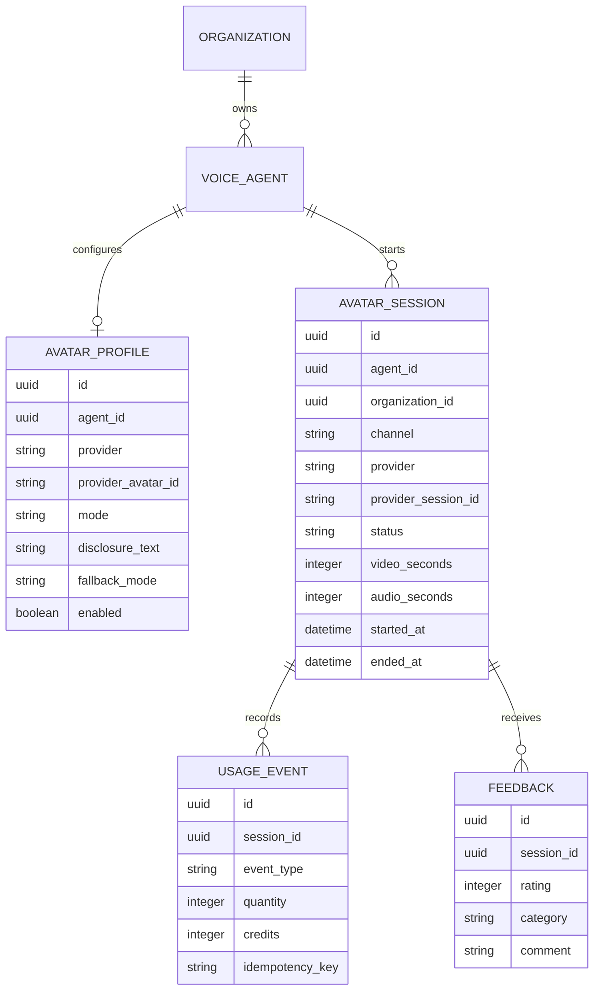
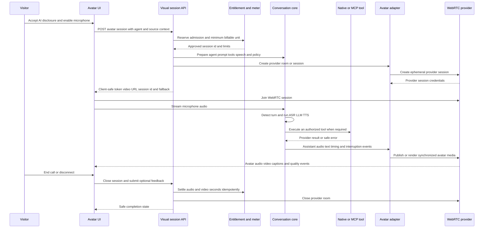
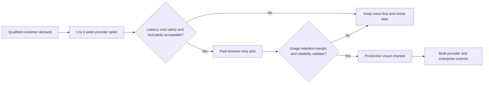

# AI Avatar + Voice Evolution Analysis

**Status:** Decision memo  
**Date:** 2026-09-13  
**Product:** 24x7 AI

## Executive answer

Yes. 24x7 AI can evolve from phone and browser voice agents into browser-based
AI avatars that speak, show a business-approved face, display captions, and
support live transcripts and feedback. The change is technically feasible, but
it is not a cosmetic frontend feature: it adds a realtime video media plane,
an avatar-rendering provider, a session bridge, new usage metering, consent
controls, and a higher compliance and support burden.

The recommended direction is **voice-first with a reversible avatar extension**:

1. Continue acquiring customers with the current phone and browser voice
   product.
2. Add the provider-neutral seams needed for an avatar channel, without
   rewriting the existing voice runtime.
3. Validate demand with one or two paid design partners before building
   self-serve avatar creation, multi-provider support, or GPU infrastructure.
4. Start with a browser-only, explicitly disclosed avatar experience. Phone
   callers should remain on the audio path and may receive a link to continue
   in video.

The reference site is a strong UX benchmark, not evidence that its avatar
rendering vendor is known or that its architecture should be copied wholesale.

## 1. What the reference experience does

The public [Dr. Malpani AI Twin video consultation](https://ai-twin.drmalpani.com/video-consultation)
page was inspected on 2026-09-13. Its public client and live browser behavior
show a complete video-conversation product surface:

- a pre-call device setup and microphone consent step;
- an AI-twin disclosure, privacy language, language selection, and short-call
  expectation;
- a short-lived server-issued session bootstrap;
- a browser WebRTC room with a remote avatar video track and synchronized
  audio;
- live captions, a transcript panel, speaking/interruption controls, local
  camera preview, connection-quality states, and reconnect behavior;
- report-a-problem and post-call helpfulness/rating feedback;
- transcript download after the call.

The public client calls POST /api/livekit-token and connects to a LiveKit Cloud
host. The client bundle handles remote audio and video tracks, transcription
events, connection state, and control messages. The public bundle does not
conclusively identify the server-side avatar renderer; it only establishes the
media/session shape and shows BeyondChats branding.

### Reference capability flow

The important product insight is that the avatar is only one visible part of a
larger trust and workflow layer. The setup, disclosure, captions, transcript,
fallback, and feedback experience are as important as the talking head.

## 2. Current 24x7 AI platform

The current platform already has most of the conversation-control primitives
needed for an avatar product:

| Capability | Current implementation | Relevance to avatars |
| --- | --- | --- |
| Agent configuration | Agent name, persona, tone, mission, custom instructions, Markdown instructions, active state, and speech preset | Reusable as the avatar's conversational identity |
| Per-call runtime | voice-ws resolves the agent, organization, timezone, tools, provider keys, prompt, and speech configuration for each call | Strong foundation for a server-owned avatar session |
| Browser voice | Pipecat WebSocket path at /ws with a short-lived voice session token | Reuse the conversation core; add a video media path |
| Phone voice | Twilio Media Streams path at /twilio | Keep as audio-only; PSTN cannot deliver avatar video |
| Embedded calls | Public embed token endpoint with origin allowlisting, source URL traceability, rate limits, and daily call limits | Extend with an avatar capability and provider session token |
| Agent tools | Dynamic native and MCP tool assembly at session start | Reuse, but keep credentials server-side |
| Billing | Entitlement pre-check, demo reservations, call logs, and rounded voice-minute settlement | Add a separate avatar-video-minute meter |
| Observability | OpenTelemetry session attributes, call lifecycle, and recording taps | Add avatar provider, room, join, render, and sync metrics |
| Browser UI | Voice visualizer, mute, hangup, and audio state | Needs video, captions, transcript, setup, recovery, and feedback UI |

The key implementation evidence is in:

- [voice-ws session setup](../../voice-ws/src/session_setup.py), which
  assembles the agent, prompt, tools, keys, and speech components per session;
- [voice-ws entrypoints](../../voice-ws/src/main.py), which expose /ws and
  /twilio and enforce the short-lived session token and entitlement checks;
- [voice-ws bot runtime](../../voice-ws/src/bot.py), which owns interruption,
  pipeline execution, call lifecycle, telemetry, and recording taps;
- [voice agent models](../../shared/voice_agents/models.py), which already
  represent the agent identity and behavior configuration;
- [public embed token routes](../../backend/src/voice_agents/embed_routes.py),
  which already protect public browser entry points;
- [current embed call page](../../frontend/src/app/embed/call/page.tsx), which
  is an audio-only Pipecat client;
- [billing behavior](../02_core_systems/billing_system.md), which defines
  voice-minute charging and final-call settlement;
- [the Pipecat transport decision](../01_architecture/ADR_VOICE_WS_PIPECAT.md),
  which records why the current voice surfaces use Pipecat WebSocket rather
  than a LiveKit-based worker.

### Current platform call flow

This is a good foundation for an avatar product because the business logic is
already separated from the browser's audio presentation. The main missing
boundary is a visual media session that can consume the agent's spoken output
and publish synchronized video.

## 3. Gap analysis and feasibility

| Reference capability | Current 24x7 AI position | Required delta |
| --- | --- | --- |
| Browser WebRTC audio/video room | Browser audio uses Pipecat WebSocket | Add a WebRTC/provider media path for avatar sessions |
| Remote talking-head video | No avatar track | Select an avatar provider and build an adapter |
| Lip-sync to the agent response | Current runtime already produces spoken audio | Stream or hand off assistant audio to the avatar renderer with timing metadata |
| Live captions and transcript panel | Call state and transcript data exist, but the current call UI is audio-first | Add a first-class transcript/caption event contract and video UI |
| Device lobby and microphone test | Current UI starts an audio call | Add permission, device, privacy, and failure states |
| Connection quality and reconnection | WebSocket reconnect behavior exists in the audio path | Add WebRTC ICE/TURN/provider reconnect and avatar readiness states |
| Post-call feedback and download | Not the core current call surface | Add a retention-safe feedback and transcript export flow |
| Per-minute economics | Voice minute is already metered | Meter video minutes separately from audio minutes |
| Healthcare likeness and safety | General voice-agent controls exist | Add explicit likeness consent, AI disclosure, clinical guardrails, and vendor data controls |

### Feasibility conclusion

The answer is **yes, with medium engineering complexity and high product and
compliance responsibility**. It is best treated as a second browser channel
sharing the current conversation core, not as a replacement for /ws and
/twilio.

Three constraints matter:

1. **An avatar is not a model.** It renders the agent's output; it does not
   replace the prompt, tools, authorization, or business workflow.
2. **A video session is not a phone call with a video tag.** WebRTC rooms,
   camera/microphone permissions, ICE/TURN, remote tracks, reconnection,
   bandwidth, recording, and mobile behavior need their own lifecycle.
3. **A realistic likeness raises the trust bar.** Customers and callers must
   know they are interacting with AI, and the business must have documented
   rights to use the person's likeness and voice.

## 4. Architecture options

### Option A: Provider-managed avatar layer with the existing voice core

Use a provider such as HeyGen LiveAvatar Lite or Simli for the avatar/video
layer while 24x7 AI keeps ownership of the agent prompt, tools, session policy,
and ideally LLM/TTS. The adapter forwards the assistant's audio to the avatar
provider and returns a browser video/audio stream.

This is the recommended pilot shape because it preserves the product's
differentiator: configurable agents and server-side tools. It also avoids
training or operating an avatar model.

The main engineering risk is the audio bridge. The current voice runtime emits
audio to a Pipecat WebSocket client; a production avatar path needs either a
server-side media sink, a provider-compatible audio ingress, or a new session
gateway that makes the conversation core transport-independent.

### Option B: LiveKit room plus a separate avatar participant

Create a LiveKit room only for avatar sessions. The conversation agent and
avatar worker join as separate participants; the worker publishes synchronized
avatar audio/video, and the browser renders standard WebRTC tracks. This is
close to the reference architecture and gives a clean room abstraction for
transcripts, data messages, quality, and future multi-party workflows.

LiveKit documents this model as an avatar worker running alongside the agent:
the agent sends output audio to the worker, and the worker publishes
synchronized audio/video for the frontend. See [LiveKit's avatar model
documentation](https://docs.livekit.io/agents/models/avatar/) and its
[virtual avatar frontend guide](https://docs.livekit.io/frontends/build/virtual-avatars/).

This option is attractive for a productized multi-provider platform, but it
would be a second transport/runtime in this repository. It should be added
only for the visual channel; the existing Pipecat voice decision should not be
reversed for ordinary browser and phone calls.

### Option C: Provider full mode

Use a vendor's end-to-end mode where it owns speech recognition, turn
detection, LLM calls, text-to-speech, WebRTC, and avatar rendering. This is the
fastest way to prove the visual experience, but it duplicates the current
conversation stack and makes 24x7 AI's tools, billing, prompts, and safety
controls dependent on the vendor's agent model.

It is useful for a throwaway prototype or a narrowly controlled demo, not the
default architecture for customer production traffic.

### Option D: Build and host the avatar renderer

Operate a custom real-time talking-head system using GPU inference,
face/voice models, lip-sync, animation, WebRTC, and a safety/consent pipeline.
This creates maximum control and potentially lower marginal cost at very high
volume, but it introduces model quality, GPU capacity, latency, security,
privacy, and 24x7 operations risk.

It is not justified before the business has validated sustained video demand
and enough volume to amortize a specialized team.

### Option comparison

| Option | Time to pilot | Control of existing tools | Vendor lock-in | Early variable cost | Recommendation |
| --- | ---: | --- | --- | --- | --- |
| Managed Lite avatar adapter | 4–8 weeks | High if audio bridge works | Medium | Low-to-medium | Best first paid pilot |
| LiveKit plus avatar worker | 6–12 weeks | High | Low-to-medium | Medium | Productized visual media plane |
| Provider full mode | 1–4 weeks | Low-to-medium | High | Medium-to-high | Prototype only |
| Self-hosted renderer | 6–18+ months | Highest | Low | Potentially low at scale | Defer |

## 5. Recommended target architecture

The target should separate three concerns:

- **Conversation core:** the existing agent, prompt, tools, entitlement, and
  LLM/TTS orchestration;
- **Visual session gateway:** a secure browser-only session API that resolves
  capability, consent, provider, limits, fallback, and ephemeral credentials;
- **Avatar adapter:** a provider-neutral interface that turns assistant audio
  and timing/text events into a video/audio stream.

### Voice-owned versus avatar-owned sessions

There are two valid control modes:

| Mode | Flow | Advantages | Disadvantages |
| --- | --- | --- | --- |
| Voice-owned | 24x7 AI owns ASR/LLM/TTS/tools; avatar provider renders the assistant audio | Reuses current prompts, tools, safety, billing, and provider keys | Requires a robust audio/media bridge |
| Avatar-owned | Avatar vendor owns ASR/LLM/TTS and publishes the video conversation | Fastest integration and fewer bridge components | Duplicates agent logic, complicates tool authorization, and reduces portability |

Use voice-owned mode for production unless a design partner explicitly accepts
the limitations of a vendor-owned agent.

### Proposed provider adapter contract

The code-level interface should hide vendor-specific tokens and events behind
operations with the following shape:

| Operation | Responsibility |
| --- | --- |
| create_session | Validate agent capability, create provider session/room, and return client-safe ephemeral credentials |
| attach_or_publish_audio | Send assistant audio and optional timestamps to the provider |
| publish_text_or_events | Send captions, interruption, greeting, and control events where supported |
| get_status | Normalize connecting, ready, degraded, reconnecting, failed, and ended states |
| close_session | Stop provider resources and capture final usage |
| collect_metrics | Return join latency, first-frame latency, playback latency, duration, and provider error class |

The adapter must never invoke another business tool or send email. It only
translates media/session events; the conversation instructions remain the
workflow orchestrator.

### Proposed data model

This is a design proposal, not a migration. Existing voice tables should remain
compatible.

Suggested avatar profile fields:

- provider and provider avatar/voice identifiers;
- voice-owned or avatar-owned mode;
- approved display name and disclosure text;
- likeness/voice consent record reference and expiration;
- allowed languages and maximum session duration;
- whether camera, captions, transcript, recording, and download are enabled;
- fallback behavior: audio-only, static image, or fail closed;
- provider region, retention class, and customer data-processing flags.

Suggested session fields:

- agent, organization, channel, source URL, and authenticated/public purpose;
- provider session/room identifier, but never a provider secret;
- start/ready/end/failure timestamps and normalized error code;
- audio seconds, video seconds, connection-quality events, and fallback reason;
- transcript/recording references subject to the existing retention policy.

## 6. Detailed session sequence

The sequence below assumes the recommended voice-owned mode. The actual
provider-specific handoff may be a WebRTC worker, a provider SDK, or a
server-side audio ingress.

The current voice runtime can be reused only after this transport boundary is
made explicit. A browser-only frontend that independently connects to an
avatar vendor while the current Pipecat client continues to play the same
audio would risk double audio, lip-sync drift, duplicate billing, and
inconsistent disconnect cleanup.

## 7. Technology required

### Realtime media

- WebRTC with a managed room/SFU or an avatar vendor's Web SDK;
- short-lived, server-issued session credentials;
- STUN/TURN and ICE fallback, mobile browser handling, reconnect, and
  connection-quality events;
- separate audio and video track handling with a single authoritative audio
  playback path;
- captions/transcript data channel or normalized server events;
- optional local camera preview; camera should not be required for an
  avatar-only interaction.

LiveKit is a viable media abstraction because its documentation covers
audio/video/data tracks, transcription data, avatar workers, and standard
frontend video tracks. Its [Agents overview](https://docs.livekit.io/agents/)
also describes realtime voice/video agents and provider integrations. It is not
required for the pilot if a managed avatar SDK provides a reliable equivalent.

### Avatar rendering provider

A practical shortlist:

| Provider | Fit | Important trade-off |
| --- | --- | --- |
| HeyGen LiveAvatar | Strong for a branded/custom human avatar; Lite mode allows the customer to bring its own AI stack | Credit/minute pricing and plan allocations need procurement verification; vendor session limits apply |
| Simli | Audio-to-video layer that can fit a voice-owned architecture; documents LiveKit and Pipecat integrations | Public paid pricing is less transparent; validate concurrency, retention, and support contract |
| Tavus CVI | Polished full conversational video product with replicas and built-in pipeline | Higher effective early cost; tends to be a full conversation platform |
| D-ID Agents | Realtime WebRTC agents with photo/video/expressive avatar choices | More provider-owned agent behavior and credit-based pricing |
| Self-hosted renderer | Maximum control at high scale | GPU, model, quality, and 24x7 operations are a separate product |

Run the first provider spike against **one voice-owned provider** and **one
full-mode provider**. Measure actual join time, first-frame time, response
latency, interruption quality, lip-sync, transcript behavior, session limits,
data retention, and cost per minute before selecting a default.

### Backend and security

Add a browser-only avatar session API alongside the existing token routes:

- POST avatar session: validates agent, channel, origin, entitlement, consent,
  capability, and duration;
- GET avatar capability/config: returns safe display metadata, never provider
  keys or private prompts;
- close/session-finalize endpoint: idempotently closes provider resources and
  settles usage;
- optional feedback endpoint: stores only the feedback and a session reference;
- provider webhook endpoint if the vendor reports final usage asynchronously.

Provider API keys must remain in the encrypted organization/platform
credential path. The browser should receive only a short-lived, scoped token or
provider session credential. Do not expose provider tokens in URLs, logs,
transcripts, screenshots, or analytics.

### Frontend

Create an AvatarCall experience rather than replacing the existing voice page:

- setup lobby with microphone test, camera toggle, privacy/disclosure, and
  language;
- connecting state with provider readiness and retry/fallback;
- video surface with accessible labels and a visible AI indicator;
- captions and transcript panel;
- mute, camera, captions, transcript, report, and end-call controls;
- degraded connection and audio-only fallback;
- post-call rating, issue categories, and retention-safe transcript download.

The existing voice visualizer can remain the audio-only presentation. The
avatar component should not depend on a visualizer as a substitute for a
remote video track.

### Testing and operations

Required test layers:

- provider adapter contract tests with success, timeout, invalid token,
  reconnect, duplicate close, and provider outage cases;
- entitlement and tenant-isolation tests for public and authenticated avatar
  sessions;
- Playwright browser smoke test covering consent, video track, captions,
  mute/end, reconnect, and audio-only fallback;
- cross-browser tests for Safari/iOS permission behavior and mobile network
  changes;
- deterministic agent/tool evaluations proving that the same prompt and tool
  confirmation rules apply in avatar mode;
- recording/transcript retention and deletion tests;
- load tests for concurrent video sessions, provider quotas, and server-side
  audio bridging;
- dashboards for session admission, join success, first-frame latency,
  provider errors, fallback rate, video minutes, and cost.

## 8. Cost and pricing analysis

### What can be known today

The repository documents a configurable voice-minute credit event and final
rounded call settlement, but it does not contain provider invoices or enough
usage traces to calculate actual Gemini/STT/TTS cost per minute. Therefore the
numbers below are planning estimates and public list-price signals, not a
24x7 AI cost quote.

The cost model should separate:

1. LLM and speech inference;
2. avatar rendering;
3. WebRTC/SFU, TURN, and bandwidth;
4. recording, transcription, and storage;
5. observability and support;
6. engineering, compliance, and provider minimums.

Use this formula after the spike:

avatar variable cost per minute =
LLM + STT + TTS + avatar render + media + recording/storage + observability

customer price per minute =
variable cost per minute / (1 - target gross margin)

### Public vendor signals

| Cost component | Public signal | Planning interpretation |
| --- | --- | --- |
| LiveKit transport/agent infrastructure | LiveKit pricing lists a Ship plan starting at $50/month, included session/connection allowances, and usage rates after allowances; its calculator presents illustrative per-minute inference line items | Useful if 24x7 AI owns the room/media plane; the avatar renderer remains an additional cost |
| LiveKit illustrative audio stack | The public calculator shows example line items around $0.0014/min LLM, $0.0058/min STT, $0.0300/min TTS, $0.0100/min agent session, and $0.0100/min observability for a selected configuration | About $0.0572/min before any separately selected telephony/media line; this is not the current 24x7 AI COGS |
| HeyGen LiveAvatar Lite | Official documentation describes Lite at one credit/minute and Full at two credits/minute. Public plan pages show roughly $19, $99, and $475 tiers with differing displayed credit allocations | Effective list-price signal is approximately $0.08–$0.13 per Lite minute when the included credits are fully used; verify current plan allocation and overage contract |
| Tavus CVI | Public pricing shows Starter at $59/month with 100 minutes and $0.37/min overage, and Growth at $397/month with 1,250 minutes and $0.32/min overage | At 1,000 minutes, the simple list-price math is about $392 on Starter or $397 on Growth, before other platform costs |
| Simli | Public materials describe audio-to-video WebRTC and offer trial/signup credits, but do not expose a comparable universal paid per-minute rate | Obtain a quote and test volume discounts, concurrency, latency, retention, and support |
| D-ID | Public API pricing lists streaming-minute bundles such as 32 minutes for $14.40, 90 for $35, and 400 for $138.60 | Roughly $0.35–$0.45/min at those bundle levels; verify what is included and whether the chosen realtime agent path has different pricing |
| Twilio phone audio | US pricing lists local inbound voice at $0.0085/min plus a monthly number rental, and Media Streams at $0.0044/min | Relevant to current phone COGS, not to the avatar video path; video should not be promised over PSTN |

Sources: [LiveKit pricing](https://livekit.com/pricing),
[LiveKit billing](https://docs.livekit.io/deploy/admin/billing/),
[HeyGen LiveAvatar credits](https://docs.liveavatar.com/docs/faq/credits),
[HeyGen public pricing](https://www.liveavatar.com/),
[Tavus pricing](https://www.tavus.io/pricing),
[Simli WebRTC](https://docs.simli.com/api-reference/simli-webrtc),
[D-ID API pricing](https://www.d-id.com/pricing/api?from=studio_settings), and
[Twilio US voice pricing](https://www.twilio.com/en-us/voice/pricing/us).

### Illustrative 1,000-minute comparison

Assume 1,000 browser conversation minutes and reuse the illustrative
$0.0572/min audio inference stack above. This gives $57.20 for the current
audio/inference reference only. It is deliberately not presented as the
platform's actual cost.

| Scenario | Incremental avatar/media estimate | Combined illustrative estimate |
| --- | ---: | ---: |
| Current audio reference | $0 | $57 |
| LiveAvatar Lite | Approximately $80–$130 for the avatar credits | Approximately $137–$187 |
| Tavus Starter | $59 base plus 900 overage minutes at $0.37, or about $392 | Approximately $449 |
| Tavus Growth | $397 base includes 1,250 minutes | Approximately $454 |
| Self-hosted renderer | Unknown until GPU, bandwidth, and staffing model exists | Not responsibly quotable before a volume model |

LiveKit Cloud, if selected as a separate media plane, adds its subscription
and any usage outside included allowances. Provider plans and credit
allocations change; re-check the live contract immediately before pricing a
customer.

The main conclusion is directional: a managed avatar layer can add roughly
$0.08–$0.40 or more per minute before the existing AI stack, and a full
conversation-video product can cost substantially more at low volume. A
video avatar should therefore be a separate paid capability, not silently
included in an audio plan.

### Recommended commercial model

Keep the existing voice plans and introduce:

- a separate metered event such as avatar_video_minute;
- a one-time avatar setup/consent fee when the customer requests a custom
  likeness;
- an optional monthly avatar add-on or minimum commitment;
- usage pricing that covers the measured provider cost, media overhead, and
  support;
- enterprise options for customer-owned provider credentials, region,
  retention, BAA/DPA, and concurrency guarantees.

Do not choose the credit rate before the spike. If the measured all-in
variable cost is $0.15/min and the target gross margin is 70%, the minimum
mathematical customer price is about $0.50/min before fixed support and setup.
As an early commercial hypothesis, a browser avatar could be tested around
$0.35–$0.60/min plus setup, then revised from real usage. If the existing
voice-minute event is 10 credits in a given catalog, avatar minutes should use
a separate rate calibrated from the same formula rather than inheriting 10
credits by default.

A custom-avatar setup range of $500–$2,000 may be reasonable for a paid design
partner if it covers consent review, provider onboarding, UX configuration,
testing, and launch support. This is a 24x7 AI commercial hypothesis, not a
vendor quote.

## 9. Trust, privacy, and healthcare risk

The reference happens to be a doctor avatar, which makes the safety boundary
especially important. The platform should treat likeness and health-data
features as gated capabilities, not ordinary agent fields.

| Risk | Required control |
| --- | --- |
| Impersonation or misleading human identity | Persistent visible AI label, spoken disclosure at the start, customer approval of display name, and written voice/likeness rights |
| Clinical overreach | Agent-specific medical guardrails, no diagnosis/prescription claims unless separately reviewed, emergency escalation, and human handoff |
| Unsafe tool mutation | Preserve confirmation and authorization rules; restrict high-impact tools in avatar profiles |
| Health data leakage | Data minimization, redacted logs, transcript/recording controls, encrypted storage, deletion workflow, and no provider secrets in the browser |
| Vendor processing of ePHI | Determine whether the provider creates, receives, maintains, or transmits ePHI on behalf of a covered entity; obtain a HIPAA-compliant BAA where required and review subprocessors |
| Regulatory classification | Have counsel assess the intended claims and clinical decision-support behavior; an avatar UI does not remove medical-software obligations |
| Deepfake/likeness abuse | Consent record, usage scope, expiration/revocation, provenance/audit trail, and a rapid disable path |
| Privacy expectation mismatch | Explain whether audio, video, transcript, and recording are stored, for how long, where, and by which vendors |
| Network or provider failure | Fail to audio-only or a clear unavailable state; never simulate a live doctor when the provider is disconnected |

HHS says a cloud service processing ePHI for a covered entity or business
associate generally requires a HIPAA-compliant business associate agreement and
appropriate safeguards; see [HHS cloud computing guidance](https://www.hhs.gov/hipaa/for-professionals/faq/2075/may-a-hipaa-covered-entity-or-business-associate-use-cloud-service-to-store-or-process-ephi/index.html).
The FDA's current [Clinical Decision Support Software guidance](https://www.fda.gov/regulatory-information/search-fda-guidance-documents/clinical-decision-support-software)
also distinguishes software functions that may be outside device regulation
from functions that continue to meet the definition of a medical device. This
memo is not legal advice; healthcare launch claims should receive legal and
clinical safety review.

For a doctor-like avatar, the minimum spoken disclosure should be materially
clearer than a small footer, for example: “You are speaking with an AI avatar
configured by the practice, not the doctor. It provides general information
and cannot replace a clinician or emergency services.” The exact wording needs
customer and counsel review.

## 10. Strategic recommendation: what to do now

### Recommended path

**Continue the current voice-first go-to-market, and build only the reusable
avatar seams plus a paid, browser-only pilot.**

Build now, in a deliberately narrow scope:

1. Add an internal channel/capability concept: audio, avatar video, or
   audio-only fallback.
2. Define the avatar adapter interface and normalize provider lifecycle events.
3. Add provider/session identifiers and an avatar-video-minute usage event.
4. Add consent/disclosure metadata and a kill switch.
5. Run a short provider spike and customer discovery with real target
   workflows.

Build only after paid demand is demonstrated:

- customer self-serve avatar training studio;
- multiple avatar vendors and selectable visual styles;
- provider-owned full-mode agents;
- custom GPU rendering;
- multi-party rooms, vision, or digital-clone marketplaces;
- an attempt to turn PSTN into a video channel.

### Why this is the best sequence

The current platform's moat is not its audio waveform. It is the combination
of configurable agents, organization-scoped tools, secure credentials,
entitlements, and observable workflows. The avatar should increase conversion
or customer value without forcing the business to abandon those primitives.

Building the full visual stack before demand is proven creates four avoidable
risks:

- high vendor and engineering spend before usage exists;
- product distraction from acquiring reference customers;
- compliance and likeness obligations before a validated use case;
- architecture debt if a provider's full-mode agent becomes the hidden system
  of record.

The direction becomes strategically attractive when a customer will pay for
the visual presence itself—for example, a branded receptionist, service
intake guide, patient education assistant, sales concierge, or onboarding
host—and the measured avatar margin is acceptable. It is less attractive when
the customer only wants faster answers; audio is cheaper, more accessible,
more reliable on mobile, and already implemented.

### Decision gate

Proceed from spike to paid pilot when all of the following are true:

- at least two qualified customers identify a browser avatar as a buying
  requirement, not merely a demo request;
- at least one customer signs a paid design-partner commitment;
- the chosen provider supports the required consent, retention, region, and
  concurrency terms;
- measured all-in variable cost supports the proposed margin;
- voice-owned mode can preserve existing tools, interruption, disclosure, and
  billing behavior;
- the team can guarantee a safe audio-only fallback.

## 11. Delivery plan

| Phase | Scope | Rough effort | Exit criteria |
| --- | --- | ---: | --- |
| 0. Demand and technical spike | Interview target customers; test one Lite and one Full provider; measure first frame, response latency, sync, interruptions, quotas, data handling, and cost | 1–2 weeks | Written provider scorecard and paid design-partner signal |
| 1. Paid pilot | Browser-only AvatarCall page, disclosure/consent, one provider adapter, secure session API, voice-owned bridge, captions, transcript, fallback, usage meter, and focused tests | 4–8 engineering weeks | Two pilot workflows complete calls with safe fallback and measured COGS |
| 2. Production hardening | Provider webhooks, idempotent close/settle, recording policy, dashboards, Playwright coverage, mobile testing, tenant controls, support runbook, and customer-facing pricing | 6–12 engineering weeks | Reliability and margin gates pass for a controlled launch |
| 3. Scale only with demand | LiveKit room abstraction if needed, second provider, self-serve profile management, enterprise region/BAA options, analytics, and multi-channel escalation | Demand-dependent | Volume and ARR justify the added operational surface |

## 12. Open questions to resolve in the spike

1. Does the selected Lite provider accept a server-side stream of the current
   Pipecat TTS output, or must the session move to a different realtime
   transport?
2. Can one authoritative audio track be used for both the user's playback and
   the avatar's lip-sync without audible duplication or drift?
3. What are the provider's minimum session unit, maximum duration, concurrent
   session limit, geographic regions, retention, training-use policy, and
   deletion SLA?
4. Can a customer revoke a likeness immediately, and can all derived assets be
   deleted?
5. What is the p95 time from Join to first avatar frame and from user turn end
   to first response audio?
6. How does the provider behave when the browser loses video but retains
   audio?
7. Are captions and transcripts available as events, and can they be stored
   under the existing privacy policy?
8. Which healthcare customers require a BAA, customer-managed keys, data
   residency, or no vendor training on content?
9. Is the avatar a meaningful conversion or retention improvement compared with
   the current audio widget?
10. What is the minimum paid volume at which an avatar add-on covers provider
    minimums, compliance work, support, and engineering maintenance?

## 13. Final decision

**Technically feasible: yes. Commercially sensible: only as a validated,
separately priced browser capability. Strategically: do not make it the main
roadmap before customer acquisition.**

24x7 AI should keep the current Pipecat/Twilio voice platform as the reliable
base, add an adapter and billing seam, and pursue a paid avatar pilot when
customers pull the capability into the roadmap. If that pilot demonstrates
conversion, retention, tool parity, safe healthcare behavior, and sustainable
margin, the platform can then add a LiveKit/provider-neutral visual media plane
without disrupting existing phone customers.

## Sources and evidence

### Reference and platform

- [Dr. Malpani AI Twin video consultation](https://ai-twin.drmalpani.com/video-consultation)
- [Pipecat transport decision](../01_architecture/ADR_VOICE_WS_PIPECAT.md)
- [Current voice engine](../02_core_systems/voice_engine.md)
- [Current billing system](../02_core_systems/billing_system.md)
- [Embed call feature](../02_features/voice_agents/embed_button.md)

### Realtime and avatar providers

- [LiveKit Agents](https://docs.livekit.io/agents/)
- [LiveKit avatar model](https://docs.livekit.io/agents/models/avatar/)
- [LiveKit virtual avatars](https://docs.livekit.io/frontends/build/virtual-avatars/)
- [LiveKit pricing](https://livekit.com/pricing)
- [HeyGen LiveAvatar documentation](https://docs.liveavatar.com/)
- [HeyGen LiveAvatar credits](https://docs.liveavatar.com/docs/faq/credits)
- [HeyGen public pricing](https://www.liveavatar.com/)
- [Tavus pricing](https://www.tavus.io/pricing)
- [Tavus CVI overview](https://docs.tavus.io/sections/conversational-video-interface/overview-cvi)
- [Simli WebRTC](https://docs.simli.com/api-reference/simli-webrtc)
- [D-ID realtime agents](https://docs.d-id.com/docs/realtime-overview)
- [D-ID API pricing](https://www.d-id.com/pricing/api?from=studio_settings)
- [Google Gemini Live API](https://ai.google.dev/gemini-api/docs/live-api/get-started-websocket)
- [Twilio Media Streams](https://www.twilio.com/docs/voice/media-streams)

### Safety and regulated-data references

- [HHS: cloud services and ePHI](https://www.hhs.gov/hipaa/for-professionals/faq/2075/may-a-hipaa-covered-entity-or-business-associate-use-cloud-service-to-store-or-process-ephi/index.html)
- [HHS: HIPAA cloud-computing guidance](https://www.hhs.gov/hipaa/for-professionals/special-topics/health-information-technology/cloud-computing/index.html)
- [FDA: Clinical Decision Support Software](https://www.fda.gov/regulatory-information/search-fda-guidance-documents/clinical-decision-support-software)

Vendor pricing and capabilities are time-sensitive list-price signals. Recheck
the live pricing, contract, terms, and data-processing addenda during
procurement.
