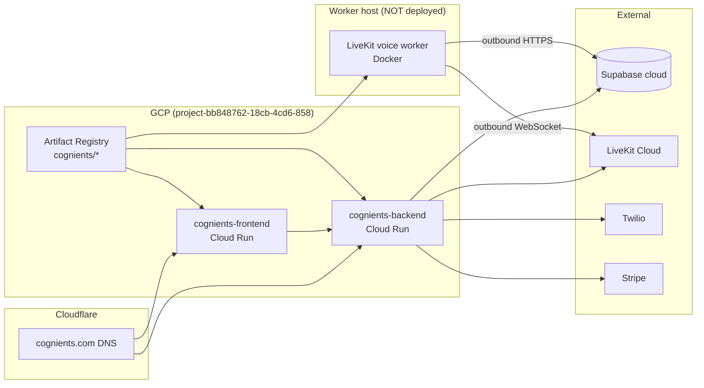

# Deploy branch — parked status (LiveKit architecture)

> **Branch:** `deploy/branch-to-deploy`  
> **Parked:** 2026-08-02  
> **Reason:** Product direction may move from LiveKit to a simpler 1:1 WebSocket voice stack (e.g. Pipecat). This branch preserves GCP/OCI deployment work so we can resume the LiveKit path later if needed.

---

## Manual deployment steps (progress)

Step-by-step guide used during initial cloud deploy. **Stopped at step 6.**

| Step | Task | Status |
|------|------|--------|
| 0 | Use Cloud Run `*.run.app` URLs (optional smoke test) | ✅ Done |
| 1 | Verify `cognients.com` in Google Search Console / GCP | ✅ Done |
| 2 | GCP Cloud Run domain mappings (`ai-studio` + `ai-studio-api`) | ✅ Done |
| 3 | Cloudflare DNS CNAME records (grey cloud, Full strict SSL) | ✅ Done |
| 4 | Supabase Auth — Site URL + redirect URLs for production domain | ✅ Done |
| 5 | Production DB migrations (`./scripts/deploy/run-alembic-cloud.sh`) | ✅ Done |
| 6 | OCI VM + LiveKit worker (`./scripts/deploy/oci-deploy-worker.sh`) | ❌ **Blocked** — OCI A1 Flex out of capacity |
| 7 | Vendor webhooks (Stripe, Twilio, Google OAuth) | ⏳ **Not started** |

**Next actions when resuming:** Complete step 6 (worker on OCI alternative, GCP e2-micro, or local laptop), then step 7 (webhooks).

---

## Quick resume checklist

When returning to this work:

1. Check out `deploy/branch-to-deploy` (or merge it into `main` if ready).
2. Confirm `.env.cloud` exists locally (never commit it). Use `.env.example` as a template.
3. Verify cloud services still healthy:
   ```bash
   curl -s https://ai-studio-api.cognients.com/health
   curl -s https://cognients-backend-lrn7jnolsa-uc.a.run.app/health
   ```
4. Confirm DB is at head (migrations were completed in step 5): `cd backend && export PYTHONPATH=.. && alembic current`
5. **Step 6** — Deploy or restart LiveKit worker (OCI alternative, GCP e2-micro, local laptop, or Render — see [Worker options](#worker-deployment-options)).
6. **Step 7** — Configure vendor webhooks (Stripe, Twilio, Google OAuth).
7. Optional: GitHub Actions secrets for CI deploy.

**Runbook (commands):** [DEPLOY_GCP_OCI.md](../DEPLOY_GCP_OCI.md)

---

## Target architecture (this branch)



| Component | Target host | Status |
|-----------|-------------|--------|
| Frontend (Next.js) | GCP Cloud Run | **Deployed** |
| Backend (FastAPI) | GCP Cloud Run | **Deployed** |
| Database | Supabase cloud | **In use** — migrations applied (step 5 ✅) |
| LiveKit worker | OCI VM (original plan) | **Not deployed** (step 6 ❌ blocked) |
| Custom domains | Cloudflare + Cloud Run mapping | **Done** (steps 1–3 ✅) |
| Supabase Auth URLs | Supabase dashboard | **Done** (step 4 ✅) |
| Vendor webhooks | Stripe / Twilio / Google | **Not configured** (step 7 ⏳) |
| CI/CD | GitHub Actions | **Workflow added**; secrets not configured |

**Production URLs (target):**

| Service | Custom domain | Cloud Run URL (fallback) |
|---------|---------------|---------------------------|
| Frontend | https://ai-studio.cognients.com | https://cognients-frontend-lrn7jnolsa-uc.a.run.app |
| Backend API | https://ai-studio-api.cognients.com | https://cognients-backend-lrn7jnolsa-uc.a.run.app |

Both custom domains and `*.run.app` URLs returned HTTP 200 on `/health` as of 2026-08-02.

---

## What was completed on this branch

### Infrastructure (GCP)

- **GCP project:** `project-bb848762-18cb-4cd6-858`, region `us-central1`
- **Artifact Registry repo:** `cognients` with images:
  - `backend:latest` (linux/amd64)
  - `frontend:latest` (linux/amd64)
  - `worker:latest` (built; intended for OCI ARM — verify platform before deploy)
- **Cloud Run services:**
  - `cognients-backend` — min 1 instance, 1Gi RAM, env from `.env.cloud` via `gcp-env-from-cloud.py`
  - `cognients-frontend` — min 0 instances, build-time `NEXT_PUBLIC_*` from `.env.cloud`
- **Domain verification:** `cognients.com` verified in GCP (`gcloud domains list-user-verified`)
- **Domain mappings (GCP):**
  - `ai-studio-api.cognients.com` → `cognients-backend`
  - `ai-studio.cognients.com` → `cognients-frontend`

### Steps 1–5 (manual deploy guide)

- **Step 1–3:** Domain verified, GCP mappings created, Cloudflare CNAMEs added
- **Step 4:** Supabase Auth Site URL and redirect URLs set for `https://ai-studio.cognients.com`
- **Step 5:** Production Alembic migrations run successfully via `./scripts/deploy/run-alembic-cloud.sh` (after fixing `shared` import via `PYTHONPATH` + `backend/alembic/env.py`)

### Scripts and automation added

| Path | Purpose |
|------|---------|
| `scripts/deploy/gcp-deploy.sh` | Build (local Docker amd64), push, deploy backend + frontend |
| `scripts/deploy/gcp-env-from-cloud.py` | Filter `.env.cloud` keys per service (backend/worker) |
| `scripts/deploy/gcp-map-domains.sh` | Create/describe Cloud Run domain mappings |
| `scripts/deploy/run-alembic-cloud.sh` | Run Alembic against Supabase using `.env.cloud` + `PYTHONPATH` |
| `scripts/deploy/read-env-cloud.py` | Read single key from env file |
| `scripts/deploy/oci-deploy-worker.sh` | SCP worker compose + env to OCI VM, `docker compose up` |
| `scripts/oci-env.sh` | OCI CLI session token auth helper |
| `scripts/oci-register-api-key.sh` | OCI API key registration helper |
| `deploy/oci/docker-compose.worker.yml` | Always-on worker container on VM |
| `deploy/cloudbuild-*.yaml` | Cloud Build stubs (local Docker build used instead — Cloud Build hit permission errors) |
| `.github/workflows/deploy-cloud.yml` | Auto-deploy on `main` (GCP + optional OCI SSH) |

### Code fixes for cloud deploy

| Change | Why |
|--------|-----|
| `backend/alembic/env.py` | Insert repo root on `sys.path` so migrations can `import shared.*`; prefer `.env.cloud` |
| `backend/tests/test_alembic_env.py` | Assert `shared` import works with monorepo layout |
| `frontend/tsconfig.json` | Exclude `tests/` from production TypeScript build (Docker build fix) |

### Environment configuration

- **Production env file:** `.env.cloud` at repo root (gitignored). Never commit.
- Key production values configured in `.env.cloud` (local only):
  - `APP_BASE_URL=https://ai-studio.cognients.com`
  - `NEXT_PUBLIC_API_URL=https://ai-studio-api.cognients.com`
  - `CORS_ORIGINS=["https://ai-studio.cognients.com"]`
  - `GOOGLE_OAUTH_TOOL_REDIRECT_URI=https://ai-studio-api.cognients.com/api/v1/tools/callback`
  - `ENVIRONMENT=production`, `DEBUG=false`, `OTEL_ENABLED=false` (initial deploy)
  - `MCP_ALLOW_LOCAL_URLS=false`
  - LiveKit, Supabase, Stripe, Twilio, Gemini keys (see `docs/ENV_VARS.md`)

### CLI tooling (local machine)

| Tool | Notes |
|------|-------|
| `gcloud` | Logged in; project set to `project-bb848762-18cb-4cd6-858` |
| `gh` | Logged in as `gauravdhiman` |
| `oci` | Session auth: `oci session authenticate` then `source scripts/oci-env.sh` |
| `wrangler` | Installed; Cloudflare token had **zone:read only** (no DNS write) |
| Docker | Local build/push used instead of Cloud Build |

---

## What is still pending

Only **steps 6 and 7** from the manual deploy guide remain.

### Step 6 — LiveKit worker (P0 — required for voice calls)

- **Status:** Blocked on OCI VM creation
- OCI A1 Flex VM creation failed: *"Out of capacity for shape VM.Standard.A1.Flex in AD-2"*
- Worker image exists in Artifact Registry but **no host is running the container**
- Without a registered worker, LiveKit can create rooms but **no agent joins calls**
- See [Worker deployment options](#worker-deployment-options) for alternatives (GCP e2-micro, local laptop, Render, retry OCI E2.1.Micro)

### Step 7 — Vendor webhooks (P1 — required for billing, phone, OAuth tools)

- **Status:** Not started
- Stripe → `https://ai-studio-api.cognients.com/billing/webhook`
- Twilio voice → `https://ai-studio-api.cognients.com/api/v1/voice/twilio/incoming`
- Google OAuth tools → redirect URI already in `.env.cloud`; confirm Google Cloud Console matches
- LiveKit webhooks (if any) → verify in LiveKit Cloud dashboard

### Optional (not part of steps 0–7)

- **GitHub Actions CI deploy** — workflow exists; secrets not configured (`ENV_CLOUD`, WIF, optional OCI SSH)
- **Observability** — OTEL disabled in initial cloud deploy
- **Cloud Build** — permission denied initially; local Docker workflow used instead

---

## Blockers encountered (and fixes)

| Blocker | Resolution / workaround |
|---------|-------------------------|
| Cloud Build `PERMISSION_DENIED` | Use local `docker build --platform linux/amd64` + push in `gcp-deploy.sh` |
| Cloud Run rejected arm64 images | Rebuild backend/frontend with `--platform linux/amd64` |
| Frontend Docker build failed on tests | `frontend/tsconfig.json` → `"exclude": ["node_modules", "tests"]` |
| Alembic `shared` import error | Fixed via `PYTHONPATH` + `alembic/env.py`; migrations completed (step 5 ✅) |
| GCP domain not verified | Resolved: `cognients.com` now in `gcloud domains list-user-verified` |
| OCI A1 out of capacity | See [Worker deployment options](#worker-deployment-options) |
| Cloudflare DNS API read-only | Manual CNAME records in Cloudflare dashboard |
| Accidental `.env copy.cloud` in WIP commit | **Removed from branch** — do not commit env files; rotate secrets if ever pushed |

---

## Worker deployment options

The worker only needs **outbound** internet (LiveKit WebSocket + Supabase HTTPS). No inbound ports or public IP required.

### Option A — Local Ubuntu laptop (fastest to test)

```bash
gcloud auth configure-docker us-central1-docker.pkg.dev
python3 scripts/deploy/gcp-env-from-cloud.py worker --env-file .env.cloud > .env.worker
export WORKER_IMAGE=us-central1-docker.pkg.dev/project-bb848762-18cb-4cd6-858/cognients/worker:latest
docker compose -f deploy/oci/docker-compose.worker.yml up -d
docker compose -f deploy/oci/docker-compose.worker.yml logs -f
```

**Good for:** dev / solo testing. **Not for:** 24/7 production (sleep, Wi‑Fi, reboots).

### Option B — GCP Compute Engine e2-micro (recommended for cheap prod)

- Same GCP project, always-free tier in `us-central1`
- Install Docker, reuse `deploy/oci/docker-compose.worker.yml` + `.env.worker`
- AMD64 — matches Cloud Run images

### Option C — OCI free tier (original plan)

- Retry **AD-1 / AD-3**, other regions, or **VM.Standard.E2.1.Micro** (AMD) instead of A1 Flex
- Deploy with `./scripts/deploy/oci-deploy-worker.sh` (set `OCI_SSH_HOST`, etc.)

### Option D — Render / Railway background worker (~$25/mo)

- Documented in [DEPLOY.md](../DEPLOY.md) (Render blueprint)
- Long-running process, env vars in UI, auto-restart

### Option E — Cloud Run for worker

**Not recommended** — LiveKit agents need persistent WebSocket connections; Cloud Run scales to zero and has request timeouts.

---

## LiveKit-specific context

- **LiveKit Cloud URL:** `wss://gemini-voice-ai-ec1hf3h5.livekit.cloud` (from `.env.cloud`)
- **Agent dispatch name:** `voice-agent` (see `shared/voice_agents/livekit_service.py`)
- **Worker entry:** `worker/src/worker.py` — registers with LiveKit, loads agent config from Supabase per job
- **Architecture docs:** [system_architecture.md](../01_architecture/system_architecture.md), [worker/README.md](../../worker/README.md)

If the product moves to Pipecat/WebSocket, this worker host and LiveKit Cloud dependency may be replaced entirely. Backend Twilio → room creation flow would also need redesign.

---

## Branch file inventory (vs `main`)

```
.github/workflows/deploy-cloud.yml
backend/alembic/env.py
backend/tests/test_alembic_env.py
deploy/cloudbuild-backend.yaml
deploy/cloudbuild-frontend.yaml
deploy/oci/docker-compose.worker.yml
docs/DEPLOY_GCP_OCI.md
docs/05_operations/DEPLOY_BRANCH_PARKED.md   ← this file
deploy/README.md
frontend/tsconfig.json
scripts/deploy/gcp-deploy.sh
scripts/deploy/gcp-env-from-cloud.py
scripts/deploy/gcp-map-domains.sh
scripts/deploy/oci-deploy-worker.sh
scripts/deploy/read-env-cloud.py
scripts/deploy/run-alembic-cloud.sh
scripts/oci-env.sh
scripts/oci-register-api-key.sh
```

---

## Security reminders

- **Never commit** `.env.cloud`, `.env`, or copies with spaces in the name.
- Store production env in GitHub secret `ENV_CLOUD` only when CI is ready.
- If any env file was ever pushed to a remote, **rotate** Supabase service key, JWT secret, Stripe webhook secret, LiveKit keys, and OAuth client secret.
- `.env copy.cloud` was accidentally included in the WIP commit locally — removed before parking; verify it was **not pushed** (`git log origin/deploy/branch-to-deploy`).

---

## Related documentation

- [DEPLOY_GCP_OCI.md](../DEPLOY_GCP_OCI.md) — command reference
- [DEPLOY.md](../DEPLOY.md) — Render.com alternative (4-service deploy)
- [ENV_VARS.md](../ENV_VARS.md) — full environment variable list
- [render_deployment.md](render_deployment.md) — Render ops guide
