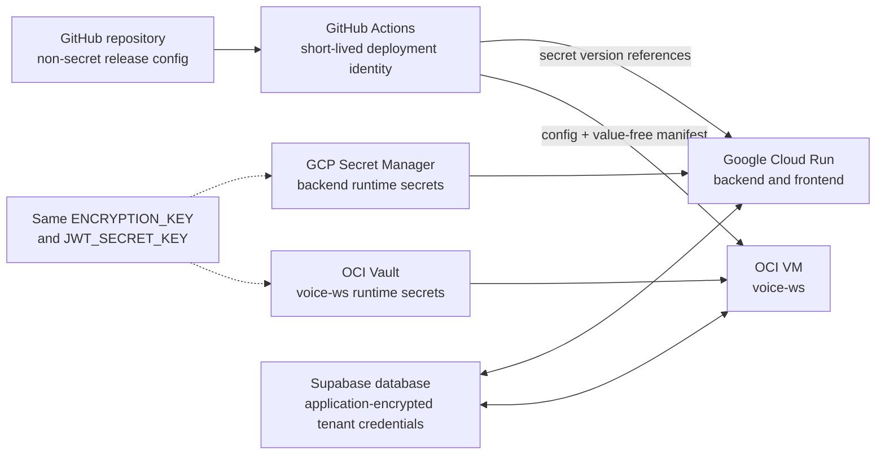

# Current production secret map

This is the short, high-level explanation of the production secret setup. For
commands, IAM details, rotation procedures, and migration safety, see
[Secret management](secret-management.md). For the release sequence, see
[CI / GitHub Actions](ci-github-actions.md) and the [production runbook](runbook.md).

## Current status

The current soft-production deployment uses the managed-secret architecture
described here:

- The backend and frontend run on Google Cloud Run.
- The voice-ws Pipecat worker runs on the OCI VM.
- Backend and frontend production releases come from the protected GitHub
  Actions promotion workflow.
- Backend and voice-ws runtime secrets are fetched from GCP Secret Manager or
  OCI Vault; they are not baked into container images or committed to Git.
- `STRIPE_MODE=test` is intentionally enabled while the environment is used
  for pre-launch testing. It must be changed to `live` before accepting real
  customer payments.

The latest managed release passed the production migration checks, deployed
both Cloud Run services and the OCI voice-ws worker, and passed the backend and
frontend HTTP smoke checks. The remaining work is launch preparation rather
than secret-infrastructure setup: Stripe live cutover, test-data cleanup, and
the final browser/PSTN voice-call release gate.

## The whole system in one picture

## Where each type of value lives

| Value category | System of record | How it is used |
| --- | --- | --- |
| App names, URLs, feature flags, service names, secret-name prefixes, and deployment identifiers | Reviewed `deploy/config/production.env` in GitHub | Loaded as non-secret deployment configuration |
| Public browser values such as the Stripe publishable key and `NEXT_PUBLIC_*` settings | Reviewed release config and frontend build inputs | Baked into the frontend bundle; never treated as backend credentials |
| GCP deployment access | GitHub Actions environment secrets plus GitHub OIDC/WIF | Lets the release workflow authenticate without a long-lived GCP service-account key |
| OCI deployment transport | GitHub Actions `OCI_SSH_KEY` and production host variables | Lets CI reach the VM; it is not the voice worker's runtime API-key store |
| Backend deployment secrets | GCP Secret Manager | Cloud Run receives pinned secret references and resolves values with its runtime identity |
| Voice-worker deployment secrets | OCI Vault | The VM's instance principal reads the worker's value-free manifest from the vault |
| Organization, agent, OAuth, and platform credentials entered by customers/admins | Supabase database, encrypted with Fernet | The backend or voice-ws decrypts them only in the server-side runtime when needed |

The local `.env.prod` file is only an ignored operator/recovery input. Editing
it does not update production. Managed-secret sync commands or the protected
release workflow must be used.

## The important shared keys

Some trust keys intentionally exist in both cloud secret stores. They are two
managed copies of the same value, not two different keys:

| Key | Stored in | Why the value must match |
| --- | --- | --- |
| `ENCRYPTION_KEY` | GCP Secret Manager and OCI Vault | Both runtimes must decrypt the same encrypted organization and agent credentials in the database |
| `JWT_SECRET_KEY` | GCP Secret Manager and OCI Vault | The backend signs voice-session JWTs and voice-ws verifies them |
| Worker-required shared integration credentials | GCP Secret Manager and OCI Vault when both runtimes need them | Each runtime must be able to reach the same configured provider or storage service |

Never replace `ENCRYPTION_KEY` during the Stripe live cutover. A key rotation
requires the documented fallback and re-encryption procedure.

## What is currently in the cloud managers

### GCP Secret Manager

GCP holds the private values needed by the Cloud Run deployment and backend,
including the following categories:

- database and Supabase access;
- `ENCRYPTION_KEY`, optional encryption fallbacks, and `JWT_SECRET_KEY`;
- Stripe private and webhook credentials;
- OAuth client secrets;
- Resend, Twilio, and recording-storage credentials; and
- configured backend/provider fallback keys such as Gemini.

Optional integrations are only fetched when their secret is explicitly
declared and provisioned. An old secret resource is not automatically injected
into a new release.

### OCI Vault

OCI holds the private values required by the voice-ws worker, including:

- the shared encryption/JWT trust keys;
- Supabase access needed by the worker;
- configured STT, LLM, and TTS provider fallbacks;
- recording-storage credentials when the worker needs them; and
- Twilio/voice integration credentials required by the worker path.

The OCI VM uses an instance principal through its dynamic group. It does not
need an OCI user API key stored in GitHub or on the VM.

### Supabase database

Customer- and agent-specific credentials remain database data, not one secret
resource per customer. Examples include organization provider keys, OAuth
tokens, agent tool credentials, and encrypted platform-tool fields. They are
stored as Fernet ciphertext. The current `ENCRYPTION_KEY` is outside the
database, in both managed secret stores.

## What GitHub does during a release

1. GitHub checks out the exact commit selected for promotion.
2. GitHub authenticates to GCP with OIDC/WIF and receives short-lived cloud
   credentials.
3. The migration job temporarily renders the required GCP secret values into
   a protected, short-lived runner file for migration verification.
4. The Cloud Run deploy step lists enabled secret-version metadata, then sends
   Cloud Run references such as `KEY=secret-name:version`; secret payloads are
   not placed in the image.
5. The OCI job transfers non-secret configuration and a value-free manifest.
   The VM fetches the actual values directly from OCI Vault.

The GitHub deployment identity has two separate GCP permissions on the
production secret resources:

- `roles/secretmanager.secretAccessor` for the deployment/migration paths that
  must read values; and
- `roles/secretmanager.viewer` to list enabled version metadata for pinned
  Cloud Run references.

The viewer grant is per secret, not project-wide. It is not the runtime
identity of either application service.

## Before the real launch

The current infrastructure is deployed, but the environment is intentionally
not live-billing production yet. Before opening the platform to customers:

1. Set `STRIPE_MODE=live` in the reviewed production config.
2. Sync live `STRIPE_SECRET_KEY` and `STRIPE_WEBHOOK_SECRET` to GCP Secret
   Manager.
3. Update the public Stripe publishable key and promote the reviewed commit.
4. Clean up test organizations, agents, and other pre-launch data deliberately.
5. Complete the authenticated browser-call and PSTN/Twilio smoke tests.

The Stripe cutover does not require changing the encryption key or resetting
existing organization API keys.
