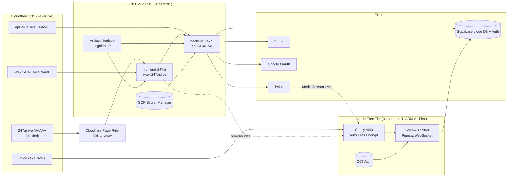

# Production deployment runbook — 247ai.live

> **Index:** [deployment/README.md](README.md) · **Commands:** [quick-reference.md](quick-reference.md)

## Target architecture



| Component | Host | Domain |
|-----------|------|--------|
| Frontend (Next.js) | GCP Cloud Run | `https://www.247ai.live` |
| Apex alias (301 redirect) | Cloudflare edge → canonical frontend | `https://247ai.live` |
| Backend (FastAPI) | GCP Cloud Run | `https://api.247ai.live` |
| voice-ws (Pipecat WS) | Oracle ARM VM + Caddy | `wss://voice.247ai.live` |
| Database + Auth | Supabase cloud | (project URL in `.env.prod`) |

The voice-ws worker is an **inbound WebSocket server** (port 7860; routes
`/ws`, `/twilio`, `/health`). Browsers connect to `wss://voice.247ai.live/ws`
and Twilio Media Streams connect to `wss://voice.247ai.live/twilio`. Caddy on
the VM terminates TLS (auto Let's Encrypt) and reverse-proxies to `voice-ws:7860`.

## Release and deploy entry points

The normal release path is **merge to protected `main`** → **local staging
validation** (`./scripts/validate-staging.sh` which runs `--env staging` with
the cloud staging database) → release smoke tests → manual
**`Promote to production`** GitHub Actions workflow. Non-secret deployment
configuration stays in the reviewed `deploy/config/` files, while runtime
secrets live in GCP Secret Manager and OCI Vault. Complete `.env.staging` /
`.env.prod` files remain gitignored for local/manual operation and are never
committed.

`./scripts/deploy.sh` remains the single lower-level entry point for operator
recovery or explicitly approved local deployment work. Build a private runtime
file from the versioned config and an ignored secret overlay:

```bash
cp deploy/config/secrets.example .env.prod.secrets
# Edit .env.prod.secrets on the secure operator workstation.
python3 scripts/deploy/build-env-file.py \
  --config-file deploy/config/production.env \
  --secret-file .env.prod.secrets \
  --output .env.prod
```

Never commit `.env.prod` or `.env.prod.secrets`. Managed cloud deployments use
the secret-manager flow described in [secret management](secret-management.md).

See [quick-reference.md](quick-reference.md) for the command cheat sheet.

**Note:** `worker` refers to the **voice-ws** Pipecat worker on OCI. The legacy
LiveKit `worker/` service is not deployed in production (`VOICE_TRANSPORT=pipecat`).

## First-time setup checklist

| Step | Task | Owner |
|------|------|-------|
| 0 | Smoke test on `*.run.app` URLs (optional) | You |
| 1 | Verify `247ai.live` in GCP (`gcloud domains list-user-verified`) | You |
| 2 | Cloud Run domain mappings (`api` + `www` + apex) | `./scripts/deploy.sh domains` |
| 3 | Cloudflare DNS (`api`, `www`, apex, and `voice`) | You |
| 4 | Supabase Auth — Site URL + redirect URLs for production | You |
| 5 | GCP Secret Manager + OCI Vault + runtime identities | See [secret management](secret-management.md); provision versions, IAM, the OCI dynamic group, and instance-principal access before the first managed release. |
| 6 | Production DB migrations + credential/phone verification + public demo bootstrap | Migrations and verification run in the protected `Promote to production` workflow; the GCP backend deployment then syncs the native tools and all three public demos. Manual recovery: `./scripts/deploy.sh migrate --env-file .env.prod` followed by both read-only verifiers and an approved GCP/backend deployment. |
| 7 | OCI A1 Flex VM + Docker + Caddy + voice-ws | `./scripts/deploy.sh voice-ws` |
## Scripts and artifacts

| Path | Purpose |
|------|---------|
| **`scripts/validate-staging.sh`** | Local staging validator (migrate + release fixture sync + `start.sh --env staging` + health checks) |
| **`scripts/deploy.sh`** | Single entry point for production |
| `.env.prod.example` | Production env template |
| `.env.staging.example` | Staging env template (local app + cloud DB) |
| `scripts/deploy/gcp-deploy.sh` | Build + deploy backend and/or frontend to Cloud Run |
| `scripts/deploy/sync-release-fixtures.sh` | Explicit bootstrap for native tools and the three public demo agents |
| `scripts/deploy/gcp-env-from-cloud.py` | Filter `.env.prod` per service |
| `scripts/deploy/render-gcp-env.py` | Render a short-lived migration env from GCP Secret Manager |
| `scripts/deploy/sync-gcp-secrets.py` | Preview/apply secret versions during initial provisioning |
| `scripts/deploy/sync-oci-secrets.py` | Preview/apply voice-ws secret versions in OCI Vault |
| `scripts/deploy/gcp-map-domains.sh` | Cloud Run domain mappings |
| `scripts/deploy/run-alembic-cloud.sh` | Alembic against Supabase |
| `scripts/deploy/verify_phone_number_backfill.py` | Read-only postcondition check for the legacy agent phone-number backfill |
| `scripts/deploy/verify_org_credential_migration.py` | Read-only postcondition check for plaintext organization credentials |
| `scripts/deploy/oci-deploy-voice-ws.sh` | Sync + build voice-ws on OCI VM |
| `scripts/deploy/oci-fetch-vault-env.sh` | Resolve the VM's secret manifest from OCI Vault |
| `scripts/oci-env.sh` | OCI CLI session auth helper |
| `deploy/oci/docker-compose.voice-ws.yml` | voice-ws + Caddy stack |
| `deploy/oci/Caddyfile` | TLS reverse proxy for `voice.247ai.live` |
| `.github/workflows/deploy-cloud.yml` | Manual-only staging recovery (no longer auto on `main`) |
| `.github/workflows/promote-production.yml` | Manual production promotion |

## Phone-number data migration release procedure

The legacy `voice_agents.phone_number` backfill is migration
`20260812000006`. It runs as part of the production Alembic chain, before the
Cloud Run deployment. The migration is atomic and fail-closed: invalid values,
duplicate legacy ownership, and conflicts with existing `phone_numbers` rows
stop the release before application code is deployed.

The protected production promotion job performs this sequence automatically:

1. Run `./scripts/deploy.sh migrate` against the production database.
2. Run `python3 scripts/deploy/verify_phone_number_backfill.py --env-file .env.prod`.
3. Deploy Cloud Run only when both commands succeed. The backend/GCP deploy
   also runs the explicit release bootstrap, which materializes the native
   tool catalog and all three public demo agents before the new backend image is
   published.

Local staging validation performs the same compatibility, migration, and verifier
sequence using `.env.staging` before starting the local stack (see
`./scripts/validate-staging.sh`). The manual staging Cloud Run workflow does the
same when dispatched.

For a manually approved recovery or staged rollout:

```bash
./scripts/deploy.sh migrate --env-file .env.prod
./scripts/deploy.sh verify-data --env-file .env.prod
```

The verifier is read-only and safe to repeat. It checks that every legacy
organization/number pair still has a `phone_numbers` row, while allowing a
later legitimate unassignment or release. Do not manually delete the
backfilled rows during an application rollback: the downgrade is intentionally
a no-op so newer customer-managed or purchased-number state cannot be erased.
Use a database backup or a reviewed, targeted repair if a rollback requires
data changes. Future data migrations should follow this same pattern: define a
preflight conflict policy, make the change atomic/idempotent, add a read-only
postcondition verifier, and wire both migration and verification into the
production deployment gate.

## Organization credential migration

Migration `20260922000002` completes the earlier encrypted provider-credentials
backfill without dropping the legacy column during a rolling deploy. It
preserves existing encrypted providers, refuses to clear a row whose ciphertext
cannot be decrypted with the deployment keyring, and then clears
`organizations.google_api_key` in the same transaction. The compatibility
column remains empty until a later release removes the old write path.

The protected workflow runs:

```bash
python3 scripts/deploy/check_alembic_compatibility.py --env-file .env.prod
./scripts/deploy.sh migrate --env-file .env.prod
python3 scripts/deploy/verify_org_credential_migration.py --env-file .env.prod
```

The verifier never prints organization IDs, ciphertext, or decrypted values.
If it fails, stop the release and investigate the key/version mismatch before
retrying; do not clear the legacy column manually.

## Environment configuration

- **Production env file:** `.env.prod` at repo root (gitignored). Never commit.
- **Template:** `.env.prod.example` (placeholders only).
- **Variable reference:** [environment-variables.md](environment-variables.md)

Production non-secret values belong in the reviewed, version-controlled
`deploy/config/production.env` file:

| Variable | Production value |
|----------|------------------|
| `APP_BASE_URL` | `https://www.247ai.live` |
| `NEXT_PUBLIC_API_URL` | `https://api.247ai.live` |
| `CORS_ORIGINS` | `["https://www.247ai.live"]` |
| `GOOGLE_OAUTH_TOOL_REDIRECT_URI` | `https://api.247ai.live/api/v1/tools/callback` |
| `VOICE_TRANSPORT` | `pipecat` |
| `VOICE_WS_PUBLIC_URL` | `wss://voice.247ai.live` |
| `VOICE_WS_TWILIO_URL` | `wss://voice.247ai.live` |
| `ENVIRONMENT` | `production` |
| `DEBUG` | `false` |
| `MCP_ALLOW_LOCAL_URLS` | `false` |

`JWT_SECRET_KEY` is shared by backend and voice-ws. Both services receive it
from GCP Secret Manager / OCI Vault in the managed cloud path. See
[secret management](secret-management.md) for the required mirrored values.

### Encryption-key recovery and rotation

`ENCRYPTION_KEY` and `ENCRYPTION_KEY_FALLBACKS` are server-side variables and
must be available to both backend and voice-ws. The managed deployment renders
them from both secret managers; the deployment filter validates the current key
before generating service environments. If an older release wrote
encrypted data while using the removed development fallback, preview and then
run the guarded one-time repair with the current production key:

```bash
python3 scripts/deploy/rotate-legacy-encrypted-data.py --env-file .env.prod
python3 scripts/deploy/rotate-legacy-encrypted-data.py --env-file .env.prod --apply
```

The repair updates only known encrypted columns, rotates rows that decrypt with
the historical fallback, verifies each payload with the current key, and never
prints secret material. Do not add the historical fallback to a long-lived
production environment; rotate the data and keep only the deployment-managed
current key (plus explicitly controlled rotation fallbacks).

### OAuth tool connection recovery

The backend refresh loop is an in-process maintenance task. The supported
Cloud Run deployment keeps one minimum backend instance and deploys it with
`--no-cpu-throttling`, so the loop can run between HTTP requests. Keep this
setting on backend revisions; request-based CPU allocation can suspend idle
background work. See [Cloud Run billing settings](https://docs.cloud.google.com/run/docs/configuring/billing-settings).

If an alert says the provider result is unknown, reconnect the affected tool in
the agent's **Tools** page. The platform intentionally stops reusing the old
refresh grant because the provider may have rotated it before the connection
failed. If the alert identifies an OAuth client configuration problem, verify
the platform tool's client ID and secret and the provider's registered callback
URL before reconnecting.

If an alert says credentials are unreadable, check whether an `ENCRYPTION_KEY`
change or deployment mismatch removed the key that encrypted the existing
connection. Restore the previous key as a controlled `ENCRYPTION_KEY_FALLBACKS`
entry and ensure backend and voice-ws use the same key set. The next OAuth scan
clears the unreadable state when decryption succeeds. Reconnect the tool only
when the old key cannot be recovered. Do not copy tokens into tickets or
logs.

Organization admins receive email. Configure the platform-admin email and
Telegram settings on the Platform Notification Settings page. Platform SMS
requires an E.164 destination, the explicit SMS opt-in, Twilio account
credentials, and `TWILIO_SMS_FROM_NUMBER`. Telegram and SMS retries use the
database outbox; email retries use the notification log scheduler. A provider
may accept an alert just before the database acknowledgment is lost, so a rare
duplicate message is possible.

For a normal planned `K1` to `K2` rotation, use the general command instead:

```bash
python3 scripts/deploy/rotate-encrypted-data.py --env-file .env.rotation
python3 scripts/deploy/rotate-encrypted-data.py \
  --env-file .env.rotation \
  --apply
```

The `.env.rotation` file is a short-lived operator file rendered from the
managed secret stores and must contain only the database URL, the new current
Fernet key, and the old key in `ENCRYPTION_KEY_FALLBACKS`. Follow the complete
dual-cloud procedure in [secret management](secret-management.md) and remove
the file immediately after the verified run.

## Mandatory release gate: AI agent calling

AI agent calling is a production-critical path. A deployment is **not
healthy** until both call surfaces have been exercised with a release-test
organization that has an active plan and enough prepaid credits for at least
one billable voice minute (`credit_balance + purchased_credit_balance`). Do
not use a zero-credit organization as the release test account: the expected
result is an entitlement rejection, not a WebSocket/network failure.

### Before production deployment

1. Deploy the candidate to staging and confirm the release-test organization
   has voice entitlements and prepaid credit headroom.
2. From the authenticated web application, start a browser test call. Verify
   the backend test-token request succeeds, the browser connects to
   `wss://<voice-host>/ws`, the agent responds with audio, and the call log is
   finalized.
3. Place a PSTN call through the configured Twilio number. Verify the incoming
   webhook returns TwiML with a public `wss://<voice-host>/twilio` Stream URL,
   the Twilio Media Stream connects, the agent answers, and the status/call
   log is updated.
4. Check backend and voice-ws logs for accepted sessions and confirm there are
   no `1006`, `401`, `403`, `4401`, `4403`, `INSUFFICIENT_CREDITS`, or
   `MAX_CONCURRENT_CALLS` failures for the release-test calls.

### After production deployment

Repeat the browser and PSTN calls against `www.247ai.live` and the production
Twilio number. The three `/health` endpoints are liveness checks only; they do
not prove that an authenticated, billed voice session can connect. Roll back
or stop the release if either call surface fails.

If a browser reports `WEBSOCKET_ERROR: ... (1006)`, inspect voice-ws logs
before changing URLs or TLS. A worker log containing
`INSUFFICIENT_CREDITS` means the session was deliberately rejected by billing;
the account needs an active entitlement/credits. A 1006 without a corresponding
worker request indicates a transport, DNS, TLS, or routing problem.

Public callers should not be shown internal billing or plan details. Embed and
public-page visitors receive a safe availability message that asks them to
retry or contact the business; PSTN callers hear the same guidance through
TwiML. Authenticated platform users may receive the specific credit or
concurrency reason so an organization administrator can resolve it.

## Web domain canonicalization and SEO

`https://www.247ai.live` is the one canonical public origin. The apex
`https://247ai.live` is a redirect-only alias. Cloudflare returns a permanent
`301` to the equivalent `www` URL while preserving the path and query string;
the Next.js middleware provides a `308` fallback if a request reaches the
frontend directly. Cloud Run `*.run.app` URLs receive the same fallback.

Apply the Cloud Run mappings after the frontend service exists:

```bash
./scripts/deploy.sh domains
```

The command maps `api.247ai.live`, `www.247ai.live`, and `247ai.live`, then
prints the DNS records Cloud Run expects. In Cloudflare, keep `api` and `www`
DNS-only / grey-cloud, and set the apex A/AAAA records to proxied / orange-cloud
so the redirect runs at the edge. Add a Page Rule for
`https://247ai.live/*` forwarding to `https://www.247ai.live/$1` with status
`301`. Do not make the apex a separate website or point it at a different
service. Keep the canonical `www` mapping and the apex mapping on the same
frontend service.

Validate the redirect and canonical response after DNS propagation:

```bash
curl -sSIL https://247ai.live/
curl -sSIL 'https://247ai.live/auth/signin?next=%2Fdashboard'
curl -sSIL https://www.247ai.live/
```

The first two responses must be `301` with a `Location` on
`https://www.247ai.live` and the same path/query. The canonical host must
return `200`. The frontend also publishes a canonical link, Open Graph URL,
`/sitemap.xml`, and `/robots.txt` using only the `www` origin.

## Quick resume checklist

1. Confirm `.env.prod` exists (from `.env.prod.example`; gitignored).
2. Verify cloud services:
   ```bash
   curl -s https://api.247ai.live/health
   curl -s https://www.247ai.live
   curl -s https://voice.247ai.live/health
   ```
3. For a normal release, run the `Promote to production` workflow with the
   full 40-character SHA of the staging-tested commit. For manual recovery,
   run `./scripts/deploy.sh migrate`.
4. Redeploy after an explicitly approved manual code change:
   ```bash
   ./scripts/deploy.sh gcp
   OCI_SSH_HOST=132.145.130.61 ./scripts/deploy.sh voice-ws
   ```
5. Complete the [mandatory AI agent calling release gate](#mandatory-release-gate-ai-agent-calling).

## voice-ws on OCI (ARM VM)

Requirements on the VM:

- Oracle **A1 Flex** ARM (Always Free: up to 2 OCPU / 12GB total), region **us-ashburn-1**
- The `voice-ws` container is capped at **2 OCPU** in Compose; keep the VM
  shape within the same 2 OCPU / 12GB tenancy limit when using an Always Free
  account.
  See Oracle's [Always Free resource limits](https://docs.oracle.com/en-us/iaas/Content/FreeTier/freetier_topic-Always_Free_Resources.htm).
- Ubuntu minimal, Docker + compose plugin
- OCI ingress: **22, 80, 443**; egress: all
- DNS **A record** `voice.247ai.live` → VM IP (Cloudflare grey cloud / DNS-only)

Deploy:

```bash
export OCI_SSH_HOST=132.145.130.61
export OCI_SSH_USER=ubuntu
# default key: ~/.ssh/oci_voice_ws
./scripts/deploy.sh voice-ws
```

The script rsyncs `shared/` + `voice-ws/` + compose + Caddyfile to `~/voice-ws/`
on the VM, then `docker compose up -d --build`.

## Post-deploy webhooks

- **Stripe** → `https://api.247ai.live/api/v1/billing/webhook/stripe`
- **Twilio voice** → `https://api.247ai.live/api/v1/voice/twilio/incoming`
- **Twilio status** → `https://api.247ai.live/api/v1/voice/twilio/status`
- **Google OAuth (tools)** → `https://api.247ai.live/api/v1/tools/callback`
- **Supabase Auth** → Site URL `https://www.247ai.live`; redirect `https://www.247ai.live/**`

## Security reminders

- **Never commit** `.env.prod` or credential copies.
- Store non-secret deployment configuration in the reviewed
  `deploy/config/production.env` file; store runtime values in GCP Secret
  Manager and OCI Vault. GitHub should contain only deployment identities,
  approvals, and unavoidable transport credentials.
- Keep Cloud Run runtime IAM and the OCI dynamic-group policy limited to the
  secrets each service needs.
- Rotate secrets if any env file was ever pushed to a remote.

## Related documentation

- [Environment variables](environment-variables.md)
- [CI / GitHub Actions](ci-github-actions.md)
- [Local Docker](local-docker.md)
- [ADR: voice-ws / Pipecat](../../01_architecture/ADR_VOICE_WS_PIPECAT.md)
