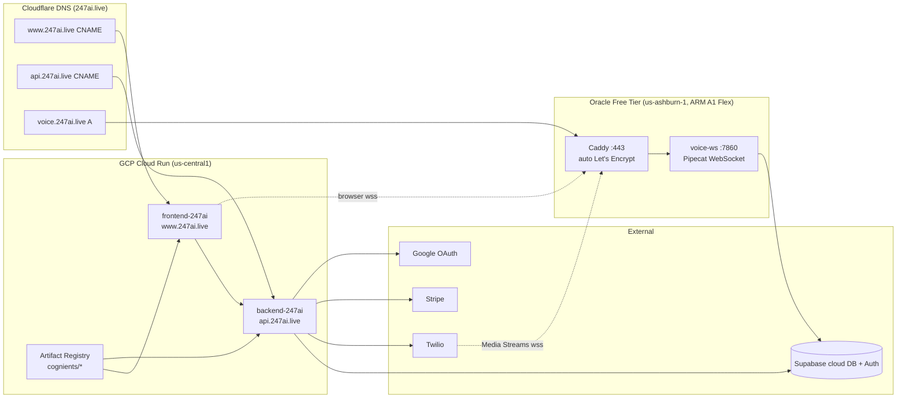

# Production deployment runbook — 247ai.live

> **Index:** [deployment/README.md](README.md) · **Commands:** [quick-reference.md](quick-reference.md)

## Target architecture



| Component | Host | Domain |
|-----------|------|--------|
| Frontend (Next.js) | GCP Cloud Run | `https://www.247ai.live` |
| Backend (FastAPI) | GCP Cloud Run | `https://api.247ai.live` |
| voice-ws (Pipecat WS) | Oracle ARM VM + Caddy | `wss://voice.247ai.live` |
| Database + Auth | Supabase cloud | (project URL in `.env.prod`) |

The voice-ws worker is an **inbound WebSocket server** (port 7860; routes
`/ws`, `/twilio`, `/health`). Browsers connect to `wss://voice.247ai.live/ws`
and Twilio Media Streams connect to `wss://voice.247ai.live/twilio`. Caddy on
the VM terminates TLS (auto Let's Encrypt) and reverse-proxies to `voice-ws:7860`.

## Release and deploy entry points

The normal release path is **merge to protected `main`** → **local staging
validation** (`./scripts/validate-staging.sh` which runs `--env staging` with
the cloud staging database) → release smoke tests → manual
**`Promote to production`** GitHub Actions workflow. Credentials stay in
protected GitHub environment secrets for production and in the gitignored
`.env.staging` / `.env.prod` files for local use; they are never committed.

`./scripts/deploy.sh` remains the single lower-level entry point for operator
recovery or explicitly approved local deployment work. Credentials stay in
**`.env.prod`** only when using it locally (gitignored). Copy
**`.env.prod.example`** to `.env.prod` and fill in values — never commit
`.env.prod`.

See [quick-reference.md](quick-reference.md) for the command cheat sheet.

**Note:** `worker` refers to the **voice-ws** Pipecat worker on OCI. The legacy
LiveKit `worker/` service is not deployed in production (`VOICE_TRANSPORT=pipecat`).

## First-time setup checklist

| Step | Task | Owner |
|------|------|-------|
| 0 | Smoke test on `*.run.app` URLs (optional) | You |
| 1 | Verify `247ai.live` in GCP (`gcloud domains list-user-verified`) | You |
| 2 | Cloud Run domain mappings (`api` + `www`) | `./scripts/deploy.sh domains` |
| 3 | Cloudflare DNS CNAMEs (`api`, `www`) + A record (`voice`) | You |
| 4 | Supabase Auth — Site URL + redirect URLs for production | You |
| 5 | Production DB migrations + phone-number data verification | Required migration job in the protected `Promote to production` workflow; manual recovery: `./scripts/deploy.sh migrate --env-file .env.prod` followed by `./scripts/deploy.sh verify-data --env-file .env.prod` |
| 6 | OCI A1 Flex VM + Docker + Caddy + voice-ws | `./scripts/deploy.sh voice-ws` |
## Scripts and artifacts

| Path | Purpose |
|------|---------|
| **`scripts/validate-staging.sh`** | Local staging validator (migrate + `start.sh --env staging` + health checks) |
| **`scripts/deploy.sh`** | Single entry point for production |
| `.env.prod.example` | Production env template |
| `.env.staging.example` | Staging env template (local app + cloud DB) |
| `scripts/deploy/gcp-deploy.sh` | Build + deploy backend and/or frontend to Cloud Run |
| `scripts/deploy/gcp-env-from-cloud.py` | Filter `.env.prod` per service |
| `scripts/deploy/gcp-map-domains.sh` | Cloud Run domain mappings |
| `scripts/deploy/run-alembic-cloud.sh` | Alembic against Supabase |
| `scripts/deploy/verify_phone_number_backfill.py` | Read-only postcondition check for the legacy agent phone-number backfill |
| `scripts/deploy/oci-deploy-voice-ws.sh` | Sync + build voice-ws on OCI VM |
| `scripts/oci-env.sh` | OCI CLI session auth helper |
| `deploy/oci/docker-compose.voice-ws.yml` | voice-ws + Caddy stack |
| `deploy/oci/Caddyfile` | TLS reverse proxy for `voice.247ai.live` |
| `.github/workflows/deploy-cloud.yml` | Manual-only staging recovery (no longer auto on `main`) |
| `.github/workflows/promote-production.yml` | Manual production promotion |

## Phone-number data migration release procedure

The legacy `voice_agents.phone_number` backfill is migration
`20260812000006`. It runs as part of the production Alembic chain, before the
Cloud Run deployment. The migration is atomic and fail-closed: invalid values,
duplicate legacy ownership, and conflicts with existing `phone_numbers` rows
stop the release before application code is deployed.

The protected production promotion job performs this sequence automatically:

1. Run `./scripts/deploy.sh migrate` against the production database.
2. Run `python3 scripts/deploy/verify_phone_number_backfill.py --env-file .env.prod`.
3. Deploy Cloud Run only when both commands succeed.

Local staging validation performs the same compatibility, migration, and verifier
sequence using `.env.staging` before starting the local stack (see
`./scripts/validate-staging.sh`). The manual staging Cloud Run workflow does the
same when dispatched.

For a manually approved recovery or staged rollout:

```bash
./scripts/deploy.sh migrate --env-file .env.prod
./scripts/deploy.sh verify-data --env-file .env.prod
```

The verifier is read-only and safe to repeat. It checks that every legacy
organization/number pair still has a `phone_numbers` row, while allowing a
later legitimate unassignment or release. Do not manually delete the
backfilled rows during an application rollback: the downgrade is intentionally
a no-op so newer customer-managed or purchased-number state cannot be erased.
Use a database backup or a reviewed, targeted repair if a rollback requires
data changes. Future data migrations should follow this same pattern: define a
preflight conflict policy, make the change atomic/idempotent, add a read-only
postcondition verifier, and wire both migration and verification into the
production deployment gate.

## Environment configuration

- **Production env file:** `.env.prod` at repo root (gitignored). Never commit.
- **Template:** `.env.prod.example` (placeholders only).
- **Variable reference:** [environment-variables.md](environment-variables.md)

Production non-secret values (secrets stay in `.env.prod` only):

| Variable | Production value |
|----------|------------------|
| `APP_BASE_URL` | `https://www.247ai.live` |
| `NEXT_PUBLIC_API_URL` | `https://api.247ai.live` |
| `CORS_ORIGINS` | `["https://www.247ai.live"]` |
| `GOOGLE_OAUTH_TOOL_REDIRECT_URI` | `https://api.247ai.live/api/v1/tools/callback` |
| `VOICE_TRANSPORT` | `pipecat` |
| `VOICE_WS_PUBLIC_URL` | `wss://voice.247ai.live` |
| `VOICE_WS_TWILIO_URL` | `wss://voice.247ai.live` |
| `ENVIRONMENT` | `production` |
| `DEBUG` | `false` |
| `MCP_ALLOW_LOCAL_URLS` | `false` |

`JWT_SECRET_KEY` is shared by backend and voice-ws. Both services receive it
via `gcp-env-from-cloud.py`.

## Mandatory release gate: AI agent calling

AI agent calling is a production-critical path. A deployment is **not
healthy** until both call surfaces have been exercised with a release-test
organization that has an active plan and enough prepaid credits for at least
one billable voice minute (`credit_balance + purchased_credit_balance`). Do
not use a zero-credit organization as the release test account: the expected
result is an entitlement rejection, not a WebSocket/network failure.

### Before production deployment

1. Deploy the candidate to staging and confirm the release-test organization
   has voice entitlements and prepaid credit headroom.
2. From the authenticated web application, start a browser test call. Verify
   the backend test-token request succeeds, the browser connects to
   `wss://<voice-host>/ws`, the agent responds with audio, and the call log is
   finalized.
3. Place a PSTN call through the configured Twilio number. Verify the incoming
   webhook returns TwiML with a public `wss://<voice-host>/twilio` Stream URL,
   the Twilio Media Stream connects, the agent answers, and the status/call
   log is updated.
4. Check backend and voice-ws logs for accepted sessions and confirm there are
   no `1006`, `401`, `403`, `4401`, `4403`, `INSUFFICIENT_CREDITS`, or
   `MAX_CONCURRENT_CALLS` failures for the release-test calls.

### After production deployment

Repeat the browser and PSTN calls against `www.247ai.live` and the production
Twilio number. The three `/health` endpoints are liveness checks only; they do
not prove that an authenticated, billed voice session can connect. Roll back
or stop the release if either call surface fails.

If a browser reports `WEBSOCKET_ERROR: ... (1006)`, inspect voice-ws logs
before changing URLs or TLS. A worker log containing
`INSUFFICIENT_CREDITS` means the session was deliberately rejected by billing;
the account needs an active entitlement/credits. A 1006 without a corresponding
worker request indicates a transport, DNS, TLS, or routing problem.

Public callers should not be shown internal billing or plan details. Embed and
public-page visitors receive a safe availability message that asks them to
retry or contact the business; PSTN callers hear the same guidance through
TwiML. Authenticated platform users may receive the specific credit or
concurrency reason so an organization administrator can resolve it.

## Quick resume checklist

1. Confirm `.env.prod` exists (from `.env.prod.example`; gitignored).
2. Verify cloud services:
   ```bash
   curl -s https://api.247ai.live/health
   curl -s https://www.247ai.live
   curl -s https://voice.247ai.live/health
   ```
3. For a normal release, run the `Promote to production` workflow with the
   full 40-character SHA of the staging-tested commit. For manual recovery,
   run `./scripts/deploy.sh migrate`.
4. Redeploy after an explicitly approved manual code change:
   ```bash
   ./scripts/deploy.sh gcp
   OCI_SSH_HOST=132.145.130.61 ./scripts/deploy.sh voice-ws
   ```
5. Complete the [mandatory AI agent calling release gate](#mandatory-release-gate-ai-agent-calling).

## voice-ws on OCI (ARM VM)

Requirements on the VM:

- Oracle **A1 Flex** ARM (Always Free: up to 4 OCPU / 24GB), region **us-ashburn-1**
- Ubuntu minimal, Docker + compose plugin
- OCI ingress: **22, 80, 443**; egress: all
- DNS **A record** `voice.247ai.live` → VM IP (Cloudflare grey cloud / DNS-only)

Deploy:

```bash
export OCI_SSH_HOST=132.145.130.61
export OCI_SSH_USER=ubuntu
# default key: ~/.ssh/oci_voice_ws
./scripts/deploy.sh voice-ws
```

The script rsyncs `shared/` + `voice-ws/` + compose + Caddyfile to `~/voice-ws/`
on the VM, then `docker compose up -d --build`.

## Post-deploy webhooks

- **Stripe** → `https://api.247ai.live/api/v1/billing/webhook/stripe`
- **Twilio voice** → `https://api.247ai.live/api/v1/voice/twilio/incoming`
- **Twilio status** → `https://api.247ai.live/api/v1/voice/twilio/status`
- **Google OAuth (tools)** → `https://api.247ai.live/api/v1/tools/callback`
- **Supabase Auth** → Site URL `https://www.247ai.live`; redirect `https://www.247ai.live/**`

## Security reminders

- **Never commit** `.env.prod` or credential copies.
- Store production env in the protected GitHub `production` environment secret
  `ENV_PROD` for CI.
- Rotate secrets if any env file was ever pushed to a remote.

## Related documentation

- [Environment variables](environment-variables.md)
- [CI / GitHub Actions](ci-github-actions.md)
- [Local Docker](local-docker.md)
- [ADR: voice-ws / Pipecat](../../01_architecture/ADR_VOICE_WS_PIPECAT.md)
