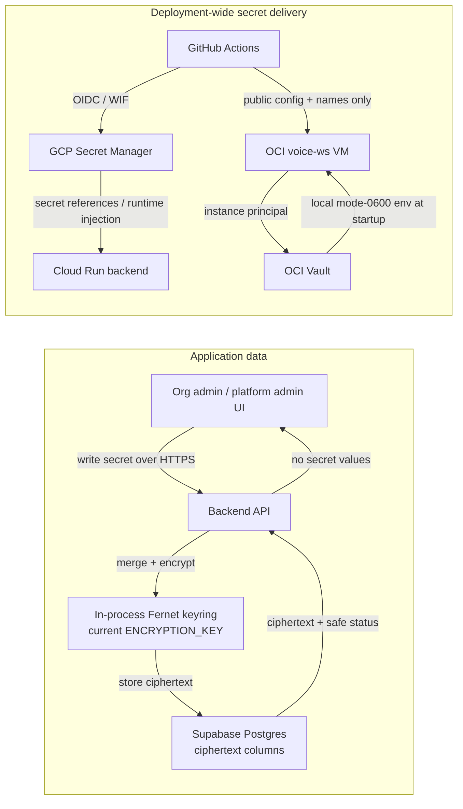
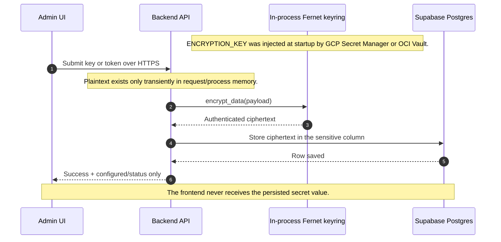

# Secret management and credential storage

The platform uses two cloud-native secret managers because its server runtimes
are split across clouds:

| Runtime | Secret manager | Access identity |
| --- | --- | --- |
| GCP Cloud Run backend and GitHub migration job | Google Cloud Secret Manager | Cloud Run runtime service account and GitHub OIDC/WIF service account |
| Oracle Free Tier voice-ws VM | OCI Vault | OCI instance principal for the VM's dynamic group |
| Tenant/provider credentials in the database | Supabase Postgres + application Fernet encryption | Backend/voice-ws deployment keyring |

This is intentionally not a single cross-cloud vault. Using GCP Secret Manager
from the OCI VM would require a second cloud identity or a long-lived GCP
credential on the VM. OCI Vault gives the VM a native, renewable identity. The
deployment pipeline transfers only public configuration and secret names to the
VM; the VM retrieves values itself.

## Visual model

The important distinction is scope: a secret that belongs to one organization,
agent, or tool is application data; a secret needed to start an entire runtime
is deployment data.



The database side includes `organizations.provider_credentials` for
organization provider keys, `agent_tools.sensitive_config` for per-agent OAuth
tokens/API keys, and encrypted platform-tool fields such as
`platform_tools.oauth_client_secret_encrypted` and
`mcp_server_secret_headers`. The deployment side includes `ENCRYPTION_KEY`,
`JWT_SECRET_KEY`, database/service credentials, and platform fallback provider
keys.

### Saving an organization or tool credential



Fernet is authenticated symmetric encryption: the ciphertext cannot be read or
silently modified without the key. The same deployment keyring is not stored in
Postgres. It is injected into the backend and voice-ws process by the runtime's
secret-delivery path.

### Using a credential during a voice call

```mermaid
sequenceDiagram
    autonumber
    participant Caller as Caller / browser
    participant WS as voice-ws runtime
    participant DB as Supabase Postgres
    participant Keyring as In-process keyring
    participant Provider as External provider

    Caller->>WS: Start authenticated call
    WS->>DB: Read agent and organization data
    DB-->>WS: Public config + encrypted credential blob
    Note over WS: ENCRYPTION_KEY is already in process memory from startup.
    WS->>Keyring: decrypt_data(ciphertext)
    Keyring-->>WS: Provider key(s) in memory
    WS->>WS: Resolve org key, or platform fallback only if no org blob
    alt Ciphertext is unreadable
        WS-->>Caller: Safe failure; do not use platform key
    else Key available
        WS->>Provider: Provider request over TLS
        Provider-->>WS: Provider response or audio
        WS-->>Caller: Audio or result
    end
    Note over WS,Caller: The key is not sent to the browser or the model.
```

### What each class of secret means

| Secret or credential | Current storage | Who uses it |
| --- | --- | --- |
| `ENCRYPTION_KEY` and `ENCRYPTION_KEY_FALLBACKS` | GCP Secret Manager for Cloud Run; OCI Vault for voice-ws | Backend and voice-ws to encrypt/decrypt application data |
| `JWT_SECRET_KEY` | GCP Secret Manager and OCI Vault | Backend and voice-ws to sign/verify voice-session JWTs |
| Database, Supabase, Stripe, Resend, and provider environment fallbacks | GCP Secret Manager and/or OCI Vault | The runtime that needs the integration |
| Organization Google/OpenAI/Deepgram/etc. keys | Fernet ciphertext in `organizations.provider_credentials` | The organization-scoped runtime path |
| Platform Google/OpenAI/Deepgram/etc. voice keys                        | Fernet ciphertext in `platform_voice_provider_credentials` | Platform-managed presets and agents explicitly using platform credits; matching environment values remain fallbacks |
| Per-agent OAuth tokens and API keys | Fernet ciphertext in `agent_tools.sensitive_config` | voice-ws and token-refresh services |
| Platform OAuth client secrets and MCP server headers | Fernet ciphertext in `platform_tools` encrypted fields | Platform catalog and runtime services |

The managed secret managers protect the deployment-wide values and the
application key that can decrypt database ciphertext. They do not remove the
need for application-level encryption, and they cannot prevent a compromised
running process from using secrets that its identity is authorized to read.

Platform admins manage shared API credentials under **Platform settings → API
Credentials**. The current credential set serves platform-managed voice presets
and is stored as Fernet ciphertext in
`platform_voice_provider_credentials`; provider environment values are used
only when no key is saved for that provider. Backend and voice-ws must share
the `ENCRYPTION_KEY` keyring to read the stored values.

## Before and after for the legacy Google key

The old `organizations.google_api_key` column was a plaintext compatibility
path. The hardened path is:

1. Read any existing encrypted provider blob.
2. Add the legacy Google value only if the encrypted blob does not already have
   a Google key.
3. Encrypt the merged provider map with the deployment keyring.
4. Clear `google_api_key` in the same transaction.
5. Keep the now-empty column temporarily so older rolling instances do not fail;
   remove it in a later release after old writers are retired.

An unreadable existing ciphertext aborts the migration and leaves the row
untouched. This prevents a key mismatch from causing either data loss or a
silent fallback to a platform account.

## What database encryption does and does not provide

Application-level Fernet encryption in the database is still required for
organization-specific credentials and OAuth material. It protects ciphertext
from a database-only compromise, backups, exports, and accidental database
reads. The application key is held outside the database in the deployment
secret managers.

It is not equivalent to a managed secret manager in every security dimension:

| Concern | Encrypted database column | Managed secret manager |
| --- | --- | --- |
| Database-only compromise | Ciphertext is protected if the Fernet key is not also exposed | Secret is outside the database control plane |
| Key custody | Application deployment can decrypt every row it is authorized to read | KMS/HSM-backed service with separate IAM boundary; customer-managed keys are available where required |
| Access scope | Usually database/table/row access; application code must enforce tenant scope | Per-secret IAM and runtime identity access policies |
| Rotation | Requires application/keyring or data-re-encryption procedures | Versioned values, enable/disable/destroy lifecycle, and controlled rollout |
| Audit | Database and application audit logs must be designed and protected | Provider audit events record secret access and administration |
| Application compromise | A compromised backend with `ENCRYPTION_KEY` can decrypt reachable rows | A compromised runtime can read secrets its identity is allowed to access; injection into env/process memory remains possible |
| High-cardinality tenant values | Good fit: one encrypted value per organization with transactional metadata | Usually a poor fit for every tenant/provider row and tenant-scoped reads |

The database remains the right home for high-cardinality organization/provider
credentials and platform OAuth material that is part of application data. The
managed stores are for deployment-wide credentials such as database access,
Fernet/JWT keyrings, provider fallback keys, and cloud integration secrets.
Runtime resolution now fails closed when a non-empty tenant ciphertext cannot be
decrypted; it does not silently fall back to a platform key or overwrite the
unreadable blob during an unrelated credential update.

“Encryption at rest” from a database provider generally protects storage media
and backups. It does not prevent a database service role, SQL query, dump, or
application response from returning plaintext. Fernet application encryption
adds a separate key boundary, but the runtime still needs that key. A secret
manager strengthens identity, access policy, versioning, audit, and rotation;
it does not make a running process unable to read its own secrets.

## GitHub Actions flow

For a concise current-state map of storage ownership and the soft-production
launch status, see [Current production secret map](production-secret-map.md).

`deploy/config/production.env` and `deploy/config/staging.env` are reviewed,
version-controlled deployment configurations containing non-secret values only.
They must not contain `DATABASE_URL`, `ENCRYPTION_KEY`, provider keys, OAuth
client secrets, or other values listed in `scripts/deploy/secret_config.py`.
Include an empty `KEY=` entry for each optional managed secret that the runtime
should receive; omitted optional keys are deliberately not fetched, so a stale
version in Secret Manager cannot silently re-enable an integration.

The promotion workflow then:

1. Authenticates to GCP with GitHub OIDC and Workload Identity Federation. No
   long-lived GCP service-account JSON key is stored in GitHub.
2. Uses `render-gcp-env.py` to read the latest GCP Secret Manager versions into
   a short-lived mode-0600 file for the migration gate.
3. Runs the compatibility check, Alembic migration, and the read-only data
   postcondition checks.
4. Builds the Cloud Run deployment environment with non-secret values only.
   `gcp-secret-refs.py` resolves enabled numeric versions and passes Cloud Run
   `KEY=secret-id:version` references. Cloud Run resolves those references
   with its runtime service account; secret values are not baked into the image.
5. Sends the OCI job only the version-controlled non-secret config, the value-free secret-name
   manifest, source files, and the SSH transport key. The VM uses
   `oci-fetch-vault-env.sh` and `--auth instance_principal` to create its local
   mode-0600 Compose env file.

The OCI job sets `SKIP_DEPLOYMENT_MIGRATIONS=true` only after the preceding
protected job has completed the same migration and credential-verification
gate. A manual/local voice-ws deployment still runs its own migration gate.

## Initial setup

### GCP Secret Manager

Use a secure operator workstation with the existing complete `.env.prod` only
for the one-time import. Preview the names first, then explicitly apply. After
the import, remove the private source file or keep it only in an encrypted
operator location:

```bash
python3 scripts/deploy/sync-gcp-secrets.py \
  --env-file .env.prod \
  --project project-bb848762-18cb-4cd6-858 \
  --secret-prefix 247ai-production

python3 scripts/deploy/sync-gcp-secrets.py \
  --env-file .env.prod \
  --project project-bb848762-18cb-4cd6-858 \
  --secret-prefix 247ai-production \
  --apply
```

The command adds versions and does not print payloads. Review the output and
remove any old complete GitHub environment secret after the managed values have
been verified. The Cloud Run runtime service account needs
`roles/secretmanager.secretAccessor` on only the production secret resources;
the GitHub WIF deployment identity needs
`roles/secretmanager.secretAccessor` on the production secrets whose payloads
the migration/release path must read, and `roles/secretmanager.viewer` on each
production secret so the deploy step can list enabled numeric versions for
Cloud Run pinning. These grants are per-secret rather than project-wide. The
WIF deployment identity also needs `iam.serviceAccountUser` on the Cloud Run
runtime identity when it deploys a service with `--service-account`. Keep
deployment administration (`run.admin`, Artifact Registry writer) separate
from runtime access where practical.

Stripe mode is explicit and fail-closed. Production defaults to live mode when
`STRIPE_MODE` is omitted, so `sk_test_` and `pk_test_` values are rejected by
the synchronizer and the protected production render. A temporary
soft-production release may set `STRIPE_MODE=test` in both the local sync input
and `deploy/config/production.env`; the same checks then require test-mode
Stripe keys. Setting `STRIPE_MODE=live` is required for the real launch. A mode
mismatch is rejected before any Secret Manager write or deployment.

Changing the ignored local `.env.prod` does not update a deployed service by
itself. It is an operator input for `sync-gcp-secrets.py` and
`sync-oci-secrets.py`; those commands add managed-secret versions, after which
the release workflow reads the managers. The public Stripe publishable key is
non-secret frontend build configuration and must be updated in the reviewed
`deploy/config/production.env` release config before the frontend is rebuilt.

Soft-production to live cutover:

1. Change `STRIPE_MODE` to `live` in the local sync input and the versioned
   production config.
2. Replace `STRIPE_SECRET_KEY` and `STRIPE_WEBHOOK_SECRET` with the live Stripe
   account values, then preview and apply the GCP sync. The webhook secret must
   match the live Stripe webhook endpoint.
3. Update `NEXT_PUBLIC_STRIPE_PUBLISHABLE_KEY` in the versioned config and
   update any live product/price IDs if the Stripe catalog differs.
4. Promote the reviewed commit. Keep `ENCRYPTION_KEY` unchanged so existing
   encrypted organization credentials remain decryptable.

The official Cloud Run integration supports Secret Manager values as env vars
or mounted files; this implementation uses pinned numeric env-var references:
[Cloud Run secrets configuration](https://docs.cloud.google.com/run/docs/configuring/services/secrets).
GitHub's Google auth action recommends Workload Identity Federation instead of
long-lived service-account keys: [google-github-actions/auth](https://github.com/google-github-actions/auth)
and [GitHub OIDC with Google Cloud](https://docs.github.com/en/actions/how-tos/secure-your-work/security-harden-deployments/oidc-in-google-cloud-platform).

### OCI Vault

Create the vault and its master encryption key in the target OCI compartment,
then use the preview-first bootstrap command below from an authenticated
operator workstation. It creates one versioned secret per configured voice-ws
secret and never puts a secret value in an OCI CLI argument or command output:

```bash
python3 scripts/deploy/sync-oci-secrets.py \
  --env-file .env.prod \
  --compartment-id <oci-compartment-ocid> \
  --vault-id <oci-vault-ocid> \
  --key-id <oci-vault-master-key-ocid> \
  --secret-prefix 247ai-production

python3 scripts/deploy/sync-oci-secrets.py \
  --env-file .env.prod \
  --compartment-id <oci-compartment-ocid> \
  --vault-id <oci-vault-ocid> \
  --key-id <oci-vault-master-key-ocid> \
  --secret-prefix 247ai-production \
  --apply
```

Use `--profile` or `--config-file` when the operator's OCI CLI context is not
the default. The command adds a new `CURRENT` version to an existing secret;
it does not delete previous versions. Give the voice-ws compute instance a
dynamic group and grant that dynamic group read access to only the vault
secret bundles. Prefer a policy scoped to the exact secret OCIDs; a
compartment-wide policy is broader and should be temporary. Install the OCI
CLI on the VM and verify instance-principal access with a non-production test
secret before the first release.

OCI's [Secret Management service](https://docs.oracle.com/en-us/iaas/Content/secret-management/home.htm)
supports versioned secret values, and [instance principals](https://docs.oracle.com/en-us/iaas/Content/Identity/Tasks/callingservicesfrominstances.htm)
allow the VM to call OCI APIs without a user API-key configuration. The VM
must never receive an OCI user private key through GitHub Actions.

## Migration and rollback safety

Migration `20260922000002_migrate_legacy_org_provider_credentials` is a staged
data hardening migration:

- It preserves and decrypts existing `provider_credentials` values using the
  deployment keyring.
- It adds a legacy `google_api_key` only when an encrypted Google value is not
  already present, then clears the plaintext column in the same transaction.
- It fails closed if an existing encrypted payload cannot be decrypted, so no
  legacy value is cleared under an unknown key.
- It intentionally leaves the now-empty compatibility column in place. This
  prevents older rolling instances from failing during writes. A later release
  can drop the column after the old application path is no longer deployable.

`verify_org_credential_migration.py` is read-only and checks that no plaintext
rows remain and every populated encrypted payload decrypts. Do not run a
shared staging or production migration manually outside the protected release
gate; use a backup and an explicitly reviewed rollback plan.

## Rotation rules

- Add a new GCP Secret Manager version, verify it, and redeploy so Cloud Run
  references the new enabled numeric version. Disable the old version only
  after rollback coverage is no longer needed.
- Update the corresponding OCI Vault secret version; `CURRENT` is fetched by
  the VM during the next voice-ws deployment.
- Rotate `JWT_SECRET_KEY` and `ENCRYPTION_KEY` as coordinated changes across
  backend and voice-ws. Keep the previous Fernet key in
  `ENCRYPTION_KEY_FALLBACKS` during a controlled re-encryption window, then
  remove it after all ciphertext has been rewritten and verified.
- Shared values must be updated in both managers. A one-sided rotation can
  make browser sessions invalid or make existing organization credentials
  unreadable, so schedule it as a release operation.

### General Fernet key rotation procedure

The application supports a no-customer-reset transition from an old Fernet
key (`K1`) to a new key (`K2`). The existing `MultiFernet` keyring is a
compatibility window; it does not rewrite old ciphertext by itself.

Before starting, confirm a current database backup/PITR recovery point and
store both `K1` and `K2` in the independent break-glass key escrow. Do not put
either key in GitHub source, a repository environment file, or the database.

1. Generate `K2` on the operator workstation. Do not print it in a terminal
   transcript or commit it.
2. Add `K2` as `ENCRYPTION_KEY` and retain `K1` in
   `ENCRYPTION_KEY_FALLBACKS` in both GCP Secret Manager and OCI Vault.
3. Deploy Cloud Run and voice-ws with the same pair. New writes use `K2`, and
   old values remain readable with `K1`.
4. Render a short-lived operator environment containing `DATABASE_URL`, `K2`,
   and `K1`, then preview the re-encryption:

   ```bash
   python3 scripts/deploy/rotate-encrypted-data.py --env-file .env.rotation
   ```

5. Review the counts. Apply only after the preview and recovery point are
   approved:

   ```bash
   python3 scripts/deploy/rotate-encrypted-data.py \
     --env-file .env.rotation \
     --apply
   ```

   The command covers the explicit application ciphertext inventory, verifies
   each rewritten payload with `K2`, aborts on unreadable populated values, and
   never prints plaintext or ciphertext.

6. Run the read-only credential verifier and repeat the rotation preview. The
   expected fallback count is zero.
7. After the rollback window expires, remove `K1` from both runtime fallback
   configurations and redeploy. Keep `K1` only in the protected escrow until
   the retention period expires.

The older `rotate-legacy-encrypted-data.py` command is different: it is only a
one-time repair for ciphertext written by the removed development fallback and
must not be used as the normal K1-to-K2 rotation procedure.

### Encryption-key loss and recovery

If the active Fernet key is unavailable, restore the exact secret version from
GCP Secret Manager or OCI Vault, or promote the matching escrow copy. If the
key is permanently lost and no escrow or surviving version exists, the
ciphertext is intentionally unrecoverable. Customers must then re-enter their
provider credentials; provider-side key rotation is only required when the
encryption key may have been exposed, not merely lost.

The recovery drill should prove that an operator can restore the key into both
cloud managers, start both runtimes, decrypt a non-production test row, and
remove the temporary recovery access. Record who can perform the break-glass
operation and test it at least once before production launch and after any
change to the secret-manager setup.

## Remaining exposure to control

Once a service starts, secrets can exist in process memory and may be visible
to sufficiently privileged operators through runtime debugging or container
inspection. Keep logs/traces redacted, limit runtime IAM, avoid shell tracing,
do not print rendered env files, and treat the OCI VM and Cloud Run service
account as part of the secret trust boundary.
