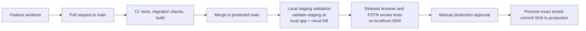

# Worktree Isolation and Release Promotion Strategy

**Status:** Implemented in this repository. The launcher and workflows below
are the supported path for new worktree and release testing.

## Purpose

Multiple Git worktrees must be testable at the same time without sharing
mutable application state. The platform has three different testing needs:

1. Fast local development and unit tests.
2. Interactive agent calls against a complete, isolated environment.
3. Release validation against one shared cloud staging database before
   production promotion — **with the application running locally**.

These needs should not be served by pointing several worktrees at the same
Supabase database.

## Environment boundaries

| Environment | Application code | Database and services | Intended use |
| --- | --- | --- | --- |
| Worktree sandbox | One worktree | A dedicated local Supabase stack and Docker project | Interactive feature development and agent calls |
| Local staging (shared DB) | Selected release commit, run locally | Cloud staging Supabase (`gdzwiwukcwbqohfwxxrx`), local FE/BE/voice-ws | Release-level integration and smoke tests |
| Production | Promoted staging commit | Production Supabase and production service hosts | Customer traffic only |

Docker Compose project names and host-port offsets isolate containers, but they
do not isolate a remote database. `start.sh` remains the lightweight
application-only launcher; `scripts/worktree-stack.sh` is the complete isolated
stack launcher; `scripts/validate-staging.sh` is the shared-staging validator.

## Worktree sandbox design

The worktree launcher provisions the complete local environment on demand. Its
interface is:

```bash
./scripts/worktree-stack.sh up
./scripts/worktree-stack.sh status
./scripts/worktree-stack.sh down
./scripts/worktree-stack.sh purge       # explicit destructive cleanup
```

The launcher does the following:

- derive a unique slug, Compose project name, Supabase project ID, ports, and
  volume names from the worktree;
- generate an ignored, worktree-specific environment file;
- resolve provider settings from the explicit `--source-env`, the worktree's
  `.env.local`, the main checkout's `.env.local`, or the example file; prefer a
  source with a usable `GEMINI_API_KEY`, refresh non-placeholder voice-provider
  credentials on every setup, and repair stale Gemini values;
- require a configured `GEMINI_API_KEY` before `up` so a placeholder cannot
  leave voice-ws running but unable to answer calls;
- generate and persist a unique URL-safe base64 Fernet `ENCRYPTION_KEY` for
  each new worktree (a valid existing key is preserved across restarts); this
  key protects organization provider credentials in that worktree's database;
- start that worktree's local Supabase services;
- obtain the local Supabase URL and keys without committing them;
- run the worktree's Alembic migrations against only its local database;
- seed deterministic test data: three standard email/password users, the
  staging-derived organization and agent, the native Google Calendar
  appointment-tool link, plan/entitlement state, credits, and required
  platform catalog data;
- start frontend, backend, and voice-ws against the generated local
  environment; and
- remove only the resources belonging to that worktree. `down` preserves
  volumes; `purge --yes` is the explicit destructive operation and verifies the
  generated state marker before removing it.

To make multiple worktrees practical on a developer machine, the generated
Supabase profile keeps the application dependencies enabled—database, REST/API,
Auth, Storage, and Realtime—but disables local Studio, Inbucket, analytics, and
Edge Runtime services. Those services are not required for password-based
agent testing and their duplicate containers create substantial Docker memory
pressure. A worktree that specifically needs one of them can enable it in its
generated ignored `supabase/config.toml` before starting Supabase.

The baseline worktree flow should use Supabase email/password authentication.
OAuth is not required when tools are disconnected. Calendar and other external
integrations should be tested separately with dedicated test accounts and
resources; production OAuth tokens and production calendars must not be copied
into a worktree.

Full local Supabase is appropriate for interactive calls because the platform
uses Supabase Auth and Supabase-backed application services. It is provisioned
on demand rather than automatically for every small code change, because a
complete Supabase stack is considerably heavier than the application containers
alone. The CLI project lives under the ignored state directory, so each
worktree gets its own project ID, ports, Docker resources, Auth users, Storage,
and database.

### Worktree commands

Run these commands from the worktree root:

```bash
# Optional: choose an explicit slot when the deterministic slot is occupied.
./scripts/worktree-stack.sh config --port-offset 60

# Start local Supabase, apply Alembic, synchronize platform data, seed the
# standard accounts and staging-shaped agent fixture, and start
# frontend/backend/voice-ws on the worktree-specific ports.
./scripts/worktree-stack.sh up --port-offset 60
./scripts/worktree-stack.sh status --port-offset 60

# Stop containers without deleting local database data.
./scripts/worktree-stack.sh down --port-offset 60

# Explicitly delete this worktree's app/Supabase state after confirming it.
./scripts/worktree-stack.sh purge --port-offset 60 --yes
```

The launcher stores generated files under `.worktree-state/` (ignored by Git):
`app.env`, `metadata.env`, the generated Supabase project, and diagnostic start
output. It prints the standard local login accounts/password and service URLs
after a successful `up`; the password is not persisted in the metadata file. Install
the [Supabase CLI](https://supabase.com/docs/guides/local-development/cli/getting-started)
and Docker before using the launcher.

Voice provider credentials are read from the canonical local environment file.
For a worktree checkout, the launcher first checks that worktree's `.env.local`,
then the main repository checkout's `.env.local`, and only uses
`.env.local.example` as a placeholder fallback. If no valid `GEMINI_API_KEY` is
available, `up` stops with an actionable error; use `--source-env PATH` when a
different private environment file should be used. The generated `app.env` is
refreshed on each `config` or `up`, so adding or rotating the key after the
first setup is picked up automatically.

The default seed mirrors the current staging fixture: `Pleasant Pediatric` in
`Peoria, AZ` (`America/Phoenix`) with the active agent `Alex`, the current
dental-receptionist instructions, and call recording enabled so the agent
detail page exposes Call History. It creates the same fixture IDs in every
isolated database, attaches the native `Google_calendar_appointment` tool, and
leaves its OAuth state empty so each worktree can authorize it independently.
The staging agent's unrelated remote MCP links and encrypted OAuth state are
not copied. The agent and organization rows are updated on repeat runs, while
credit balances are left unchanged after their first insert.

For isolated manual testing, the launcher also enables the runtime recording
gate and forces `RECORDING_STORAGE_BACKEND=local`. Opted-in calls are written
under the worktree's ignored `.local-data/call-recordings/` directory and are
served through the authenticated backend. This does not change the general
local environment default, which keeps recording disabled unless explicitly
enabled.

| Role | Email | Password | Organization |
| --- | --- | --- | --- |
| Regular user | `regular-user@247ai.local` | `Password123!` | Pleasant Pediatric |
| Org admin | `org-admin@247ai.local` | `Password123!` | Pleasant Pediatric |
| Platform admin | `platform-admin@247ai.local` | `Password123!` | Org-agnostic |

These are intentionally fixed local-only credentials so every worktree has the
same manual-test entry point. The launcher does not accept per-worktree login
overrides; changing them would make parallel worktree testing harder to repeat.

## Local staging validation (shared DB, local app)

Staging is **not** a cloud Cloud Run environment. The application runs locally,
the database is the shared cloud staging Supabase:

```bash
# after merging to main (or checking out any release candidate):
./scripts/validate-staging.sh              # migrate + sync native tools + restart local staging stack
./scripts/validate-staging.sh --migrate-only  # migrate without starting Docker

# manual equivalent:
python3 scripts/deploy/check_alembic_compatibility.py --env-file .env.staging
./scripts/deploy.sh migrate --env-file .env.staging
python3 scripts/deploy/verify_phone_number_backfill.py --env-file .env.staging
./start.sh start dev --env staging
```

`./start.sh start dev --env staging` starts the same `docker-compose.dev.yml`
services as local dev, but with `ENV_FILE=.env.staging` pointing at the cloud
staging Supabase (`gdzwiwukcwbqohfwxxrx`). Compose project `247ai-staging` and
port offsets keep it isolated from `247ai-local` worktree stacks. Use
`./scripts/validate-staging.sh` for release validation; it also materializes
the checked-out native tool catalog before the app starts.

See `docs/05_operations/staging_environment.md` for `.env.staging` setup,
bootstrap, and verification checklist.

## Migration ownership

Each database has one migration owner at a time:

- A worktree sandbox is owned by the code in that worktree. Run its Alembic
  migrations locally after the database is created.
- Shared staging is owned by the release candidate being validated. A random
  worktree must not upgrade or downgrade it — use `validate-staging.sh` on the
  release checkout only.
- Production migrations run only through the protected production deployment
  workflow.

Migrations are forward-only operational changes. A process must not run an
older branch's `alembic upgrade head` against a database whose revision is
newer or unknown to that branch. The launcher, staging validator, and
deployment workflows perform a read-only compatibility check before their
migration step. The check rejects a database revision that is not present in
the checked-out migration graph; it does not mutate the database. An older or
empty database is allowed and is upgraded by the following Alembic step.

## Recommended Git and deployment flow

Use trunk-based development with protected `main` rather than a permanent
long-lived `staging` branch:



The important separation is between merging to `main` and promoting to
production. `main` should first be validated against staging **locally**.
Production should be a separate, explicitly approved promotion of the exact
commit that passed local staging. This prevents the tested code and the
deployed code from diverging.

The implemented workflows are:

- `scripts/validate-staging.sh` — local staging validator (migrate + `start.sh`
  with `--env staging` + health checks). This is the normal staging path.
- `.github/workflows/deploy-cloud.yml` — manual dispatch only; retained for
  recovery if a Cloud Run staging deployment is ever needed. It no longer runs
  on push to `main`.
- `.github/workflows/promote-production.yml` — manual dispatch only. The
  operator supplies the full commit SHA that passed local staging; the
  protected `production` environment then gates production migration and
  deployment.

Production is therefore no longer a side effect of merging to `main`.

## Why not a permanent staging branch?

A short-lived `release/*` branch can be useful for a release-train process, but
a permanent `staging` branch is not the default recommendation. It tends to:

- drift from `main`;
- create two-way merge and conflict pressure;
- complicate migration ordering;
- test combinations that are not represented by the eventual production
  commit; and
- make rollback and artifact identity less clear.

If a release-train model becomes necessary, use a short-lived release branch
and promote its exact commit. Do not use a shared staging branch as a substitute
for isolated worktree databases.

## Testing layers

| Layer | State isolation | External integrations | Goal |
| --- | --- | --- | --- |
| Unit/component tests | Fixtures and mocks | Mocked | Fast regression coverage |
| Worktree sandbox | Full local Supabase per worktree | Disabled, mocked, or dedicated test accounts | Interactive agent development |
| Local staging (shared DB) | One shared cloud staging DB, local app per validator | Staging credentials and release-test resources | Release confidence |
| Production | Production data | Production credentials and resources | Customer operation |

The shared staging environment should have a documented release-test
organization with sufficient voice credits. It should not be used as the
database for arbitrary concurrent worktrees. The read-only staging check on
2026-08-19 reported Alembic `20260818000001`, which was the repository head
before this change; no corrective migration was applied manually during this
infrastructure work. This branch adds `20260819000001` for fresh local
Supabase service-role grants, so staging will be one revision behind until the
staging workflow applies it. Future workflows will fail safely if staging is
ahead of the checkout.

## Implementation checklist

Delivered by this change:

- worktree-specific Supabase configuration and deterministic port allocation;
- generated ignored environment files;
- read-only migration compatibility checks;
- deterministic email/password seed data;
- explicit, scoped cleanup for containers and volumes;
- a complete local interactive-call stack;
- a local staging validator (`scripts/validate-staging.sh`) using the shared
  cloud staging database; and
- a protected, manually dispatched production promotion workflow.
