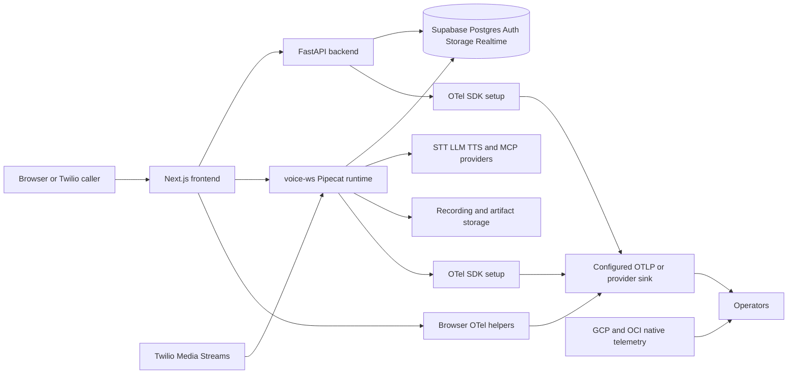
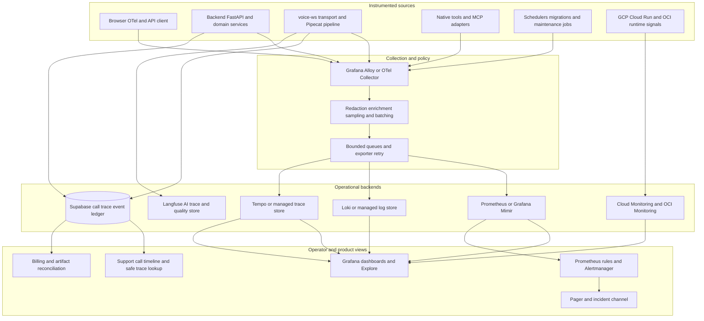
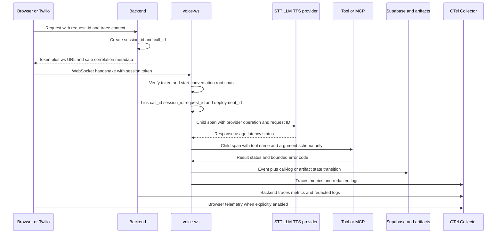
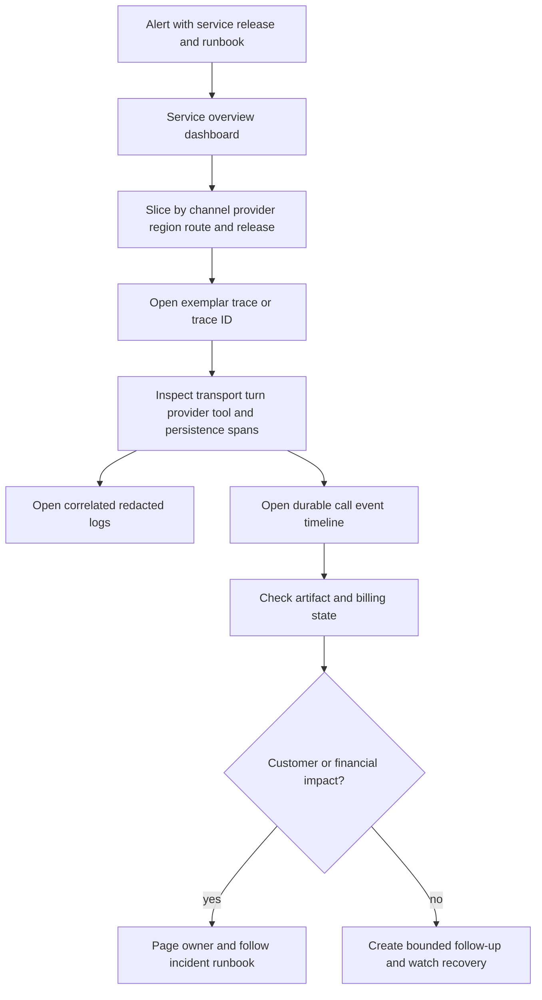
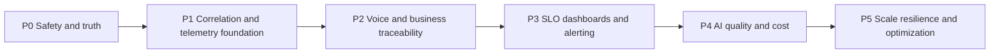

# Production Observability, Monitoring, Traceability & Alerting Plan

**Status:** Proposed production hardening plan
**Review date:** 2026-09-06
**Scope:** Backend, frontend, voice-ws, shared services/tools, call lifecycle, billing, recordings, deployment, and operator workflows

## 1. Executive decision

The platform has useful observability building blocks, but it is not yet
production-operable. OpenTelemetry setup exists in the Python services and
browser code, and the voice runtime has call-log, billing, recording, and
failure persistence. The current implementation does not yet provide a
reliable end-to-end operational story: telemetry is disabled in the production
examples, health endpoints can report success while dependencies are failing,
the trace context is not propagated across the call lifecycle, logs and traces
are not consistently correlated, there are no checked-in dashboards or alert
rules, and the durable call record is not a turn/tool/provider event ledger.

This plan establishes a production-grade path built around four complementary
planes:

1. **Service telemetry plane:** OpenTelemetry SDKs and semantic conventions in
   backend, voice-ws, frontend, and provider/tool boundaries.
2. **Operations plane:** Prometheus-compatible metrics, Loki-compatible logs,
   Tempo traces, Grafana dashboards/Explore, and Alertmanager routing. Grafana
   Alloy is the recommended collector/agent distribution.
3. **AI quality and cost plane:** Langfuse or an equivalent AI-observability
   store for prompt/model/tool spans, token/cost metadata, evaluations, and
   feedback. Keep sensitive payload capture disabled by default.
4. **Business traceability plane:** A redacted, queryable call event ledger
   linked to `call_logs`, `call_artifacts`, billing transactions, and
   organization/agent identifiers. This is the durable audit trail; a trace
   backend alone is not.

### Recommended tool choice

Start with **OpenTelemetry + Grafana Alloy + Grafana Cloud Free** for a low-
operations initial deployment, subject to current plan limits and data
retention review. Keep the telemetry contract backend-neutral so the same
instrumentation can later feed a self-hosted stack:

- **Grafana OSS** for dashboards, Explore, alert rules, and incident views.
- **Prometheus** for metrics and recording rules.
- **Loki** for structured logs.
- **Tempo** for distributed traces.
- **Alertmanager** for deduplication, grouping, routing, silences, and
  inhibition.
- **Grafana Alloy** as the OpenTelemetry Collector distribution for receiving,
  batching, redacting, enriching, and exporting signals.

Add **Langfuse** only after the service telemetry and privacy controls are in
place, when prompt/model/tool quality, token usage, cost, and human feedback
need a dedicated AI view. Do not make **MLflow** a dependency of the first
operations rollout. MLflow is a strong option for a later model/experiment/
evaluation lifecycle and now supports GenAI tracing, but it is not necessary
to solve the immediate production incident-response and service-health gaps.

The plan intentionally separates these choices from provider-native telemetry.
GCP Cloud Run/Cloud Monitoring and OCI Monitoring/Logging remain required
infrastructure backstops; they should feed or link to the common operator
workflow instead of becoming the only place an incident can be understood.

## 2. What production operators must be able to answer

For any incident, on-call should be able to answer these questions in minutes,
without reproducing the call first:

| Question | Required evidence | Target query key |
| --- | --- | --- |
| Is the platform available? | Liveness, readiness, request success, dependency health, container restarts | `service`, `environment`, `region` |
| Who is affected? | Organization, agent, channel, provider, route, release, region; safely redacted | `organization_id`, `agent_id`, `channel`, `provider`, `release` |
| What happened to one call? | Conversation root span, call-log state transitions, turn/tool/provider events, recording/artifact state, billing result | `call_id`, `session_id`, `trace_id` |
| Where is latency spent? | Stage durations and percentiles for WebSocket connect, STT, LLM, TTS, tools, persistence, billing | `trace_id`, `span_id`, `operation` |
| Why did it fail? | Stable failure code, exception type, provider status, retry classification, safe error details | `failure_code`, `error.type`, `provider` |
| Is the issue systemic or tenant-specific? | Error/latency/capacity slices by service, route, provider, organization, agent, and release | bounded low-cardinality labels |
| Did a deployment cause it? | Release/build metadata, change markers, pre/post deployment SLO comparison | `service.version`, `deployment.id` |
| Is money or quota correct? | Usage estimate, completed-call decision, idempotent billing result, ledger transaction ID, reconciliation metric | `call_id`, `credit_transaction_id` |
| Are artifacts safe and available? | Recording/transcript status, storage latency, retention deadline, encryption/upload failure | `call_id`, `artifact_type`, `storage_provider` |
| Can we prove the control worked? | Alert fired, runbook followed, recovery time, audit event, post-incident evidence | incident ID / trace ID |

## 3. Review method and evidence boundary

This assessment reviewed the repository as a production system, including:

- shared OpenTelemetry configuration and settings;
- FastAPI startup, health, authentication, organization, and voice routes;
- voice-ws connection, session setup, Pipecat pipeline, tool/MCP adapters,
  call tracking, billing, and recording persistence;
- frontend telemetry helpers, API client, browser instrumentation, and
  production build settings;
- call-log and call-artifact models/migrations;
- Docker/OCI/GCP deployment configuration and CI promotion flow;
- existing observability documentation and tests;
- current OpenTelemetry, Grafana, Prometheus, Pipecat, Langfuse, and MLflow
  documentation for tool selection.

The review is intentionally conservative. A comment that says “implemented”
was not treated as evidence unless the executable code, deployment path, and
tests support it. Provider-native logs and managed-service metrics are useful
but do not replace application-level traceability.

## 4. Current architecture and instrumentation map

The operational path currently looks like this:



The significant gap is visible in the diagram: the call path and the
telemetry path are loosely connected. There is no enforced propagation of a
single correlation context from backend session issuance through voice-ws,
provider calls, tools, persistence, and frontend-visible status. The existing
`call_logs` row records an outcome, but not the sequence that produced it.

### Evidence map

| Area | Current evidence | Operational consequence |
| --- | --- | --- |
| Shared OTel | `shared/config/opentelemetry.py`, `shared/config/settings.py` | Configuration exists, but endpoint/protocol/header fields are not consistently used; lifecycle, resource metadata, error recording, and exporter health are incomplete. |
| Backend startup | `backend/main.py` | Instrumentation is initialized at import and app creation, creating duplicate/noisy behavior; synthetic `/test-otel` is public and blocks the event loop. |
| Backend health | `backend/main.py` `/health`, `/health/ready`, `/health/live` | Readiness is effectively unconditional; `/health` can return HTTP 200 and `status: healthy` while a dependency check reports an error. |
| Voice transport | `voice-ws/src/main.py`, `voice-ws/src/bot.py` | WebSocket and Twilio paths work as runtime boundaries, but there is no durable root trace with transport, call, session, or release context. |
| Session setup | `voice-ws/src/session_setup.py` | Prepared-agent logs help local debugging but do not carry stable correlation IDs or a privacy policy. |
| Pipeline | `voice-ws/src/bot.py` | Call tracking, recording, and bounded failure state exist; conversation/turn/STT/LLM/TTS/tool/persistence spans and metrics are missing. |
| Call tracking | `voice-ws/src/call_tracking.py` | Sync Supabase calls run in async code; failure and billing paths are best-effort and lack telemetry needed to distinguish persistence, billing, and provider failures. |
| Recording | `voice-ws/src/recording.py` | Artifact persistence is best-effort with broad failure logging but no duration, bytes, queue/backlog, retry, or storage error metrics. |
| Tools/MCP | `voice-ws/src/tools/assembly.py`, `voice-ws/src/tools/mcp_pipecat.py` and related handlers | Native/MCP tool failures are model-visible, but execution duration/status/provider metadata are not consistently traced; some paths log raw arguments/results or return raw exception text. |
| Durable model | `backend/src/call_logs/models.py` and call-artifact migrations | Call outcome and artifact metadata exist; there is no append-only call/turn/tool/provider/billing event ledger. |
| Frontend | `frontend/src/lib/opentelemetry.ts`, `opentelemetry-helpers.ts`, `api/client.ts`, `instrumentation.ts` | Browser telemetry is mostly helper/synthetic instrumentation; API calls do not consistently create spans or propagate `traceparent`/request IDs. Production disables it. |
| Deployment | `.env.prod.example`, `scripts/deploy/gcp-env-from-cloud.py`, `scripts/deploy/gcp-deploy.sh`, `deploy/oci/docker-compose.voice-ws.yml` | Production telemetry is disabled or only partially configured; there is no checked-in collector/dashboard/alert deployment and no telemetry smoke gate. |
| Docs/tests | `docs/02_features/observability/overview.md`, `docs/02_core_systems/opentelemetry_implementation.md`, `backend/README.md`, OTel dependency tests | Documentation overstates current capability and is stale in places; tests verify dependency/config presence, not signal correctness or operator workflows. |

## 5. Production maturity scorecard

Scores are capability scores, not a judgment of code quality. `0` means
absent, `1` prototype/partial, `2` usable with manual work, and `3` production
operable with ownership, tests, and runbooks.

| Capability | Score | Assessment |
| --- | ---: | --- |
| Metrics coverage and naming | 1/3 | A few auth/org/RBAC metrics exist; voice, provider, tool, recording, billing, queue, and dependency metrics are not covered by a consistent contract. |
| Structured logging | 1/3 | Standard logging is present, but fields, redaction, severity, request IDs, and correlation are inconsistent. |
| Distributed tracing | 1/3 | OTel decorators/setup exist, but there is no end-to-end propagation or useful voice turn/tool trace. |
| Browser-to-backend traceability | 0/3 | Plain `fetch` is the default; no standard request/trace propagation path is enforced. |
| Voice-call traceability | 1/3 | Call IDs and call logs exist; a traceable conversation/turn/event chronology does not. |
| Health and dependency monitoring | 0/3 | Liveness/readiness semantics are not trustworthy and do not cover all critical dependencies. |
| SLOs and error budgets | 0/3 | No checked-in SLI/SLO definitions or burn-rate alert rules were found. |
| Alerting and escalation | 0/3 | No production alert catalogue, routing policy, deduplication, inhibition, or tested notification path is checked in. |
| Dashboards and operator UX | 0/3 | No versioned Grafana dashboards, drilldowns, or release overlays were found. |
| AI quality/cost visibility | 0/3 | No first-class prompt/model/token/cost/quality view is wired to the runtime. |
| Durable audit/event history | 1/3 | Call outcome, artifacts, and billing identifiers persist; the causal event ledger is absent. |
| Privacy and retention controls | 1/3 | Recordings have retention metadata, but telemetry payload and log redaction are not enforced consistently. |
| Telemetry pipeline resilience | 0/3 | No collector ownership, queue/backpressure policy, exporter health, or telemetry-loss alert exists. |
| Verification and release gates | 0/3 | No telemetry contract tests, alert tests, dashboard checks, or post-deploy observability smoke gate. |

**Production-readiness conclusion:** the platform can be debugged by reading
individual logs and database rows, but it cannot yet provide dependable,
low-latency incident diagnosis or prove that critical calls, tools, billing,
and recordings completed correctly.

## 6. Findings and priorities

Priority meanings:

- **P0:** must be addressed before production traffic or before declaring a
  production release observable.
- **P1:** required for reliable day-to-day operation and fast diagnosis.
- **P2:** important hardening and optimization after the operational baseline.

| ID | Priority | Finding | Risk | Required direction |
| --- | --- | --- | --- | --- |
| OBS-001 | P0 | Production examples and GCP deployment explicitly disable backend and frontend OTel. | No production telemetry exists even if code appears instrumented. | Enable through a controlled collector endpoint, deploy collector/export path, and add a post-deploy telemetry smoke test. |
| OBS-002 | P0 | `/health/ready` always reports ready; `/health` can report healthy despite dependency errors. | Load balancers send traffic to an unready instance and alerts miss outages. | Separate live/ready/startup checks, return 503 on readiness failure, bound dependency checks, and expose dependency-specific status privately. |
| OBS-003 | P0 | No SLO, alert, notification, or escalation contract is checked in. | Incidents are discovered by users and handled inconsistently. | Define SLIs/SLOs, multi-window burn-rate alerts, capacity alerts, routing, silences, and runbooks as versioned configuration. |
| OBS-004 | P0 | No reliable trace context crosses backend session issuance, browser/Twilio, voice-ws, providers, tools, persistence, and billing. | One-call diagnosis requires manual joins and may be impossible. | Establish `request_id`, `session_id`, `call_id`, and W3C `trace_id`; propagate context in HTTP/WebSocket/Twilio-safe metadata and attach IDs to every durable event. |
| OBS-005 | P0 | Tool/MCP paths can log raw arguments/results and return raw exception strings. | Credentials, PII, prompts, provider responses, or internal details may leak. | Centralize redaction, log only schemas/keys and bounded result summaries, classify error codes, and disable payload capture by default. |
| OBS-006 | P0 | There is no durable event ledger for turns, tool calls, provider calls, failures, recording, or billing transitions. | Post-incident reconstruction and reconciliation are incomplete. | Add append-only `call_trace_events` with indexes, retention, idempotency, and redacted metadata. |
| OBS-007 | P1 | Shared OTel setup does not consistently honor configured endpoint/protocol/headers, retains no provider handle, and swallows setup/export failures with prints. | Operators cannot prove where telemetry went or shut it down cleanly. | Build one idempotent lifecycle manager; honor settings; use logging; expose startup/exporter health; flush/shutdown on service termination. |
| OBS-008 | P1 | OTel resource metadata is incomplete/hardcoded (`service.version`, nonstandard environment attribute), and frontend defaults point at localhost. | Signals cannot be compared by release/environment and browser export may fail or leak. | Use deployment-injected resource attributes and a controlled browser telemetry path; never ship localhost defaults to production. |
| OBS-009 | P1 | Backend instrumentation is initialized twice and `/test-otel` is public, incorrectly named, and uses blocking `time.sleep`. | Duplicate spans/metrics, attack surface, and event-loop stalls. | Initialize once during app lifespan; remove or protect synthetic endpoints; use async test fixtures. |
| OBS-010 | P1 | `emit_metric` dynamically creates counters and `emit_log` ignores level/attributes. | Cardinality, missing dimensions, and misleading signal severity. | Define metric instruments once; use bounded labels; preserve severity and structured attributes. |
| OBS-011 | P1 | Voice pipeline lacks root/turn/stage metrics and has no provider latency/error/usage breakdown. | Audio quality and latency regressions cannot be localized. | Instrument transport, STT, LLM, TTS, interruptions, queue depth, TTFB, tool calls, and provider outcomes. Validate the pinned Pipecat version before using newer helper APIs. |
| OBS-012 | P1 | Call tracking and billing use synchronous database calls in async runtime and broad best-effort catches without telemetry. | Latency, connection exhaustion, silent state divergence, and missed billing are hard to detect. | Move I/O to async or bounded worker paths; emit state/billing spans and reconciliation metrics; preserve idempotency. |
| OBS-013 | P1 | Recording persistence has no upload/bytes/latency/retention/backlog signal. | Successful calls can lose artifacts silently or consume unbounded storage. | Instrument capture, encode, upload, artifact upsert, retry, retention, and storage capacity. |
| OBS-014 | P1 | Frontend API calls and auth flows lack standard network spans and correlation; auth logs include user/expiry details. | UI failures cannot be joined to backend traces and sensitive identity metadata may be over-collected. | Instrument the shared API client, propagate context, redact auth fields, and add UX error/voice-connect metrics. |
| OBS-015 | P2 | Provider-native GCP/OCI signals are fragmented and promotion has no telemetry gate. | A release can be “healthy” at HTTP level while voice, billing, or telemetry is broken. | Create common service dashboards and a release smoke test that asserts traces, logs, metrics, alerts, and call completion. |
| OBS-016 | P2 | Existing observability docs claim more than the code implements and mention stale runtime/provider concepts. | Operators and engineers follow incorrect runbooks. | Rewrite docs from executable behavior, link this plan, and make telemetry contracts part of CI/release review. |

## 7. Target operating model

The target is a three-speed system:

1. **Real-time signals** detect availability, latency, saturation, errors,
   provider degradation, and telemetry loss.
2. **Per-call traceability** explains one request or call across service,
   transport, model, tool, artifact, and billing boundaries.
3. **Durable business evidence** survives trace sampling and retention limits,
   allowing support, finance, security, and engineering to reconstruct the
   lifecycle without storing raw conversation content by default.

### Target architecture



### Signal ownership

| Signal | Source of truth | Owner | Retention principle |
| --- | --- | --- | --- |
| Metrics | OTel instruments exported to Prometheus-compatible storage | Service/platform owner | Long enough for SLO windows and release comparison; aggregate labels only |
| Logs | Structured JSON logs through Alloy/Loki or provider sink | Service/platform owner | Shorter than audit events; redacted and sampled for repetitive success logs |
| Traces | OTel spans in Tempo or managed trace store | Service/platform owner | Sample normal success; retain errors, slow calls, and incident traces longer |
| AI traces | Langfuse/AI store | AI/product owner | Payload capture opt-in, tenant-aware, retention by data policy |
| Call events | Supabase `call_trace_events` | Voice/platform owner | Durable, append-only, redacted, tenant-scoped, lifecycle retention policy |
| Billing evidence | Existing billing transaction plus call events | Finance/platform owner | Must outlive short operational trace retention and support idempotent reconciliation |
| Provider-native telemetry | GCP/OCI | Infrastructure owner | Required for platform/container/network capacity and provider incidents |

No single backend is the source of truth for everything. In particular,
sampling or exporter outages must not erase billing state transitions or the
minimum call timeline.

## 8. Tool research and selection

The selection criteria are: open standards, low lock-in, self-hostability,
tenant/privacy controls, low operator burden, correlation between logs/metrics/
traces, alerting maturity, voice/AI suitability, and a practical free starting
path. Verify current plan limits, licenses, data residency, and pricing before
procurement; hosted free tiers change.

### 8.1 OpenTelemetry: required instrumentation standard

Use OpenTelemetry as the instrumentation and transport contract, not as the
storage product. The Collector model supports receivers, processors, and
exporters in pipelines; this lets the code emit OTLP once while operators
change storage or add a redaction policy centrally. Use semantic conventions
for HTTP, database, messaging, and GenAI attributes, while treating payload
attributes as sensitive unless explicitly approved.

Required OTel practices for this repository:

- use one `TracerProvider`, `MeterProvider`, and `LoggerProvider` lifecycle per
  process;
- configure an OTLP exporter to an in-environment collector, not directly to a
  vendor from every application;
- add `service.name`, `service.version`, `deployment.environment.name`,
  `service.instance.id`, `cloud.provider`, `cloud.region`, and deployment ID
  from runtime configuration;
- use `BatchSpanProcessor`, bounded queues, a memory limiter, and explicit
  shutdown/flush hooks;
- record exception type and stable error code, but never put tokens, full
  prompts, phone numbers, raw audio, or unrestricted tool payloads in span
  attributes;
- use head sampling at the edge and retain errors/high-latency traces; add
  tail sampling at the collector only after resource sizing and failure modes
  are tested;
- use W3C Trace Context where the protocol supports it and carry an explicit
  application correlation envelope for WebSocket/Twilio boundaries.

### 8.2 Grafana stack: recommended operations plane

| Tool | Role | Strengths | Trade-offs | Decision |
| --- | --- | --- | --- | --- |
| Grafana OSS | Dashboards, Explore, alert views, links across signals | Mature operator workflow; trace-to-log and trace-to-metric navigation; broad datasource support | Dashboards/alerting need ownership and version control; AGPL license for Grafana OSS | Adopt |
| Grafana Alloy | Collector/agent | Open-source OTel Collector distribution with unified telemetry pipelines and integrations | Another runtime to operate; must pin versions and secure endpoints | Adopt |
| Prometheus | Metrics and recording rules | Simple, proven, PromQL, excellent alert-rule ecosystem | Long-term/high-cardinality storage needs remote-write/Mimir or managed service | Adopt for initial metrics |
| Loki | Logs | Cost-efficient label-indexed logs; excellent Grafana integration | Labels must remain low-cardinality; full-text search and retention need sizing | Adopt if self-hosting |
| Tempo | Traces | Open-source, OTel-native, object-storage-friendly, trace/log/metric links | Requires object storage and careful retention/sampling | Adopt if self-hosting |
| Alertmanager | Alert routing | Deduplicates, groups, silences, and inhibits alerts | Does not replace notification ownership or incident process | Adopt |
| Grafana Cloud | Hosted Grafana metrics/logs/traces/profiles | Fastest start and lowest infrastructure burden; free tier may be enough for early traffic | Hosted limits, retention, cost growth, data residency, vendor dependency | Recommended initial path after limit review |

Grafana Cloud Free is a reasonable pilot because it removes the need to run
storage immediately, but it must be capacity-tested with realistic voice
trace/log volume. The current pricing page advertises free allowances and
retention that may change; record the approved limits in deployment
documentation and alert on approaching them. For a fully self-managed path,
run Grafana, Prometheus, Loki, Tempo, and Alertmanager with object storage,
backups, upgrades, access control, and a tested disaster-recovery procedure.

### 8.3 Langfuse: optional AI observability plane

Langfuse is a good fit when the team needs an AI-native view of conversation,
turn, model, tool, token, cost, latency, feedback, and evaluation data. Its
Pipecat integration and OTLP-compatible ingestion can complement the service
trace rather than replace it. Use the same `trace_id`, `call_id`, `session_id`,
organization, agent, model, and release metadata where supported.

Adoption guardrails:

- first deploy it in a non-production or metadata-only mode;
- capture prompt/completion/audio content only through an explicit tenant and
  data-policy opt-in;
- redact phone numbers, emails, authorization headers, secrets, and tool
  arguments before export;
- keep the canonical call event ledger and billing records in platform-owned
  storage;
- choose self-hosted Langfuse only if the team accepts database/object-storage
  operations and reviews its current core/enterprise licensing boundary.

### 8.4 MLflow: defer from the operations baseline

MLflow now provides OTel-compatible GenAI tracing and is a credible choice for
model/experiment/run/artifact tracking, evaluation workflows, and a future
model lifecycle. It is not the best first dependency for this gap because the
immediate need is cross-service production operations: availability,
correlation, low-latency incident diagnosis, billing/artifact state, and
alerting. Re-evaluate MLflow when the platform owns model training, registry,
prompt-version promotion, offline evaluation, or model governance. If adopted,
link its run/evaluation ID to the OTel trace and release metadata instead of
creating a second uncorrelated trace universe.

### 8.5 Provider-native backstops

- **GCP Cloud Run:** retain Cloud Logging, Cloud Monitoring, Error Reporting,
  revision metadata, instance/cold-start/container health, request metrics, and
  platform logs. Export or link them to the common Grafana incident view where
  practical.
- **OCI:** retain OCI Monitoring alarms, Logging, load balancer/network and
  compute/container signals, and Caddy/runtime logs. The current OCI compose
  definition needs an explicit healthcheck and a documented log/metric export
  path.
- **Supabase/Postgres:** monitor connection saturation, query latency, errors,
  storage, replication/backup status where applicable, and Realtime/Auth
  provider health. Application traces must include safe database operation
  names and not SQL values.
- **Twilio and external model providers:** ingest provider status/error,
  request IDs, rate limits, timeouts, and usage metadata into spans/events;
  subscribe to provider status notifications where available. Never page on a
  single provider timeout; page on an error-rate/availability SLO breach.

## 9. Correlation and traceability contract

### 9.1 Identifiers

Every externally initiated operation must have these fields, with clear
lifetimes:

| Identifier | Meaning | Created by | Durable? | Allowed in logs/metrics |
| --- | --- | --- | --- | --- |
| `request_id` | One HTTP request or WebSocket handshake | Edge/backend middleware | Optional | Yes, bounded string |
| `trace_id` | W3C distributed trace | OTel context | No; store as reference when useful | Yes |
| `span_id` | One timed operation | OTel SDK | No | Yes |
| `session_id` | Backend-issued voice session authorization/session | Backend | Yes on call/session records | Yes |
| `call_id` | Stable platform call identity, mapped to `call_logs.id` | Call tracking | Yes | Yes |
| `call_sid` | External Twilio/provider call identity | Provider/webhook | Yes, redacted according to policy | Yes if safe |
| `event_id` | Idempotent call event identity | Event writer | Yes | Yes |
| `deployment_id` | Release/revision that handled the operation | Runtime | Yes in event/trace metadata | Yes |

Rules:

- `call_id` is the platform join key; `trace_id` is the diagnostic join key.
- Never use organization IDs, user IDs, email addresses, phone numbers, tool
  argument values, or arbitrary provider request IDs as metric labels.
- Use bounded categorical labels for `channel`, `operation`, `provider`,
  `status`, `failure_code`, `artifact_type`, and `environment`.
- Attach organization and agent identifiers to traces/logs/events only when
  authorization and retention policy permit; hash or tokenize sensitive
  external identities when an aggregate view is sufficient.
- Include a safe `trace_id` and `call_id` in support-facing views, but do not
  expose internal stack traces or provider credentials to callers.

### 9.2 Context propagation



For Twilio, do not place long-lived secrets or full trace headers in a URL
query string. Use the existing short-lived session token only as the
authentication mechanism, and carry the platform `call_id`/correlation data
through server-side verified session claims and the WebSocket context. Ensure
proxy/access logs redact token query parameters.

### 9.3 Durable event ledger

Add an Alembic migration and a model/service for an append-only table similar
to:

```text
call_trace_events
------------------
id                       uuid primary key
organization_id          uuid not null
call_log_id              uuid null references call_logs(id)
session_id               text null
trace_id                 text null
span_id                  text null
event_type               text not null
event_version            integer not null default 1
occurred_at              timestamptz not null
sequence_no              bigint null
actor                    text not null
channel                  text null
provider                 text null
operation                text null
status                   text not null
failure_code             text null
duration_ms              integer null
idempotency_key          text not null
safe_metadata            jsonb not null default '{}'
created_at               timestamptz not null
```

Recommended event types:

`session.issued`, `session.accepted`, `transport.connected`,
`transport.disconnected`, `call.started`, `turn.started`, `stt.completed`,
`llm.started`, `llm.completed`, `tts.started`, `tts.completed`,
`interruption.received`, `tool.started`, `tool.completed`, `tool.failed`,
`provider.rate_limited`, `provider.timeout`, `recording.started`,
`recording.persisted`, `artifact.failed`, `call.failed`, `call.completed`,
`billing.attempted`, `billing.succeeded`, `billing.skipped`,
`billing.reconciliation_required`.

Invariants:

- writes are append-only; corrections are compensating events;
- `idempotency_key` prevents duplicate event writes on retries;
- event writes never contain raw prompt, completion, audio, transcript,
  authorization, cookie, phone, email, or tool argument values;
- event creation is bounded and must not block the audio loop; use an async
  queue or outbox strategy with a clear loss policy;
- call completion must record whether event persistence, artifact persistence,
  and billing succeeded or require reconciliation;
- add indexes on `(organization_id, occurred_at)`, `(call_log_id,
  occurred_at)`, `(trace_id)`, `(event_type, occurred_at)`, and a uniqueness
  constraint on the appropriate `(organization_id, idempotency_key)` scope;
- define retention and tenant authorization in the same migration/docs change;
- expose a paginated, permission-checked support query rather than raw table
  access.

## 10. Instrumentation implementation plan

Implement in vertical slices. Each slice must include code, tests, dashboard
queries, alert/runbook updates, and a redaction review.

### 10.1 Shared telemetry foundation

Create a small shared telemetry package with explicit public APIs:

```python
telemetry = configure_telemetry(service_name, settings, resource_metadata)
with telemetry.span("operation", attributes=safe_attributes(...)):
    ...
telemetry.record_error(error_code, exception_type, retryable)
telemetry.emit_metric("operation.duration", value, attributes=bounded_labels)
```

Required behavior:

1. Make initialization idempotent and process-lifecycle aware. The backend
   must not initialize one provider at module import and another during app
   creation.
2. Honor the configured OTLP endpoint, protocol, headers, TLS/insecure mode,
   exporter timeout, queue size, batch size, and sampling settings. Validate
   required values at startup and fail clearly when production telemetry is
   enabled but unusable.
3. Replace `print`-based setup failures with redacted structured logs. Do not
   recursively export exporter failures through the same failing provider.
4. Retain providers/exporters and flush on graceful shutdown. Use bounded
   queues and a memory limiter; document the behavior during collector outage.
5. Set `service.version` and `deployment.environment.name` from build/runtime
   metadata rather than hardcoded values. Add `service.instance.id` only where
   it is stable and safe.
6. Make logging severity and attributes effective. A helper that accepts
   `level` but always emits INFO is not an operational contract.
7. Create meters/counters/histograms once at module or provider scope. Never
   create an instrument dynamically on every call.
8. Centralize `safe_attributes`, `redact_exception`, and bounded-value helpers.
   Include automated tests with representative secrets, phone numbers, emails,
   prompts, tool arguments, provider responses, and nested structures.
9. Provide a `telemetry.self_check` result with exporter reachability,
   configured sampling, collector endpoint, and last successful export time;
   expose only a safe summary to authenticated operators/metrics.

### 10.2 Backend

Add middleware and spans around:

- HTTP request lifecycle, route template, status, duration, response size,
  authenticated role, tenant scope, and request ID;
- Supabase/Auth/Storage/Realtime calls by operation name, status, timeout,
  retry classification, and bounded latency;
- organization/agent selection, entitlements, credit checks, and permission
  denials;
- voice session token issuance, including safe session/call linkage and token
  redaction in access logs;
- Twilio webhook and status callbacks, including provider request/call IDs and
  state transition outcome;
- background/scheduled jobs, migrations, seed synchronization, and cleanup.

Backend requirements:

- return a request ID in every response and accept a validated inbound one;
- use stable route templates, never raw IDs or query strings as metric labels;
- record exceptions with stable API error codes and `error.type`; do not log
  full request bodies;
- make `/health/live` process-only, `/health/ready` dependency-aware, and add
  a startup probe where deployment supports it;
- remove `/test-otel` from production or require an authenticated admin,
  non-production environment, explicit rate limiting, and async sleep in tests;
- make dependency checks bounded and distinguish degraded from ready.

### 10.3 voice-ws and Pipecat

Create one conversation root span after token verification and close it on
disconnect or terminal call state. Add the following child spans/metrics,
using Pipecat's built-in tracing hooks where supported by the pinned `1.8.1`
dependency and wrapping boundaries where it is not:

| Boundary | Span attributes | Metrics |
| --- | --- | --- |
| WebSocket/Twilio connect | channel, transport, close code, auth result, region | connect count, auth failures, abnormal closes, active sessions |
| Call lifecycle | call ID, session ID, organization/agent, outcome, failure code | started/completed/failed, duration, concurrent calls |
| Audio input/output | sample rate, frame counts, interruption state | input/output frames, queue depth, dropped frames, audio errors |
| STT | provider, model, language, final/interim, timeout | request count, error rate, latency, TTFB |
| LLM/Gemini Live | provider, model, operation, finish reason, usage if available | request/error/timeout, TTFB, total latency, tokens/usage |
| TTS | provider, model/voice, output duration | request/error, TTFB, latency, synthesized duration |
| Turn | turn number, outcome, interruption, end reason | turn duration, interrupted turns, empty responses |
| Native/MCP tool | tool name, adapter, argument schema hash, status, retryable | call/error/timeout, duration, rate-limit count |
| Recording | channel, sample rate, bytes, storage provider, artifact status | capture/upload/upsert latency, bytes, failures, retention backlog |
| Billing | entitlement decision, idempotency result, credit transaction ID | attempts/success/skip/failure, reconciliation backlog, credits |
| Shutdown/cleanup | MCP/session cleanup outcome | cleanup failures and duration |

Voice-specific rules:

- attach `call_id` and `trace_id` to every call-log, artifact, billing, and
  event write;
- use the existing bounded failure state as a fallback, but ensure the final
  span and event distinguish transport failure, provider failure, tool failure,
  persistence failure, recording failure, and billing reconciliation;
- keep synchronous database/provider work out of the audio event loop; use
  async clients, bounded worker queues, or explicitly measured offloading;
- never record raw audio, transcript, prompt, completion, or tool result by
  default; payload capture requires policy and tenant opt-in;
- include external provider request IDs only in safe, bounded event/log fields;
- make sampling aware of calls: keep all failed/abnormal/slow calls and a
  bounded sample of successful calls; preserve durable lifecycle events even
  when traces are sampled out;
- add a kill switch for optional AI payload tracing that does not disable
  service health metrics or call outcome events.

### 10.4 Tool and MCP contract

Wrap every tool adapter in a common execution decorator. The wrapper should:

1. validate arguments before creating the provider call;
2. create a span named `tool.execute` with tool identity and schema version;
3. emit `tool.started` and a terminal event with status, duration, error code,
   retryability, and provider request ID;
4. log argument keys/schema hash, not values;
5. log a bounded, classified result summary, not the full result;
6. translate exceptions into a stable model-facing error contract that tells
   the agent whether retry is safe and what next action is appropriate;
7. distinguish validation, authorization, provider, timeout, rate-limit,
   conflict, and internal errors;
8. ensure retries are idempotent or explicitly prohibited;
9. add contract tests for redaction, timeout, provider outage, duplicate retry,
   and model-visible error text.

Audit all existing handlers for raw `arguments`, raw result prefixes, raw
exception interpolation, and parameter dictionaries. The safe default is
metadata-only telemetry.

### 10.5 Frontend

Use the shared API client as the only default HTTP instrumentation point:

- create a client span for method, route template, status, duration, and
  request ID;
- inject W3C trace headers only to explicitly allowlisted first-party origins;
- propagate `x-request-id` or equivalent and show it in support-safe error
  details;
- instrument login/session refresh/logout, dashboard query latency, voice
  connect/auth/close, tool-connection status, and user-visible error states;
- remove raw user IDs, expiry timestamps, auth storage data, and response
  bodies from logs;
- use a same-origin collector proxy or a protected browser exporter; never put
  collector API keys in browser JavaScript;
- gate browser tracing by environment, consent, sampling, and a CSP/CORS
  policy; metrics that are needed for frontend health can remain enabled with
  aggregate dimensions;
- instrument the actual Next.js runtime entrypoint or server hooks; a helper
  module and console registration alone do not create a telemetry pipeline.

### 10.6 Infrastructure and deployment

Add an explicit collector deployment and configuration for each supported
environment:

- pin Alloy/Collector and exporter image versions; do not use `latest` in
  production;
- receive OTLP over authenticated TLS from services and, where needed,
  through a same-origin frontend proxy;
- apply memory limit, batch, redaction, resource detection, attributes, and
  sampling processors in a documented order;
- export metrics/logs/traces to the selected backends with bounded retries;
- expose collector health, queue utilization, dropped telemetry, exporter
  errors, and config version;
- make telemetry endpoints/credentials deployment secrets, never `.env`
  examples with real values;
- add startup and health checks for collector, voice-ws, backend, and any
  self-hosted telemetry backend;
- deploy Grafana dashboards, alert rules, contact points, folders, and data
  source configuration from version-controlled provisioning or Terraform;
- add GCP revision and OCI deployment IDs to resource metadata so releases can
  be overlaid on dashboards;
- test firewall, DNS, TLS, CORS, proxy, and egress behavior from every
  workload; do not assume localhost means the collector is reachable.

## 11. Metrics, SLIs, SLOs, and alert contract

### 11.1 Metric design rules

Use counters for totals, histograms for latency/duration, gauges for current
state, and up/down or info metrics for configuration. Use seconds as the
canonical latency unit. Keep label cardinality bounded. Never use user IDs,
phone numbers, emails, trace IDs, call IDs, arbitrary URLs, prompt text, or
tool arguments as Prometheus labels.

Suggested names (adapt to the repository's naming convention before merging):

```text
http_server_request_duration_seconds
http_server_requests_total
http_server_errors_total
voice_sessions_active
voice_session_connections_total
voice_session_failures_total
voice_call_duration_seconds
voice_calls_total
voice_turn_duration_seconds
voice_provider_request_duration_seconds
voice_provider_requests_total
voice_provider_errors_total
voice_tool_duration_seconds
voice_tool_calls_total
voice_tool_errors_total
voice_recording_upload_duration_seconds
voice_recording_bytes_total
voice_recording_failures_total
voice_billing_attempts_total
voice_billing_reconciliation_required_total
voice_call_trace_event_write_failures_total
telemetry_exporter_failures_total
telemetry_dropped_spans_total
```

Recommended bounded labels:
`service`, `environment`, `region`, `route`, `method`, `status_class`,
`channel`, `transport`, `provider`, `model_family`, `operation`,
`tool_name` (only if the catalog is bounded), `artifact_type`, `failure_code`,
`retryable`, and `release`. Review every new label in code review.

### 11.2 Initial SLOs

Set numerical targets only after a baseline week; the following are proposed
starting points and must be ratified by product/platform owners:

| SLO | SLI | Initial target | Window |
| --- | --- | ---: | --- |
| Backend availability | Successful non-health API requests / eligible requests | 99.9% | 30 days |
| Readiness correctness | Ready instances with all required dependencies healthy | 99.9% | 30 days |
| Voice connection success | Authenticated calls that connect and start pipeline / attempts | 99.5% | 30 days |
| Voice completion | Calls reaching a terminal persisted outcome / started calls | 99.5% | 30 days |
| Voice latency | Successful turns within agreed end-to-end budget | Establish baseline; target p95 | 30 days |
| Tool reliability | Successful non-user-error tool executions / executions | 99% per critical tool | 30 days |
| Recording durability | Required recordings persisted and readable / eligible calls | 99.9% | 30 days |
| Billing integrity | Completed billable calls with verified idempotent billing outcome | 100% | 30 days |
| Traceability | Calls with root trace plus minimum durable event sequence | 99.9% | 30 days |
| Telemetry delivery | Telemetry accepted by collector/backend / emitted telemetry | 99.9% | 30 days |

Define exclusions explicitly: intentional user cancellation, invalid auth,
known provider maintenance, test calls, and approved maintenance windows must
not silently disappear from the denominator. Keep raw totals alongside SLO
ratios.

### 11.3 Alert catalogue

Every alert needs an owner, severity, runbook URL, query, for/duration,
notification route, and a test fixture. Start with:

| Alert | Severity | Trigger | First operator action |
| --- | --- | --- | --- |
| Backend availability burn | Critical | Fast and slow burn of API availability budget | Check Grafana service dashboard, recent release, dependency panels, and request traces. |
| Readiness failure | Critical | Ready instances below threshold or dependency readiness failing | Check Supabase/provider reachability and deployment revision; stop routing only if confirmed. |
| Voice connection failures | Critical | Connection/auth/start failure budget burn | Slice by channel, release, region, close code, and provider; inspect one failed trace. |
| Abnormal WebSocket closes | High | 1006/401/403/4401/4403 rate exceeds baseline | Check token expiry, public endpoint/TLS, entitlement, and voice-ws logs. |
| Voice turn latency | High | p95/p99 budget breach for sustained window | Drill from turn histogram to STT/LLM/TTS/tool spans and provider status. |
| Provider errors/timeouts | High | Provider-specific error/timeout burn | Check provider status/rate limits and whether fallback/retry is safe. |
| Concurrent calls saturation | High | Active sessions near configured max | Check voice-ws CPU/memory, queue depth, entitlement limits, and autoscaling. |
| Recording failures | High | Eligible artifact persistence below target | Inspect capture format, storage, encryption, upload, and artifact upsert. |
| Billing reconciliation backlog | Critical | Any unreviewed required reconciliation or age threshold | Freeze automatic assumptions; compare call events, call log, and transaction RPC. |
| Call event write failures | High | Event writer failures or outbox age threshold | Inspect DB connectivity/constraints and ensure call outcome fallback is intact. |
| Telemetry exporter failure | High | Collector/exporter errors or dropped critical signals | Check collector queues, credentials/TLS, endpoint limits, and storage quota. |
| Error log surge | High | Stable error-code rate significantly above baseline | Group by release, route, provider, and exception type; open representative trace. |
| Database saturation | Critical | Connections, latency, locks, storage, or errors over threshold | Check Supabase/Postgres health and isolate noisy operations. |
| Container crash/restart | High | Restart loop or abnormal exit count | Check revision logs, OOM, dependency startup, and recent deployment. |
| Collector unavailable | High | Collector health/ready failure or no accepted telemetry | Restore collection path; rely on provider-native backstop and durable events. |
| Storage/retention risk | Medium | Recording/artifact storage or log/trace quota near limit | Review retention, growth, and cleanup; avoid deleting evidence before policy. |

Use multi-window multi-burn-rate alerts for availability and latency SLOs. Use
severity based on customer and financial impact, not merely log level. A
single exception should usually be a metric/log event, not a page.

Example rule shape (illustrative; ratify thresholds and datasource labels):

```yaml
groups:
  - name: voice-slos
    rules:
      - alert: VoiceConnectionAvailabilityBurn
        expr: |
          (
            1 - sum(rate(voice_session_connections_total{status="success"}[5m]))
                / clamp_min(sum(rate(voice_session_connections_total[5m])), 1)
          ) > 0.05
        for: 10m
        labels:
          severity: critical
          service: voice-ws
        annotations:
          summary: Voice connection failures are burning the error budget
          runbook: https://runbooks.example.invalid/voice-connection-failures

      - alert: BillingReconciliationRequired
        expr: voice_billing_reconciliation_required_total > 0
        for: 5m
        labels:
          severity: critical
          service: voice-ws
        annotations:
          summary: Completed calls require billing reconciliation
          runbook: https://runbooks.example.invalid/billing-reconciliation
```

The example URL is a placeholder and must be replaced by a repository runbook
link before deployment. Do not copy the thresholds into production without a
baseline and denominator review.

## 12. Dashboards and operator workflows

Provision dashboards as JSON or Terraform/Grafana resources in the repository;
do not make the only copy an edited dashboard in a shared Grafana instance.
Every panel must show its time range, unit, denominator, environment, region,
and release. Every error panel must link to logs and traces.

### 12.1 Required dashboards

1. **Executive/service overview:** availability SLO, active calls, call
   starts/completions/failures, error budget, provider status, recording and
   billing integrity, current release.
2. **Backend/API:** request rate, p50/p95/p99 latency, 4xx/5xx, auth and
   permission denials, dependency latency/errors, DB pool/connection state,
   queue/job health, instance CPU/memory/restarts.
3. **Voice operations:** active sessions, connect success, close codes,
   abnormal disconnects, turn latency, interruption rate, STT/LLM/TTS TTFB,
   tool latency/error, audio queue/drops, call outcomes by channel.
4. **Provider health:** per-provider request rate, latency, timeouts,
   rate-limits, error classes, usage, fallback, and status-page link.
5. **Recording/artifacts:** capture status, upload duration/bytes, storage
   errors, artifact state, retention horizon, unreadable/missing artifact rate.
6. **Billing/reconciliation:** billable/completed calls, billing attempts,
   success/skip/failure, duplicate prevention, reconciliation backlog and age.
7. **Telemetry pipeline:** collector receive/export rate, queue size, dropped
   data, exporter failures, sampling, backend ingestion, quota/retention.
8. **Release comparison:** current vs previous release by service, route,
   provider, channel, SLO, error, latency, and call completion.

### 12.2 Drilldown contract

Configure Grafana data links and a standard operator workflow:



For a support agent, provide a permission-checked call timeline keyed by
`call_id`, showing timestamps, outcome, safe failure code, artifact state,
billing result, and links to authorized trace/log views. Support must not need
direct Grafana or database access to answer basic “what happened to my call?”

## 13. Incident response and runbooks

Create short runbooks in `docs/05_operations/observability/` (or the repository
runbook location selected by the operations owner). Each runbook must contain:

- customer impact and alert meaning;
- dashboards and exact queries;
- first five minutes: validate alert, scope, recent deploy, dependencies,
  and one representative trace;
- safe mitigations and rollback criteria;
- escalation owner and provider contacts;
- data to capture without exposing PII/secrets;
- recovery verification and event/billing reconciliation;
- post-incident evidence and follow-up template.

Minimum runbooks:

1. backend 5xx/latency and readiness failure;
2. voice WebSocket 1006/401/403/4401/4403 and token/session failures;
3. voice provider timeout/rate-limit/degradation;
4. tool/MCP authorization, conflict, timeout, and duplicate-mutation failure;
5. recording/artifact missing or unreadable;
6. billing mismatch or reconciliation backlog;
7. Supabase/DB saturation or connectivity;
8. collector/exporter/backend telemetry loss;
9. GCP Cloud Run incident;
10. OCI/Caddy/voice-ws incident;
11. secret/correlation-data exposure response;
12. rollback and post-deploy observability verification.

### Incident timeline standard

For every page, record:

`incident_id`, detector, first observed time, first customer impact time,
scope, release, owner, key `trace_id`/`call_id` examples, mitigation, recovery,
data-loss or billing impact, and follow-up issues. This creates traceability of
the response itself, not just the application event.

## 14. Testing and verification strategy

Observability is part of the product contract. A green application test suite
is not sufficient if telemetry is absent or unsafe.

### 14.1 Unit and contract tests

- OTel setup is idempotent, honors every supported setting, and shuts down
  cleanly.
- Resource attributes include service/version/environment/release and never
  include secrets.
- Redaction removes tokens, cookies, authorization headers, phone numbers,
  emails, prompts, completions, audio references, and nested tool values.
- Log helper preserves severity and structured attributes.
- Metric instruments are created once and reject unbounded labels.
- Exceptions map to stable error codes and retry classification.
- Event ledger validates schema/version, tenant scope, timestamps,
  idempotency, append-only semantics, and safe metadata.
- Tool/MCP wrapper emits start/terminal spans/events exactly once under success,
  validation error, timeout, provider error, and retry.
- Billing/recording events remain correct if telemetry export is unavailable.

### 14.2 Integration tests

- backend HTTP request creates correlated logs/metric/span and returns the
  request ID;
- session issuance to voice-ws creates the expected call root and durable
  events;
- browser API client propagates only allowlisted trace context;
- Twilio webhook to `/twilio` preserves call identity without leaking the
  token through access logs;
- a synthetic call emits transport, turn, provider, tool, artifact, billing,
  and terminal call outcome evidence;
- collector outage does not block the audio loop, and the documented loss/
  fallback behavior is observed;
- exporter receives telemetry in a disposable collector/backend;
- readiness returns failure when a required dependency is unavailable;
- event and billing idempotency hold under duplicate callback/retry;
- Grafana queries return data for deterministic fixtures.

### 14.3 Alert and dashboard tests

- use `promtool check rules` and `promtool test rules` for Prometheus rules;
- validate Grafana provisioning and datasource links in CI or a disposable
  Grafana instance;
- test Alertmanager grouping, inhibition, silence, and contact-point delivery
  in a non-production channel;
- inject synthetic latency/error/telemetry-loss signals and confirm the right
  alert fires with the correct runbook and severity;
- verify alerts resolve after recovery and do not page repeatedly for one
  incident;
- run a release smoke test that searches for a known safe trace/event/metric
  using a disposable organization and deletes/retains only approved fixtures.

### 14.4 Browser and voice smoke gates

For release-critical changes:

- authenticated browser call reaches public `wss` voice-ws and returns audio;
- Twilio/PSTN test reaches webhook and `/twilio` when the release gate is
  enabled;
- final call log, recording/artifact state, billing outcome, event sequence,
  trace, logs, and metrics are all present;
- inspect voice-ws/backend logs for `1006`, `401`, `403`, `4401`, `4403`,
  `INSUFFICIENT_CREDITS`, and `MAX_CONCURRENT_CALLS`;
- ensure public callers receive safe availability guidance, not internal
  plan/credit/authorization detail;
- clean temporary users, rows, recordings, screenshots, videos, downloads,
  and scripts after the test.

## 15. Phased implementation roadmap

Each phase has an exit criterion. Do not advance based only on code merged;
the signal must be visible and verified in the target environment.



### P0 — Safety and truthful health (release blocker)

- Correct live/ready semantics and dependency checks; return correct status
  codes and remove public synthetic telemetry endpoint.
- Disable raw argument/result/exception logging and add redaction tests.
- Confirm production telemetry decision, data classification, retention,
  ownership, and access model.
- Pin collector/exporter versions and remove production `latest`/localhost
  assumptions.

**Exit:** readiness fails safely, no sensitive telemetry is observed in a
  representative test, and an owner approves the telemetry data policy.

### P1 — Correlation and telemetry foundation

- Refactor shared OTel lifecycle and settings handling.
- Add request ID middleware, W3C HTTP propagation, resource metadata, and
  structured logging.
- Deploy Alloy/Collector with redaction, batching, memory limits, and
  exporter health.
- Instrument backend request/dependency/session paths and frontend API client.
- Prove metrics/logs/traces arrive in a disposable or approved hosted stack.

**Exit:** one backend request is searchable across all three signals and
telemetry failure does not take down the application.

### P2 — Voice and business traceability

- Create conversation root and stage spans around the pinned Pipecat runtime.
- Add common tool/MCP wrapper and provider/voice metrics.
- Add `call_trace_events`, idempotent event writer, indexes, RLS/permissioned
  query, retention, and event sequence tests.
- Link call log, artifact, billing, provider request, trace, and release data.

**Exit:** an authenticated browser call and a Twilio call each produce a safe,
complete timeline from session issuance to terminal outcome.

### P3 — SLO dashboards and alerting

- Establish baseline traffic, latency, error, provider, storage, and billing
  distributions.
- Ratify SLO targets and denominators; provision dashboards, recording rules,
  alert rules, Alertmanager routes, silences, and runbooks.
- Test notifications and synthetic failure/recovery.
- Add post-deploy telemetry smoke gate to promotion workflow.

**Exit:** on-call can detect, scope, drill into, mitigate, and verify each P0/
P1 alert without ad-hoc queries.

### P4 — AI quality and cost

- Pilot Langfuse metadata-only traces and link IDs to service traces/events.
- Add token/usage/cost estimates, model/provider version, prompt/schema hash,
  tool success, user feedback, and deterministic evaluation links.
- Establish payload capture consent, redaction, retention, tenant isolation,
  and access reviews.
- Re-evaluate MLflow if model registry/evaluation lifecycle is now a real
  operating requirement.

**Exit:** product/AI owners can explain quality, latency, and cost changes by
model/provider/release without exposing customer content.

### P5 — Scale, resilience, and optimization

- Load-test voice concurrency, collector queues, storage, event writes, and
  alert evaluation.
- Add remote write/Mimir or managed metrics if Prometheus retention/scale
  requires it; size Loki/Tempo object storage and backups.
- Add tail sampling for errors/slow calls only after collector sizing;
  document sampling loss and incident override.
- Add telemetry disaster recovery, quota alerts, schema evolution, and
  operational cost dashboards.
- Run quarterly incident/game-day exercises and review alert quality.

**Exit:** capacity, failure, recovery, retention, and cost behavior are tested
at expected peak and documented for the supported deployment topologies.

## 16. Repository change map

The implementation should be split into reviewable changes, with each change
updating its tests and docs:

| Change | Likely files/area | Deliverable |
| --- | --- | --- |
| Telemetry foundation | `shared/config/opentelemetry.py`, settings, shared telemetry package | Lifecycle, resource metadata, redaction, propagation, metrics API |
| Backend instrumentation | `backend/main.py`, middleware, routes/services | Request/dependency/session spans, request ID, truthful health |
| Voice instrumentation | `voice-ws/src/main.py`, `bot.py`, `call_tracking.py`, `recording.py` | Conversation/stage spans, metrics, event writes, cleanup telemetry |
| Tool contract | `voice-ws/src/tools/`, shared registry/adapters | Common wrapper, safe errors, duration/status telemetry |
| Event ledger | call-log models, Alembic, service, support route | Schema, migration, RLS/permissions, idempotency, retention |
| Frontend | `frontend/src/lib/opentelemetry*.ts`, API client, instrumentation | Actual client/server instrumentation, propagation, UX metrics, redaction |
| Collector | `otel-collector/`, deployment files, secrets/config templates | Pinned Alloy/Collector, pipelines, health, backpressure, exporter |
| Operations as code | new Grafana/Prometheus/Alertmanager provisioning | Dashboards, rules, contact routes, recording rules, links |
| Release gate | `.github/workflows/promote-production.yml`, deploy scripts | Post-deploy telemetry and call smoke checks |
| Documentation | existing observability docs, `docs/05_operations/` | Source-of-truth plan, runbooks, data policy, architecture, recovery |

Keep each production deployment topology explicit. GCP and OCI may share the
instrumentation contract but differ in collector placement, network routes,
secret injection, load balancer health checks, and native backstops.

## 17. Security, privacy, retention, and cost controls

Observability data is production data. Treat it with the same discipline as
call recordings and transcripts.

- Default to metadata-only traces. Payloads are opt-in, time-bounded, tenant-
  scoped, and approved by policy.
- Redact at the application boundary and again at the collector; defense in
  depth is required because providers and loggers can change independently.
- Do not record access tokens, JWTs, cookies, authorization headers, raw
  Twilio URLs containing tokens, phone numbers, emails, full request bodies,
  audio, transcripts, prompts, completions, or tool arguments.
- Hash/tokenize identifiers only when the join remains useful and the mapping
  is protected; do not pretend hashing makes sensitive data non-sensitive.
- Apply tenant authorization to event and trace lookup APIs. Platform-admin
  access must be explicit and audited.
- Encrypt in transit and at rest; use separate credentials for collection,
  query, and administration. Browser clients must never receive backend
  telemetry credentials.
- Set retention by signal and purpose. Keep durable billing/audit evidence
  according to business/legal policy; keep normal logs/traces only as long as
  incident diagnosis requires; honor recording deletion/retention workflows.
- Alert on ingestion quota, storage growth, cardinality, dropped telemetry,
  and collector queue age. Cost is an SLO-adjacent operational signal.
- Restrict who can change alert routing, sampling, redaction, dashboards, and
  data-source credentials; review changes like production code.
- Include a telemetry data inventory and deletion/access procedure in the
  security/privacy documentation.

## 18. Definition of done

The observability program is ready for production when all of the following
are true:

- production has an owned, reachable, authenticated collection path;
- service/version/environment/release metadata is present and correct;
- backend, frontend, voice-ws, tools, providers, recordings, billing, and
  persistence share a documented correlation contract;
- a single call can be traced from session issuance to terminal outcome;
- sampling cannot remove the minimum durable call/billing/artifact evidence;
- health endpoints have tested live/ready/startup semantics;
- SLOs, recording rules, alerts, routes, silences, and runbooks are versioned;
- dashboards support overview-to-trace-to-log-to-event-to-billing drilldown;
- alert delivery and recovery are tested in a safe channel;
- redaction, tenant isolation, retention, and browser-export controls pass
  tests and an access review;
- recording and billing reconciliation are observable and idempotent;
- deployment promotion verifies telemetry and a representative browser/voice
  path;
- collector/backend loss behavior is load-tested and documented;
- existing observability docs no longer claim capabilities that are absent;
- operational owners have completed a game day and accepted residual gaps.

## 19. Immediate next actions

1. Assign a platform observability owner, a voice owner, an AI-quality owner,
   and a finance/reconciliation owner.
2. Approve the data classification/retention matrix and choose Grafana Cloud
   Free pilot versus self-hosted Grafana stack.
3. Implement P0 health/security fixes and the shared telemetry lifecycle.
4. Deploy a disposable collector and prove one correlated backend request.
5. Add the call event ledger design/migration and synthetic browser-call
   traceability test.
6. Establish a baseline week, ratify SLOs, then provision the first dashboards,
   alerts, routes, and runbooks.
7. Pilot metadata-only Langfuse after the operational path is reliable; defer
   MLflow until model lifecycle requirements justify it.

## 20. Research references

These are the primary references used for the tool and practice
recommendations. Check current versions, licenses, hosted limits, and provider
terms before implementation:

- [OpenTelemetry Collector architecture](https://opentelemetry.io/docs/collector/architecture/)
- [OpenTelemetry Python exporters](https://opentelemetry.io/docs/languages/python/exporters/)
- [OpenTelemetry semantic conventions](https://opentelemetry.io/docs/specs/semconv/)
- [OpenTelemetry HTTP span conventions](https://opentelemetry.io/docs/specs/semconv/http/http-spans/)
- [OpenTelemetry GenAI attributes](https://opentelemetry.io/docs/specs/semconv/registry/attributes/gen-ai/)
- [OpenTelemetry sampling](https://opentelemetry.io/docs/concepts/sampling/)
- [OpenTelemetry Collector processors](https://opentelemetry.io/docs/collector/components/processor/)
- [OpenTelemetry hosting security best practices](https://opentelemetry.io/docs/security/hosting-best-practices/)
- [Grafana documentation](https://grafana.com/docs/grafana/latest/)
- [Grafana Alloy](https://grafana.com/docs/alloy/latest/introduction/)
- [Grafana Tempo](https://grafana.com/docs/tempo/latest/)
- [Grafana trace-to-logs](https://grafana.com/docs/grafana/latest/datasources/tempo/configure-tempo-data-source/configure-trace-to-logs/)
- [Grafana trace-to-metrics](https://grafana.com/docs/grafana/latest/datasources/tempo/configure-tempo-data-source/configure-trace-to-metrics/)
- [Grafana pricing and hosted limits](https://grafana.com/pricing/)
- [Prometheus metric naming](https://prometheus.io/docs/practices/naming/)
- [Prometheus instrumentation](https://prometheus.io/docs/practices/instrumentation/)
- [Prometheus histograms](https://prometheus.io/docs/practices/histograms/)
- [Prometheus recording rules](https://prometheus.io/docs/prometheus/latest/configuration/recording_rules/)
- [Prometheus alerting overview](https://prometheus.io/docs/alerting/latest/overview/)
- [Prometheus Alertmanager](https://prometheus.io/docs/alerting/latest/alertmanager/)
- [Prometheus OpenTelemetry guide](https://prometheus.io/docs/guides/opentelemetry/)
- [Pipecat OpenTelemetry tracing](https://docs.pipecat.ai/api-reference/server/utilities/opentelemetry)
- [Langfuse Pipecat integration](https://langfuse.com/integrations/frameworks/pipecat)
- [Langfuse observability overview](https://langfuse.com/docs/observability/overview)
- [Langfuse data model](https://langfuse.com/docs/observability/data-model)
- [Langfuse token and cost tracking](https://langfuse.com/docs/observability/features/token-and-cost-tracking)
- [MLflow GenAI tracing](https://mlflow.org/docs/latest/genai/tracing)
- [MLflow tracking](https://mlflow.org/docs/latest/tracking)
- [Google Cloud Run monitoring](https://docs.cloud.google.com/run/docs/monitoring-overview)
- [Google Cloud Run logging](https://docs.cloud.google.com/run/docs/logging)
- [OCI resource monitoring](https://docs.oracle.com/en-us/iaas/Content/General/Concepts/resourcemonitoring.htm)
