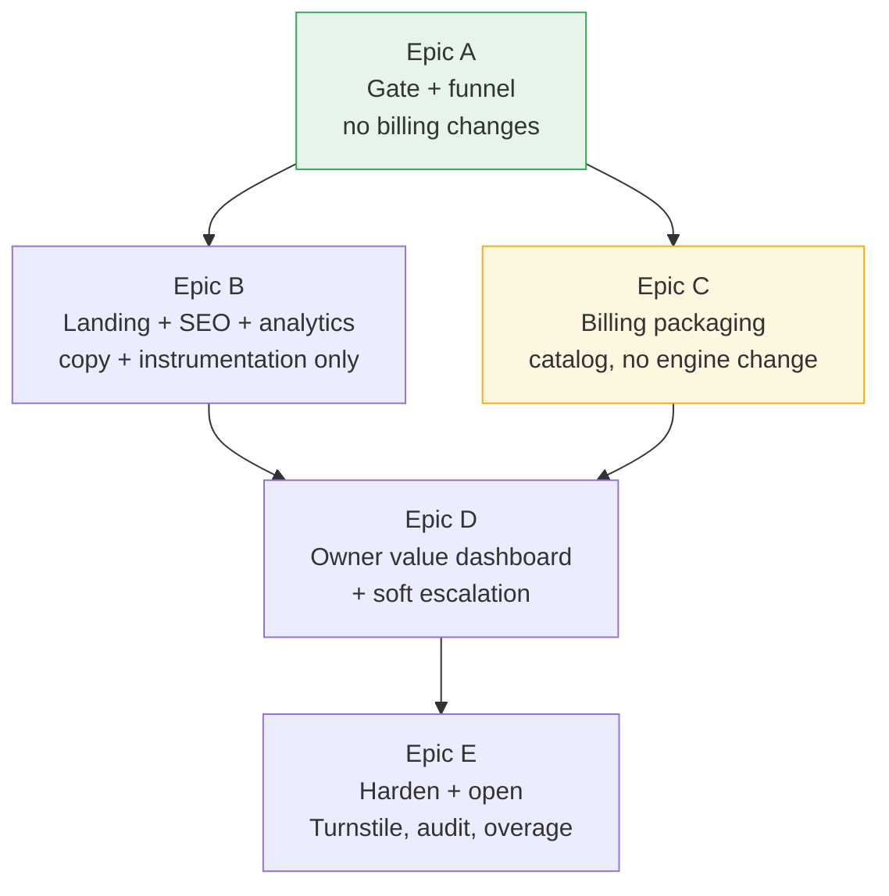
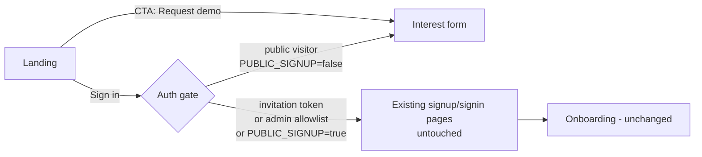
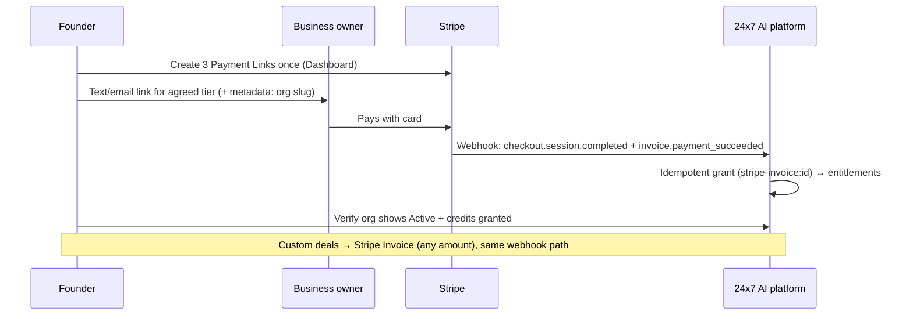

# Controlled-SaaS Execution Plan — From Report to Launch

**Worktree:** `.worktrees/opencode-launch-foundation` | **Branch:** `codex/launch-foundation` (from `origin/main` @ `fe9f30f`)
**Companion:** `launch-strategy-report.md` (copied into this worktree, same folder)
**Integration branch:** `codex/controlled-saas-launch` (from `origin/main` @ `fe9f30f`) — the destination for ALL epic worktrees. Nothing merges to `main` until the integrated launch line is tested and approved.
**Role I am playing:** product owner + architect + UX + principal engineer. You align, I drive.

---

## 0. One go vs phased? — Phased, no contest

Doing auth-gating + billing repackaging + landing rewrite + analytics + observability + transfer in one change is unreviewable, untestable, and unrevertable. One bad migration poisons every pilot.

| Epic | Worktree | Touches | Risk | Ship gate |
|---|---|---|---|---|
| **A. Gated entry + interest funnel** | `opencode-gated-entry` | Landing CTAs, auth middleware flag, `leads` table + form, demo caps | Low (no billing engine) | Demo → interest → admin view works on staging |
| **B. Business messaging + SEO + traffic analytics** | `opencode-messaging-seo` | `app/page.tsx`, 3 use-case pages, PostHog/Plausible, sitemap/metadata | Low (frontend only) | Lighthouse + SEO checks pass, events flowing |
| **C. Pricing packaging (no engine rewrite)** | `opencode-pricing-package` | `plan_versions` seed, Stripe Products/Prices, plan cards copy, pilot-billing runbook | Medium (money!) | Staging checkout → webhook → grant verified end-to-end |
| **D. Owner value + soft escalation** | `opencode-owner-value` | Call outcome summary (cheap LLM, NOT Twilio transcription), org dashboard v1, callback-request escalation | Medium | Owner sees bookings + cost/call without listening to audio |
| **E. Abuse + observability hardening, then open** | `opencode-hardening` | Turnstile, auth audit, reset hardening, OTel dashboards/alerts | Medium | Abuse tests blocked, dashboards live, then flip `PUBLIC_SIGNUP` |

**Branching rule (locked 2026-09-03):** Epic worktrees branch from and merge back into `codex/controlled-saas-launch` — never directly into `main`. Before merging any epic, `git fetch origin && git rebase codex/controlled-saas-launch`, resolve manually, rerun affected tests. Merge order A → B → C → D → E. The integration branch itself merges (never rebases) `origin/main` periodically to stay current. `main` merge happens once, after the integrated line is staging-tested end to end. Never force-push.

---

## 1. Auth gating — hide without losing

**Your question:** how do we hide signup but keep the pages + keep admin entry?

**Answer: keep every page, gate with a flag + allowlist.** Zero deletions, so reopening later is a one-line env change.

Concrete plan (Epic A):

- [ ] New env `PUBLIC_SIGNUP_ENABLED=false` (default closed) + `PLATFORM_ADMIN_ALLOWLIST` (your email). Sync across `.env.*.example` files.
- [ ] Middleware on `/auth/signup` + `/auth/session` handoff: if no `invitation_token` param and email not allowlisted and flag off → redirect to `/request-demo` with context preserved (`?next=`).
- [ ] `/auth/signin` stays reachable (admins + invited users need entry) but gets Turnstile + existing rate limits (Epic E hardens further).
- [ ] Landing header: `Get Started Free` → `Request a Demo`; `Sign In` stays (small, ghost). Pricing section replaced with "Pilot plans from $79/mo — configured for you" (Epic B copy).
- [ ] Invitation flow becomes the *only* public path to an account: you approve interest → create org → send invitation → user signs up with token. This path already exists and is tested — we are just making it the default.

**What we explicitly do NOT do:** delete `signup/page.tsx`, `oauth/callback`, `verify-email`, or backend routes. They are the reopen path.

---

## 2. Pricing model — credits stay, packaging changes

**Your question:** per-call instead of credits sounds like a big change — what breaks?

**Good instinct. So here is the careful version: the metering engine does NOT change in Phase 1.**

| Layer | Today | Phase 1 (pilots) | Later (only if data demands) |
|---|---|---|---|
| Engine (metering, settle, RPCs, `voice_session_entitlement.py`) | `ceil(min) × 10cr`, plan→bonus→purchased | **Untouched.** Zero migration risk. | Per-call metering = new `billing_mode` + migration. Defer. |
| Catalog (`plan_versions`, Stripe) | Only `free` seeded | Seed Trial/Starter/Growth/Scale as **minute bundles converted to credits** (400min=4000cr, 1200min=12000cr, 3200min=32000cr) | Add true per-call SKUs if `cost/booked-appointment` proves cleaner |
| Marketing copy | Credits/minutes nowhere coherent | Sell **minutes ≈ calls** ("400 min ≈ 120 appointments"); credits invisible | Per-call headline only if avg-duration variance is low across pilots |

**Why this is safe:** no Alembic data migration on `credit_events`/grants, no change to the atomic settle RPCs, no change to 4403 pre-checks. The diff is: seed rows + Stripe Products/Prices + plan-card copy + entitlement numbers. Reviewable in one PR.

**Files in scope (Epic C), nothing else:** `backend/src/master_data/definitions.py`, one new Alembic seed migration, `stripe_manager.py` product creation, `step-plan-selection.tsx` + `plan-card.tsx` copy, `DATABASE_SCHEMA.md` + `.env` Stripe keys check.

---

## 3. Human transfer / escalation — soft first, PSTN later

**Fact check:** `codex/human-call-transfer` is **docs-only** (one commit, `call_transfer_to_human.md` expanded, status = deferred). No runtime code. So yes, it needs a proper plan.

**Is it critical for SMB launch?** The *feeling* of a safety net is critical; actual PSTN warm-transfer on day one is not. Owners fear "AI says something wrong with no human to catch it."

Phased:

- [ ] **Phase 1 — Soft escalation (Epic D, no telephony risk):** AI offers "Would you like the owner to call you back?" → captures number + reason → writes `escalations` record → SMS/email to owner instantly (Resend tool already exists) → shows in owner dashboard. This is ~2 tables + prompt skill + notification. Shippable in one epic.
- [ ] **Phase 2 — Real transfer (backlog):** Twilio `<Dial>` warm transfer with allowlisted owner numbers, business-hours rules, recording consent handling, per-transfer billing. Needs the deferred doc turned into an RFC + PSTN staging gate. Do NOT bundle with launch.

---

## 4. Stripe pilot billing — how the "link" actually works

**Your question:** custom price per customer, or fixed plans sent manually? I am new to Stripe — explain.

Three Stripe primitives, and which we use when:

| Primitive | What it is | When we use it |
|---|---|---|
| **Payment Link** (no-code, created in Dashboard) | A URL for a fixed product/price; customer pays; Stripe fires `checkout.session.completed` webhook | **Default for pilots.** You create 3 links (Starter $79, Growth $179, Scale $399) once, then text/email the right one. |
| **Invoice** (custom amount, send by email) | You type any amount + description, e.g. "$120 setup + $79 first month" | **Exceptions only** (custom scope, setup fee, multi-location deal). |
| **Checkout Session via API** (what the platform builds) | Same as Payment Link but generated programmatically | **Epic E**, when self-serve reopens. Not now. |

**Critical detail most first-timers miss:** the Payment Link / Price must carry `metadata.organization_id` (or you match by customer email → org) or the webhook cannot credit the right org. Epic C includes a runbook: create products → set metadata rule → test on staging with a $1 test price → verify grant → then create real links. No custom price per customer as the norm — fixed tiers keep support sane; invoices cover the 10% exceptions.

---

## 5. Interest capture — in-platform, not a separate CRM

**Your question:** leads in `247ai.live` or a separate CRM on a subdomain? Context: CogniEnts has products + consulting + training; no CRM today.

**Recommendation: capture in-platform now; sync to Sheets/HubSpot you already integrate; standalone CRM is overkill.**

| Option | Cost | Verdict |
|---|---|---|
| New open-source CRM on subdomain (Mautic/Odoo/ERPNext) | Hosting + auth + maintenance + GDPR surface, for ~dozens of leads/mo | ❌ Over-engineering. Your lead volume does not justify a second product to operate. |
| Google Form / Typeform embed | Zero build, but data outside your DB, no link to demo outcome | ⚠️ Acceptable week-one stopgap only |
| **In-platform `leads` table (recommended)** | 1 migration + 1 form + admin list; RLS `platform_admin` only; `source` tags `voice-pilot` / `consulting` / `training` | ✅ Leads sit next to demo outcomes; lead-capture tools (Sheets/HubSpot) you already built on the demo branch forward them; cognients.com just links to `247ai.live/request-demo` |

Cognients.com already funnels correctly ("Book a Discovery Call", voice product page at `/ai-voice-agents`). Keep it as the **brand front door**; `247ai.live` is the **product funnel**. Tag every lead with `source` + `vertical` (dental/HVAC/restaurant) so consulting/training cross-sell stays possible without a second system. Revisit a real CRM at 100+ leads/mo.

---

## 6. COGS — full picture including infra you listed

**Your question:** include Cloud Run + Oracle VM + Supabase + R2, not just call costs. Agreed — and flag the free-tier risks.

| Cost | Today | Pilot-scale estimate | Watch-out |
|---|---|---|---|
| Gemini Realtime (STT+LLM+TTS via Pipecat) | pay-per-token | **$0.06–0.10/min** (measure per pilot from week 1) | Biggest variance; cap output tokens, lean prompts |
| Twilio voice + numbers + Media Streams + recording | pay-per-use | **$0.015–0.03/min** + $1.15 local / $2.15 toll-free per number/mo | Toll-free inbound $0.022/min — steer pilots to local |
| Cloud Run (frontend + backend) | metered | **~$20–60/mo** at pilot volume | Set billing alert at $50 |
| Oracle free VM (voice-ws) | **$0 — single point of failure** | $0 now; budget **$24–48/mo** paid VM before any paid SLA | ⚠️ Free tier can throttle/reclaim; no paid pilot without a migration + restart runbook |
| Supabase free tier (DB/Auth/Storage/Realtime) | $0 with caps | **$25/mo Pro** the moment pilots grow (connection + storage caps) | Monitor DB size + auth MAUs weekly |
| Cloudflare R2 (recordings) | ~$0.015/GB + egress | **<$10/mo** at pilot scale; lifecycle rule to expire raw audio | Dual 16kHz capture doubles bytes — intended, keep |
| **All-in pilot COGS target** | | **$0.10–0.15/min** incl. infra allocation | Tier pricing ($0.12–0.20 effective) holds ≥70% margin at 60–70% bundle utilization |

Epic D adds a **COGS tab** (platform-admin only): per-org minutes × measured AI cost + Twilio + infra share → margin per pilot. No more guessing.

---

## 7. Bot protection — demo + auth + forms

You are right to worry; voice + SMS + AI tokens = burnable inventory. Layered, cheapest-first:

1. **Cloudflare Turnstile** on demo player, interest form, signup, password-reset (Epic A for forms, E for auth-wide).
2. **Demo caps already partially exist — enforce + surface:** per-IP/day call cap, max duration, 1 concurrent, `reserve_demo_voice_call` RPC stays the gatekeeper.
3. **Embed:** keep domain allowlist + daily call limit + 1h JWT; add per-domain rate alert.
4. **Signup:** keep 5/min + 10/min limits; add lockout/backoff + backend reset endpoint with audit (Epic E).
5. **Money:** no paid number provisioning without verified email + (later) verified phone; toll-free requires manual approval always.

---

## 8. Landing + SEO + analytics (Epics A/B)

**Messaging (business, not technical):** hero answers "missed calls → booked jobs" in 7 seconds: headline ("Never miss another customer call"), sub ("AI receptionist answers, books, and follows up — on your number and website, live in 48 hours"), CTA (Hear a demo → Request demo), proof strip (calls answered, bookings, response time). Technical words (Pipecat, Gemini, R2, JWT) appear nowhere on the landing page — they live in docs.

**SEO pages (one template, three instances):** `/dental`, `/hvac`, `/restaurants` — same skeleton (pain → demo clip → how booking works → pricing anchor → FAQ schema), unique copy + metadata + sitemap entries. This is also where vertical ROI math lives ("50 missed bookings/mo recovered").

**Traffic analytics:** no `gtag`/PostHog/Plausible exists today (verified — only in-app call analytics). Recommendation: **PostHog** (free tier, funnels + replays for the demo→interest path, EU/US hosting choice) on marketing + demo pages only (never inside call audio paths). Instrument 5 events: `demo_played`, `demo_completed`, `interest_submitted`, `invite_accepted`, `pilot_activated`. Server-side billing/usage stays in your DB/OTel — never in PostHog.

---

## 9. Observability — two audiences, two dashboards

Today: OTel spans exist, call logs + artifacts exist, but no pipeline-level voice metrics, no business-value view, no alerting tied to money.

| Audience | They need | Build in |
|---|---|---|
| **You (platform)** | Pipeline health: answer latency p50/p99, interruption handling, STT/TTS error rate, 4403 deny rate + reason split, webhook lag, concurrent usage vs cap, COGS/min, free-tier gauges (Supabase/Oracle/Run) | Epic E: OTel dashboards + alerts (deny-spike, webhook-lag, COGS-breach) |
| **Owner (org_admin)** | Value proof: calls answered vs missed, bookings created, callbacks requested, minutes used vs plan, cost/call, 1-line outcome per call | Epic D: dashboard v1 fed by cheap LLM outcome summary |

**Transcription verdict (your explicit question): full transcripts are BACKLOG, outcome summaries are LAUNCH.** Twilio transcription ($0.05/min) is too pricey for the value; a 1-line Gemini outcome ("Booked cleaning Tue 10am, confirmed SMS sent") costs fractions of a cent and answers the owner's only question: "did it work?" Full transcript search/export waits until an owner churns for lack of it — none will in pilots.

---

## 10. Backlog (explicitly NOT launch)

Per-call metering engine · real PSTN warm transfer · annual plans with proration math · tax/invoice-download portal · SAML/SSO · MFA/passkeys · standalone CRM · transcript search · multi-language beyond EN/ES · outbound campaigns at scale.

---

## 11. What happens next — your call

1. Approve this plan (or mark what to change) — reply with **"Approved, start Epic A"** or edits.
2. On approval I implement **Epic A** in `opencode-gated-entry` worktree: flag-gated auth, `/request-demo` + `leads` table, landing CTA swap, demo caps surfaced. Small diff, staging-verified, then PR.
3. Nothing here is committed yet (per repo rules) — worktree files + this plan await your go-ahead to commit/PR.

**Open questions I need from you (max 3):** (a) PostHog vs Plausible preference for traffic analytics? (b) Keep plan names Starter/Growth/Scale or SMB-friendlier (Essential/Plus/Premium)? (c) Owner notifications for soft escalation via SMS, email, or both on day one?
