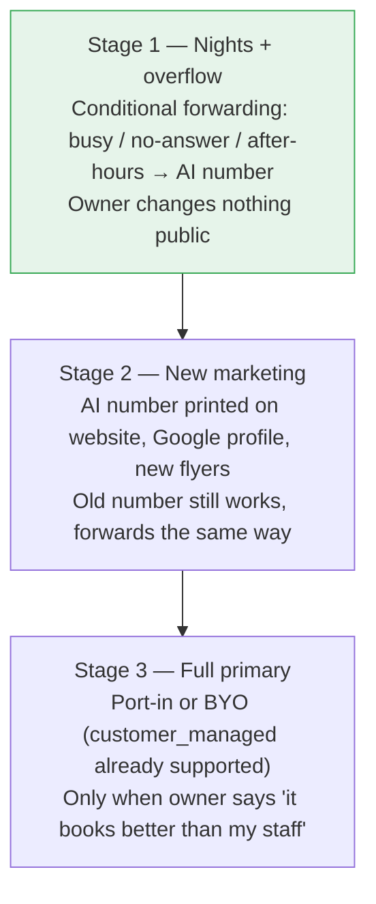
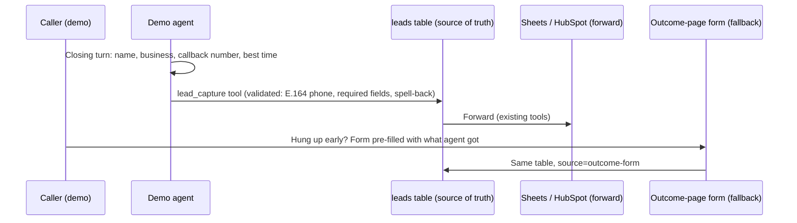

# Decision Addendum — Number Positioning, Voice Pipeline, Lead Capture, Pricing Flexibility

**Parent:** `00-execution-plan.md` | **Date:** 2026-09-03
Each section: your question → fact check → recommendation → what changes in the plan.

---

## 1. Missed-call positioning — you spotted the real friction

**Your question:** if the AI number must be shown as primary, owners won't trust AI with all traffic; if secondary ("after-hours number"), it's friction to explain. How do we position?

**Fact check:** the trust concern is valid and universal (Goodcall/Smith.ai win on "we answer when you can't"). The good news: telcos already solved the mechanics — **conditional call forwarding**. The owner's primary number stays primary; their carrier forwards to our Twilio number only on busy / no-answer / after-hours. Zero website changes, zero "call this other number" friction.

**Recommendation: a 3-stage trust ladder. Sell Stage 1, graduate to 2 and 3.**

| Stage | Owner action | Our setup | Pitch line |
|---|---|---|---|
| 1. Nights + overflow | Dial a carrier forwarding code (we give a 1-page guide per carrier) | Twilio number assigned to agent; business-hours rules in agent config | "Change nothing. We only answer the calls you currently miss." |
| 2. New marketing | Put AI number on new materials | Same number; add daytime overflow rules | "Every new caller meets the AI first." |
| 3. Full primary | Port-in request (we assist) | `customer_managed` BYO path already in `phone_numbers/service.py` | "Retire the old line when the data says so." |

**Plan impact:** Epic B landing copy leads with Stage 1 ("answers when you can't"); Epic A concierge checklist gains a "forwarding guide" step (T-Mobile/AT&T/Verizon codes + hours config). No telephony code changes — forwarding is carrier-side. Stage 3 port-in stays backlog.

---

## 2. Realtime vs pipeline — your hunch is directionally right, but don't decide on free-tier evidence

**Your question:** Gemini realtime (default preset) felt worse + slower than expected; should we build a pipeline preset (Deepgram STT + Gemma/Qwen-class LLM via OpenRouter + Fish Audio S2 TTS)? Pipeline may be cheaper?

**Fact check — two parts, both verified:**

**(a) The platform already supports pipeline presets as pure config — no code to build.**
`shared/voice_agents/speech_config.py` + `preset_models.py` define exactly two engines (`realtime`/`pipeline`); `key_resolver.py` already anticipates `deepgram` / `openrouter` / `fish` keys; `speech_config_resolver.py` falls back to the realtime default on any error. Creating your pipeline preset = one row via the Platform presets UI, not an epic.

**(b) Your free-tier latency observation is not valid evidence for the decision.**
Free-tier Gemini throttles and deprioritizes; production-tier behavior differs materially. Decide from a paid-tier A/B, not from testing tiers.

**Cost math (public pricing, Sep 2026 — per conversation minute, ~50/50 talk):**

| Component | Pipeline pick | $/min | Realtime equivalent |
|---|---|---|---|
| STT | Deepgram Nova-3 streaming ($0.0048 promo, reverts $0.0077 — budget **$0.008**) | ~$0.008 | Inside Live API audio-input tokens (~$0.002) |
| LLM | Small open model via OpenRouter (Gemma/Qwen-flash class) | ~$0.002–0.005 | Inside Live session (history re-bills; grows on long calls) |
| TTS | Fish Audio S2 ($15/1M bytes ≈ $0.006 for ~400 agent chars) — 4–11x cheaper than ElevenLabs | ~$0.006 | Inside Live API audio-output (~$0.03/min at 25 tok/s × $20/1M) |
| Telephony | Twilio (same either way) | ~$0.02 | Same |
| **Total** | | **~$0.035–0.05/min** | **~$0.05–0.09/min** |

So yes — **you are right: the pipeline is roughly half the COGS**, and TTS (not the LLM) is the biggest line in a pipeline, which is exactly why Fish over ElevenLabs matters. Latency can also favor the pipeline (small LLM + streaming TTS + semantic VAD), while realtime wins on expressivity/naturalness. Independent worked models (Inworld, July 2026) land the same way: cascaded $0.007–0.029 vs speech-to-speech up to ~$0.09.

**Recommendation:**

- [ ] Keep **Gemini realtime as the default** through pilots (one key, already tuned, fallback chain already defaults to it — zero risk).
- [ ] Create **one challenger pipeline preset** (Deepgram Nova-3 + Qwen/Gemma-flash via OpenRouter + Fish S2) as platform config (Epic D, half a day — no code).
- [ ] Run both through the existing `evals/` harness + 10 pilot calls each: score latency p50/p99, booking accuracy, naturalness, measured $/min. Promote the winner to default **from data**, and record the COGS delta in the Epic D margin tab (it directly moves tier margins: pipeline COGS ≈ $0.04 vs realtime ≈ $0.07).
- [ ] Budget Deepgram at the **revert rate ($0.0077)**, not the promo ($0.0048, "limited-time").

---

## 3. Lead capture after demo — agent asks first, form catches the rest

**Your question:** structured form stored in-platform, or the agent itself asks for feedback/info (via tool → platform or Google Sheet)?

**Fact check:** the demo branch already built the agent side — `google_sheets_lead_capture` + `hubspot_lead_capture` tools, `demo_outcome_service.py` + receipts, `evals/lead_capture.py`. The merge (Epic A) brings all of it to `main`. A bare Google Sheet as source of truth is not robust (no validation, no dedup, no link to the call); as a *forward destination* it is fine.

**Recommendation: both, same table, agent-first.**

Why agent-first: zero friction at peak interest, higher conversion than a form wall; the tool validates (not free-text summary) so the number is callable. Why form still exists: catches hang-ups and skeptics who won't tell a bot their number. Both rows carry `call_id + source + vertical` so you can measure which converts.

**Plan impact:** no change to Epic A scope — the merge already contains both halves; this decision just fixes their priority (tool = primary, form = fallback pre-filled from tool output).

---

## 4. Pricing flexibility — smaller change than you fear, by design

**Your fear:** moving "from permanent credit to per-call" means rewriting billing + entitlements, and pricing must stay evolvable.

**Two clarifications:**

**(a) Credits today are not permanent — so there is less to change than it feels.**
Free-plan credits **recur monthly** (`included_credits_per_billing_period` + `free_plan_renewal_scheduler`); only purchased/top-up credits are non-expiring. Nobody holds a permanent balance that a repackaging would strand. Epic C converts minute bundles → credit grants (400min = 4000cr at 10cr/min) through the *existing* grant path — no settle/RPC/pre-check code changes, no data migration.

**(b) Evolvability is already the architecture — `plan_versions` + migration service.**
That versioning system (`draft → publish`, immutable versions, `new_signups_only` / `grace_then_optional` / `immediate_required` migrations) exists precisely so pricing is data, not code. Evolving after market feedback = publish v2 + migrate — the reviewed path, not a rewrite. What *would* be a big change (true per-call settle unit, new `billing_mode`, new RPCs) is explicitly deferred until pilot data shows avg-duration variance is low enough for per-call math to hold margin.

| If market says… | Evolution path (no engine rewrite) |
|---|---|
| "Minutes confuse me, price per booked appointment" | Re-label tiers as call/outcome bundles; keep credit settle underneath |
| "Starter too small / Scale too big" | Publish v2 sizes; `grace_then_optional` migration |
| "I want annual" | v2 with annual prices; period logic already handles `current_period_end` |
| "True per-call billing or bust" | Only then: new settle unit epic (post-launch, data-backed) |

**Plan impact:** none — Epic C already scoped this way. This section is your insurance note: the design bends without breaking.

---

## 5. Auth gating — your understanding is correct (+ the two terms clarified)

Your recap matches the plan exactly: landing → signin reachable but gated; demo → interest form; `PUBLIC_SIGNUP=true` reopens SaaS later; invitation/allowlist admits chosen customers now.

- **Invitation token (concrete):** you (platform admin) create an invitation for `owner@smb.com` + role → they get `/auth/signup?token=xxx` → backend `process_invitation` validates (not expired/used, org exists) and assigns their org role *before* default-org provisioning runs. This flow already exists and is tested — Epic A just makes it the default door.
- **Admin allowlist (concrete):** env list (your email + team) that bypasses the closed gate so you always have entry even with `PUBLIC_SIGNUP=false`. No dummy orgs, no backdoors — just an explicit list in config.

---

## 6. Clarifications locked 2026-09-03 (pre-Epic-A)

### 6a. Forwarding ownership — they press the buttons, we remove every other obstacle

- **We cannot do it for them, technically.** Forwarding lives in *their* carrier account / phone settings; Twilio cannot pull calls off another carrier. No API, no integration, no workaround — the action must originate owner-side.
- **So the split is:** owner executes (a ~2-minute settings change); **we own everything around it** — 1-page per-carrier guides (mobile star-codes vs landline vs VoIP dashboards like RingCentral), a 15-min concierge screen-share inside the 48h setup, and a test-call verification (we call their primary, let it forward, confirm the agent answers + logs the call).
- **Friction is real but bounded:** mobile owners finish in minutes; landline/PBX/VoIP-admin cases vary — for those, fallback is Stage 1b (after-hours schedule only, same forwarding primitive) or skip straight to Stage 2 (AI number on Google profile/website, no forwarding at all). Epic A concierge checklist now includes: guide + screen-share offer + test-call proof + fallback pick.
- Repo-note: per AGENTS.md product identity, forwarding guides and all 247ai.live copy stay brand-neutral (no parent-company names in user-facing copy).

### 6b. Lead data paths — one correction to your recap

Your understanding is 90% right; the correction: **our `leads` table holds BOTH the contact info AND the demo substance** (appointment details included) — it is the source of truth for everything. Third parties get *copies/forwards*, never the original:

| Data | Primary home | Forwards to |
|---|---|---|
| Contact (name, business, callback number, best time) + experience feedback, captured by agent tool-call (validated, spell-back on phone) | `leads` table | Sheets / HubSpot (existing demo-branch tools) |
| Demo appointment substance (e.g. "cleaning Tue 10am") | Outcome receipt + `leads` row (flagged `is_demo=true`) | Sheet copy for the owner to see |
| Hang-up / no-share cases | Outcome-page form → same `leads` table (`source=outcome-form`) | Same forwards |

And the agent's closing turn asks **contact-capture first, experience feedback second** — the phone number is the conversion event; the rating feeds our evals. Note the demo appointment is synthetic (no real calendar write); real pilots write to the owner's calendar via the booking tools.

### 6c. Demo third-party writes stay — correction of a misunderstanding (locked 2026-09-03)

To be explicit: **the public Google Sheet / Calendar writes in the demo stay exactly as built. Nothing is replaced.** The `leads` table and the third-party writes are not alternatives — the demo does both:

- **Public Sheet + Calendar event (dummy data, shared, with the dummy-data warning) = the proof.** Visitors see other callers' rows landing in real time — that *is* the pitch ("it updates the tools you already use; Sheets/Calendar today, your CRM tomorrow"). Removing it would gut the demo. Your instinct here is correct.
- **`leads` table (private, platform-admin only) = the source of truth for follow-up.** Dedup, conversion tracking, per-vertical counts, invite issuance — things a shared public sheet can never do (and must never hold real contact data).

So the rule: **every demo capture writes private-first to `leads`, then forwards the demo-safe subset to the public Sheet/Calendar.** Same dual-write pattern carries into pilots (private record + owner's real tools).

### 6d. Delegated picks — locked by architect (locked 2026-09-03)

- **Traffic analytics → PostHog Cloud (free tier).** Why over Plausible: PostHog's free tier (≈1M events/mo) covers us for a long time and includes funnels + session replay (we need to *watch* demo→interest drop-off, not just count pageviews) + feature flags (useful for the `PUBLIC_SIGNUP` reopen later). Plausible is simpler but paid from day one — wrong trade for a pre-revenue startup. Scope: marketing + demo + outcome pages only, never call-audio paths; 5 events (`demo_played`, `demo_completed`, `interest_submitted`, `invite_accepted`, `pilot_activated`).
- **Plan names → Starter ($79) / Growth ($179) / Scale ($399).** Conventional, SMB-legible, and yes — fully configurable: names live as data (`plan_products.display_name`), renamable via a v2 publish without code changes if the market prefers friendlier labels.
- **Notifications → both SMS and email behind one service.** Confirmed: build a single notification service with per-trigger channel config (booking-confirmed → SMS + email; callback-requested → SMS to owner + email backup; pilot-invited → email). Transport already in-house: Resend for email (exists), Twilio SMS (number + credentials already operated; ~$0.008/msg US). Triggers choose channels via config, so any step can use either or both without new code.

---

*Next: reply "Approved, start Epic A" (+ PostHog/Plausible pick, plan-name pick, SMS/email/both for escalation) and I build the gated-entry worktree.*
