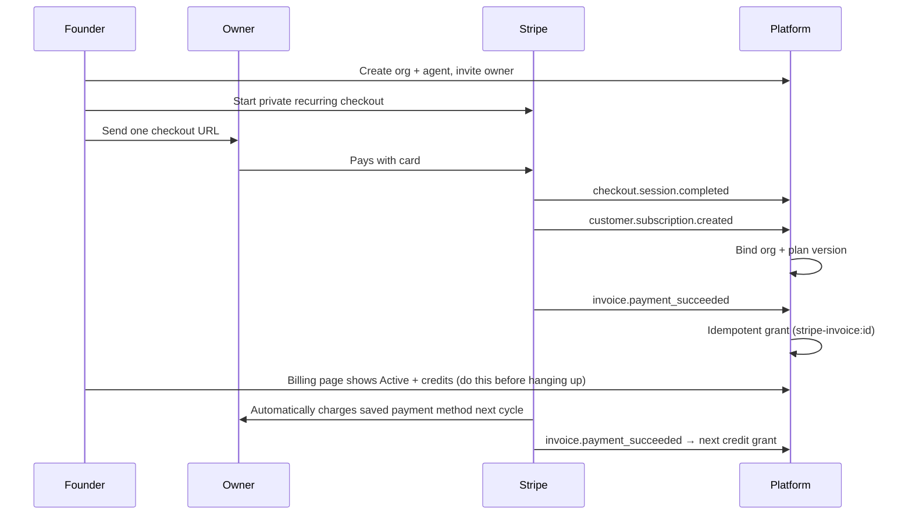

# Pilot Billing Runbook — Founder-operated Stripe Path (Epic C1)

**Status:** active procedure for the first 2–3 founder-led customer pilots.
**Pricing decision:** three fixed monthly plans; no fourth fixed tier. Public
pages say “Plans from $49/month” and route visitors to a demo. Exact plan
selection and checkout stay behind sign-in during the pilot. Higher-volume and
multi-location requests use `/contact` for a sales conversation.
Annual prices, when published, charge 10 monthly payments for 12 months of
service (two months free, a 16.7% discount).

## Approved launch package

| Plan | Monthly price | Included credits | Up to call minutes¹ | Effective list price/minute |
|---|---:|---:|---:|---:|
| Starter | $49 | 2,500 | 250 | $0.196 |
| Pro | $149 | 10,000 | 1,000 | $0.149 |
| Scale | $299 | 21,000 | 2,100 | $0.142 |

¹ Calls use 10 credits per connected minute, rounded up to a whole minute per
call. These are “up to” estimates if all credits go to calls; phone-number
rentals also use the same balance. No automatic credit reload is enabled.

| Credit top-up | Credits | Up to call minutes | Credit value |
|---|---:|---:|---:|
| $5 | 200 | 20 | 40 credits/$1 |
| $10 | 400 | 40 | 40 credits/$1 |
| $25 | 1,000 | 100 | 40 credits/$1 |

Every paid plan includes one US local platform number when requested. Each
additional platform-provided US local number uses 80 credits/month ($2
equivalent) from the shared balance. The first included line uses zero credits.
It remains included only while paid-plan access is active. If it is kept after
the paid plan ends, the line converts to the 80-credit monthly rental on its
next renewal date; the subscription-cancel dialog discloses this, and the
existing renewal grace period applies if the balance is short.
Set `max_phone_numbers` to `unlimited` for all three paid plans so users can
add numbers as needed; rental charges still apply from credits. Keep the free
plan at zero platform numbers. Customer-owned Twilio numbers have no platform
rental charge and are excluded from the platform-number count. Current carrier
numbers (for example, T-Mobile or Verizon) cannot connect directly: the owner
can enable call forwarding to a connected platform number and should confirm
forwarding fees and setup with their carrier.

Every plan includes the standard voice profile, with call usage taken from plan
credits. Optional provider voices use BYOK (bring your own keys). The customer
connects the provider key and pays that provider directly for its optional voice
service; the platform does not add a provider usage charge.

Annual versions cost 10 times the equivalent monthly price and include 12
months of the monthly credit allowance. For the launch prices above, that is
$490 for Starter, $1,490 for Pro, and $2,990 for Scale; do not publish an annual
version if its price or credit allowance differs from this rule.

At 40 credits per dollar of top-up value, price platform rentals in credits as
follows: one included US local number per paid plan; each additional US local
number 80 credits ($2) per month; toll-free 120 credits ($3) per month;
mobile numbers 200 credits ($5) per month; existing non-US local numbers keep
the 200-credit legacy price. Mobile and non-US costs vary by country and should
be reviewed against current carrier rates before those number types are sold.

Before enabling number rentals, follow the reviewed
[master-data seeding runbook](../05_operations/master_data_seeding_runbook.md)
to preview and apply the code-owned `system_pricing` catalog. Verify that
`phone_number_us_local_month` is 80 credits and the legacy
`phone_number_local_month` rate remains 200 credits. Migration
`20261001000002` updates existing toll-free rentals to 120 credits/month.
This creates the event
required for US local number debits without changing administrator-set rates
on other events. Do not use catalog reset in a shared environment.
Platform-provided number search and purchase reject non-US countries in v1;
existing non-US local rentals, if any, retain their 200-credit rate.

Enterprise stays a sales conversation, not a published fixed plan. Do not
create a fourth price/version until pilot usage and support needs justify it.

The founder sends one private checkout link per customer. A recurring Stripe
Price creates a Subscription, and Stripe attempts the saved payment method on
each billing cycle. You do **not** send a new payment link every month.

## One-time setup (test mode first, then live)

1. In the platform admin **Plan Catalog**, mark the obsolete $79/$179/$399
   launch versions as not current for new sign-ups (keep historical versions
   and existing customer subscriptions intact). Create and publish the three
   paid monthly plan versions with the approved prices and included-credit
   amounts above. Set `max_phone_numbers=unlimited` on all paid plans and
   `max_phone_numbers=0` on Free. Configure one on-demand included US local
   line in the customer experience; the included line is not a Stripe item.
   Each paid version must have:
   - its recurring Stripe Price ID;
   - an included-credit entitlement; and
   - the correct current-for-signup status.
2. Stripe Dashboard → **Test mode** → Products → create or verify monthly
   prices:
   - `24x7 AI Starter` — $49/month
    - `24x7 AI Pro` — $149/month
   - `24x7 AI Scale` — $299/month
    Also create/verify one-time credit top-ups of $5/200, $10/400, and
    $25/1,000 credits in the platform's credit-product catalog. These are all
    40 credits per dollar; no pack is marked as discounted unless its actual
    per-credit price is lower than the others.
3. Prefer the platform’s authenticated plan-selection checkout for each
   invited organization. It writes `organization_id` and `plan_version_id`
   onto both the Checkout Session and the underlying Subscription, which is
   the binding the webhook processor expects.
4. If you use a Stripe Payment Link instead, configure
   `subscription_data.metadata.organization_id` and
   `subscription_data.metadata.plan_version_id` on the recurring Payment Link.
   Top-level Payment Link metadata alone is not enough for this application:
   it reaches `checkout.session.completed`, but that event does not activate a
   subscription here. Do not use a link until you have verified the nested
   Subscription metadata in Stripe test mode.
5. Rehearse end-to-end in test mode with `4242…`. Confirm all three events in
   Developers → Webhooks:
   `checkout.session.completed`, `customer.subscription.created`, and
   `invoice.payment_succeeded`. Confirm the org flips to Active and receives
   the expected credit grant in the platform billing page.
6. Repeat the verified setup in **Live mode**. You can use the same Stripe
   account, but Test and Live mode have separate products, prices, customers,
   webhook endpoints, and IDs. Re-create the three products/prices and top-ups
   in Live mode, then save the Live Price IDs in the Production Plan Catalog.
   Changing API keys alone does not promote Test objects or their IDs. Set the
   Live API key and webhook signing secret through the production secret
   process; do not paste them into this repository. Never send a test-mode link
   to a customer. A new Stripe account is not required.

## Per pilot (after the owner approves on the setup call)

1. Create the organization and agent, configure the agent, and invite the
   owner. Keep the agent disabled for paid traffic until billing is confirmed.
2. Start the private recurring checkout using the platform flow, or send a
   Payment Link that has been verified to write nested Subscription metadata.
3. Stay on the call: open the org billing page, confirm **Active + the first
   credit grant**, and place the first test call together.
4. Log the pilot row: organization, plan version, Stripe customer ID,
   subscription ID, first invoice ID, and minutes baseline.

## What happens on renewal

Stripe creates the next invoice and automatically charges the saved payment
method for a recurring subscription. The webhook handler records the invoice
and grants the plan’s credits using `stripe-invoice:<invoice_id>` as an
idempotency key, so webhook retries do not double-credit the organization.

You only need to intervene when:

- a payment fails or requires customer action;
- the customer changes or cancels the plan;
- a refund or dispute occurs; or
- the platform’s webhook/entitlement check shows an unexpected state.

Enable Stripe’s Smart Retries and customer payment-failure emails. A failed
invoice moves the platform subscription to `past_due`; paid-plan entitlements
are then withheld by the voice gate until Stripe reports recovery. The founder
should follow up with the customer rather than manually granting credits.

## Pilot capacity and review

Keep the current OCI Free Tier deployment while onboarding the first 2–3
customers. Use Grafana to watch CPU, memory, worker restarts, active voice
sessions, WebSocket errors, and provider latency. Do not advertise a
platform-wide concurrent-call guarantee from plan names or minutes. Review
measured peak concurrency and support load before moving to a paid VM or
publishing an enterprise offer.

## When something looks wrong

| Symptom | Cause (usual) | Fix |
|---|---|---|
| Paid, org still unselected/old plan | Subscription metadata missing, price not mapped to a published plan version, or webhook failed | Do not grant credits in the DB. Inspect the Stripe Subscription metadata and price mapping, fix the configuration, then use a reviewed repair/replay procedure before enabling calls |
| Customer charged twice | Double-click / resent link paid twice | Refund the duplicate in Dashboard (manual refunds only — no auto path exists) |
| Downgrade requested | — | Cancel at period end in Dashboard; access continues to `current_period_end` by design |
| Payment fails at renewal | Card decline, expired card, or authentication required | Let Stripe retry; send the Stripe payment-update link. The platform marks the subscription `past_due` and blocks paid entitlements until recovery |
| Custom one-time setup fee | — | Use a Stripe **Invoice** as a separate setup charge. It does not create a platform subscription or monthly credit grant; keep the recurring plan checkout as the source of subscription state |

## Never do this

- Publish Payment Links on the website, in demos, or in email templates.
- Create prices/coupons during a live sales call (rehearse in test mode).
- Grant entitlements manually in the DB to "fix" billing — fix the webhook
  path; manual grants are unauditable and strand on migration.
